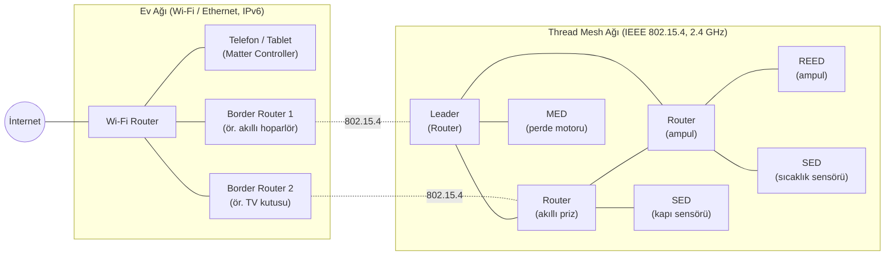
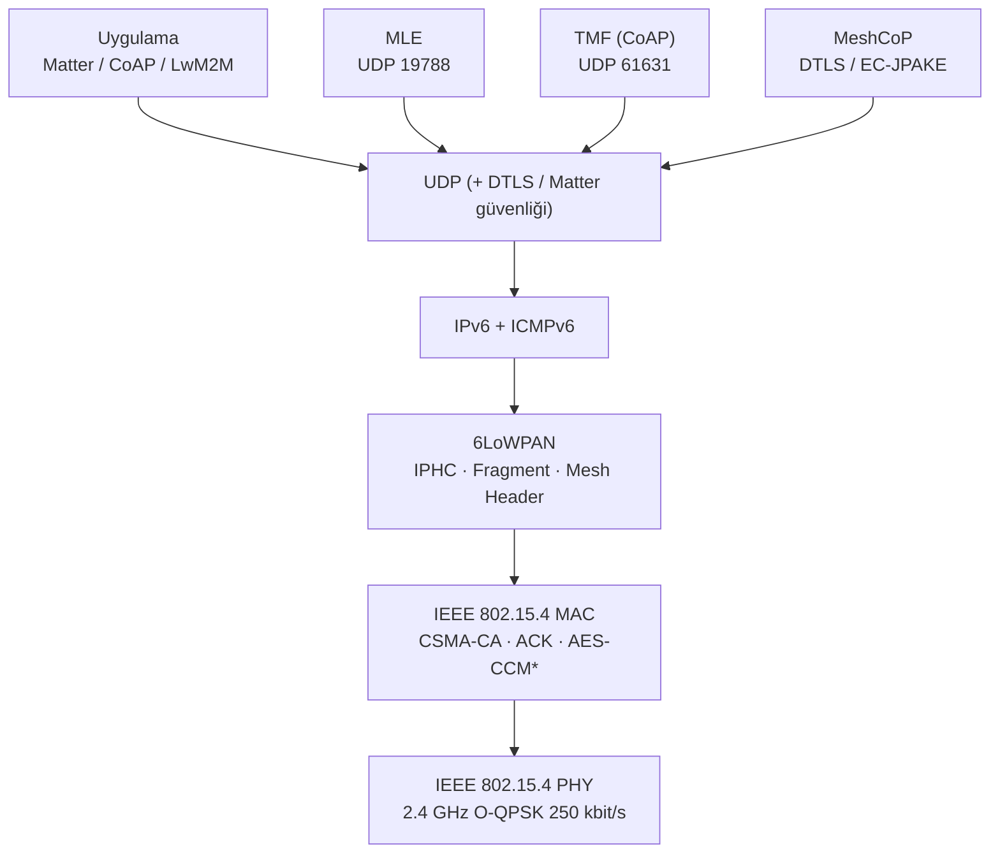
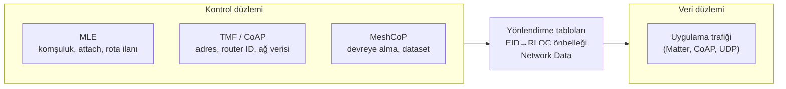
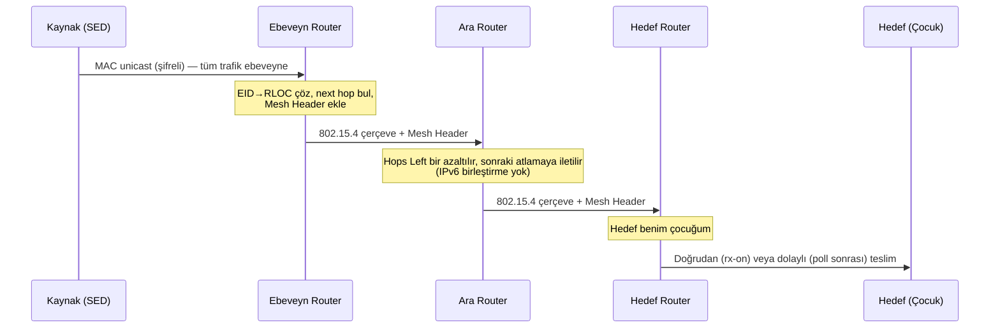
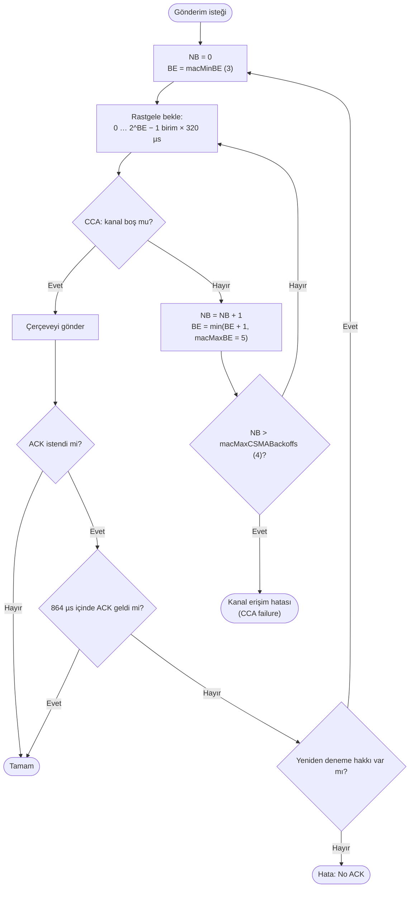
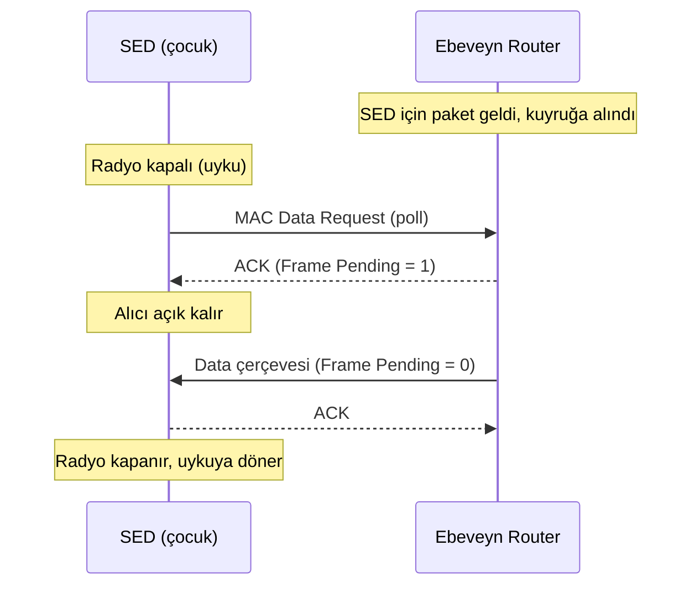
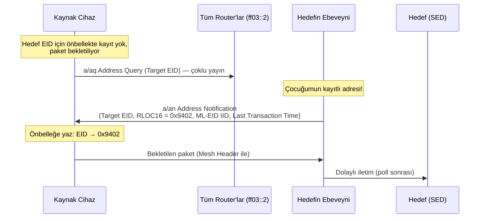
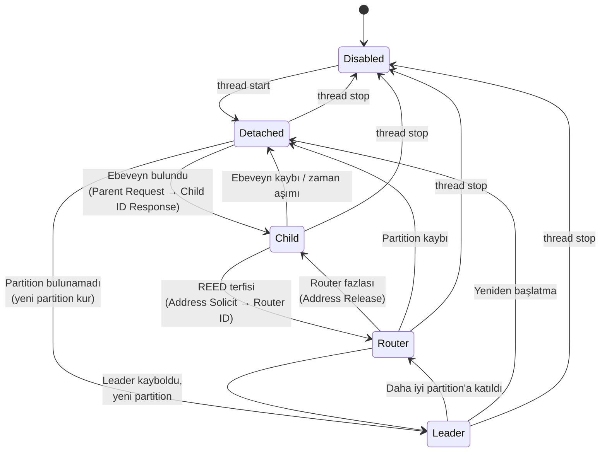
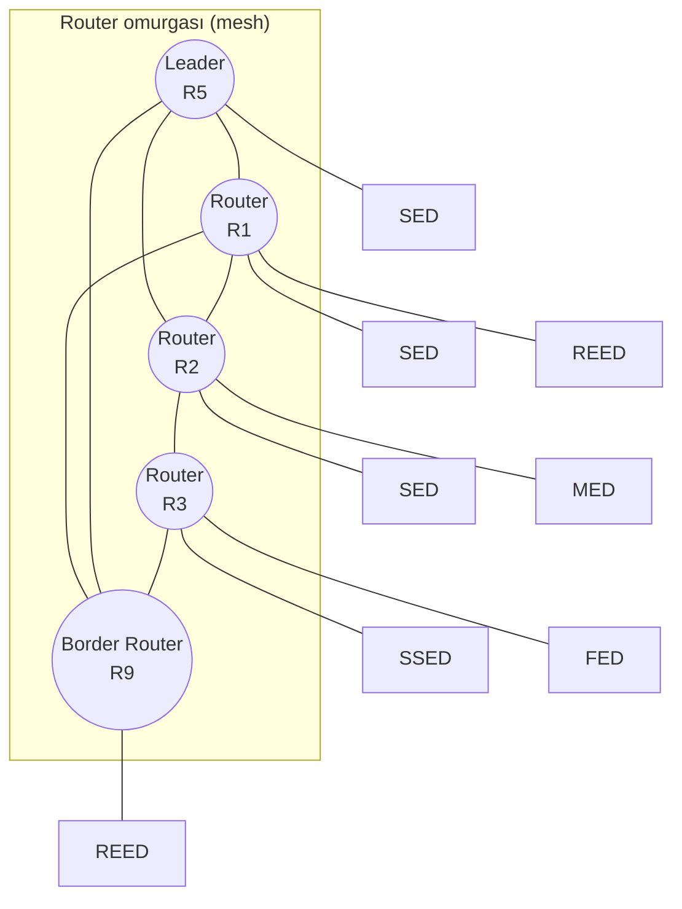

<!-- Bu dosya tools/build.py tarafından bolumler/ klasöründen otomatik üretilir. Düzenlemeleri bolumler/ altında yapıp betiği yeniden çalıştırın. -->

# Thread Ağ Mimarisi ve Haberleşme Yapısı — Kapsamlı Teknik Rehber

> IEEE 802.15.4 radyosu üzerinde IPv6 konuşan, düşük güçlü, kendi kendini onaran mesh ağ protokolü **Thread**'in fiziksel katmandan uygulama katmanına (Matter) kadar tüm mimarisi, mesaj akışları, adresleme ve yönlendirme mantığı, güvenlik modeli, Border Router işlevleri ve pratik kullanımı.

| Özellik | Değer |
|---|---|
| **Kapsam** | Thread 1.1 → 1.4, OpenThread, Thread Border Router, Matter over Thread |
| **Dil** | Türkçe (teknik terimler orijinal İngilizce adlarıyla birlikte verilmiştir) |
| **Seviye** | Temelden uzmanlığa: her bölüm önce kavramı, sonra bit/bayt seviyesindeki ayrıntıyı anlatır |
| **Biçim** | Tek parça Markdown + aynı içeriğin kenar menülü HTML sürümü |
| **Doküman sürümü** | 1.0 — Kasım 2026 |

## 0. Bu Doküman Hakkında

### 0.1 Kimler İçin?

Bu rehber şu okuyucular düşünülerek hazırlanmıştır:

- **Gömülü yazılım geliştiricileri** — OpenThread veya üretici SDK'ları (Nordic, Silicon Labs, TI, NXP, Espressif) ile Thread cihazı geliştirenler.
- **IoT / akıllı ev mimarları** — Matter tabanlı ürün ve ağ tasarlayanlar, Border Router seçimi ve ağ planlaması yapanlar.
- **Ağ mühendisleri** — IPv6, 6LoWPAN, mesh yönlendirme ve güvenlik konularını Thread özelinde derinlemesine öğrenmek isteyenler.
- **Test / saha ekipleri** — Sniffer ile paket analizi yapan, kopma, gecikme, pil tüketimi gibi sorunları teşhis edenler.
- **Meraklı öğrenciler** — "Akıllı ampulüm telefonumla nasıl konuşuyor?" sorusunun her katmandaki cevabını bilmek isteyenler.

### 0.2 Nasıl Okunmalı?

Doküman katmanlı bir sırayla ilerler: önce büyük resim (Bölüm 1–2), sonra radyodan yukarıya doğru katmanlar (Bölüm 3–6), ardından Thread'in kendine özgü kontrol düzlemi (Bölüm 7–14), güvenlik ve devreye alma (Bölüm 15–17), enerji ve Border Router (Bölüm 18–19), sürüm özellikleri ve teşhis (Bölüm 20–21), uçtan uca senaryolar ve Matter (Bölüm 22–23), yazılım/donanım/tasarım (Bölüm 24–27), karşılaştırma ve ekler (Bölüm 28–29).

- Hızlı bir genel bakış için: **Bölüm 1, 2, 7, 8, 22**.
- Paket seviyesinde derinlik için: **Bölüm 4, 5, 9, 10, 13**.
- Güvenlik odaklı okuma için: **Bölüm 15, 16, 17**.
- Ürün geliştirme için: **Bölüm 18, 19, 23, 24, 26, 27**.

### 0.3 Gösterim Kuralları

| Gösterim | Anlamı |
|---|---|
| `0x1A` | Onaltılık (hex) değer |
| `0b0110` | İkili (binary) değer |
| `fd00::/8` | IPv6 öneki (prefix) ve uzunluğu |
| **RLOC16** | İlk geçtiği yerde kalın yazılan teknik terim; sözlükte (Ek E) açıklaması vardır |
| `a/aq` | Thread yönetim mesajı (CoAP URI yolu) |
| bit 7 … bit 0 | Bayt içindeki bitler en anlamlıdan (MSB) en anlamsıza (LSB) doğru numaralanır |
| LE / BE | Little-endian / Big-endian bayt sırası |
| ≈ | Yaklaşık değer; donanıma, yapılandırmaya veya yazılım sürümüne göre değişir |

> [!NOTE]
> Thread şartnamesi (Thread Specification) Thread Group tarafından yayımlanır. Bu dokümandaki sabitler ve varsayılan değerler şartname ile yaygın açık kaynak uygulama OpenThread'deki karşılıkları esas alınarak verilmiştir. "OpenThread varsayılanı" ifadesi geçen değerler derleme zamanında veya çalışma anında değiştirilebilir; kesin ürün davranışı için kullandığınız SDK sürümünün belgelerine bakın.

## İçindekiler

- [0. Bu Doküman Hakkında](#0-bu-doküman-hakkında)
  - [0.1 Kimler İçin?](#01-kimler-i̇çin)
  - [0.2 Nasıl Okunmalı?](#02-nasıl-okunmalı)
  - [0.3 Gösterim Kuralları](#03-gösterim-kuralları)
- [1. Thread'e Giriş](#1-threade-giriş)
  - [1.1 Thread Nedir?](#11-thread-nedir)
  - [1.2 Neden Thread? Çözdüğü Problemler](#12-neden-thread-çözdüğü-problemler)
  - [1.3 Tarihçe](#13-tarihçe)
  - [1.4 Sürümlerin Özeti](#14-sürümlerin-özeti)
  - [1.5 Thread Group ve Sertifikasyon](#15-thread-group-ve-sertifikasyon)
  - [1.6 OpenThread](#16-openthread)
  - [1.7 Thread ve Matter İlişkisi](#17-thread-ve-matter-i̇lişkisi)
  - [1.8 Büyük Resim](#18-büyük-resim)
  - [1.9 Thread'in Tanımlamadıkları](#19-threadin-tanımlamadıkları)
  - [1.10 Bölüm Özeti](#110-bölüm-özeti)
- [2. Protokol Yığını ve Genel Mimari](#2-protokol-yığını-ve-genel-mimari)
  - [2.1 Katmanlar](#21-katmanlar)
  - [2.2 OSI Modeliyle Eşleme](#22-osi-modeliyle-eşleme)
  - [2.3 Thread'in Kullandığı ve Tanımladığı Bileşenler](#23-threadin-kullandığı-ve-tanımladığı-bileşenler)
  - [2.4 Kontrol Düzlemi ve Veri Düzlemi](#24-kontrol-düzlemi-ve-veri-düzlemi)
  - [2.5 Bir Paketin Yolculuğu (Genel Bakış)](#25-bir-paketin-yolculuğu-genel-bakış)
  - [2.6 Önemli UDP Portları](#26-önemli-udp-portları)
  - [2.7 Bölüm Özeti](#27-bölüm-özeti)
- [3. Fiziksel Katman (IEEE 802.15.4 PHY)](#3-fiziksel-katman-ieee-802154-phy)
  - [3.1 Genel Bakış](#31-genel-bakış)
  - [3.2 Kanallar ve Frekanslar](#32-kanallar-ve-frekanslar)
  - [3.3 Modülasyon ve Yayılma Spektrumu](#33-modülasyon-ve-yayılma-spektrumu)
  - [3.4 PPDU (Fiziksel Paket) Yapısı](#34-ppdu-fiziksel-paket-yapısı)
  - [3.5 Önemli PHY/MAC Zaman Sabitleri](#35-önemli-phymac-zaman-sabitleri)
  - [3.6 Alıcı Ölçümleri: RSSI, LQI, ED ve Gürültü Tabanı](#36-alıcı-ölçümleri-rssi-lqi-ed-ve-gürültü-tabanı)
  - [3.7 CCA (Clear Channel Assessment)](#37-cca-clear-channel-assessment)
  - [3.8 Wi-Fi ve Bluetooth ile Bir Arada Yaşama](#38-wi-fi-ve-bluetooth-ile-bir-arada-yaşama)
  - [3.9 Bağlantı Bütçesi ve Menzil](#39-bağlantı-bütçesi-ve-menzil)
  - [3.10 Etkin Veri Hızı (Throughput)](#310-etkin-veri-hızı-throughput)
  - [3.11 Bölüm Özeti](#311-bölüm-özeti)
- [4. MAC Katmanı (IEEE 802.15.4 MAC)](#4-mac-katmanı-ieee-802154-mac)
  - [4.1 Görevler](#41-görevler)
  - [4.2 Thread'in 802.15.4 MAC'i Kullanma Biçimi](#42-threadin-802154-maci-kullanma-biçimi)
  - [4.3 MAC Çerçeve Formatı](#43-mac-çerçeve-formatı)
  - [4.4 Adresler](#44-adresler)
  - [4.5 CSMA-CA (Slotsuz)](#45-csma-ca-slotsuz)
  - [4.6 Onay (ACK) ve Yeniden İletim](#46-onay-ack-ve-yeniden-i̇letim)
  - [4.7 Dolaylı İletim (Indirect Transmission) ve Veri Sorgulama (Data Poll)](#47-dolaylı-i̇letim-indirect-transmission-ve-veri-sorgulama-data-poll)
  - [4.8 MAC Komutları](#48-mac-komutları)
  - [4.9 MAC Güvenliği](#49-mac-güvenliği)
  - [4.10 Bilgi Elemanları (Information Elements — IE)](#410-bilgi-elemanları-information-elements--ie)
  - [4.11 Taramalar](#411-taramalar)
  - [4.12 MAC Seviyesinde Alım Filtreleri](#412-mac-seviyesinde-alım-filtreleri)
  - [4.13 Bölüm Özeti](#413-bölüm-özeti)
- [5. 6LoWPAN Uyarlama Katmanı](#5-6lowpan-uyarlama-katmanı)
  - [5.1 Neden 6LoWPAN?](#51-neden-6lowpan)
  - [5.2 Dispatch (Gönderim Türü) Baytları](#52-dispatch-gönderim-türü-baytları)
  - [5.3 IPHC: IPv6 Başlık Sıkıştırma](#53-iphc-ipv6-başlık-sıkıştırma)
  - [5.4 Bağlamlar (Contexts)](#54-bağlamlar-contexts)
  - [5.5 NHC: UDP Başlık Sıkıştırma](#55-nhc-udp-başlık-sıkıştırma)
  - [5.6 Sıkıştırma Örneği: Router'lar Arası TMF Mesajı](#56-sıkıştırma-örneği-routerlar-arası-tmf-mesajı)
  - [5.7 Mesh Header](#57-mesh-header)
  - [5.8 Parçalama (Fragmentation)](#58-parçalama-fragmentation)
  - [5.9 Tam Bir Çerçevenin Anatomisi](#59-tam-bir-çerçevenin-anatomisi)
  - [5.10 Thread'de Yönlendirme Hangi Katmanda?](#510-threadde-yönlendirme-hangi-katmanda)
  - [5.11 Bölüm Özeti](#511-bölüm-özeti)
- [6. Thread'de IPv6 Adresleme](#6-threadde-ipv6-adresleme)
  - [6.1 Temel Fikir: Kimlik ve Konum Ayrımı](#61-temel-fikir-kimlik-ve-konum-ayrımı)
  - [6.2 Kapsamlar (Scopes)](#62-kapsamlar-scopes)
  - [6.3 Tekil (Unicast) Adres Türleri](#63-tekil-unicast-adres-türleri)
  - [6.4 RLOC16 Yapısı](#64-rloc16-yapısı)
  - [6.5 ALOC (Anycast Locator) Tablosu](#65-aloc-anycast-locator-tablosu)
  - [6.6 Çoklu Yayın (Multicast) Adresleri](#66-çoklu-yayın-multicast-adresleri)
  - [6.7 Adreslerin Yapılandırılması](#67-adreslerin-yapılandırılması)
  - [6.8 Uç Cihazların Adres Kaydı](#68-uç-cihazların-adres-kaydı)
  - [6.9 EID → RLOC Çözümleme: Address Query](#69-eid--rloc-çözümleme-address-query)
  - [6.10 Çakışma Tespiti: Address Error](#610-çakışma-tespiti-address-error)
  - [6.11 Hangi Adres Ne İçin Kullanılmalı?](#611-hangi-adres-ne-i̇çin-kullanılmalı)
  - [6.12 Örnek: Bir Router'ın Adres Listesi](#612-örnek-bir-routerın-adres-listesi)
  - [6.13 Bölüm Özeti](#613-bölüm-özeti)
- [7. Cihaz Türleri ve Roller](#7-cihaz-türleri-ve-roller)
  - [7.1 İki Boyut: Cihaz Türü ve Rol](#71-i̇ki-boyut-cihaz-türü-ve-rol)
  - [7.2 Full Thread Device (FTD)](#72-full-thread-device-ftd)
  - [7.3 Minimal Thread Device (MTD)](#73-minimal-thread-device-mtd)
  - [7.4 Mode TLV: Cihazın Kendini Tanıtması](#74-mode-tlv-cihazın-kendini-tanıtması)
  - [7.5 Roller ve Durum Makinesi](#75-roller-ve-durum-makinesi)
  - [7.6 Rol Geçiş Kuralları](#76-rol-geçiş-kuralları)
  - [7.7 Leader](#77-leader)
  - [7.8 Diğer İşlevsel Roller](#78-diğer-i̇şlevsel-roller)
  - [7.9 Karşılaştırma Tablosu](#79-karşılaştırma-tablosu)
  - [7.10 Ürünlerde Tipik Rol Eşlemesi](#710-ürünlerde-tipik-rol-eşlemesi)
  - [7.11 Bölüm Özeti](#711-bölüm-özeti)
- [8. Ağ Topolojisi ve Ölçek](#8-ağ-topolojisi-ve-ölçek)
  - [8.1 İki Katmanlı Yapı](#81-i̇ki-katmanlı-yapı)
  - [8.2 Ölçek Sınırları](#82-ölçek-sınırları)
  - [8.3 Ağ Kimlik Parametreleri](#83-ağ-kimlik-parametreleri)
  - [8.4 Ağın Kurulması](#84-ağın-kurulması)
  - [8.5 Partition (Bölüm/Ada) Kavramı](#85-partition-bölümada-kavramı)
  - [8.6 Kendi Kendini Onarma](#86-kendi-kendini-onarma)
  - [8.7 Birden Fazla Thread Ağı](#87-birden-fazla-thread-ağı)
  - [8.8 Ölçekleme Değerlendirmeleri](#88-ölçekleme-değerlendirmeleri)
  - [8.9 Bölüm Özeti](#89-bölüm-özeti)

## 1. Thread'e Giriş

### 1.1 Thread Nedir?

**Thread**, nesnelerin interneti (IoT) için tasarlanmış; **IPv6 tabanlı**, **düşük güçlü**, **kablosuz mesh (ağ örgüsü)** ağ protokolüdür. Özellikle akıllı ev ve bina otomasyonu cihazlarının (lambalar, prizler, sensörler, kilitler, termostatlar, perdeler vb.) birbirleriyle ve internetle güvenli, güvenilir ve pil dostu şekilde haberleşmesi için geliştirilmiştir.

Tek cümleyle: **Thread = IEEE 802.15.4 radyosu + 6LoWPAN + IPv6 + Thread'e özgü ağ yönetimi (MLE, yönlendirme, güvenlik, devreye alma).**

Thread'in temel karakteristikleri:

| Özellik | Açıklama |
|---|---|
| **IP tabanlı** | Ağdaki her cihazın kendi IPv6 adresi vardır. Cihaza ulaşmak için protokol çeviren bir "gateway" gerekmez; sadece bir yönlendirici (**Border Router**) yeterlidir. |
| **Mesh topoloji** | Cihazlar birbirlerinin mesajlarını taşır. Kapsama alanı cihaz eklendikçe büyür. |
| **Kendi kendini onarma** | Bir yönlendirici bozulursa trafik otomatik olarak başka yollardan akar; yeni bir **Leader** seçilir. |
| **Tek hata noktası yok** | Zigbee'deki "coordinator" gibi vazgeçilmez merkezi bir düğüm yoktur. Leader rolünü herhangi bir router devralabilir; birden fazla Border Router bulunabilir. |
| **Düşük güç** | Pille çalışan "uyuyan" cihazlar (Sleepy End Device) radyolarını çoğu zaman kapalı tutarak yıllarca çalışabilir. |
| **Güvenlik** | Tüm bağlantı katmanı trafiği AES-128-CCM ile şifrelenir ve doğrulanır. Ağa katılım, parola doğrulamalı anahtar değişimi (EC-JPAKE) veya bant dışı (Matter) devreye alma ile yapılır. |
| **Ölçeklenebilirlik** | Tek ağda 32 aktif router ve her router'a bağlı çok sayıda çocuk cihaz: pratikte 250+ cihaz. |
| **Açık standartlar** | IEEE 802.15.4, IETF RFC'leri (6LoWPAN, IPv6, CoAP, DTLS, MPL, Trickle) üzerine kuruludur. |

> [!IMPORTANT]
> Thread bir **ağ katmanı** protokolüdür; **uygulama katmanını tanımlamaz**. Bir lambanın "aç/kapat" komutunun nasıl kodlanacağı Thread'in değil, üzerinde çalışan uygulama protokolünün (bugün çoğunlukla **Matter**) işidir. Thread'i "Wi-Fi'ın düşük güçlü, mesh'li kuzeni", Matter'ı ise "bu ağların üzerinde konuşulan ortak dil" olarak düşünebilirsiniz.

### 1.2 Neden Thread? Çözdüğü Problemler

Thread öncesinde akıllı ev dünyası birkaç temel sorunla boğuşuyordu:

1. **Dikey, kapalı yığınlar.** Zigbee ve Z-Wave gibi teknolojiler radyodan uygulamaya kadar kendi protokol yığınlarını tanımlıyordu. İnternete veya telefona bağlanmak için mesajları IP dünyasına **çeviren** üreticiye özel hub/gateway'ler gerekiyordu.
2. **Wi-Fi'ın güç tüketimi.** Wi-Fi yüksek veri hızı sunar ama sürekli dinleme ve ilişkilendirme (association) maliyeti, düğme pilli bir kapı sensörü için uygun değildir. Ayrıca Wi-Fi erişim noktalarının bağlı istemci sayısı sınırlıdır.
3. **Bluetooth'un menzil ve topoloji kısıtları.** Klasik BLE noktadan noktaya çalışır; BLE Mesh ise IP tabanlı değildir ve "managed flooding" yaklaşımı büyük ağlarda verimsizleşebilir.
4. **Tek hata noktası.** Coordinator/hub'a bağımlı ağlarda o cihaz bozulduğunda bütün ağ etkilenir.

Thread bu sorunlara şu yaklaşımla cevap verir:

- Radyo olarak düşük güçlü ve olgun **IEEE 802.15.4**'ü kullanır (Zigbee ile aynı radyo).
- Üzerine **IPv6**'yı taşır (6LoWPAN ile sıkıştırarak). Böylece "çeviri" değil, sadece "yönlendirme" gerekir.
- Uygulama katmanını serbest bırakır; bugün bu boşluğu **Matter** doldurur.
- Yönetimi dağıtık yapar: Leader, router'lar ve Border Router'lar yedeklidir.

### 1.3 Tarihçe

| Yıl | Olay |
|---|---|
| **2014 (Temmuz)** | **Thread Group** kuruldu. Kurucular arasında Nest Labs (Google), Samsung, ARM, Freescale (bugün NXP), Silicon Labs, Big Ass Fans ve Yale Security vardı. |
| **2015** | Thread 1.0 şartnamesi yayımlandı; ilk sertifikalı ürünler (Nest ürünleri) pazara çıktı. |
| **2016 (Mayıs)** | Google/Nest, Thread'in açık kaynak uygulaması **OpenThread**'i BSD-3 lisansıyla yayımladı. |
| **2017** | **Thread 1.1**: devreye alma (commissioning) ve ağ yönetimi iyileştirmeleri, MLE tabanlı keşif, anahtar yönetimi düzenlemeleri. |
| **2019** | **Thread 1.2**: büyük/kurumsal ağlar için **Thread Domain**, **Backbone Router**, **DUA**, çoklu yayın kaydı (MLR), **CSL** (senkronize uyuyan cihazlar), **Link Metrics**, Enhanced ACK, ticari devreye alma (CCM). |
| **2019 (Aralık)** | Apple, Google, Amazon ve Zigbee Alliance **Project CHIP**'i duyurdu; Thread düşük güçlü taşıma katmanı olarak seçildi. |
| **2020** | Apple HomePod mini gibi tüketici ürünleriyle Thread Border Router'lar evlere yayılmaya başladı. |
| **2021** | Zigbee Alliance adını **Connectivity Standards Alliance (CSA)** olarak değiştirdi; Project CHIP'in adı **Matter** oldu. |
| **2022–2023** | **Matter 1.0** (Ekim 2022) yayımlandı. **Thread 1.3** ile Border Router işlevleri (SRP, DNS-SD proxy, NAT64, OMR yönlendirme) ve TREL standartlaştırıldı. |
| **2024 (Eylül)** | **Thread 1.4** duyuruldu: zorunlu ve birlikte çalışabilir Border Router özellikleri, ekosistemler arası kimlik bilgisi paylaşımı (ePSKc), gelişmiş internet bağlantısı (DHCPv6-PD), gelişmiş ağ teşhisi, TCAT. |

### 1.4 Sürümlerin Özeti

| Sürüm | Öne çıkan özellikler | Uyumluluk |
|---|---|---|
| **1.0** | Temel mesh, MLE, 6LoWPAN, güvenlik, MAC beacon tabanlı keşif | Tarihsel |
| **1.1** | MLE Discovery, iyileştirilmiş MeshCoP, harici commissioner, network key rotasyonu | 1.2+ ile birlikte çalışır |
| **1.2** | CSL / SSED, Enhanced Frame Pending, Enhanced Keep-Alive, Link Metrics, 802.15.4-2015 çerçeveleri, Thread Domain, Backbone Router, DUA, MLR, CCM | 1.1 ile geriye uyumlu |
| **1.3** | Thread Border Router (TBR) şartnamesi: OMR prefix, RA/RIO, SRP sunucusu, Advertising/Discovery Proxy, NAT64; TREL (Thread over Wi-Fi/Ethernet) | Matter için temel gereksinim |
| **1.4** | Zorunlu BR yetenekleri, ePSKc ile kimlik paylaşımı, DHCPv6-PD ile global IPv6, gelişmiş teşhis TLV'leri, TCAT (TLS tabanlı devreye alma) | 1.3 ile geriye uyumlu |

> [!TIP]
> Bir Thread ağında farklı sürümlerden cihazlar bir arada çalışabilir. Yeni özellikler (ör. CSL) yalnızca bu özelliği destekleyen eşler arasında kullanılır; eski cihazlar bunları görmezden gelir. Sürüm bilgisi MLE mesajlarındaki **Version TLV** ile taşınır (1.1 = 2, 1.2 = 3, 1.3 = 4, 1.4 = 5).

### 1.5 Thread Group ve Sertifikasyon

**Thread Group**, şartnameyi geliştiren, sertifikasyon programını yürüten ve birlikte çalışabilirlik etkinlikleri düzenleyen kar amacı gütmeyen endüstri birliğidir.

- **Şartname**: Thread Specification (çekirdek ağ katmanı), Thread Border Router özellikleri, test şartnameleri.
- **Sertifikasyon**: Ürünler yetkili test laboratuvarlarında sertifika test senaryolarından geçer. Sertifikalı yığınlar ("Thread Certified Component") üzerine ürün geliştiren üreticiler süreci kısaltabilir.
- **Logo**: "Built on Thread" logosu sertifikalı ürünlerde kullanılır.
- **Test araçları**: Thread Test Harness ve referans cihaz setleri ile otomatik birlikte çalışabilirlik testleri yapılır.

### 1.6 OpenThread

**OpenThread**, Google tarafından başlatılan, Thread şartnamesini uygulayan açık kaynak (BSD-3-Clause) bir yığındır.

- C++ ile yazılmıştır, C API sunar; mikrodenetleyiciden Linux'a kadar taşınabilir.
- **Platform soyutlama katmanı** (radyo, zamanlayıcı, kalıcı bellek, rastgele sayı, kripto) sayesinde birçok çip üreticisi tarafından desteklenir: Nordic, Silicon Labs, NXP, Texas Instruments, Espressif, Qorvo, Telink ve diğerleri.
- **OpenThread Border Router (OTBR)** projesi Linux tabanlı Border Router'lar için referans uygulamadır (Home Assistant OTBR eklentisi de buna dayanır).
- Thread sürümleriyle paralel güncellenir; Thread sertifikası almış sürümleri vardır.

Ayrıntılar için Bölüm 24'e bakın.

### 1.7 Thread ve Matter İlişkisi

| Konu | Thread | Matter |
|---|---|---|
| **Katman** | Ağ (bağlantı + IPv6 ağ yönetimi) | Uygulama (veri modeli, etkileşim modeli, güvenlik oturumları) |
| **Sorumlu kuruluş** | Thread Group | Connectivity Standards Alliance (CSA) |
| **Neyi tanımlar?** | Paketlerin cihazdan cihaza nasıl taşınacağını | "Lambayı aç" komutunun anlamını ve formatını |
| **Taşıma** | IEEE 802.15.4 | Thread, Wi-Fi, Ethernet (IPv6 üzerinden) |

Matter cihazı, Thread ağında sıradan bir IPv6/UDP uygulaması gibi çalışır (UDP port 5540). Matter, Thread ağının kimlik bilgilerini (Operational Dataset) cihaza devreye alma sırasında BLE üzerinden aktarır. Ayrıntılar Bölüm 23'te.

### 1.8 Büyük Resim

Tipik bir akıllı evde Thread ağı şöyle görünür:



- **Border Router**'lar Thread mesh'i ile Wi-Fi/Ethernet ev ağını IP seviyesinde birbirine bağlar.
- **Router**'lar (genelde şebekeden beslenen cihazlar) mesh omurgasını oluşturur ve paketleri yönlendirir.
- **Leader**, router'lardan biridir; router kimliklerini dağıtır ve ağ verisini yönetir.
- **REED** (Router Eligible End Device), gerektiğinde router'a terfi edebilen cihazdır.
- **SED/MED** gibi uç cihazlar yalnızca **ebeveyn (parent)** router'larıyla konuşur.

### 1.9 Thread'in Tanımlamadıkları

Thread'in kapsamını doğru anlamak için neleri **tanımlamadığını** bilmek önemlidir:

- **Uygulama protokolü / veri modeli** → Matter, LwM2M, özel CoAP uygulamaları vb.
- **Bulut bağlantısı ve uzaktan erişim** → Ekosistem hub'ları/bulut servisleri.
- **Kullanıcı arayüzü ve cihaz eşleştirme deneyimi** → Ekosistem uygulamaları (Apple Home, Google Home, Home Assistant vb.).
- **Uçtan uca (end-to-end) uygulama güvenliği** → Thread bağlantı katmanında hop-by-hop güvenlik sağlar; uçtan uca güvenlik Matter (CASE/PASE oturumları) veya DTLS gibi üst katmanların işidir.
- **Wi-Fi ağının yapılandırılması** → Border Router'ın altyapı ağıyla etkileşimi Thread BR şartnamesinde tanımlanır ama ev ağı Thread'in kontrolünde değildir.

### 1.10 Bölüm Özeti

- Thread, 802.15.4 radyo üzerinde IPv6 taşıyan, düşük güçlü ve kendi kendini onaran bir mesh ağıdır.
- Uygulama katmanından bağımsızdır; bugün en yaygın üst katman Matter'dır.
- Merkezi tek hata noktası yoktur: Leader ve Border Router işlevleri yedeklidir.
- Sürümler geriye uyumludur; 1.2 enerji ve ölçek, 1.3 Border Router, 1.4 birlikte çalışabilirlik ve kimlik paylaşımı odaklıdır.

## 2. Protokol Yığını ve Genel Mimari

### 2.1 Katmanlar

Thread, mevcut standartları bir araya getirip eksik parçaları kendisi tanımlayan bir "sistem şartnamesi"dir. Yığın aşağıdan yukarıya şöyledir:

```text
+-----------------------------------------------------------------------+
|  UYGULAMA        Matter  |  CoAP uygulamaları  |  LwM2M  |  özel UDP  |
+-----------------------------------------------------------------------+
|  OTURUM/GÜVENLİK         (Matter CASE/PASE, DTLS — uygulamaya bağlı)  |
+-----------------------------------------------------------------------+
|  TAŞIMA          UDP   (TCP isteğe bağlı; Thread 1.3+ TCP desteği)    |
+--------------------------+--------------------------------------------+
|                          |  Thread Kontrol Düzlemi:                   |
|  AĞ  IPv6 + ICMPv6       |   MLE   (UDP 19788)  komşuluk / bağlanma   |
|      Thread yönlendirme  |   TMF   (CoAP, UDP 61631) ağ yönetimi      |
|                          |   MeshCoP (DTLS)  devreye alma             |
+--------------------------+--------------------------------------------+
|  UYARLAMA        6LoWPAN: başlık sıkıştırma, parçalama, mesh başlığı  |
+-----------------------------------------------------------------------+
|  BAĞLANTI (MAC)  IEEE 802.15.4-2006 (+2015 özellikleri): CSMA-CA,     |
|                  ACK, AES-CCM* güvenlik, dolaylı iletim, IE'ler       |
+-----------------------------------------------------------------------+
|  FİZİKSEL (PHY)  IEEE 802.15.4  2.4 GHz  O-QPSK  250 kbit/s  k11-26   |
+-----------------------------------------------------------------------+
```



### 2.2 OSI Modeliyle Eşleme

| OSI katmanı | Thread'deki karşılığı | Standart / kaynak |
|---|---|---|
| 7 Uygulama | Matter, CoAP uygulamaları | CSA Matter, RFC 7252 |
| 6 Sunum | (Uygulamaya ait — TLV, CBOR vb.) | — |
| 5 Oturum | Matter CASE/PASE, DTLS 1.2 | RFC 6347 |
| 4 Taşıma | UDP (ağırlıklı), TCP | RFC 768, RFC 9293 |
| 3 Ağ | IPv6, ICMPv6, Thread yönlendirme, MLE, TMF, MPL | RFC 8200, RFC 4443, RFC 7731, Thread Spec |
| 2.5 Uyarlama | 6LoWPAN | RFC 4944, RFC 6282 |
| 2 Veri bağlantısı | IEEE 802.15.4 MAC | IEEE 802.15.4-2006 / -2015 |
| 1 Fiziksel | IEEE 802.15.4 O-QPSK PHY (2.4 GHz) | IEEE 802.15.4 |

### 2.3 Thread'in Kullandığı ve Tanımladığı Bileşenler

**Kullandığı (başkalarının tanımladığı) standartlar:**

| Bileşen | Kaynak | Thread'deki rolü |
|---|---|---|
| IEEE 802.15.4 PHY/MAC | IEEE | Radyo ve çerçeve erişimi |
| 6LoWPAN çerçeveleme ve parçalama | RFC 4944 | IPv6'yı 127 baytlık çerçevelere sığdırma |
| IPHC / NHC sıkıştırma | RFC 6282 | IPv6/UDP başlıklarını sıkıştırma |
| IPv6 adresleme | RFC 4291, RFC 4193 (ULA), RFC 4862 (SLAAC) | Adres yapısı |
| ICMPv6 | RFC 4443 | Ping, hata mesajları |
| CoAP | RFC 7252 | TMF yönetim mesajları |
| DTLS 1.2 | RFC 6347 | Devreye alma oturumları |
| EC-JPAKE | RFC 8236 (J-PAKE) temelli TLS uzantısı | Parola doğrulamalı anahtar değişimi |
| Trickle | RFC 6206 | Advertisement zamanlaması |
| MPL | RFC 7731 | Mesh içi çoklu yayın (multicast) iletimi |
| mDNS / DNS-SD / SRP | RFC 6762, RFC 6763, RFC 9665 | Servis keşfi (Border Router) |
| NAT64 / DNS64 | RFC 6146, RFC 6147, RFC 6052 | IPv4 erişimi (Border Router) |

**Thread'in kendi tanımladıkları:**

| Bileşen | Görevi |
|---|---|
| **MLE** (Mesh Link Establishment) | Komşu keşfi, bağlanma (attach), ebeveyn seçimi, bağlantı kalitesi ölçümü, yönlendirme bilgisinin yayılması, ağ parametrelerinin dağıtımı |
| **Thread yönlendirme protokolü** | Router'lar arası mesafe-vektör (distance-vector) yönlendirme (Route64 TLV) |
| **TMF** (Thread Management Framework) | CoAP tabanlı yönetim: adres sorgulama, router ID atama, ağ verisi kaydı, teşhis |
| **Network Data** | Ağ genelinde önekler, rotalar, servisler, sıkıştırma bağlamları |
| **MeshCoP** (Mesh Commissioning Protocol) | Commissioner, Border Agent, Joiner süreçleri; Operational Dataset yönetimi |
| **Adres mimarisi** | RLOC, ALOC, ML-EID, RLOC16 yapısı, adres sorgulama |
| **Güvenlik mimarisi** | Network Key'den MAC/MLE anahtarı türetme, anahtar rotasyonu, PSKc/PSKd |
| **Border Router davranışları** | OMR prefix, RA/RIO, SRP, NAT64, TREL (1.3+) |

### 2.4 Kontrol Düzlemi ve Veri Düzlemi

Thread'deki trafiği iki gruba ayırmak mimariyi anlamayı kolaylaştırır:

**Veri düzlemi (data plane)** — Uygulamanın asıl yükü: Matter komutları, sensör verileri, CoAP istekleri. IPv6/UDP paketleri olarak taşınır, 6LoWPAN ile sıkıştırılır, MAC katmanında şifrelenir.

**Kontrol düzlemi (control plane)** — Ağın kendisini ayakta tutan trafik:

| Protokol | Kapsam | Örnek işler |
|---|---|---|
| **MLE** | Tek atlama (link-local) | Parent Request/Response, Child ID Request/Response, Link Request/Accept, Advertisement, Data Response |
| **TMF** | Mesh geneli (RLOC/ALOC adresleri) | Address Query/Notification, Address Solicit/Release, Server Data, Diagnostic Get |
| **MeshCoP** | Mesh + Border Agent + harici commissioner | Commissioner Petition, Joiner DTLS, Joiner Entrust, Active/Pending Set |



### 2.5 Bir Paketin Yolculuğu (Genel Bakış)

Bir uygulamanın Thread ağındaki başka bir cihaza UDP mesajı gönderdiğini düşünelim. Ayrıntılar ilgili bölümlerde verilecek; burada akışı kuşbakışı görüyoruz:

1. **Uygulama** veriyi UDP soketine yazar (ör. hedef: `fd4f:…:1234` port 5540).
2. **IPv6 katmanı** kaynak adresini seçer ve hedefin mesh içinde mi (on-mesh) yoksa dışarıda mı olduğuna bakar.
3. **Thread yönlendirme**: Hedef bir EID ise (ML-EID veya OMR adresi) **EID→RLOC** önbelleğine bakılır. Kayıt yoksa ağa **Address Query** gönderilir ve paket bekletilir. Hedef ağ dışındaysa Network Data'dan uygun **Border Router**'ın RLOC16'sı seçilir.
4. **Sonraki atlama (next hop)** yönlendirme tablosundan bulunur.
5. **6LoWPAN**: IPv6 ve UDP başlıkları sıkıştırılır; paket birden fazla atlama gidecekse **Mesh Header** (kaynak ve nihai hedef RLOC16) eklenir; paket 127 bayta sığmıyorsa **parçalanır** (FRAG1/FRAGN).
6. **MAC**: Her parça, hedef MAC adresi = sonraki atlama olacak şekilde çerçevelenir, **AES-CCM*** ile şifrelenip doğrulanır, **CSMA-CA** ile kanala erişilip gönderilir, **ACK** beklenir; gelmezse yeniden denenir.
7. **Ara router'lar** her çerçeveyi alır, MAC güvenliğini doğrular, Mesh Header'daki nihai hedefe bakar, *Hops Left* değerini azaltır ve sonraki atlamaya — paketi IPv6 seviyesinde birleştirmeden — iletir.
8. **Hedef router** paketi doğrudan veya (uyuyan çocuk cihaz ise) **dolaylı iletim** ile teslim eder.
9. **Hedef cihaz** parçaları birleştirir, başlıkları açar ve UDP yükünü uygulamaya verir.



### 2.6 Önemli UDP Portları

| Port | Protokol | Açıklama |
|---|---|---|
| **19788** | MLE | Mesh Link Establishment (link-local) |
| **61631** | TMF (CoAP) | Thread yönetim mesajları (`0xF0BF`; 6LoWPAN ile 4 bite sıkıştırılabilir) |
| **1000** | MeshCoP Joiner | Joiner UDP portu (varsayılan; Discovery Response içinde ilan edilir) |
| **49191** | MeshCoP Border Agent | OTBR varsayılanı; gerçek port mDNS `_meshcop._udp` SRV kaydıyla ilan edilir |
| **5540** | Matter | Matter operasyonel mesajları (UDP/TCP) |
| **5353** | mDNS | Altyapı ağında (Wi-Fi/Ethernet) servis keşfi |
| **53** | DNS | Discovery Proxy / DNS sorguları (Border Router) |
| **53535–53554** | SRP | OpenThread SRP sunucusunun kullandığı aralık (Network Data'da ilan edilir) |

### 2.7 Bölüm Özeti

- Thread yığını: 802.15.4 PHY/MAC → 6LoWPAN → IPv6 → UDP → uygulama.
- Thread'e özgü kontrol protokolleri: MLE (link yönetimi), TMF (CoAP tabanlı ağ yönetimi), MeshCoP (devreye alma).
- Mesh içinde paketler IPv6 seviyesinde değil, 6LoWPAN **Mesh Header** ile RLOC16'lara göre iletilir; ara düğümler parçaları birleştirmez.
- Her atlamada MAC katmanı şifreleme/doğrulama yapar (hop-by-hop güvenlik).

## 3. Fiziksel Katman (IEEE 802.15.4 PHY)

### 3.1 Genel Bakış

Thread, IEEE 802.15.4 standardının **2.4 GHz O-QPSK** fiziksel katmanını kullanır. Bu bant dünya genelinde lisanssız (ISM) olduğu için aynı ürün her ülkede satılabilir. 802.15.4'ün sub-GHz (868/915 MHz) PHY'leri Thread şartnamesinde yer almaz.

| Parametre | Değer |
|---|---|
| Frekans bandı | 2400–2483.5 MHz (ISM) |
| Kanal sayfası (channel page) | 0 |
| Kanallar | 11–26 (16 kanal) |
| Kanal aralığı | 5 MHz |
| Kapladığı bant genişliği | ≈ 2 MHz |
| Modülasyon | O-QPSK, yarım-sinüs darbe şekillendirme |
| Yayılma (spreading) | DSSS: 4 bit → 32 chip |
| Chip hızı | 2 Mchip/s |
| Sembol hızı | 62.5 ksembol/s (1 sembol = 16 µs) |
| Bit hızı | **250 kbit/s** (1 bayt = 32 µs) |
| Maksimum PSDU (MAC çerçevesi) | **127 bayt** (`aMaxPHYPacketSize`) |
| Asgari alıcı hassasiyeti (standart) | −85 dBm (%1 PER, 20 baytlık PSDU) |
| Tipik çip hassasiyeti | −98 … −106 dBm |
| Tipik çıkış gücü | 0 … +10 dBm (FEM ile +20 dBm'e kadar) |

### 3.2 Kanallar ve Frekanslar

Kanal merkez frekansı şu formülle bulunur:

```text
Fc(k) = 2405 + 5 × (k − 11)  MHz      k = 11, 12, …, 26
```

| Kanal | Merkez (MHz) | Kanal | Merkez (MHz) | Kanal | Merkez (MHz) | Kanal | Merkez (MHz) |
|---|---|---|---|---|---|---|---|
| 11 | 2405 | 15 | 2425 | 19 | 2445 | 23 | 2465 |
| 12 | 2410 | 16 | 2430 | 20 | 2450 | 24 | 2470 |
| 13 | 2415 | 17 | 2435 | 21 | 2455 | 25 | 2475 |
| 14 | 2420 | 18 | 2440 | 22 | 2460 | 26 | 2480 |

Bir Thread ağı **tek bir kanalda** çalışır. Kanal, Operational Dataset'in parçasıdır (Bölüm 17) ve ağın tüm cihazları aynı kanalı kullanır. Kanal değişikliği, "Pending Dataset" mekanizmasıyla tüm ağda eşzamanlı yapılır.

> [!NOTE]
> Thread **frekans atlamalı (frequency hopping)** değildir. Bu, tasarımı basitleştirir ve uyuyan cihazların ağı bulmasını kolaylaştırır; karşılığında girişime karşı direnç, iyi kanal seçimi ve gerektiğinde ağ genelinde kanal değiştirme ile sağlanır.

### 3.3 Modülasyon ve Yayılma Spektrumu

802.15.4 2.4 GHz PHY'sinde veri şu adımlarla radyo sinyaline dönüşür:

1. **Bit → Sembol**: Her bayt iki adet 4 bitlik sembole bölünür (önce düşük dörtlü / LSB nibble).
2. **Sembol → Chip (DSSS)**: Her 4 bitlik sembol, 16 adet yarı-ortogonal 32 chip'lik PN dizisinden birine eşlenir. Böylece 4 bit, 32 chip ile temsil edilir (yayılma oranı 8).
3. **Chip → O-QPSK**: Çift numaralı chip'ler I (in-phase) koluna, tek numaralı chip'ler Q (quadrature) koluna yerleştirilir. Q kolu yarım chip süresi (0.5 µs) geciktirilir (Offset-QPSK).
4. **Yarım-sinüs darbe şekillendirme**: Her chip yarım sinüs darbesiyle şekillendirilir. Sonuç, MSK'ye benzeyen **sabit zarflı** bir sinyaldir; bu da verimli (doğrusal olmayan) güç yükselteçleri kullanılmasına izin verir — pil ömrü için önemlidir.

```text
 Bayt 0xA7  →  sembol 0x7, sembol 0xA  (önce düşük nibble)
 sembol 0x7 →  32 chip'lik PN dizisi #7
 32 chip    →  16 chip I kolunda + 16 chip Q kolunda (Q, Tc/2 kaydırılmış)
 1 sembol   =  32 chip / 2 Mchip/s = 16 µs
 250 kbit/s =  4 bit / 16 µs
```

**İşlem kazancı (processing gain)**: 32 chip / 4 bit → 10·log10(8) ≈ **9 dB**. Alıcı korelasyon yaparak gürültü ve dar bantlı girişime karşı bu kadar ek dayanıklılık kazanır. Bu nedenle 802.15.4 sinyalleri gürültü tabanına yakın seviyelerde bile çözülebilir.

### 3.4 PPDU (Fiziksel Paket) Yapısı

```text
+------------------+---------+-----------------+-----------------------------+
| Preamble         |   SFD   |      PHR        |           PSDU              |
| 4 bayt (0x00×4)  | 1 bayt  | 1 bayt          |   0–127 bayt                |
| 8 sembol         | 0xA7    | bit0-6: uzunluk |   (MAC çerçevesi = MPDU)    |
|                  |         | bit7: ayrılmış  |                             |
+------------------+---------+-----------------+-----------------------------+
|<------- SHR (5 bayt, 160 µs) ------>|<- 32 µs ->|<---- uzunluk × 32 µs ---->|
```

| Alan | Boyut | Açıklama |
|---|---|---|
| **Preamble** | 4 bayt | Tümü sıfır; alıcının bit/chip senkronizasyonu için |
| **SFD** (Start of Frame Delimiter) | 1 bayt | `0xA7`; çerçevenin başladığını işaretler |
| **PHR** (PHY Header) | 1 bayt | 7 bit çerçeve uzunluğu (0–127), 1 bit ayrılmış |
| **PSDU** | ≤127 bayt | MAC çerçevesi (MHR + yük + 2 bayt FCS) |

**Yayın süresi (airtime) hesabı:**

```text
Airtime = (5 + 1 + PSDU_uzunluğu) × 32 µs

127 baytlık en büyük çerçeve : (6 + 127) × 32 µs = 4256 µs ≈ 4.26 ms
5 baytlık Imm-ACK çerçevesi   : (6 + 5)   × 32 µs =  352 µs
```

### 3.5 Önemli PHY/MAC Zaman Sabitleri

| Sabit | Değer | Süre | Anlamı |
|---|---|---|---|
| Sembol süresi | 1 sembol | 16 µs | Temel zaman birimi |
| `aTurnaroundTime` | 12 sembol | 192 µs | RX↔TX geçiş süresi; ACK bu süre sonra gönderilir |
| `aUnitBackoffPeriod` | 20 sembol | 320 µs | CSMA-CA geri çekilme birimi |
| `aCCATime` | 8 sembol | 128 µs | Kanal boşluk değerlendirme (CCA) süresi |
| `macAckWaitDuration` | 54 sembol | 864 µs | ACK bekleme süresi |
| `aMaxSIFSFrameSize` | 18 bayt | — | Bu boyuta kadar çerçevelerden sonra kısa aralık |
| `macSIFSPeriod` | 12 sembol | 192 µs | Kısa çerçeveler arası boşluk (SIFS) |
| `macLIFSPeriod` | 40 sembol | 640 µs | Uzun çerçeveler arası boşluk (LIFS) |

### 3.6 Alıcı Ölçümleri: RSSI, LQI, ED ve Gürültü Tabanı

| Terim | Açıklama | Thread'de kullanımı |
|---|---|---|
| **RSSI** (Received Signal Strength Indicator) | Alınan çerçevenin sinyal gücü (dBm) | Link margin hesabı |
| **Gürültü tabanı (noise floor)** | Kanal boşken ölçülen arka plan gücü (tipik −95…−100 dBm) | Link margin hesabı |
| **Link Margin** | RSSI − gürültü tabanı (dB) | Link Quality (0–3) seviyesine dönüştürülür |
| **LQI** (Link Quality Indicator) | Alınan sinyalin kalitesi, 0–255; üreticiye özgü hesaplanır | Teşhis, Link Metrics |
| **ED** (Energy Detection) | Kanaldaki toplam enerji ölçümü | Energy Scan, CCA, kanal seçimi |

Thread, **Link Margin**'i şöyle bir **Link Quality (LQ)** seviyesine çevirir (ayrıntılar Bölüm 10):

| Link Margin | Link Quality | Bağlantı maliyeti (link cost) |
|---|---|---|
| > 20 dB | 3 (çok iyi) | 1 |
| > 10 dB | 2 (iyi) | 2 |
| > 2 dB | 1 (zayıf) | 4 |
| ≤ 2 dB | 0 (kullanılamaz) | ∞ (16) |

Eşikler arasında yaklaşık 2 dB'lik **histerezis** uygulanır; böylece sınırdaki bağlantılar seviyeler arasında sürekli zıplamaz.

### 3.7 CCA (Clear Channel Assessment)

Göndermeden önce kanalın boş olup olmadığına bakılır. 802.15.4 üç mod tanımlar:

| Mod | Ölçüt |
|---|---|
| **Mod 1** | Enerji eşiğin (ED threshold) üzerindeyse meşgul |
| **Mod 2** | 802.15.4 uyumlu bir sinyal (carrier) algılanırsa meşgul |
| **Mod 3** | Mod 1 ve/veya Mod 2 birlikte (AND / OR) |

Tipik CCA enerji eşiği yaklaşık **−75 dBm** civarındadır (platforma göre değişir). Eşik çok düşük seçilirse Wi-Fi gürültüsü yüzünden sürekli "kanal meşgul" hatası (CCA failure) alınır; çok yüksek seçilirse çakışmalar artar.

### 3.8 Wi-Fi ve Bluetooth ile Bir Arada Yaşama

Thread, Wi-Fi ve Bluetooth ile aynı 2.4 GHz bandını paylaşır. 20 MHz genişliğindeki Wi-Fi kanalları birçok Thread kanalını örter:

```text
MHz:   2400   2410   2420   2430   2440   2450   2460   2470   2480
        |------|------|------|------|------|------|------|------|
Wi-Fi1  [==== 2402–2422 ====]
Wi-Fi6                   [==== 2427–2447 ====]
Wi-Fi11                                   [==== 2452–2472 ====]
Wi-Fi13 (AB)                                        [==== 2462–2482 ====]
Thread   11  12  13  14 [15] 16  17  18  19 [20] 21  22  23  24 [25] 26
```

| Thread kanalı | Merkez | Wi-Fi 1/6/11 ile örtüşme | Not |
|---|---|---|---|
| **15** | 2425 MHz | Wi-Fi 1 ile 6 arasındaki boşlukta | Wi-Fi 1/6/11 planında iyi seçenek; BLE reklam kanalı 38'e (2426 MHz) yakın |
| **20** | 2450 MHz | Wi-Fi 6 ile 11 arasındaki boşlukta | İyi seçenek |
| **25** | 2475 MHz | Wi-Fi 11'in üstünde | Avrupa'da Wi-Fi 12/13 kullanılıyorsa örtüşür |
| **26** | 2480 MHz | Wi-Fi 11'in üstünde | ABD'de bant kenarı (2483.5 MHz) nedeniyle bazı ürünlerde düşük güç; BLE reklam kanalı 39 ile aynı frekans |
| 11–14, 16–19, 21–24 | — | Bir Wi-Fi kanalının içinde | Wi-Fi yoğunsa CCA hataları ve kayıplar artar |

**Bir arada yaşama (coexistence) yöntemleri:**

- **Kanal planlama**: Ortamın Wi-Fi kanallarını ölçüp (Energy Scan) en az örtüşen Thread kanalını seçmek.
- **PTA (Packet Traffic Arbitration)**: Aynı cihazda Wi-Fi ve 802.15.4 radyosu varsa (ör. Border Router, ESP32-C6, tri-radio çipler) radyolar 2/3 telli bir hakemlik arayüzüyle hangisinin göndereceğini koordine eder.
- **Anten izolasyonu**: Aynı kutudaki Wi-Fi ve Thread antenleri arasında fiziksel mesafe ve polarizasyon farkı.
- **Dinamik kanal yönetimi**: OpenThread'in *Channel Monitor* ve *Channel Manager* özellikleri kanalları periyodik örnekleyip gerekirse ağın kanalını değiştirebilir.

### 3.9 Bağlantı Bütçesi ve Menzil

**Bağlantı bütçesi (link budget)** = verici gücü + anten kazançları − alıcı hassasiyeti.

```text
Örnek: TX = +8 dBm, hassasiyet = −100 dBm, anten kazançları ≈ 0 dBi
Bütçe = 8 − (−100) = 108 dB
```

2.44 GHz'te serbest uzay yol kaybı (FSPL):

```text
FSPL(dB) ≈ 40.2 + 20·log10(d / 1 m)

d =  1 m  →  40 dB          d = 10 m  →  60 dB
d = 30 m  →  70 dB          d = 100 m →  80 dB
```

İç mekânda her duvar/kat için ek kayıplar eklenir (alçıpan ≈ 3–5 dB, tuğla ≈ 6–12 dB, betonarme ≈ 10–20 dB, metal yüzeyler çok daha fazla). Ayrıca çok yollu sönümlenme (multipath fading) için 10–20 dB pay bırakmak gerekir.

| Ortam | Tipik tek atlama menzili |
|---|---|
| İç mekân, birkaç duvar | 10–30 m |
| Açık alan, görüş hattı | 50–100+ m (FEM ile daha fazla) |

Mesh yapısı sayesinde tek atlama menzili sınırlı olsa da ağ, router ekledikçe kapsama alanını genişletir.

### 3.10 Etkin Veri Hızı (Throughput)

250 kbit/s ham hızdır; gerçek uygulama verimi çok daha düşüktür. Tek atlamada en büyük çerçeve için kaba bir hesap:

| Bileşen | Süre |
|---|---|
| Ortalama CSMA geri çekilme (BE = 3 → ortalama 3.5 × 320 µs) | ≈ 1120 µs |
| CCA + RX→TX geçişi | 128 + 192 = 320 µs |
| 127 baytlık çerçeve | 4256 µs |
| ACK öncesi geçiş + ACK çerçevesi | 192 + 352 = 544 µs |
| **Toplam** | **≈ 6.24 ms / çerçeve** |

127 baytlık çerçevenin içinde MAC başlığı, güvenlik başlığı, MIC, FCS, 6LoWPAN parçalama/sıkıştırma ve UDP başlıkları çıktıktan sonra yaklaşık **80–90 bayt** uygulama verisi kalır:

```text
Tek atlama, en iyi durum : 85 bayt × 8 / 6.24 ms ≈ 109 kbit/s
Çok atlama (aynı kanal)  : her atlama aynı kanalı paylaştığı için verim
                           kabaca atlama sayısıyla bölünür
3 atlama                 : ≈ 30–40 kbit/s
```

Gerçek ağlarda yeniden iletimler, Wi-Fi girişimi ve kontrol trafiği nedeniyle tipik uygulama verimi **onlarca kbit/s** düzeyindedir. Bu, sensör/aktüatör trafiği için fazlasıyla yeterlidir; ancak OTA yazılım güncellemeleri gibi büyük aktarımlar dakikalar sürebilir (Bölüm 26).

### 3.11 Bölüm Özeti

- Thread yalnızca 2.4 GHz, 16 kanallı, 250 kbit/s O-QPSK PHY kullanır; ağ tek kanalda çalışır.
- DSSS ≈ 9 dB işlem kazancı ve sabit zarflı modülasyon, düşük güç ve gürültüye dayanıklılık sağlar.
- En büyük çerçeve 127 bayttır ve ≈ 4.26 ms sürer; bu sınır üst katmanlarda sıkıştırma ve parçalamayı zorunlu kılar.
- Link margin → Link Quality (0–3) → link cost dönüşümü, yönlendirmenin temelidir.
- Wi-Fi ile çakışmayı azaltmak için 15, 20, 25 (ve bölgeye göre 26) numaralı kanallar genelde daha temizdir.

## 4. MAC Katmanı (IEEE 802.15.4 MAC)

### 4.1 Görevler

802.15.4 MAC katmanının Thread'deki sorumlulukları:

| Görev | Açıklama |
|---|---|
| **Kanal erişimi** | Slotsuz (unslotted) CSMA-CA ile çakışmaları azaltmak |
| **Çerçeveleme** | Başlık (MHR), yük ve FCS (CRC-16) oluşturmak |
| **Adresleme** | PAN ID, 16 bit kısa adres, 64 bit genişletilmiş adres |
| **Güvenilirlik** | Onay (ACK) ve yeniden iletim (retry) |
| **Güvenlik** | AES-128-CCM* ile şifreleme + bütünlük (MIC), tekrar (replay) koruması |
| **Dolaylı iletim** | Uyuyan cihazlar için ebeveynde kuyruklama ve "poll" ile teslim |
| **Tarama** | Active scan, energy scan |
| **Bilgi elemanları (IE)** | Thread 1.2+: CSL, Link Metrics gibi bilgilerin başlıkta taşınması |

### 4.2 Thread'in 802.15.4 MAC'i Kullanma Biçimi

802.15.4 çok geniş bir standarttır; Thread bunun yalnızca belirli bir alt kümesini kullanır:

- **Beacon'sız (non-beacon) mod**: Süper çerçeve (superframe), GTS (garantili zaman dilimi) yoktur. Kanal erişimi tamamen **slotsuz CSMA-CA** ile yapılır.
- **802.15.4 "association" kullanılmaz**: Bir cihazın ağa bağlanması MAC Association komutlarıyla değil, **MLE** (Bölüm 9) ile yapılır. Bu sayede bağlanma süreci güvenli ve IP tabanlıdır.
- **PAN Coordinator kavramı yoktur**: Thread'de "coordinator" rolü bulunmaz; Leader bir MAC kavramı değil, Thread ağ katmanı rolüdür.
- **Çerçeve sürümleri**: Thread 1.1 güvenli çerçeveler için 802.15.4-**2006** sürümünü kullanır. Thread 1.2 ve sonrası, IE (Information Element) ve Enhanced ACK gerektiren durumlarda 802.15.4-**2015** çerçeve sürümünü kullanır (ör. CSL, Link Metrics).
- **Genişletilmiş adres rastgeledir**: Thread cihazları ağda fabrika EUI-64'ünü değil, rastgele üretilmiş bir 64 bit **Extended Address** kullanır (gizlilik). Fabrika EUI-64'ü yalnızca devreye almada Joiner ID türetmek için kullanılır.

### 4.3 MAC Çerçeve Formatı

```text
           MHR (MAC Header)                                          MAC Payload      MFR
+-------+-----+-------+-------+-------+-------+-----------+-------+--------------+--------+
| Frame | Seq | Dest  | Dest  |  Src  |  Src  | Auxiliary | Header|   Payload    |  FCS   |
|Control| Num | PAN ID| Addr  | PAN ID| Addr  | Security  |  IEs  | (+Payload IE)| CRC-16 |
|   2   | 0/1 | 0/2   |0/2/8  | 0/2   | 0/2/8 | 0/5/6/10/14| değ. |   değişken   |   2    |
+-------+-----+-------+-------+-------+-------+-----------+-------+--------------+--------+
```

Tüm çok baytlı alanlar havada **little-endian** sırayla gönderilir.

#### Frame Control (2 bayt)

```text
 bit: 15 14 | 13 12 | 11 10 |  9  |  8  |  7  |  6  |  5  |  4  |  3  | 2 1 0
      SrcAM | Sürüm | DstAM | IEP | SNS | ayr.| PIC | AR  | FP  | Sec | Tür
```

| Bit(ler) | Alan | Değerler |
|---|---|---|
| 0–2 | **Frame Type** | `000` Beacon, `001` Data, `010` Ack, `011` MAC Command (diğerleri Thread'de kullanılmaz) |
| 3 | **Security Enabled** | 1 = Aux Security Header var, yük şifreli/doğrulanmış |
| 4 | **Frame Pending** | 1 = gönderende bu alıcı için bekleyen veri var (uyuyan cihazlar için kritik) |
| 5 | **AR** (Ack Request) | 1 = alıcı ACK göndermeli (unicast çerçeveler); yayın (broadcast) çerçevelerde 0 |
| 6 | **PAN ID Compression** | 1 = kaynak PAN ID atlanır (hedef PAN ID ile aynı kabul edilir) |
| 8 | **Sequence Number Suppression** | (2015) 1 = sıra numarası alanı yok |
| 9 | **IE Present** | (2015) 1 = başlıkta Information Element var |
| 10–11 | **Dest Addr Mode** | `00` yok, `10` kısa (16 bit), `11` genişletilmiş (64 bit) |
| 12–13 | **Frame Version** | `00` 2003, `01` 2006, `10` 2015 |
| 14–15 | **Src Addr Mode** | `00` yok, `10` kısa, `11` genişletilmiş |

#### Çözümlenmiş örnekler

| Havadaki baytlar | FCF değeri | Anlamı |
|---|---|---|
| `41 D8` | `0xD841` | Data, güvenliksiz, ACK yok, PAN sıkıştırma; hedef kısa (yayın `0xFFFF`), kaynak genişletilmiş, sürüm 2006 → tipik **MLE yayın** çerçevesi (ör. Parent Request) |
| `61 DC` | `0xDC61` | Data, güvenliksiz, ACK istekli, PAN sıkıştırma; hedef ve kaynak genişletilmiş, sürüm 2006 → tipik **MLE unicast** çerçevesi |
| `69 98` | `0x9869` | Data, **güvenli**, ACK istekli, PAN sıkıştırma; hedef ve kaynak kısa, sürüm 2006 → tipik **komşular arası veri** çerçevesi |
| `69 D8` | `0xD869` | Aynısı, kaynak genişletilmiş |
| `02 00` | `0x0002` | Imm-Ack (Frame Pending = 0) |
| `12 00` | `0x0012` | Imm-Ack (Frame Pending = 1) — "sende bekleyen veri var" |

#### Tam bir veri çerçevesi örneği

```text
69 98                 Frame Control: Data, Sec=1, AR=1, PIC=1, kısa→kısa, 2006
5A                    Sıra numarası = 90
34 12                 Hedef PAN ID = 0x1234
00 5C                 Hedef kısa adres = 0x5C00  (Router ID 23)
01 5C                 Kaynak kısa adres = 0x5C01 (Router 23'ün 1 numaralı çocuğu)
0D                    Security Control: seviye 5 (ENC-MIC-32), Key ID Mode 1
3A 00 00 00           Frame Counter = 58
01                    Key Index = 1  (Key Sequence 0)
.. .. .. ..           Şifreli yük (6LoWPAN: Mesh/Frag/IPHC + UDP + uygulama)
xx xx xx xx           MIC (32 bit)
yy yy                 FCS (CRC-16/ITU-T)
```

MAC ek yükü: başlık 9 bayt + güvenlik başlığı 6 bayt + MIC 4 bayt + FCS 2 bayt = **21 bayt**. Yani kısa adreslerle MAC yükü için en fazla **106 bayt** kalır (kaynak genişletilmiş adres ise ≈ 100 bayt).

### 4.4 Adresler

| Adres | Boyut | Thread'deki anlamı |
|---|---|---|
| **PAN ID** | 16 bit | Ağın MAC seviyesindeki kimliği; Operational Dataset'te bulunur. `0xFFFF` yayın PAN ID'sidir. |
| **Kısa adres (Short Address)** | 16 bit | Thread'de doğrudan **RLOC16** değeridir (Router ID + Child ID). `0xFFFF` yayın, `0xFFFE` "kısa adres yok" anlamına gelir. |
| **Genişletilmiş adres (Extended Address)** | 64 bit | Cihazın ağdaki rastgele 64 bitlik kimliği. Link-local IPv6 adresinin arayüz kimliği (IID) bundan türetilir. Ayrıca MAC güvenlik **nonce**'unda kullanılır. |

**Hangi adres ne zaman kullanılır?**

- Cihaz henüz RLOC16 almamışken (bağlanma sırasında) **genişletilmiş** adres kullanılır.
- MLE mesajları link-local IPv6 adresleriyle gönderildiği için MAC kaynağı genellikle **genişletilmiş** adrestir.
- Bağlanmış komşular arasındaki veri trafiğinde çerçeveyi küçültmek için **kısa** adresler tercih edilir.
- IPv6 çoklu yayın (multicast) paketleri MAC seviyesinde **`0xFFFF`** yayın adresine gönderilir ve ACK istenmez.

### 4.5 CSMA-CA (Slotsuz)

Thread cihazları göndermeden önce rastgele süre bekleyip kanalı dinler:



| Parametre | Varsayılan | Açıklama |
|---|---|---|
| `macMinBE` | 3 | İlk geri çekilme üssü (0–7 birim) |
| `macMaxBE` | 5 | En büyük geri çekilme üssü (0–31 birim) |
| `macMaxCSMABackoffs` | 4 | Vazgeçmeden önce en fazla CCA denemesi (toplam 5 CCA) |
| `macMaxFrameRetries` | 3 | ACK gelmezse yeniden iletim sayısı (OpenThread doğrudan iletim varsayılanı 3) |

> [!TIP]
> MAC sayaçlarında **TxErrCca** (kanal erişim hatası) oranı yüksekse kanal çok meşguldür (genellikle Wi-Fi); **TxRetry** oranı yüksekse bağlantı kalitesi zayıftır veya gizli düğüm (hidden node) problemi vardır. Bkz. Bölüm 21.

### 4.6 Onay (ACK) ve Yeniden İletim

- Unicast çerçevelerde AR = 1 olur. Alıcı çerçeveyi doğru aldıysa (FCS geçerli ve adres kendisine) **`aTurnaroundTime` = 192 µs** sonra ACK gönderir; CSMA uygulanmaz.
- **Imm-Ack** (2006): 5 baytlık MPDU (FCF 2 + Seq 1 + FCS 2). Güvenlik içermez; yalnızca sıra numarası eşleşmesi kontrol edilir.
- **Enhanced ACK** (2015, Thread 1.2+): IE taşıyabilen, güvenli olabilen ACK. CSL bilgisi (CSL IE) veya Link Metrics verisi taşımak için kullanılır.
- Yayın (broadcast) çerçeveler ACK'lenmez. Bu yüzden MLE/MPL gibi üst katmanlar kendi tekrar mekanizmalarını kullanır.
- Gönderen ACK gelmezse çerçeveyi **aynı sıra numarasıyla** yeniden gönderir; alıcı, yinelenen çerçeveleri sıra numarası + kaynak adres ile ayıklar (RxDuplicated sayacı).

### 4.7 Dolaylı İletim (Indirect Transmission) ve Veri Sorgulama (Data Poll)

Uyuyan cihazlar (SED) radyolarını çoğu zaman kapalı tutar; ebeveyn onlara istediği an veri gönderemez. Çözüm **dolaylı iletim**dir:

1. Ebeveyn, SED'e giden paketi **kuyrukta** tutar.
2. SED periyodik olarak uyanıp ebeveynine **MAC Data Request** komutu (komut kimliği `0x04`) gönderir — buna **poll** (sorgulama) denir.
3. Ebeveyn ACK'deki **Frame Pending** bitini 1 yaparak "senin için veri var" der.
4. SED alıcısını açık tutar; ebeveyn veriyi gönderir.
5. Kuyrukta başka çerçeve varsa veri çerçevesindeki Frame Pending biti 1 olur; SED dinlemeye devam eder veya tekrar poll eder.



**Ebeveynin tampon yükümlülüğü:** Thread, ebeveynin her uyuyan çocuğu için en az bir tam IPv6 datagramını (1280 bayt) tutabilmesini ister. Thread 1.2+ ebeveynler bu kapasiteyi **Connectivity TLV** içindeki *SED Buffer Size* ve *SED Datagram Count* alanlarıyla ilan eder.

**Poll yanıtı gecikmesi:** Data Request ile veri çerçevesi arasındaki süre kısa olmalıdır; SED bu süre boyunca alıcısını açık tutar. Bu yüzden ebeveyn yazılımları poll'a hızlı cevap verecek şekilde optimize edilir.

### 4.8 MAC Komutları

Thread yalnızca birkaç MAC komutu kullanır:

| Kimlik | Komut | Thread'de kullanımı |
|---|---|---|
| `0x04` | **Data Request** | SED'in ebeveynini sorgulaması (poll) |
| `0x07` | **Beacon Request** | Active scan (çevredeki 802.15.4 ağlarını bulma) |
| `0x01`–`0x03`, `0x05`, `0x06`, `0x08`, `0x09` | Association, Disassociation, Orphan, Coordinator Realignment, GTS vb. | **Kullanılmaz** (MLE ile değiştirilmiştir) |

**Thread Beacon (tarihsel):** Thread 1.0'da ağlar, Beacon Request'e MAC beacon ile cevap verip beacon yükünde *Protocol ID (3)*, sürüm, "Joining Permitted" ve "Native Commissioning" bayrakları, *Network Name*, *Extended PAN ID* ve *Steering Data* taşırdı. Thread 1.1 ve sonrası ağ keşfi için **MLE Discovery Request/Response** kullanır (Bölüm 9.13); beacon yükü geriye uyumluluk için isteğe bağlıdır.

### 4.9 MAC Güvenliği

Thread'de ağ trafiği **her atlamada** MAC katmanında şifrelenir ve doğrulanır.

#### Güvenlik seviyeleri

| Seviye | Ad | Şifreleme | MIC |
|---|---|---|---|
| 0 | None | Hayır | — |
| 1 / 2 / 3 | MIC-32 / 64 / 128 | Hayır | 4 / 8 / 16 bayt |
| 4 | ENC | Evet | — |
| **5** | **ENC-MIC-32** | **Evet** | **4 bayt** ← Thread bunu kullanır |
| 6 / 7 | ENC-MIC-64 / 128 | Evet | 8 / 16 bayt |

#### Auxiliary Security Header

```text
+------------------+----------------+--------------------------------------+
| Security Control | Frame Counter  | Key Identifier                       |
|     1 bayt       |  4 bayt (LE)   | Mode 0: yok                          |
|                  |                | Mode 1: Key Index (1)                |
|                  |                | Mode 2: Key Source (4) + Index (1)   |
|                  |                | Mode 3: Key Source (8) + Index (1)   |
+------------------+----------------+--------------------------------------+

Security Control:
 bit:   7      6           5              4  3          2 1 0
      ayr.  ASN-in-Nonce  FC Suppression  Key ID Mode   Security Level
```

| Kullanım | Key ID Mode | Anahtar | Security Control | Başlık boyutu |
|---|---|---|---|---|
| Normal veri çerçeveleri | **1** | MAC Key (Network Key'den türetilmiş) | `0x0D` | 6 bayt |
| Joiner Entrust (devreye almada) | **0** | **KEK** (DTLS oturumundan türetilmiş) | `0x05` | 5 bayt |
| MLE mesajları | MAC'te güvenliksiz; güvenlik **MLE katmanında** (Bölüm 9.4) | MLE Key | — | — |

**Key Index** değeri, mevcut **Key Sequence**'ten türetilir:

```text
Key Index = (Key Sequence mod 128) + 1        → 1 … 128
```

Alıcı, Key Index'e bakarak çerçevenin mevcut, önceki veya sonraki anahtar dizisiyle şifrelendiğini anlar ve ilgili anahtarı kullanır (anahtar rotasyonu, Bölüm 15).

#### AES-CCM* nonce'u (13 bayt)

```text
+-----------------------------------+--------------------+----------------+
| Kaynak Extended Address (8 bayt)  | Frame Counter (4)  | Sec. Level (1) |
+-----------------------------------+--------------------+----------------+
```

> [!IMPORTANT]
> Nonce her zaman gönderenin **64 bitlik Extended Address**'ini içerir — çerçeve kısa adresle gönderilse bile. Bu yüzden bir cihaz, bir komşudan gelen kısa adresli güvenli çerçeveyi çözebilmek için o komşunun Extended Address'ini önceden (MLE ile) öğrenmiş olmalıdır. Bu, MLE bağlantı kurulumunun neden zorunlu olduğunun bir sebebidir.

**Şifrelenen ve doğrulanan kısımlar:**

- **Doğrulanır (AAD)**: MHR (Frame Control, adresler, Aux Security Header, IE'ler).
- **Şifrelenir + doğrulanır**: MAC yükü (6LoWPAN ile sıkıştırılmış IPv6 paketi).
- **MIC** (4 bayt) yükün sonuna, FCS'den önce eklenir.

#### Frame Counter ve tekrar (replay) koruması

- Her cihaz, gönderdiği her güvenli çerçeve için 32 bitlik **Frame Counter**'ı bir artırır.
- Alıcı, her komşu için en son kabul ettiği frame counter'ı saklar ve **daha küçük veya eşit** değerli çerçeveleri reddeder.
- Komşuların başlangıç sayaçları MLE ile değiş tokuş edilir (*Link-layer Frame Counter TLV*).
- Key Sequence değiştiğinde (yeni anahtar) sayaçlar sıfırlanır; çünkü (anahtar, nonce) çifti benzersiz kalmaya devam eder.
- Cihazlar yeniden başlatmada sayacın geri gitmemesi için değeri kalıcı belleğe **ileriye dönük bir payla** yazar (OpenThread birkaç yüz/bin değer ileriyi saklar); aksi hâlde yeniden başlatma sonrası gönderilen çerçeveler komşular tarafından reddedilirdi.

### 4.10 Bilgi Elemanları (Information Elements — IE)

802.15.4-2015 çerçevelerinde, başlığa esnek alanlar eklemek için IE'ler kullanılır. Thread 1.2+ bunları şu amaçlarla kullanır:

| IE | Element ID | İçerik | Kullanım |
|---|---|---|---|
| **CSL IE** | `0x1A` | CSL Phase (2 bayt), CSL Period (2 bayt) — 10 sembol (160 µs) biriminde | SSED'in örnekleme zamanlamasını ebeveynine bildirmesi (Bölüm 18) |
| **Vendor Specific Header IE** | `0x00` | Thread Group OUI'si + içerik | Enhanced-ACK tabanlı Link Metrics raporları |
| **Header Termination 1** | `0x7E` | — | Header IE'lerin bittiğini ve Payload IE'lerin başladığını gösterir |
| **Header Termination 2** | `0x7F` | — | Header IE'lerin bittiğini ve doğrudan yükün başladığını gösterir |

Header IE tanımlayıcısı 2 bayttır: 7 bit uzunluk, 8 bit Element ID, 1 bit tür (0 = header IE).

### 4.11 Taramalar

| Tarama | Nasıl? | Thread'de amacı |
|---|---|---|
| **Energy Scan** | Her kanalda belirli süre ED ölçümü | En sessiz kanalı seçmek; commissioner'ın uzaktan Energy Scan istemesi (`c/es`) |
| **Active Scan** | Her kanalda Beacon Request yayını, beacon dinleme | Çevredeki 802.15.4 ağlarını listelemek (`scan` komutu) |
| **MLE Discovery Scan** | Her kanalda MLE Discovery Request yayını | Thread ağlarını ve devreye almaya açık ağları bulmak (`discover` komutu, Joiner) |

### 4.12 MAC Seviyesinde Alım Filtreleri

Bir çerçeve kabul edilmeden önce sırasıyla şu kontrollerden geçer:

1. **FCS** doğru mu? (Değilse: RxErrFcs)
2. **Hedef PAN ID** kendi PAN ID'm veya `0xFFFF` mi?
3. **Hedef adres** kendi kısa/genişletilmiş adresim veya `0xFFFF` mi? (Değilse: RxDestAddrFiltered)
4. **Kaynak adres** geçerli mi, (filtre etkinse) izin listesinde mi?
5. Güvenli çerçeveyse: **anahtar** bulunuyor mu, **frame counter** yeni mi, **MIC** doğru mu? (Değilse: RxErrSec)
6. **Yinelenen çerçeve** mi? (sıra numarası + kaynak; RxDuplicated)
7. Gönderen bilinen bir **komşu** mu? Değilse ve çerçeve güvenliyse genellikle reddedilir (RxErrUnknownNeighbor) — istisna: MLE ve devreye alma mesajları.

### 4.13 Bölüm Özeti

- Thread, 802.15.4 MAC'in beacon'sız, slotsuz CSMA-CA modunu kullanır; association yerine MLE vardır.
- Kısa MAC adresi = RLOC16; genişletilmiş adres rastgeledir ve güvenlik nonce'unun parçasıdır.
- Veri çerçeveleri seviye 5 (AES-CCM*, 4 baytlık MIC), Key ID Mode 1 ile korunur; MAC ek yükü ≈ 21 bayttır.
- Uyuyan cihazlara veri dolaylı iletimle (poll + Frame Pending) ulaştırılır.
- Thread 1.2+ Enhanced ACK ve Header IE'leri ile CSL ve Link Metrics gibi gelişmiş özellikleri taşır.

## 5. 6LoWPAN Uyarlama Katmanı

### 5.1 Neden 6LoWPAN?

IPv6 ile 802.15.4 arasında ciddi bir boyut uyumsuzluğu vardır:

| Ölçü | Değer |
|---|---|
| IPv6 asgari MTU (her bağlantının taşıması gereken) | **1280 bayt** |
| 802.15.4 en büyük çerçeve | **127 bayt** |
| MAC ek yükü (güvenli, kısa adres) | ≈ 21 bayt |
| IPv6 başlığı | 40 bayt |
| UDP başlığı | 8 bayt |

Sıkıştırma olmadan 127 baytın 69'u başlıklara giderdi. **6LoWPAN** (IPv6 over Low-Power Wireless Personal Area Networks) bu sorunu üç araçla çözer:

1. **Başlık sıkıştırma** (IPHC/NHC — RFC 6282): 48 baytlık IPv6+UDP başlığını çoğu durumda 6–10 bayta indirir.
2. **Parçalama** (Fragmentation — RFC 4944): 1280 bayta kadar IPv6 paketlerini birden çok 802.15.4 çerçevesine böler.
3. **Mesh başlığı** (Mesh Header — RFC 4944): Paketin asıl kaynağını ve nihai hedefini taşıyarak çok atlamalı iletimi IPv6 katmanına çıkmadan yapmayı sağlar.

### 5.2 Dispatch (Gönderim Türü) Baytları

6LoWPAN yükünün ilk baytı(ları), hangi başlığın geldiğini belirtir:

| Bit deseni | Anlamı | Thread'de |
|---|---|---|
| `00xxxxxx` | NALP — 6LoWPAN çerçevesi değil | — |
| `01000001` (`0x41`) | Sıkıştırılmamış IPv6 başlığı | Nadiren |
| `011xxxxx` | **IPHC** — sıkıştırılmış IPv6 başlığı (RFC 6282) | Evet (her pakette) |
| `10xxxxxx` | **Mesh Header** | Evet (çok atlamalı iletimde) |
| `11000xxx` | **FRAG1** — ilk parça | Evet |
| `11100xxx` | **FRAGN** — sonraki parçalar | Evet |
| `01010000` | LOWPAN_BC0 (yayın başlığı) | Hayır (Thread MPL kullanır) |

Başlıkların sırası sabittir:

```text
[ Mesh Header ] [ Fragment Header ] [ IPHC (+ inline alanlar) ] [ NHC (UDP) ] [ yük ]
```

### 5.3 IPHC: IPv6 Başlık Sıkıştırma

IPHC'nin temel fikri: **alt katmanlardan veya paylaşılan bağlamdan (context) çıkarılabilen hiçbir bilgiyi gönderme.**

#### IPHC kodlaması (2 bayt temel)

```text
  Bayt 0                          Bayt 1
  0   1   1 | TF  | NH | HLIM     CID | SAC | SAM | M | DAC | DAM
 bit7     5 | 4 3 |  2 | 1 0      7   |  6  | 5 4 | 3 |  2  | 1 0
```

| Alan | Bit | Değerler |
|---|---|---|
| **TF** (Traffic Class + Flow Label) | 2 | `00` ECN+DSCP+FL inline (4 bayt) · `01` ECN+FL (3 bayt) · `10` ECN+DSCP (1 bayt) · `11` tamamen atlanmış (0 bayt) |
| **NH** (Next Header) | 1 | `0` Next Header inline (1 bayt) · `1` NHC ile sıkıştırılmış |
| **HLIM** (Hop Limit) | 2 | `00` inline · `01` = 1 · `10` = 64 · `11` = 255 |
| **CID** | 1 | `1` = ek bağlam kimliği baytı var (kaynak ve hedef için 4'er bit) |
| **SAC** | 1 | `0` durumsuz (stateless) · `1` bağlam tabanlı (stateful) kaynak |
| **SAM** | 2 | Kaynak adres modu (aşağıda) |
| **M** | 1 | `1` hedef çoklu yayın (multicast) |
| **DAC** | 1 | Hedef için durumsuz/bağlam tabanlı |
| **DAM** | 2 | Hedef adres modu |

#### Tekil (unicast) adres sıkıştırma modları

| SAC/DAC | SAM/DAM | Satır içi (inline) | Adres nasıl elde edilir? |
|---|---|---|---|
| 0 | `00` | 16 bayt | Tam adres |
| 0 | `01` | 8 bayt | `fe80::` + 64 bit IID |
| 0 | `10` | 2 bayt | `fe80::ff:fe00:XXXX` |
| 0 | `11` | 0 bayt | `fe80::` + IID MAC adresinden türetilir |
| 1 | `00` | 0 bayt | Belirtilmemiş adres `::` (yalnızca kaynak için) |
| 1 | `01` | 8 bayt | Bağlam öneki + 64 bit IID |
| 1 | `10` | 2 bayt | Bağlam öneki + `0000:00ff:fe00:XXXX` |
| 1 | `11` | 0 bayt | Bağlam öneki + IID MAC (veya Mesh Header) adresinden türetilir |

**IID'nin MAC adresinden türetilmesi:**

```text
Genişletilmiş MAC adresi : 1A:2B:3C:4D:5E:6F:70:81
IID                      : 182B:3C4D:5E6F:7081      (ilk bayttaki U/L biti, 0x02, ters çevrilir)

Kısa MAC adresi (RLOC16) : 0x5C01
IID                      : 0000:00FF:FE00:5C01
```

Mesh Header varsa, "MAC adresinden türetme" kuralında MAC çerçevesinin adresleri yerine Mesh Header'daki **asıl kaynak (originator)** ve **nihai hedef (final destination)** adresleri kullanılır. Bu sayede çok atlamalı paketlerde de RLOC adresleri 0 bayta sıkışır.

#### Çoklu yayın (multicast) hedef sıkıştırma (M = 1)

| DAC | DAM | Inline | Biçim |
|---|---|---|---|
| 0 | `00` | 16 bayt | Tam adres |
| 0 | `01` | 6 bayt | `ffXX::00XX:XXXX:XXXX` |
| 0 | `10` | 4 bayt | `ffXX::00XX:XXXX` |
| 0 | `11` | 1 bayt | `ff02::00XX` (ör. `ff02::1`, `ff02::2`) |
| 1 | `00` | 6 bayt | Önek tabanlı çoklu yayın (RFC 3306): `ffXX:XXLL:<bağlam öneki>:XXXX:XXXX` |

Örnek: Thread'in **Realm-Local All Thread Nodes** adresi `ff33:40:<mesh-local önek>::1`, bağlam 0 kullanılarak 6 bayta sıkıştırılabilir.

### 5.4 Bağlamlar (Contexts)

Bağlam tabanlı sıkıştırma, ağdaki tüm düğümlerin paylaştığı **önek tablosuna** dayanır:

| Bağlam ID | İçerik | Kaynağı |
|---|---|---|
| **0** | **Mesh-Local Prefix** (her zaman) | Operational Dataset |
| 1–15 | Diğer önekler (ör. OMR öneki, Domain öneki) | Network Data'daki **6LoWPAN Context** alt-TLV'leri (Bölüm 12) |

- Bağlam kimliklerini **Leader** atar ve Network Data ile dağıtır.
- Context alt-TLV'sindeki **C (Compress)** bayrağı, o bağlamın sıkıştırma için kullanılıp kullanılamayacağını belirtir. Bir önek kaldırılırken bağlam önce C=0 yapılır, kimlik bir süre (Thread'de 48 saat) yeniden kullanılmaz; böylece eski bağlamla sıkıştırılmış paketler yanlış açılmaz.
- CID = 0 olduğunda ek bayt gönderilmez ve varsayılan bağlam 0 (mesh-local) kullanılır.

### 5.5 NHC: UDP Başlık Sıkıştırma

UDP başlığı (8 bayt) da sıkıştırılır:

```text
  1 1 1 1 0 | C | P P
```

| Alan | Değer | Anlamı |
|---|---|---|
| **C** | 0 | Sağlama toplamı (checksum) inline (2 bayt) — **Thread'de checksum atlanmaz** |
| **P** | `00` | Her iki port inline (4 bayt) |
| | `01` | Kaynak inline (2), hedef `0xF0XX` → 1 bayt |
| | `10` | Kaynak `0xF0XX` → 1 bayt, hedef inline (2) |
| | `11` | Her iki port `0xF0BX` → 4'er bit (toplam 1 bayt) |

Uzunluk alanı her zaman atlanır (alt katmandan hesaplanır).

> [!TIP]
> TMF'nin portu **61631 = `0xF0BF`** özellikle bu yüzden seçilmiştir: `0xF0B0–0xF0BF` aralığında olduğu için iki uçta da TMF portu kullanıldığında portlar tek bayta sığar. MLE portu 19788 (`0x4D4C`, ASCII "ML") ise sıkıştırılamaz ve inline taşınır. Matter'ın 5540 portu da inline taşınır.

### 5.6 Sıkıştırma Örneği: Router'lar Arası TMF Mesajı

RLOC adresinden RLOC adresine, TMF portundan TMF portuna giden bir CoAP mesajı düşünelim (iki router komşu olsun):

```text
Sıkıştırılmamış:
  IPv6 başlığı 40 bayt  (kaynak fdde:ad00:beef:0:0:ff:fe00:5c00,
                          hedef  fdde:ad00:beef:0:0:ff:fe00:9400,
                          hop limit 64, next header UDP)
  UDP  başlığı  8 bayt  (61631 → 61631)
  Toplam       48 bayt

Sıkıştırılmış:
  7E          IPHC bayt 0: 011 | TF=11 | NH=1 | HLIM=10 (64)
  77          IPHC bayt 1: CID=0 | SAC=1 SAM=11 | M=0 | DAC=1 DAM=11
  F3          NHC UDP: 11110 | C=0 | P=11
  FF          Kaynak port 0xF0B[F], hedef port 0xF0B[F]
  xx xx       UDP checksum
  Toplam       6 bayt   (%87.5 tasarruf)
```

Burada kaynak/hedef adresler, bağlam 0'ın (mesh-local önek) ve MAC çerçevesindeki kısa adreslerin (RLOC16) birleşiminden tamamen türetilir.

### 5.7 Mesh Header

Bir paket kaynaktan hedefe **birden fazla radyo atlaması** ile gidecekse, 6LoWPAN Mesh Header eklenir. MAC başlığı yalnızca *o anki atlamanın* adreslerini (gönderen → sonraki atlama) taşırken, Mesh Header *uçtan uca* adresleri taşır:

```text
  1 0 | V | F | Hops Left (4 bit) | Originator Addr | Final Destination Addr
 bit7 6   5   4                 0 |   2 veya 8 bayt |   2 veya 8 bayt

  V = 1 → originator kısa (16 bit)    F = 1 → final kısa (16 bit)
```

Thread'de Mesh Header her zaman **RLOC16** (kısa) adresler kullanır → toplam **5 bayt**:

```text
B? 5C 01 94 02
│  │     └──── Final Destination = 0x9402  (Router 37'nin 2 numaralı çocuğu)
│  └────────── Originator        = 0x5C01  (Router 23'ün 1 numaralı çocuğu)
└───────────── 10 1 1 xxxx → V=1, F=1, Hops Left = xxxx
```

- **Hops Left**: Paketi başlatan router tarafından uygun bir değerle başlatılır, her atlamada 1 azaltılır; 0'a ulaşan paket atılır (döngü koruması). 4 bit yetmezse `0xF` değeri ve ek bir "deep hops left" baytı kullanılabilir.
- **Ara router'lar paketi IPv6 seviyesinde açmaz/birleştirmez**: Mesh Header'daki nihai hedefe göre sonraki atlamayı seçer ve çerçeveyi (parça olsa bile) iletir. Bu, bellek ve gecikme açısından büyük kazançtır.
- Komşuya giden (tek atlamalı) paketlerde Mesh Header eklenmez.

### 5.8 Parçalama (Fragmentation)

127 bayta sığmayan IPv6 paketleri parçalanır:

```text
FRAG1 (ilk parça) — 4 bayt:
  1 1 0 0 0 | datagram_size (11 bit) | datagram_tag (16 bit)

FRAGN (sonraki parçalar) — 5 bayt:
  1 1 1 0 0 | datagram_size (11 bit) | datagram_tag (16 bit) | datagram_offset (8 bit, 8 bayt birim)
```

| Alan | Açıklama |
|---|---|
| **datagram_size** | Sıkıştırılmamış IPv6 paketinin toplam boyutu (en fazla 2047) |
| **datagram_tag** | Aynı paketin parçalarını eşleştiren etiket (kaynak başına artan) |
| **datagram_offset** | Bu parçanın, sıkıştırılmamış paketteki konumu (8 baytlık birimlerle) |

Kurallar:

- İlk parça sıkıştırılmış IPHC başlığını içerir; sonrakiler yalnızca ham yük taşır.
- Son parça hariç parçaların taşıdığı (sıkıştırılmamış karşılık) veri 8'in katı olmalıdır.
- Alıcı tüm parçaları **yeniden birleştirme (reassembly)** tamponunda toplar; bir zaman aşımı içinde tamamlanmazsa (OpenThread varsayılanı birkaç saniye) paket atılır.
- **Tek bir parçanın kaybı bütün paketin kaybı demektir.** Parça sayısı arttıkça paket kaybı olasılığı katlanarak artar.

> [!WARNING]
> Uygulama tasarımında yükleri mümkün olduğunca **tek çerçeveye sığacak** şekilde küçük tutun (yaklaşık 60–80 bayt uygulama verisi). Matter'ın sertifika içeren CASE el sıkışması gibi büyük mesajlar kaçınılmaz olarak 10+ parçaya bölünür; bu mesajlar zayıf bağlantılarda en çok sorun yaşayan trafiktir.

### 5.9 Tam Bir Çerçevenin Anatomisi

Çok atlamalı, parçalanmamış, OMR adresinden OMR adresine giden bir Matter mesajı:

| Katman | Alan | Bayt |
|---|---|---|
| PHY | Preamble + SFD + PHR | 6 (PSDU'ya dahil değil) |
| MAC | Frame Control + Seq + PAN ID + Dest(kısa) + Src(kısa) | 9 |
| MAC | Aux Security Header (Key ID Mode 1) | 6 |
| 6LoWPAN | Mesh Header | 5 |
| 6LoWPAN | IPHC (2) + CID baytı (1) + kaynak IID (8) + hedef IID (8) | 19 |
| 6LoWPAN | NHC UDP (1) + portlar inline (4) + checksum (2) | 7 |
| Uygulama | Matter mesaj başlığı + şifreli yük + Matter MIC (16) | ≈ 30 + yük |
| MAC | MIC | 4 |
| MAC | FCS | 2 |
| **Toplam ek yük (yük hariç)** | | **≈ 82 bayt** → uygulama yükü için ≈ 45 bayt kalır |

OMR adreslerinin IID'leri MAC/Mesh adreslerinden türetilemediği için inline taşınır. Bu yüzden mesh-local RLOC trafiğine göre daha fazla yer kaplar.

### 5.10 Thread'de Yönlendirme Hangi Katmanda?

6LoWPAN literatüründe iki yaklaşım vardır:

- **Mesh-under**: Yönlendirme tamamen bağlantı katmanında yapılır; tüm mesh tek bir IP bağlantısı (link) gibi görünür.
- **Route-over**: Her atlama bir IP yönlendirmesidir; her radyo atlaması ayrı bir IP bağlantısıdır.

Thread ikisinin karışımıdır:

- IP semantiği açısından **link-local kapsam tek radyo atlamasıdır** (route-over benzeri). Mesh genelini kapsayan ayrı bir kapsam, **realm-local** (scope 3), tanımlanmıştır.
- Yönlendirme kararı Thread ağ katmanında RLOC16'ya göre verilir; ancak paketin atlamalar boyunca taşınması 6LoWPAN **Mesh Header** ile, IPv6 paketini her atlamada yeniden oluşturmadan yapılır (mesh-under benzeri verimlilik).

### 5.11 Bölüm Özeti

- 6LoWPAN, IPv6'yı 127 baytlık çerçevelere sıkıştırma, parçalama ve mesh başlığı ile uyarlar.
- IPHC, adresleri bağlam (context 0 = mesh-local önek) ve MAC adreslerinden türeterek 40 baytlık IPv6 başlığını 2 bayta kadar indirebilir.
- TMF portu 61631 bilerek `0xF0BX` aralığından seçilmiştir; UDP portları 4 bite sığar.
- Mesh Header (5 bayt) uçtan uca RLOC16'ları taşır; ara router'lar parçaları birleştirmeden iletir.
- Parça kaybı tüm paketi kaybettirir; uygulama yükleri küçük tutulmalıdır.

## 6. Thread'de IPv6 Adresleme

### 6.1 Temel Fikir: Kimlik ve Konum Ayrımı

Thread adres mimarisinin kalbinde **kimlik (identifier)** ile **konum (locator)** ayrımı yatar:

- **EID (Endpoint Identifier)**: Cihazın "kim" olduğunu söyleyen, topoloji değişse de **sabit kalan** adres. Uygulamalar bunu kullanır. (ML-EID, OMR/GUA adresi, DUA)
- **RLOC (Routing Locator)**: Cihazın ağda "nerede" olduğunu söyleyen, **topolojiye bağlı** adres. Ebeveyn veya router kimliği değişince değişir. Yalnızca Thread'in iç kontrol trafiği tarafından kullanılır.

Thread, bir EID'ye paket gönderirken önce o EID'nin güncel RLOC'unu bulur (**EID→RLOC eşlemesi**), sonra paketi RLOC16'ya göre yönlendirir. Bu sayede cihazlar ebeveyn değiştirdiğinde uygulamalar hiçbir şey fark etmez.

### 6.2 Kapsamlar (Scopes)

| Kapsam | Değer | Thread'deki anlamı |
|---|---|---|
| **Link-local** | 2 | **Tek radyo atlaması** (doğrudan komşular) |
| **Realm-local** | 3 | **Tüm Thread ağı** (partition) — mesh geneli |
| Admin-local | 4 | Thread ağının ötesi; Backbone Router ile (Thread 1.2+) |
| Site-local | 5 | Bina/site; Border/Backbone Router üzerinden |
| Global | 14 (`e`) | İnternet |

### 6.3 Tekil (Unicast) Adres Türleri

Örneklerde mesh-local önek `fdde:ad00:beef:0::/64` kabul edilmiştir.

| Tür | Biçim | Örnek | Kullanım |
|---|---|---|---|
| **Link-Local** | `fe80::/64` + IID (Extended Address'ten, U/L biti ters) | `fe80::182b:3c4d:5e6f:7081` | MLE, tek atlama komşu iletişimi |
| **ML-EID** (Mesh-Local EID) | Mesh-local önek + **rastgele** IID | `fdde:ad00:beef:0:6c1f:c63a:9a2e:3b07` | Mesh içi uygulama iletişimi; topolojiden bağımsız |
| **RLOC** | Mesh-local önek + `0:ff:fe00:` + RLOC16 | `fdde:ad00:beef:0:0:ff:fe00:5c01` | Thread kontrol trafiği (TMF); topolojiye bağlı |
| **ALOC** | Mesh-local önek + `0:ff:fe00:` + ALOC16 (`0xFCxx`) | `fdde:ad00:beef:0:0:ff:fe00:fc00` | Servis/rol adresi (anycast): Leader, commissioner vb. |
| **OMR / GUA** | Network Data'daki on-mesh önek + SLAAC IID | `fd4f:2d3c:ee9b:1:8a43:...` veya `2001:db8:...` | Ağ dışıyla iletişim (Matter bunu kullanır) |
| **DUA** (1.2+) | Domain öneki + IID | `fd00:7d03:7d03:7d03:...` | Thread Domain genelinde sabit adres |

> [!NOTE]
> Mesh-local önek **ULA** (`fd00::/8`) aralığındandır ve Operational Dataset'in parçasıdır. Mesh-local adresler (ML-EID, RLOC, ALOC) **asla Thread ağı dışına yönlendirilmez**; Border Router bunları dışarı sızdırmaz.

### 6.4 RLOC16 Yapısı

**RLOC16**, 16 bitlik yönlendirme konum değeridir ve aynı zamanda cihazın **MAC kısa adresidir**.

```text
 bit: 15 14 13 12 11 10 |  9  |  8  7  6  5  4  3  2  1  0
      Router ID (6 bit) | 0   |        Child ID (9 bit)
```

| Değer | Anlamı |
|---|---|
| Router ID | 0–62 (63 geçersiz) |
| Child ID = 0 | Router'ın kendisi |
| Child ID = 1–511 | O router'ın çocuklarından biri |

Örnekler:

| Cihaz | Router ID | Child ID | RLOC16 |
|---|---|---|---|
| Router 0 | 0 | 0 | `0x0000` |
| Router 1 | 1 | 0 | `0x0400` |
| Router 23 | 23 | 0 | `0x5C00` |
| Router 23'ün 1. çocuğu | 23 | 1 | `0x5C01` |
| Router 37'nin 2. çocuğu | 37 | 2 | `0x9402` |
| Router 62 | 62 | 0 | `0xF800` |

**Pratik çıkarım:** Bir RLOC16'nın ebeveyn router'ını bulmak için alt 10 biti sıfırlamak yeterlidir: `0x9402 & 0xFC00 = 0x9400` → Router 37. Yönlendirme bu sayede çocukların ayrı ayrı tabloda tutulmasını gerektirmez.

Router ID 63 hiçbir zaman atanmadığı için `0xFC00–0xFFFF` aralığı serbest kalır; bu aralık **ALOC16** değerleri için kullanılır.

### 6.5 ALOC (Anycast Locator) Tablosu

| ALOC16 | Servis / rol |
|---|---|
| `0xFC00` | **Leader** |
| `0xFC01`–`0xFC0F` | DHCPv6 Agent (bağlam ID 1–15'e göre) |
| `0xFC10`–`0xFC2F` | **Service ALOC** (Network Data'daki Service ID'ye göre; ör. SRP anycast) |
| `0xFC30`–`0xFC37` | **Commissioner** (Commissioner Session ID'ye göre) |
| `0xFC38` | **Primary Backbone Router** (Thread 1.2+) |
| `0xFC40`–`0xFC4E` | Neighbor Discovery Agent (bağlam ID'ye göre) |

Bir cihaz Leader'a mesaj göndermek istediğinde Leader'ın kim olduğunu bilmek zorunda değildir: `<mesh-local önek>::ff:fe00:fc00` adresine gönderir. Yönlendirme katmanı, Leader Data TLV'sindeki **Leader Router ID**'yi kullanarak bunu doğru router'a ulaştırır.

### 6.6 Çoklu Yayın (Multicast) Adresleri

| Adres | Ad | Kimler alır? |
|---|---|---|
| `ff02::1` | Link-Local All Nodes | Tek atlamadaki tüm FTD'ler ve MED'ler (rx-on cihazlar) |
| `ff02::2` | Link-Local All Routers | Tek atlamadaki tüm FTD'ler (router, REED, FED) |
| `ff03::1` | Realm-Local All Nodes | Tüm ağdaki FTD'ler ve MED'ler |
| `ff03::2` | Realm-Local All Routers | Tüm ağdaki FTD'ler |
| `ff03::fc` | Realm-Local All MPL Forwarders | Çoklu yayını ileten cihazlar (MPL) |
| `ff32:40:<ML önek>::1` | **Link-Local All Thread Nodes** | Tek atlamadaki **tüm** Thread cihazları (SED'ler dahil) |
| `ff33:40:<ML önek>::1` | **Realm-Local All Thread Nodes** | Ağdaki **tüm** Thread cihazları (SED'ler dahil) |

Neden iki ayrı "tümü" adresi var? Çünkü uyuyan cihazlara çoklu yayın ulaştırmak pahalıdır (ebeveyn her SED'e ayrı ayrı dolaylı iletim yapmak zorundadır). `ff02::1` / `ff03::1` gibi standart adresler SED'leri kapsamaz; gerçekten herkese ulaşılması gerekiyorsa "All Thread Nodes" adresleri kullanılır.

`ff33:40:<önek>::1` biçimi, RFC 3306 **önek tabanlı çoklu yayın** adresidir: `ff3` (önek tabanlı, geçici), kapsam `3`, `40` = önek uzunluğu 64 bit, ardından mesh-local önek ve grup kimliği 1.

### 6.7 Adreslerin Yapılandırılması

| Adres | Nasıl oluşur? |
|---|---|
| Link-local | Extended Address'ten otomatik |
| ML-EID | Ağa ilk katılımda rastgele üretilir, kalıcı saklanır |
| RLOC / ALOC | RLOC16 atanınca / rol üstlenilince otomatik |
| OMR / GUA (SLAAC) | Network Data'da **`a` (SLAAC)** bayraklı bir on-mesh önek görünce cihaz kendi IID'siyle adres oluşturur (RFC 4862; IID için genellikle RFC 7217 kararlı-gizli yöntem) |
| DHCPv6 | Önekte **`d` (DHCP)** bayrağı varsa DHCPv6 Agent ALOC'una istek |
| DUA | Domain önekinden türetilir ve Primary BBR'ye kaydedilir (Bölüm 20) |

Thread, standart IPv6 **Neighbor Discovery**'yi (Router Advertisement, Neighbor Solicitation/Advertisement, DAD) mesh içinde kullanmaz. Onların yerine:

- Önekler ve rotalar **Network Data** ile yayılır (RA yerine).
- Adres çözümleme **Address Query / Address Notification** ile yapılır (NS/NA yerine).
- Çakışan adresler **Address Error** ile bildirilir (DAD yerine).

### 6.8 Uç Cihazların Adres Kaydı

MTD çocuklar (MED, SED) ağ genelindeki adres sorgularını kendileri cevaplamaz; çünkü `ff03::2`'ye abone değildirler ve SED'ler çoğu zaman uykudadır. Bunun yerine adreslerini **ebeveynlerine kaydederler**:

- Kayıt, MLE **Child ID Request** veya **Child Update Request** içindeki **Address Registration TLV** ile yapılır.
- Adres bir bağlam öneki ile sıkıştırılabiliyorsa yalnızca 8 baytlık IID + bağlam kimliği gönderilir; değilse 16 baytın tamamı.
- Ebeveyn, çocukları adına Address Query'leri cevaplar (vekil — proxy).
- Ebeveyn, çocuklarının çoklu yayın aboneliklerini de bu yolla öğrenir.

FTD çocuklar (FED, REED) ise sorguları kendileri cevaplar ve kendi EID→RLOC önbelleklerini tutar.

### 6.9 EID → RLOC Çözümleme: Address Query

Bir cihaz bir EID'ye (ör. ML-EID veya OMR adresi) paket göndermek istediğinde:

1. **EID→RLOC önbelleğine** (Address Cache) bakar. Kayıt varsa RLOC16 bellidir.
2. Kayıt yoksa paketi bekletir ve **Address Query** (`a/aq`) mesajını `ff03::2` (Realm-Local All Routers) adresine çoklu yayınla gönderir. Mesaj **Target EID TLV** içerir.
3. Adresin sahibi (veya sahibi MTD ise ebeveyni) **Address Notification** (`a/an`) ile tekil olarak cevap verir. İçerik: Target EID, **RLOC16**, **ML-EID IID**, (çocuk adına cevap veriliyorsa) **Last Transaction Time**.
4. Sorgulayan önbelleğe yazar ve bekleyen paketi gönderir.



**Zamanlayıcılar (OpenThread varsayılanları):**

| Parametre | Değer | Anlamı |
|---|---|---|
| Address Query zaman aşımı | 3 s | Cevap beklenen süre |
| İlk yeniden deneme gecikmesi | 15 s | Cevapsız sorgudan sonra aynı EID için bekleme |
| En büyük yeniden deneme gecikmesi | 8 saat | Gecikme her başarısızlıkta katlanarak artar |

**Diğer önbellek doldurma yolları:**

- **Snoop (dinleme)**: Router'lar, ilettikleri paketlerin Mesh Header'ındaki kaynak RLOC16 ile IPv6 kaynak adresini eşleştirip önbelleğe ekleyebilir (cevap trafiği için sorgu gerekmez).
- **Mesh-local RLOC adresleri** sorgu gerektirmez; RLOC16 doğrudan adresin içindedir.

### 6.10 Çakışma Tespiti: Address Error

İki farklı cihaz aynı EID'yi kullanıyorsa Address Query'ye **farklı ML-EID IID**'leriyle iki Address Notification gelir. Bu durumda sorgulayan, ilgili cihazlara **Address Error** (`a/ae`) gönderir; Target EID ve ML-EID IID'si eşleşen cihaz o adresi bırakır. Ebeveynler de çocukları adına benzer kontroller yapar.

### 6.11 Hangi Adres Ne İçin Kullanılmalı?

| Senaryo | Önerilen adres | Neden |
|---|---|---|
| Thread ağı içindeki iki uygulama | ML-EID (veya OMR) | Topolojiden bağımsız, sabit |
| Ağ dışından (Wi-Fi'daki telefon) erişim | OMR / GUA | Border Router üzerinden yönlendirilebilir |
| Matter iletişimi | OMR (DNS-SD/SRP ile ilan edilen) | Hem mesh içi hem dışı erişilebilir |
| Thread yönetim mesajları (TMF) | RLOC / ALOC | Topolojiye göre doğrudan yönlendirilebilir |
| MLE | Link-local | Tek atlama, ağ adresleri olmadan da çalışır |
| Uygulama bildirimi tüm cihazlara | `ff33:40:<önek>::1` veya uygulamaya özgü grup | SED'ler dahil herkese |

### 6.12 Örnek: Bir Router'ın Adres Listesi

```text
> ipaddr -v
fdde:ad00:beef:0:0:ff:fe00:fc00 origin:thread    (ALOC — bu cihaz Leader)
fdde:ad00:beef:0:0:ff:fe00:5c00 origin:thread    (RLOC — Router 23)
fd4f:2d3c:ee9b:1:a7b9:56f2:e01:93c1 origin:slaac (OMR adresi)
fdde:ad00:beef:0:6c1f:c63a:9a2e:3b07 origin:thread (ML-EID)
fe80:0:0:0:182b:3c4d:5e6f:7081 origin:thread     (Link-local)
Done

> ipmaddr
ff33:40:fdde:ad00:beef:0:0:1     (Realm-Local All Thread Nodes)
ff32:40:fdde:ad00:beef:0:0:1     (Link-Local All Thread Nodes)
ff02::2
ff03::2
ff03::fc
ff02::1
ff03::1
Done
```

### 6.13 Bölüm Özeti

- Thread kimlik (EID) ile konumu (RLOC) ayırır; uygulamalar EID, ağ katmanı RLOC kullanır.
- RLOC16 = Router ID (6 bit) + Child ID (9 bit); aynı zamanda MAC kısa adresidir.
- ALOC'lar (`0xFCxx`) Leader, commissioner, servis gibi rollere anycast erişim sağlar.
- Standart IPv6 ND yerine Network Data, Address Query/Notification ve Address Error kullanılır.
- SED'leri de kapsayan çoklu yayın için "All Thread Nodes" (`ff32:40:…::1`, `ff33:40:…::1`) adresleri vardır.

## 7. Cihaz Türleri ve Roller

### 7.1 İki Boyut: Cihaz Türü ve Rol

Thread'de bir cihazı tanımlarken iki ayrı boyut vardır:

- **Cihaz türü (device type)** — cihazın **yeteneği**; donanım/yazılım tasarımıyla belirlenir: FTD veya MTD.
- **Rol (role)** — cihazın **o anki işlevi**; ağın durumuna göre dinamik olarak değişir: Router, Leader, Child, Detached…

Örneğin bir akıllı priz (FTD) ağa ilk katıldığında **Child** (REED) rolündedir; ağa router gerekirse **Router** olur; Leader kaybolursa **Leader** olabilir.

### 7.2 Full Thread Device (FTD)

FTD'nin radyosu **her zaman açıktır** (rx-on-when-idle), router tablosu tutabilir, `ff03::2`/`ff02::2` adreslerine abonedir ve EID→RLOC önbelleği tutar.

| FTD türü | Açıklama |
|---|---|
| **Router** | Paketleri yönlendirir, çocuk cihazlara ebeveynlik yapar, MLE Advertisement gönderir, commissioning'de Joiner Router olabilir. |
| **REED** (Router Eligible End Device) | Router olabilecek ama şu anda **çocuk** rolünde olan FTD. Ağa router gerektiğinde (router sayısı azsa ya da yakınındaki bir cihaz ebeveyn arıyorsa) router'a terfi eder. |
| **FED** (Full End Device) | Router olmayacak şekilde yapılandırılmış FTD. Tam ağ verisini tutar, çoklu yayınları alır ama yönlendirme yapmaz. |

### 7.3 Minimal Thread Device (MTD)

MTD tüm trafiğini **ebeveyni üzerinden** gönderir ve alır; yönlendirme yapmaz, router olamaz.

| MTD türü | Radyo | Ebeveynden veri alma | Tipik cihaz |
|---|---|---|---|
| **MED** (Minimal End Device) | Her zaman açık | Doğrudan (anında) | Şebekeden beslenen ama router olması istenmeyen cihazlar |
| **SED** (Sleepy End Device) | Çoğu zaman kapalı | Dolaylı: periyodik **poll** ile | Pilli sensörler, kapı/pencere sensörleri, uzaktan kumandalar |
| **SSED** (Synchronized SED, Thread 1.2+) | Çoğu zaman kapalı; belirli aralıklarla kısa süre dinler | **CSL**: ebeveyn, SED'in dinleme anına denk gelecek şekilde gönderir | Düşük gecikme gereken pilli cihazlar (kilit, perde, termostat) |

### 7.4 Mode TLV: Cihazın Kendini Tanıtması

Cihaz, ebeveynine MLE mesajlarında **Mode TLV** ile kendini tanıtır:

```text
 bit:  7  6  5  4 |  3  |  2  |  1  |  0
       ayrılmış   |  R  | ayr.|  D  |  N
```

| Bit | Maske | Ad | Anlamı |
|---|---|---|---|
| R | `0x08` | Receiver On When Idle | Radyo boştayken açık (MED/FTD). 0 ise uyuyan cihaz. |
| (S) | `0x04` | (eski: Secure Data Requests) | Thread 1.0'dan kalma; artık kullanılmaz |
| D | `0x02` | Full Thread Device | 1 = FTD |
| N | `0x01` | Full Network Data | 1 = tam ağ verisini ister; 0 = yalnızca "stable" (kalıcı) alt kümeyi |

| Cihaz | Mode | OpenThread gösterimi |
|---|---|---|
| Router / REED / FED | `0x0B` (R+D+N) | `rdn` |
| MED | `0x09` (R+N) veya `0x08` | `rn` / `r` |
| SED | `0x00` veya `0x01` | `-` / `n` |

### 7.5 Roller ve Durum Makinesi

| Rol | Anlamı |
|---|---|
| **Disabled** | Thread yığını durdurulmuş |
| **Detached** | Yığın çalışıyor ama hiçbir partition'a bağlı değil; ebeveyn veya partition arıyor |
| **Child** | Bir ebeveyne bağlı uç cihaz (REED, FED, MED, SED, SSED) |
| **Router** | Aktif router (Router ID'si var) |
| **Leader** | Partition'ın lideri olan router |



### 7.6 Rol Geçiş Kuralları

**REED → Router (terfi / upgrade):**

- Ağdaki aktif router sayısı **`ROUTER_UPGRADE_THRESHOLD` = 16**'nın altındaysa REED, 0 ile **`ROUTER_SELECTION_JITTER` = 120 s** arasında rastgele bir süre bekleyip Leader'a **Address Solicit** gönderir.
- Bir cihaz REED'i ebeveyn olarak seçip ona **Child ID Request** gönderirse, REED hemen terfi etmeye çalışır (çocuğu kabul edebilmek için router olmalıdır).
- Rastgele bekleme, aynı anda çok sayıda REED'in router olmasını engeller.

**Router → REED (düşürme / downgrade):**

- Router sayısı **`ROUTER_DOWNGRADE_THRESHOLD` = 23**'ün üzerindeyse,
- router'ın **hiç çocuğu yoksa**,
- ve yeterli sayıda (OpenThread'de 7+) iyi kaliteli router komşusu varsa (yani ağ bu router'a ihtiyaç duymuyorsa),
- router rastgele bir beklemenin ardından **Address Release** ile Router ID'sini bırakıp REED olur.

Bu iki eşik arasındaki boşluk (16–23) **histerezis** sağlar; router sayısı sürekli salınmaz.

**Mutlak sınır:** Bir partition'da en fazla **32 aktif router** olabilir (`MAX_ROUTERS`). Leader, 32 router varken yeni Address Solicit isteklerini reddeder.

### 7.7 Leader

Leader, partition'daki router'lardan biridir ve şu ek görevleri üstlenir:

- **Router ID yönetimi**: Router ID atama (Address Solicit) ve geri alma (Address Release); ID Sequence'ı artırma.
- **Network Data yönetimi**: Border Router'ların ve servislerin kayıtlarını toplama, birleştirme, sürüm numaralarını artırma ve dağıtma.
- **6LoWPAN bağlam (context) ID'lerini** atama.
- **Commissioner oturumu yetkilendirme**: Aynı anda yalnızca bir aktif commissioner'a izin verme.
- **Partition kimliği**: Partition ID ve ağırlık (weighting) değerlerinin sahibi olma.
- **Operational Dataset** değişikliklerini (Active/Pending Set) kabul etme ve dağıtma.

Leader tek hata noktası değildir: Leader kaybolursa diğer router'lar bunu fark eder ve içlerinden biri yeni Leader olur (Bölüm 11).

### 7.8 Diğer İşlevsel Roller

Aşağıdaki roller ağ rollerinin **üzerine eklenen** işlevlerdir; bir router aynı anda birkaçını üstlenebilir:

| İşlev | Açıklama | Genelde kimde? |
|---|---|---|
| **Border Router** | Thread ağını Wi-Fi/Ethernet gibi diğer IP ağlarına bağlar; önek ve rota ilan eder | Hub, akıllı hoparlör, TV kutusu, Wi-Fi router |
| **Border Agent** | Harici commissioner'ın (ör. telefon uygulaması) Thread ağına güvenli erişimini sağlar | Border Router |
| **Commissioner** | Yeni cihazların ağa katılmasını yetkilendirir; ağda aynı anda bir tane aktif olabilir | Telefon uygulaması, hub |
| **Joiner** | Ağa katılmaya çalışan yeni cihaz | Yeni cihaz |
| **Joiner Router** | Joiner'a komşu olan ve onun DTLS trafiğini commissioner'a aktaran router | Herhangi bir router |
| **Backbone Router (BBR)** | Thread 1.2+: Thread ağını omurga (backbone) bağlantısına çoklu yayın ve DUA açısından bağlar; Primary/Secondary | Border Router |
| **SRP Server** | Thread cihazlarının DNS-SD servis kaydı yaptığı sunucu | Border Router |
| **DHCPv6 Agent / ND Agent** | İlgili önekler için adres dağıtımı / komşu keşfi vekilliği | Border Router (nadir) |

### 7.9 Karşılaştırma Tablosu

| Özellik | Router | REED | FED | MED | SED | SSED |
|---|---|---|---|---|---|---|
| Cihaz türü | FTD | FTD | FTD | MTD | MTD | MTD |
| Radyo boştayken | Açık | Açık | Açık | Açık | Kapalı | Kapalı (periyodik kısa dinleme) |
| Paket yönlendirme | Evet | Hayır | Hayır | Hayır | Hayır | Hayır |
| Çocuk kabul etme | Evet | Hayır (önce terfi) | Hayır | Hayır | Hayır | Hayır |
| Router olabilir | — | Evet | Hayır | Hayır | Hayır | Hayır |
| Ebeveyni var | Hayır | Evet | Evet | Evet | Evet | Evet |
| Ağ verisi | Tam | Tam | Tam | Tam / stable | Genelde stable | Genelde stable |
| Adres kaydı ebeveyne | — | Hayır | Hayır | Evet | Evet | Evet |
| Gecikme (aşağı yön) | Anında | Anında | Anında | Anında | Poll periyoduna bağlı | CSL periyoduna bağlı |
| Güç tüketimi | Yüksek (mA) | Yüksek | Yüksek | Yüksek | Çok düşük (µA) | Çok düşük (µA) |
| Tipik güç kaynağı | Şebeke | Şebeke | Şebeke | Şebeke | Pil | Pil |

### 7.10 Ürünlerde Tipik Rol Eşlemesi

| Ürün | Tipik Thread rolü |
|---|---|
| Akıllı priz, duvar anahtarı, ampul | Router / REED |
| Hoparlör, TV kutusu, hub, Wi-Fi router | Border Router + Router (sıklıkla Leader) |
| Kapı/pencere sensörü, hareket sensörü, su kaçağı sensörü | SED |
| Sıcaklık/nem sensörü | SED |
| Akıllı kilit | SED veya SSED (hızlı tepki için) |
| Pilli perde/jaluzi motoru | SED / SSED |
| Pilli termostat | SED / SSED (şebekeden besleniyorsa Router) |
| Duvara takılı uzaktan kumanda / düğme | SED |

> [!TIP]
> Pilli bir cihazı asla router/REED olarak yapılandırmayın: radyosu sürekli açık kalır ve pil günler içinde biter. Tersine, şebekeden beslenen cihazların REED/router olması ağın kapsama ve dayanıklılığını artırır.

### 7.11 Bölüm Özeti

- Cihaz türü (FTD/MTD) yeteneği, rol (Router/Leader/Child…) anlık işlevi belirtir.
- FTD'ler: Router, REED, FED; MTD'ler: MED, SED, SSED.
- REED'ler router sayısı 16'nın altına düşünce terfi eder; 23'ün üstündeyken gereksiz router'lar REED'e döner; üst sınır 32 router.
- Leader, router ID'leri ve ağ verisini yöneten ama yerine başkası geçebilen bir router'dır.
- Border Router, Border Agent, Commissioner, BBR, SRP Server gibi işlevler ağ rollerinin üzerine eklenir.

## 8. Ağ Topolojisi ve Ölçek

### 8.1 İki Katmanlı Yapı

Thread topolojisi iki katmandan oluşur:

1. **Router omurgası (mesh)**: Router'lar birbirleriyle tam bir mesh oluşturur. Her router, mesafe-vektör yönlendirmesi sayesinde diğer **her router'a** giden en iyi yolu bilir.
2. **Uç cihaz yıldızları (star)**: Her router çevresindeki çocuk cihazların (REED, FED, MED, SED, SSED) ebeveynidir. Çocuklar yalnızca ebeveynleriyle konuşur.



Bu yapının avantajları:

- **Yönlendirme tabloları küçüktür**: Router'lar yalnızca en fazla 32 router için rota tutar; çocuklar RLOC16'nın içinde ebeveynin Router ID'siyle adreslenir.
- **Uç cihazlar basittir**: Yönlendirme yapmaz, yalnızca ebeveynlerini bilirler; bu da düşük güç ve az bellek demektir.
- **Kendi kendini onarma**: Router kaybolursa diğer router'lar rotaları yeniden hesaplar; o router'ın çocukları başka bir ebeveyne bağlanır.

### 8.2 Ölçek Sınırları

| Sınır | Değer | Kaynağı |
|---|---|---|
| Atanabilir Router ID'leri | 0–62 (63 adet) | RLOC16'nın 6 bitlik Router ID alanı (63 geçersiz) |
| Aynı anda aktif router | **32** | `MAX_ROUTERS`; Route64 TLV ve yönlendirme yükü |
| Router başına çocuk (adres alanı) | 511 | 9 bitlik Child ID |
| Router başına çocuk (pratik) | Onlarca (uygulamaya ve RAM'e bağlı; OpenThread'de derleme zamanı ayarı) | Tampon ve tablo bellek ihtiyacı |
| Toplam cihaz (pratik) | **250–300+** | Thread Group'un sıkça verdiği hedef değer |

> [!NOTE]
> 32 router × (örneğin) 10–20 çocuk ile yüzlerce cihaz mümkündür. Daha büyük kurulumlar (ör. bina otomasyonu) için birden fazla Thread ağı kullanılır ve bunlar Thread 1.2'nin **Thread Domain / Backbone Router** veya Thread 1.3'ün **TREL** özellikleriyle IP omurgası üzerinden birleştirilir.

### 8.3 Ağ Kimlik Parametreleri

Bir Thread ağı şu parametrelerle tanımlanır (hepsi **Operational Dataset**'in parçası, Bölüm 17):

| Parametre | Boyut | Açıklama |
|---|---|---|
| **Network Name** | ≤ 16 bayt (UTF-8) | İnsan tarafından okunabilir ad, ör. "MyHome" |
| **Extended PAN ID** | 8 bayt | Ağın küresel olarak benzersiz kimliği (ağı ayırt etmenin asıl yolu) |
| **PAN ID** | 2 bayt | MAC seviyesindeki kimlik |
| **Channel** | 11–26 | Çalışılan kanal |
| **Mesh-Local Prefix** | /64 | Mesh-local adreslerin öneki (ULA) |
| **Network Key** | 16 bayt | Ağ anahtarı (tüm güvenlik bundan türetilir) |
| **PSKc** | 16 bayt | Commissioner kimlik doğrulama anahtarı |
| **Security Policy** | 3–4 bayt | Anahtar rotasyon süresi ve izin bayrakları |
| **Active Timestamp** | 8 bayt | Dataset'in sürümü |

### 8.4 Ağın Kurulması

İlk cihaz (genellikle bir Border Router) ağı şöyle kurar:

1. Yeni bir Operational Dataset oluşturur (rastgele Network Key, Extended PAN ID, PAN ID, mesh-local önek; enerji taramasıyla seçilmiş kanal).
2. Thread'i başlatır; cihaz **Detached** durumundadır.
3. **Parent Request** gönderir; kimse cevap vermez (ağda başka cihaz yok).
4. Bağlanma denemeleri tükenince cihaz **yeni bir partition kurar** ve **Leader** olur:
    - Rastgele bir **Partition ID** seçer.
    - Kendine bir **Router ID** atar.
    - Network Data'yı başlatır (Border Router ise öneklerini ve servislerini ekler).
    - MLE **Advertisement** göndermeye başlar.
5. Sonra gelen cihazlar bu ağa çocuk olarak bağlanır, gerektiğinde router'a terfi eder.

### 8.5 Partition (Bölüm/Ada) Kavramı

Bir **partition**, radyo bağlantısıyla birbirine ulaşabilen ve aynı Leader'ı paylaşan Thread cihazları kümesidir. Normalde bir Thread ağı tek partition'dır. Ancak:

- Ağın iki bölgesi arasındaki bağlantı koparsa (ör. aradaki router'lar kapanırsa), kopan taraf kendi Leader'ını seçer ve **ikinci bir partition** oluşur. İki partition aynı Network Key, kanal ve PAN ID'yi kullanır ama birbirinden habersizdir.
- Bağlantı geri geldiğinde partition'lar Advertisement'lar aracılığıyla birbirini fark eder ve **birleşir** (merge): "daha iyi" partition kazanır, diğerinin cihazları ona katılır (Bölüm 11).

Partition'ı karakterize eden değerler **Leader Data TLV**'de taşınır: Partition ID, Weighting, Data Version, Stable Data Version, Leader Router ID.

### 8.6 Kendi Kendini Onarma

| Olay | Ağın tepkisi |
|---|---|
| Bir router kapanır | Komşuları ondan Advertisement alamaz; bağlantı kalitesi düşer ve en geç `MAX_NEIGHBOR_AGE` (100 s) sonra komşu silinir; rotalar alternatif yollardan yeniden hesaplanır. |
| O router'ın çocukları | MED'ler ACK alamayınca, SED'ler poll'larına cevap alamayınca veya *child supervision* zaman aşımıyla durumu fark eder ve yeni ebeveyn arar. |
| Router ID'si | Leader, router'dan uzun süre haber alamazsa ID'yi serbest bırakır; ID bir süre (`ID_REUSE_DELAY` = 100 s) yeniden kullanılmaz. |
| Leader kapanır | Router'lar Leader'a rotayı kaybeder; `NETWORK_ID_TIMEOUT` (120 s) sonra bir router yeni Leader olur, diğerleri ona bağlanır. |
| Border Router kapanır | Leader, BR'nin Network Data girdilerini kaldırır; diğer BR'ler (varsa) devralır. |
| Kanal çok gürültülü | Commissioner/BR kanal yöneticisi Pending Dataset ile ağı yeni kanala taşıyabilir. |

### 8.7 Birden Fazla Thread Ağı

Aynı ortamda birden fazla bağımsız Thread ağı bulunabilir: farklı Extended PAN ID ve Network Key ile, aynı veya farklı kanallarda. Örnek: bir evde Apple, Google ve Amazon Border Router'ları **kimlik bilgilerini paylaşmazsa** her biri kendi Thread ağını kurar.

Bu durumun sonuçları:

- Cihazlar ağlar arasında bölünür; her ağın mesh'i daha seyrek olur (daha az router, daha zayıf kapsama).
- Bir ağın cihazları diğer ağın router'larını kullanamaz.
- Aynı kanaldaysalar birbirlerinin yayınlarıyla kanalı paylaşırlar (ek girişim).

Çözüm: Ekosistemlerin aynı Thread ağını paylaşması. Bunun için işletim sistemlerinin kimlik bilgisi paylaşım API'leri ve Thread 1.4'ün **ePSKc** mekanizması geliştirilmiştir (Bölüm 16 ve 19).

### 8.8 Ölçekleme Değerlendirmeleri

- **Advertisement boyutu**: Route64 TLV, her aktif router için 1 bayt + 9 bayt sabit içerir. 32 router'da Advertisement yaklaşık 60–70 bayttır ve tek çerçeveye sığar.
- **Router sayısı ve kontrol trafiği**: Daha çok router daha çok Advertisement ve daha çok çoklu yayın tekrarı demektir. 16–23 eşikleri bu dengeyi kurar.
- **Çocuk tabloları ve tamponlar**: Ebeveynin her SED için paket tutması gerekir; çok sayıda SED'i olan router'ın RAM'i yeterli olmalıdır.
- **Atlama sayısı**: Her atlama gecikme ekler ve aynı kanal paylaşıldığı için verimi düşürür. İyi bir tasarımda cihazların büyük çoğunluğu Border Router'a 2–4 atlama uzaklıktadır.
- **Network Data boyutu**: En fazla 254 bayt; çok sayıda önek/servis ilanı bu sınıra takılabilir.

### 8.9 Bölüm Özeti

- Thread: router'lardan oluşan bir mesh + router'ların etrafında uç cihaz yıldızları.
- Partition başına en fazla 32 aktif router; pratikte 250+ cihaz.
- Ağ kimliği Extended PAN ID, Network Name, PAN ID, kanal ve Network Key ile tanımlanır.
- Kopan bölgeler ayrı partition'lar oluşturur; bağlantı gelince birleşirler.
- Bir evde birden çok bağımsız Thread ağı oluşması verimsizdir; kimlik paylaşımıyla tek ağ hedeflenmelidir.
