<!-- Bu dosya tools/build.py tarafından bolumler/ klasöründen otomatik üretilir. Düzenlemeleri bolumler/ altında yapıp betiği yeniden çalıştırın. -->

# Thread Ağ Mimarisi ve Haberleşme Yapısı — Kapsamlı Teknik Rehber

> IEEE 802.15.4 radyosu üzerinde IPv6 konuşan, düşük güçlü, kendi kendini onaran mesh ağ protokolü **Thread**'in fiziksel katmandan uygulama katmanına (Matter) kadar tüm mimarisi, mesaj akışları, adresleme ve yönlendirme mantığı, güvenlik modeli, Border Router işlevleri ve pratik kullanımı.

| Özellik | Değer |
|---|---|
| **Kapsam** | Thread 1.1 → 1.4, OpenThread, Thread Border Router, Matter over Thread |
| **Dil** | Türkçe (teknik terimler orijinal İngilizce adlarıyla birlikte verilmiştir) |
| **Seviye** | Temelden uzmanlığa: her bölüm önce kavramı, sonra bit/bayt seviyesindeki ayrıntıyı anlatır |
| **Biçim** | Tek parça Markdown + aynı içeriğin kenar menülü HTML sürümü |
| **Doküman sürümü** | 1.0 — Kasım 2026 |

## 0. Bu Doküman Hakkında

### 0.1 Kimler İçin?

Bu rehber şu okuyucular düşünülerek hazırlanmıştır:

- **Gömülü yazılım geliştiricileri** — OpenThread veya üretici SDK'ları (Nordic, Silicon Labs, TI, NXP, Espressif) ile Thread cihazı geliştirenler.
- **IoT / akıllı ev mimarları** — Matter tabanlı ürün ve ağ tasarlayanlar, Border Router seçimi ve ağ planlaması yapanlar.
- **Ağ mühendisleri** — IPv6, 6LoWPAN, mesh yönlendirme ve güvenlik konularını Thread özelinde derinlemesine öğrenmek isteyenler.
- **Test / saha ekipleri** — Sniffer ile paket analizi yapan, kopma, gecikme, pil tüketimi gibi sorunları teşhis edenler.
- **Meraklı öğrenciler** — "Akıllı ampulüm telefonumla nasıl konuşuyor?" sorusunun her katmandaki cevabını bilmek isteyenler.

### 0.2 Nasıl Okunmalı?

Doküman katmanlı bir sırayla ilerler: önce büyük resim (Bölüm 1–2), sonra radyodan yukarıya doğru katmanlar (Bölüm 3–6), ardından Thread'in kendine özgü kontrol düzlemi (Bölüm 7–14), güvenlik ve devreye alma (Bölüm 15–17), enerji ve Border Router (Bölüm 18–19), sürüm özellikleri ve teşhis (Bölüm 20–21), uçtan uca senaryolar ve Matter (Bölüm 22–23), yazılım/donanım/tasarım (Bölüm 24–27), karşılaştırma ve ekler (Bölüm 28–29).

- Hızlı bir genel bakış için: **Bölüm 1, 2, 7, 8, 22**.
- Paket seviyesinde derinlik için: **Bölüm 4, 5, 9, 10, 13**.
- Güvenlik odaklı okuma için: **Bölüm 15, 16, 17**.
- Ürün geliştirme için: **Bölüm 18, 19, 23, 24, 26, 27**.

### 0.3 Gösterim Kuralları

| Gösterim | Anlamı |
|---|---|
| `0x1A` | Onaltılık (hex) değer |
| `0b0110` | İkili (binary) değer |
| `fd00::/8` | IPv6 öneki (prefix) ve uzunluğu |
| **RLOC16** | İlk geçtiği yerde kalın yazılan teknik terim; sözlükte (Ek E) açıklaması vardır |
| `a/aq` | Thread yönetim mesajı (CoAP URI yolu) |
| bit 7 … bit 0 | Bayt içindeki bitler en anlamlıdan (MSB) en anlamsıza (LSB) doğru numaralanır |
| LE / BE | Little-endian / Big-endian bayt sırası |
| ≈ | Yaklaşık değer; donanıma, yapılandırmaya veya yazılım sürümüne göre değişir |

> [!NOTE]
> Thread şartnamesi (Thread Specification) Thread Group tarafından yayımlanır. Bu dokümandaki sabitler ve varsayılan değerler şartname ile yaygın açık kaynak uygulama OpenThread'deki karşılıkları esas alınarak verilmiştir. "OpenThread varsayılanı" ifadesi geçen değerler derleme zamanında veya çalışma anında değiştirilebilir; kesin ürün davranışı için kullandığınız SDK sürümünün belgelerine bakın.

## İçindekiler

- [0. Bu Doküman Hakkında](#0-bu-doküman-hakkında)
  - [0.1 Kimler İçin?](#01-kimler-i̇çin)
  - [0.2 Nasıl Okunmalı?](#02-nasıl-okunmalı)
  - [0.3 Gösterim Kuralları](#03-gösterim-kuralları)
- [1. Thread'e Giriş](#1-threade-giriş)
  - [1.1 Thread Nedir?](#11-thread-nedir)
  - [1.2 Neden Thread? Çözdüğü Problemler](#12-neden-thread-çözdüğü-problemler)
  - [1.3 Tarihçe](#13-tarihçe)
  - [1.4 Sürümlerin Özeti](#14-sürümlerin-özeti)
  - [1.5 Thread Group ve Sertifikasyon](#15-thread-group-ve-sertifikasyon)
  - [1.6 OpenThread](#16-openthread)
  - [1.7 Thread ve Matter İlişkisi](#17-thread-ve-matter-i̇lişkisi)
  - [1.8 Büyük Resim](#18-büyük-resim)
  - [1.9 Thread'in Tanımlamadıkları](#19-threadin-tanımlamadıkları)
  - [1.10 Bölüm Özeti](#110-bölüm-özeti)
- [2. Protokol Yığını ve Genel Mimari](#2-protokol-yığını-ve-genel-mimari)
  - [2.1 Katmanlar](#21-katmanlar)
  - [2.2 OSI Modeliyle Eşleme](#22-osi-modeliyle-eşleme)
  - [2.3 Thread'in Kullandığı ve Tanımladığı Bileşenler](#23-threadin-kullandığı-ve-tanımladığı-bileşenler)
  - [2.4 Kontrol Düzlemi ve Veri Düzlemi](#24-kontrol-düzlemi-ve-veri-düzlemi)
  - [2.5 Bir Paketin Yolculuğu (Genel Bakış)](#25-bir-paketin-yolculuğu-genel-bakış)
  - [2.6 Önemli UDP Portları](#26-önemli-udp-portları)
  - [2.7 Bölüm Özeti](#27-bölüm-özeti)
- [3. Fiziksel Katman (IEEE 802.15.4 PHY)](#3-fiziksel-katman-ieee-802154-phy)
  - [3.1 Genel Bakış](#31-genel-bakış)
  - [3.2 Kanallar ve Frekanslar](#32-kanallar-ve-frekanslar)
  - [3.3 Modülasyon ve Yayılma Spektrumu](#33-modülasyon-ve-yayılma-spektrumu)
  - [3.4 PPDU (Fiziksel Paket) Yapısı](#34-ppdu-fiziksel-paket-yapısı)
  - [3.5 Önemli PHY/MAC Zaman Sabitleri](#35-önemli-phymac-zaman-sabitleri)
  - [3.6 Alıcı Ölçümleri: RSSI, LQI, ED ve Gürültü Tabanı](#36-alıcı-ölçümleri-rssi-lqi-ed-ve-gürültü-tabanı)
  - [3.7 CCA (Clear Channel Assessment)](#37-cca-clear-channel-assessment)
  - [3.8 Wi-Fi ve Bluetooth ile Bir Arada Yaşama](#38-wi-fi-ve-bluetooth-ile-bir-arada-yaşama)
  - [3.9 Bağlantı Bütçesi ve Menzil](#39-bağlantı-bütçesi-ve-menzil)
  - [3.10 Etkin Veri Hızı (Throughput)](#310-etkin-veri-hızı-throughput)
  - [3.11 Bölüm Özeti](#311-bölüm-özeti)
- [4. MAC Katmanı (IEEE 802.15.4 MAC)](#4-mac-katmanı-ieee-802154-mac)
  - [4.1 Görevler](#41-görevler)
  - [4.2 Thread'in 802.15.4 MAC'i Kullanma Biçimi](#42-threadin-802154-maci-kullanma-biçimi)
  - [4.3 MAC Çerçeve Formatı](#43-mac-çerçeve-formatı)
  - [4.4 Adresler](#44-adresler)
  - [4.5 CSMA-CA (Slotsuz)](#45-csma-ca-slotsuz)
  - [4.6 Onay (ACK) ve Yeniden İletim](#46-onay-ack-ve-yeniden-i̇letim)
  - [4.7 Dolaylı İletim (Indirect Transmission) ve Veri Sorgulama (Data Poll)](#47-dolaylı-i̇letim-indirect-transmission-ve-veri-sorgulama-data-poll)
  - [4.8 MAC Komutları](#48-mac-komutları)
  - [4.9 MAC Güvenliği](#49-mac-güvenliği)
  - [4.10 Bilgi Elemanları (Information Elements — IE)](#410-bilgi-elemanları-information-elements--ie)
  - [4.11 Taramalar](#411-taramalar)
  - [4.12 MAC Seviyesinde Alım Filtreleri](#412-mac-seviyesinde-alım-filtreleri)
  - [4.13 Bölüm Özeti](#413-bölüm-özeti)
- [5. 6LoWPAN Uyarlama Katmanı](#5-6lowpan-uyarlama-katmanı)
  - [5.1 Neden 6LoWPAN?](#51-neden-6lowpan)
  - [5.2 Dispatch (Gönderim Türü) Baytları](#52-dispatch-gönderim-türü-baytları)
  - [5.3 IPHC: IPv6 Başlık Sıkıştırma](#53-iphc-ipv6-başlık-sıkıştırma)
  - [5.4 Bağlamlar (Contexts)](#54-bağlamlar-contexts)
  - [5.5 NHC: UDP Başlık Sıkıştırma](#55-nhc-udp-başlık-sıkıştırma)
  - [5.6 Sıkıştırma Örneği: Router'lar Arası TMF Mesajı](#56-sıkıştırma-örneği-routerlar-arası-tmf-mesajı)
  - [5.7 Mesh Header](#57-mesh-header)
  - [5.8 Parçalama (Fragmentation)](#58-parçalama-fragmentation)
  - [5.9 Tam Bir Çerçevenin Anatomisi](#59-tam-bir-çerçevenin-anatomisi)
  - [5.10 Thread'de Yönlendirme Hangi Katmanda?](#510-threadde-yönlendirme-hangi-katmanda)
  - [5.11 Bölüm Özeti](#511-bölüm-özeti)
- [6. Thread'de IPv6 Adresleme](#6-threadde-ipv6-adresleme)
  - [6.1 Temel Fikir: Kimlik ve Konum Ayrımı](#61-temel-fikir-kimlik-ve-konum-ayrımı)
  - [6.2 Kapsamlar (Scopes)](#62-kapsamlar-scopes)
  - [6.3 Tekil (Unicast) Adres Türleri](#63-tekil-unicast-adres-türleri)
  - [6.4 RLOC16 Yapısı](#64-rloc16-yapısı)
  - [6.5 ALOC (Anycast Locator) Tablosu](#65-aloc-anycast-locator-tablosu)
  - [6.6 Çoklu Yayın (Multicast) Adresleri](#66-çoklu-yayın-multicast-adresleri)
  - [6.7 Adreslerin Yapılandırılması](#67-adreslerin-yapılandırılması)
  - [6.8 Uç Cihazların Adres Kaydı](#68-uç-cihazların-adres-kaydı)
  - [6.9 EID → RLOC Çözümleme: Address Query](#69-eid--rloc-çözümleme-address-query)
  - [6.10 Çakışma Tespiti: Address Error](#610-çakışma-tespiti-address-error)
  - [6.11 Hangi Adres Ne İçin Kullanılmalı?](#611-hangi-adres-ne-i̇çin-kullanılmalı)
  - [6.12 Örnek: Bir Router'ın Adres Listesi](#612-örnek-bir-routerın-adres-listesi)
  - [6.13 Bölüm Özeti](#613-bölüm-özeti)
- [7. Cihaz Türleri ve Roller](#7-cihaz-türleri-ve-roller)
  - [7.1 İki Boyut: Cihaz Türü ve Rol](#71-i̇ki-boyut-cihaz-türü-ve-rol)
  - [7.2 Full Thread Device (FTD)](#72-full-thread-device-ftd)
  - [7.3 Minimal Thread Device (MTD)](#73-minimal-thread-device-mtd)
  - [7.4 Mode TLV: Cihazın Kendini Tanıtması](#74-mode-tlv-cihazın-kendini-tanıtması)
  - [7.5 Roller ve Durum Makinesi](#75-roller-ve-durum-makinesi)
  - [7.6 Rol Geçiş Kuralları](#76-rol-geçiş-kuralları)
  - [7.7 Leader](#77-leader)
  - [7.8 Diğer İşlevsel Roller](#78-diğer-i̇şlevsel-roller)
  - [7.9 Karşılaştırma Tablosu](#79-karşılaştırma-tablosu)
  - [7.10 Ürünlerde Tipik Rol Eşlemesi](#710-ürünlerde-tipik-rol-eşlemesi)
  - [7.11 Bölüm Özeti](#711-bölüm-özeti)
- [8. Ağ Topolojisi ve Ölçek](#8-ağ-topolojisi-ve-ölçek)
  - [8.1 İki Katmanlı Yapı](#81-i̇ki-katmanlı-yapı)
  - [8.2 Ölçek Sınırları](#82-ölçek-sınırları)
  - [8.3 Ağ Kimlik Parametreleri](#83-ağ-kimlik-parametreleri)
  - [8.4 Ağın Kurulması](#84-ağın-kurulması)
  - [8.5 Partition (Bölüm/Ada) Kavramı](#85-partition-bölümada-kavramı)
  - [8.6 Kendi Kendini Onarma](#86-kendi-kendini-onarma)
  - [8.7 Birden Fazla Thread Ağı](#87-birden-fazla-thread-ağı)
  - [8.8 Ölçekleme Değerlendirmeleri](#88-ölçekleme-değerlendirmeleri)
  - [8.9 Bölüm Özeti](#89-bölüm-özeti)
- [9. MLE — Mesh Link Establishment](#9-mle--mesh-link-establishment)
  - [9.1 MLE Nedir, Ne İşe Yarar?](#91-mle-nedir-ne-i̇şe-yarar)
  - [9.2 Taşıma](#92-taşıma)
  - [9.3 Mesaj Formatı](#93-mesaj-formatı)
  - [9.4 Komut Türleri](#94-komut-türleri)
  - [9.5 MLE TLV'leri](#95-mle-tlvleri)
  - [9.6 Önemli TLV'lerin Ayrıntısı](#96-önemli-tlvlerin-ayrıntısı)
  - [9.7 Bağlanma (Attach) Süreci](#97-bağlanma-attach-süreci)
  - [9.8 Router'lar Arası Bağlantı Kurulumu](#98-routerlar-arası-bağlantı-kurulumu)
  - [9.9 Advertisement ve Trickle Zamanlayıcısı](#99-advertisement-ve-trickle-zamanlayıcısı)
  - [9.10 Child Update](#910-child-update)
  - [9.11 Data Request / Data Response ve Ağ Verisinin Yayılması](#911-data-request--data-response-ve-ağ-verisinin-yayılması)
  - [9.12 Discovery Request / Discovery Response](#912-discovery-request--discovery-response)
  - [9.13 Announce](#913-announce)
  - [9.14 Örnek: Parent Request'in Çözümlenmesi](#914-örnek-parent-requestin-çözümlenmesi)
  - [9.15 MLE Zaman Sabitleri](#915-mle-zaman-sabitleri)
  - [9.16 Bölüm Özeti](#916-bölüm-özeti)
- [10. Yönlendirme (Routing)](#10-yönlendirme-routing)
  - [10.1 Genel Bakış](#101-genel-bakış)
  - [10.2 Link Margin → Link Quality → Link Cost](#102-link-margin--link-quality--link-cost)
  - [10.3 Route64 TLV Ayrıntısı](#103-route64-tlv-ayrıntısı)
  - [10.4 Rota Hesaplama](#104-rota-hesaplama)
  - [10.5 Rota Bilgisinin Yayılması ve Yakınsama](#105-rota-bilgisinin-yayılması-ve-yakınsama)
  - [10.6 Paket İletme Algoritması](#106-paket-i̇letme-algoritması)
  - [10.7 Uç Cihazların ve Çocukların Yönlendirilmesi](#107-uç-cihazların-ve-çocukların-yönlendirilmesi)
  - [10.8 Ağ Dışına Yönlendirme (Border Router Seçimi)](#108-ağ-dışına-yönlendirme-border-router-seçimi)
  - [10.9 Uçtan Uca Örnek](#109-uçtan-uca-örnek)
  - [10.10 Döngü ve Hata Durumları](#1010-döngü-ve-hata-durumları)
  - [10.11 Bölüm Özeti](#1011-bölüm-özeti)
- [11. Leader, Partition ve Router ID Yönetimi](#11-leader-partition-ve-router-id-yönetimi)
  - [11.1 Leader'ın Görevleri](#111-leaderın-görevleri)
  - [11.2 Leader Nasıl Belirlenir?](#112-leader-nasıl-belirlenir)
  - [11.3 Leader Data TLV ve Partition Kimliği](#113-leader-data-tlv-ve-partition-kimliği)
  - [11.4 Partition Karşılaştırma ve Birleşme](#114-partition-karşılaştırma-ve-birleşme)
  - [11.5 Router ID Atama: Address Solicit](#115-router-id-atama-address-solicit)
  - [11.6 Router ID Geri Alma: Address Release](#116-router-id-geri-alma-address-release)
  - [11.7 Leader Kaybı ve Kurtarma](#117-leader-kaybı-ve-kurtarma)
  - [11.8 Network Data Yönetimi (Leader Tarafı)](#118-network-data-yönetimi-leader-tarafı)
  - [11.9 Commissioner Oturumunun Yönetimi](#119-commissioner-oturumunun-yönetimi)
  - [11.10 Bölüm Özeti](#1110-bölüm-özeti)
- [12. Network Data (Ağ Verisi)](#12-network-data-ağ-verisi)
  - [12.1 Nedir?](#121-nedir)
  - [12.2 Yaşam Döngüsü](#122-yaşam-döngüsü)
  - [12.3 Stable ve Temporary Veri](#123-stable-ve-temporary-veri)
  - [12.4 TLV Biçimi](#124-tlv-biçimi)
  - [12.5 Prefix TLV](#125-prefix-tlv)
  - [12.6 Border Router Alt-TLV'si](#126-border-router-alt-tlvsi)
  - [12.7 Has Route Alt-TLV'si](#127-has-route-alt-tlvsi)
  - [12.8 6LoWPAN ID (Context) Alt-TLV'si](#128-6lowpan-id-context-alt-tlvsi)
  - [12.9 Service ve Server TLV'leri](#129-service-ve-server-tlvleri)
  - [12.10 Commissioning Data TLV](#1210-commissioning-data-tlv)
  - [12.11 Örnek: `netdata show` Çıktısı](#1211-örnek-netdata-show-çıktısı)
  - [12.12 Cihazın Network Data'yı Kullanması](#1212-cihazın-network-datayı-kullanması)
  - [12.13 Bölüm Özeti](#1213-bölüm-özeti)
- [13. TMF — Thread Management Framework ve CoAP](#13-tmf--thread-management-framework-ve-coap)
  - [13.1 TMF Nedir?](#131-tmf-nedir)
  - [13.2 CoAP'a Kısa Bakış](#132-coapa-kısa-bakış)
  - [13.3 TMF URI'leri](#133-tmf-urileri)
  - [13.4 Ağ Katmanı TMF TLV'leri](#134-ağ-katmanı-tmf-tlvleri)
  - [13.5 Örnek: Address Query Mesajının Baytları](#135-örnek-address-query-mesajının-baytları)
  - [13.6 Örnek Akış: Address Solicit](#136-örnek-akış-address-solicit)
  - [13.7 TMF'nin Güvenlik Sınırları](#137-tmfnin-güvenlik-sınırları)
  - [13.8 Bölüm Özeti](#138-bölüm-özeti)
- [14. Çoklu Yayın (Multicast) ve MPL](#14-çoklu-yayın-multicast-ve-mpl)
  - [14.1 Kapsama Göre Çoklu Yayın](#141-kapsama-göre-çoklu-yayın)
  - [14.2 MPL (Multicast Protocol for Low-Power and Lossy Networks)](#142-mpl-multicast-protocol-for-low-power-and-lossy-networks)
  - [14.3 Çoklu Yayının Uç Cihazlara Ulaştırılması](#143-çoklu-yayının-uç-cihazlara-ulaştırılması)
  - [14.4 Hangi Adres Kime Ulaşır?](#144-hangi-adres-kime-ulaşır)
  - [14.5 Ağ Dışından Çoklu Yayın (Thread 1.2+)](#145-ağ-dışından-çoklu-yayın-thread-12)
  - [14.6 Matter Grupları ve Çoklu Yayın](#146-matter-grupları-ve-çoklu-yayın)
  - [14.7 Bölüm Özeti](#147-bölüm-özeti)
- [15. Güvenlik Mimarisi](#15-güvenlik-mimarisi)
  - [15.1 Güvenlik Hedefleri ve Temel Model](#151-güvenlik-hedefleri-ve-temel-model)
  - [15.2 Anahtar Hiyerarşisi](#152-anahtar-hiyerarşisi)
  - [15.3 MAC ve MLE Anahtarlarının Türetilmesi](#153-mac-ve-mle-anahtarlarının-türetilmesi)
  - [15.4 Key Sequence ve Anahtar Rotasyonu](#154-key-sequence-ve-anahtar-rotasyonu)
  - [15.5 MAC Katmanı Güvenliği (Özet)](#155-mac-katmanı-güvenliği-özet)
  - [15.6 MLE Güvenliği (Özet)](#156-mle-güvenliği-özet)
  - [15.7 Frame Counter'lar ve Tekrar Koruması](#157-frame-counterlar-ve-tekrar-koruması)
  - [15.8 Devreye Alma Kimlik Bilgileri](#158-devreye-alma-kimlik-bilgileri)
  - [15.9 Security Policy TLV](#159-security-policy-tlv)
  - [15.10 Tehdit Modeli](#1510-tehdit-modeli)
  - [15.11 Platform ve Donanım Güvenliği](#1511-platform-ve-donanım-güvenliği)
  - [15.12 En İyi Uygulamalar](#1512-en-i̇yi-uygulamalar)
  - [15.13 Bölüm Özeti](#1513-bölüm-özeti)
- [16. Devreye Alma (Commissioning) ve MeshCoP](#16-devreye-alma-commissioning-ve-meshcop)
  - [16.1 Kavramlar](#161-kavramlar)
  - [16.2 MeshCoP Rolleri](#162-meshcop-rolleri)
  - [16.3 Aşama 1 — Commissioner'ın Aktif Olması (Petition)](#163-aşama-1--commissionerın-aktif-olması-petition)
  - [16.4 Joiner ID ve Steering Data](#164-joiner-id-ve-steering-data)
  - [16.5 Aşama 2 — Joiner'ın Ağı Bulması](#165-aşama-2--joinerın-ağı-bulması)
  - [16.6 Aşama 3 — DTLS, Finalize ve Entrust](#166-aşama-3--dtls-finalize-ve-entrust)
  - [16.7 Native Commissioning ve On-Mesh Commissioner](#167-native-commissioning-ve-on-mesh-commissioner)
  - [16.8 Matter ile Devreye Alma (Bant Dışı)](#168-matter-ile-devreye-alma-bant-dışı)
  - [16.9 Thread 1.4: TCAT](#169-thread-14-tcat)
  - [16.10 Ekosistemler Arası Kimlik Paylaşımı ve ePSKc](#1610-ekosistemler-arası-kimlik-paylaşımı-ve-epskc)
  - [16.11 OpenThread CLI ile Örnek Devreye Alma](#1611-openthread-cli-ile-örnek-devreye-alma)
  - [16.12 Bölüm Özeti](#1612-bölüm-özeti)
- [17. Operational Dataset](#17-operational-dataset)
  - [17.1 Kavram](#171-kavram)
  - [17.2 Active Dataset Bileşenleri](#172-active-dataset-bileşenleri)
  - [17.3 Pending Dataset](#173-pending-dataset)
  - [17.4 Zaman Damgaları ve Sürüm Karşılaştırma](#174-zaman-damgaları-ve-sürüm-karşılaştırma)
  - [17.5 Dataset Değiştirme](#175-dataset-değiştirme)
  - [17.6 Dataset TLV Kodlaması: Tam Örnek](#176-dataset-tlv-kodlaması-tam-örnek)
  - [17.7 Diğer MeshCoP TLV'leri (Referans)](#177-diğer-meshcop-tlvleri-referans)
  - [17.8 Dataset'in Yönetimi (OpenThread CLI)](#178-datasetin-yönetimi-openthread-cli)
  - [17.9 Bölüm Özeti](#179-bölüm-özeti)
- [18. Uyuyan Cihazlar, Enerji Yönetimi ve CSL](#18-uyuyan-cihazlar-enerji-yönetimi-ve-csl)
  - [18.1 Enerji Tüketiminin Kaynakları](#181-enerji-tüketiminin-kaynakları)
  - [18.2 SED Çalışma Modeli](#182-sed-çalışma-modeli)
  - [18.3 Enerji Bütçesi Örneği](#183-enerji-bütçesi-örneği)
  - [18.4 Child Timeout ve Canlı Tutma](#184-child-timeout-ve-canlı-tutma)
  - [18.5 Child Supervision (Çocuk Denetimi)](#185-child-supervision-çocuk-denetimi)
  - [18.6 Enhanced Frame Pending (Thread 1.2+)](#186-enhanced-frame-pending-thread-12)
  - [18.7 CSL — Coordinated Sampled Listening (Thread 1.2+)](#187-csl--coordinated-sampled-listening-thread-12)
  - [18.8 Matter ICD (Intermittently Connected Device)](#188-matter-icd-intermittently-connected-device)
  - [18.9 Enerji Tasarımı İpuçları](#189-enerji-tasarımı-i̇puçları)
  - [18.10 Bölüm Özeti](#1810-bölüm-özeti)
- [19. Border Router](#19-border-router)
  - [19.1 Görevi](#191-görevi)
  - [19.2 OMR Öneki (Off-Mesh Routable Prefix)](#192-omr-öneki-off-mesh-routable-prefix)
  - [19.3 Altyapı Ağına Yönelik Yönlendirme: RA, RIO ve PIO](#193-altyapı-ağına-yönelik-yönlendirme-ra-rio-ve-pio)
  - [19.4 NAT64 ve IPv4 Erişimi](#194-nat64-ve-ipv4-erişimi)
  - [19.5 Servis Keşfi: SRP, Advertising Proxy, Discovery Proxy](#195-servis-keşfi-srp-advertising-proxy-discovery-proxy)
  - [19.6 Border Agent ve mDNS İlanı](#196-border-agent-ve-mdns-i̇lanı)
  - [19.7 Birden Fazla Border Router](#197-birden-fazla-border-router)
  - [19.8 OpenThread Border Router (OTBR) Mimarisi](#198-openthread-border-router-otbr-mimarisi)
  - [19.9 Güvenlik Duvarı ve Giriş Filtreleme](#199-güvenlik-duvarı-ve-giriş-filtreleme)
  - [19.10 Bölüm Özeti](#1910-bölüm-özeti)
- [20. Thread 1.2, 1.3 ve 1.4 Gelişmiş Özellikleri](#20-thread-12-13-ve-14-gelişmiş-özellikleri)
  - [20.1 Sürümlere Göre Özellik Matrisi](#201-sürümlere-göre-özellik-matrisi)
  - [20.2 Thread 1.2](#202-thread-12)
  - [20.3 Thread 1.3](#203-thread-13)
  - [20.4 Thread 1.4](#204-thread-14)
  - [20.5 Sürüm Uyumluluğu Nasıl Yönetilir?](#205-sürüm-uyumluluğu-nasıl-yönetilir)
  - [20.6 Gelecek Yönelimleri](#206-gelecek-yönelimleri)
  - [20.7 Bölüm Özeti](#207-bölüm-özeti)
- [21. Ağ Teşhisi, İzleme ve Paket Analizi](#21-ağ-teşhisi-i̇zleme-ve-paket-analizi)
  - [21.1 Network Diagnostics (Ağ Teşhis) Protokolü](#211-network-diagnostics-ağ-teşhis-protokolü)
  - [21.2 Teşhis İçin OpenThread CLI Komutları](#212-teşhis-i̇çin-openthread-cli-komutları)
  - [21.3 İzlenmesi Gereken Göstergeler](#213-i̇zlenmesi-gereken-göstergeler)
  - [21.4 Paket Yakalama (Sniffing)](#214-paket-yakalama-sniffing)
  - [21.5 Matter Üzerinden Thread Teşhisi](#215-matter-üzerinden-thread-teşhisi)
  - [21.6 Diğer Araçlar](#216-diğer-araçlar)
  - [21.7 Bölüm Özeti](#217-bölüm-özeti)
- [22. Uçtan Uca Haberleşme Senaryoları](#22-uçtan-uca-haberleşme-senaryoları)
  - [22.1 Senaryo A — Ağın Sıfırdan Kurulması](#221-senaryo-a--ağın-sıfırdan-kurulması)
  - [22.2 Senaryo B — Yeni Bir Matter Sensörünün Eklenmesi](#222-senaryo-b--yeni-bir-matter-sensörünün-eklenmesi)
  - [22.3 Senaryo C — Telefondan Bir Lambayı Açmak](#223-senaryo-c--telefondan-bir-lambayı-açmak)
  - [22.4 Senaryo D — Uyuyan Sensörün Rapor Göndermesi](#224-senaryo-d--uyuyan-sensörün-rapor-göndermesi)
  - [22.5 Senaryo E — Bir Router'ın Fişinin Çekilmesi](#225-senaryo-e--bir-routerın-fişinin-çekilmesi)
  - [22.6 Senaryo F — Leader'ın Kaybolması](#226-senaryo-f--leaderın-kaybolması)
  - [22.7 Senaryo G — Ağın Kanal Değiştirmesi](#227-senaryo-g--ağın-kanal-değiştirmesi)
  - [22.8 Senaryo H — İki Adanın Birleşmesi](#228-senaryo-h--i̇ki-adanın-birleşmesi)
  - [22.9 Bölüm Özeti](#229-bölüm-özeti)
- [23. Matter ve Thread](#23-matter-ve-thread)
  - [23.1 Matter'a Kısa Bakış](#231-mattera-kısa-bakış)
  - [23.2 Matter over Thread Yığını](#232-matter-over-thread-yığını)
  - [23.3 Keşif (Discovery)](#233-keşif-discovery)
  - [23.4 Devreye Alma (Commissioning) Akışı](#234-devreye-alma-commissioning-akışı)
  - [23.5 Thread Kimlik Bilgileri ve Çoklu Yönetici (Multi-Admin)](#235-thread-kimlik-bilgileri-ve-çoklu-yönetici-multi-admin)
  - [23.6 Uyuyan Matter Cihazları: ICD](#236-uyuyan-matter-cihazları-icd)
  - [23.7 Thread ile İlgili Matter Kümeleri](#237-thread-ile-i̇lgili-matter-kümeleri)
  - [23.8 Grup İletişimi](#238-grup-i̇letişimi)
  - [23.9 Matter over Thread İçin Performans İpuçları](#239-matter-over-thread-i̇çin-performans-i̇puçları)
  - [23.10 Bölüm Özeti](#2310-bölüm-özeti)
- [24. OpenThread ve Yazılım Mimarisi](#24-openthread-ve-yazılım-mimarisi)
  - [24.1 Genel Bakış](#241-genel-bakış)
  - [24.2 Katmanlı Yapı](#242-katmanlı-yapı)
  - [24.3 Derleme Türleri](#243-derleme-türleri)
  - [24.4 Cihaz Mimarileri: SoC, NCP, RCP](#244-cihaz-mimarileri-soc-ncp-rcp)
  - [24.5 Spinel Protokolü](#245-spinel-protokolü)
  - [24.6 OpenThread CLI: Hızlı Başlangıç](#246-openthread-cli-hızlı-başlangıç)
  - [24.7 Uygulama Geliştirme: C API Örneği](#247-uygulama-geliştirme-c-api-örneği)
  - [24.8 Diğer Önemli API Grupları](#248-diğer-önemli-api-grupları)
  - [24.9 Simülasyon ve Test](#249-simülasyon-ve-test)
  - [24.10 Bölüm Özeti](#2410-bölüm-özeti)
- [25. Donanım, Çipler ve RF Tasarımı](#25-donanım-çipler-ve-rf-tasarımı)
  - [25.1 Thread Destekli Popüler Çipler](#251-thread-destekli-popüler-çipler)
  - [25.2 Çip Seçerken Dikkat Edilecekler](#252-çip-seçerken-dikkat-edilecekler)
  - [25.3 RF Ön Uç (Front-End)](#253-rf-ön-uç-front-end)
  - [25.4 Anten Tasarımı](#254-anten-tasarımı)
  - [25.5 Saat Kaynakları](#255-saat-kaynakları)
  - [25.6 Border Router Donanım Seçenekleri](#256-border-router-donanım-seçenekleri)
  - [25.7 Geliştirme Kitleri](#257-geliştirme-kitleri)
  - [25.8 Bölüm Özeti](#258-bölüm-özeti)
- [26. Ağ Tasarımı ve En İyi Uygulamalar](#26-ağ-tasarımı-ve-en-i̇yi-uygulamalar)
  - [26.1 Planlama Adımları](#261-planlama-adımları)
  - [26.2 Router ve Border Router Yerleşimi](#262-router-ve-border-router-yerleşimi)
  - [26.3 Kanal Planlama](#263-kanal-planlama)
  - [26.4 Tek Ağ İlkesi](#264-tek-ağ-i̇lkesi)
  - [26.5 Ev Ağı (Altyapı) Gereksinimleri](#265-ev-ağı-altyapı-gereksinimleri)
  - [26.6 Cihaz Davranışı Ayarları](#266-cihaz-davranışı-ayarları)
  - [26.7 Güvenlik Uygulamaları](#267-güvenlik-uygulamaları)
  - [26.8 Yazılım Güncellemeleri (OTA) Üzerine](#268-yazılım-güncellemeleri-ota-üzerine)
  - [26.9 Kurulum Sonrası Kontrol Listesi](#269-kurulum-sonrası-kontrol-listesi)
  - [26.10 Bölüm Özeti](#2610-bölüm-özeti)
- [27. Sorun Giderme Rehberi](#27-sorun-giderme-rehberi)
  - [27.1 Teşhis Akışı: "Cihaz Yanıt Vermiyor"](#271-teşhis-akışı-cihaz-yanıt-vermiyor)
  - [27.2 Yaygın Sorunlar ve Çözümleri](#272-yaygın-sorunlar-ve-çözümleri)
  - [27.3 Belirtiye Göre Bakılacak Sayaçlar](#273-belirtiye-göre-bakılacak-sayaçlar)
  - [27.4 Sorun Giderme İçin Altın Kurallar](#274-sorun-giderme-i̇çin-altın-kurallar)
  - [27.5 Bölüm Özeti](#275-bölüm-özeti)
- [28. Diğer IoT Protokolleriyle Karşılaştırma](#28-diğer-iot-protokolleriyle-karşılaştırma)
  - [28.1 Genel Karşılaştırma Tablosu](#281-genel-karşılaştırma-tablosu)
  - [28.2 Thread ve Zigbee: Aynı Radyo, Farklı Mimari](#282-thread-ve-zigbee-aynı-radyo-farklı-mimari)
  - [28.3 Thread ve Wi-Fi (Matter Açısından)](#283-thread-ve-wi-fi-matter-açısından)
  - [28.4 Thread ve BLE Mesh](#284-thread-ve-ble-mesh)
  - [28.5 Thread ve Wi-SUN](#285-thread-ve-wi-sun)
  - [28.6 Bölüm Özeti](#286-bölüm-özeti)
- [29. Ekler](#29-ekler)
  - [Ek A — Sabitler ve Zamanlayıcılar](#ek-a--sabitler-ve-zamanlayıcılar)
  - [Ek B — Portlar, Adresler ve Kimlikler](#ek-b--portlar-adresler-ve-kimlikler)
  - [Ek C — Mesaj ve TLV Referans Dizini](#ek-c--mesaj-ve-tlv-referans-dizini)
  - [Ek D — İlgili Standartlar ve RFC'ler](#ek-d--i̇lgili-standartlar-ve-rfcler)
  - [Ek E — Sözlük](#ek-e--sözlük)
  - [Ek F — Kaynaklar ve İleri Okuma](#ek-f--kaynaklar-ve-i̇leri-okuma)
  - [Ek G — Doküman Sürüm Geçmişi](#ek-g--doküman-sürüm-geçmişi)

## 1. Thread'e Giriş

### 1.1 Thread Nedir?

**Thread**, nesnelerin interneti (IoT) için tasarlanmış; **IPv6 tabanlı**, **düşük güçlü**, **kablosuz mesh (ağ örgüsü)** ağ protokolüdür. Özellikle akıllı ev ve bina otomasyonu cihazlarının (lambalar, prizler, sensörler, kilitler, termostatlar, perdeler vb.) birbirleriyle ve internetle güvenli, güvenilir ve pil dostu şekilde haberleşmesi için geliştirilmiştir.

Tek cümleyle: **Thread = IEEE 802.15.4 radyosu + 6LoWPAN + IPv6 + Thread'e özgü ağ yönetimi (MLE, yönlendirme, güvenlik, devreye alma).**

Thread'in temel karakteristikleri:

| Özellik | Açıklama |
|---|---|
| **IP tabanlı** | Ağdaki her cihazın kendi IPv6 adresi vardır. Cihaza ulaşmak için protokol çeviren bir "gateway" gerekmez; sadece bir yönlendirici (**Border Router**) yeterlidir. |
| **Mesh topoloji** | Cihazlar birbirlerinin mesajlarını taşır. Kapsama alanı cihaz eklendikçe büyür. |
| **Kendi kendini onarma** | Bir yönlendirici bozulursa trafik otomatik olarak başka yollardan akar; yeni bir **Leader** seçilir. |
| **Tek hata noktası yok** | Zigbee'deki "coordinator" gibi vazgeçilmez merkezi bir düğüm yoktur. Leader rolünü herhangi bir router devralabilir; birden fazla Border Router bulunabilir. |
| **Düşük güç** | Pille çalışan "uyuyan" cihazlar (Sleepy End Device) radyolarını çoğu zaman kapalı tutarak yıllarca çalışabilir. |
| **Güvenlik** | Tüm bağlantı katmanı trafiği AES-128-CCM ile şifrelenir ve doğrulanır. Ağa katılım, parola doğrulamalı anahtar değişimi (EC-JPAKE) veya bant dışı (Matter) devreye alma ile yapılır. |
| **Ölçeklenebilirlik** | Tek ağda 32 aktif router ve her router'a bağlı çok sayıda çocuk cihaz: pratikte 250+ cihaz. |
| **Açık standartlar** | IEEE 802.15.4, IETF RFC'leri (6LoWPAN, IPv6, CoAP, DTLS, MPL, Trickle) üzerine kuruludur. |

> [!IMPORTANT]
> Thread bir **ağ katmanı** protokolüdür; **uygulama katmanını tanımlamaz**. Bir lambanın "aç/kapat" komutunun nasıl kodlanacağı Thread'in değil, üzerinde çalışan uygulama protokolünün (bugün çoğunlukla **Matter**) işidir. Thread'i "Wi-Fi'ın düşük güçlü, mesh'li kuzeni", Matter'ı ise "bu ağların üzerinde konuşulan ortak dil" olarak düşünebilirsiniz.

### 1.2 Neden Thread? Çözdüğü Problemler

Thread öncesinde akıllı ev dünyası birkaç temel sorunla boğuşuyordu:

1. **Dikey, kapalı yığınlar.** Zigbee ve Z-Wave gibi teknolojiler radyodan uygulamaya kadar kendi protokol yığınlarını tanımlıyordu. İnternete veya telefona bağlanmak için mesajları IP dünyasına **çeviren** üreticiye özel hub/gateway'ler gerekiyordu.
2. **Wi-Fi'ın güç tüketimi.** Wi-Fi yüksek veri hızı sunar ama sürekli dinleme ve ilişkilendirme (association) maliyeti, düğme pilli bir kapı sensörü için uygun değildir. Ayrıca Wi-Fi erişim noktalarının bağlı istemci sayısı sınırlıdır.
3. **Bluetooth'un menzil ve topoloji kısıtları.** Klasik BLE noktadan noktaya çalışır; BLE Mesh ise IP tabanlı değildir ve "managed flooding" yaklaşımı büyük ağlarda verimsizleşebilir.
4. **Tek hata noktası.** Coordinator/hub'a bağımlı ağlarda o cihaz bozulduğunda bütün ağ etkilenir.

Thread bu sorunlara şu yaklaşımla cevap verir:

- Radyo olarak düşük güçlü ve olgun **IEEE 802.15.4**'ü kullanır (Zigbee ile aynı radyo).
- Üzerine **IPv6**'yı taşır (6LoWPAN ile sıkıştırarak). Böylece "çeviri" değil, sadece "yönlendirme" gerekir.
- Uygulama katmanını serbest bırakır; bugün bu boşluğu **Matter** doldurur.
- Yönetimi dağıtık yapar: Leader, router'lar ve Border Router'lar yedeklidir.

### 1.3 Tarihçe

| Yıl | Olay |
|---|---|
| **2014 (Temmuz)** | **Thread Group** kuruldu. Kurucular arasında Nest Labs (Google), Samsung, ARM, Freescale (bugün NXP), Silicon Labs, Big Ass Fans ve Yale Security vardı. |
| **2015** | Thread 1.0 şartnamesi yayımlandı; ilk sertifikalı ürünler (Nest ürünleri) pazara çıktı. |
| **2016 (Mayıs)** | Google/Nest, Thread'in açık kaynak uygulaması **OpenThread**'i BSD-3 lisansıyla yayımladı. |
| **2017** | **Thread 1.1**: devreye alma (commissioning) ve ağ yönetimi iyileştirmeleri, MLE tabanlı keşif, anahtar yönetimi düzenlemeleri. |
| **2019** | **Thread 1.2**: büyük/kurumsal ağlar için **Thread Domain**, **Backbone Router**, **DUA**, çoklu yayın kaydı (MLR), **CSL** (senkronize uyuyan cihazlar), **Link Metrics**, Enhanced ACK, ticari devreye alma (CCM). |
| **2019 (Aralık)** | Apple, Google, Amazon ve Zigbee Alliance **Project CHIP**'i duyurdu; Thread düşük güçlü taşıma katmanı olarak seçildi. |
| **2020** | Apple HomePod mini gibi tüketici ürünleriyle Thread Border Router'lar evlere yayılmaya başladı. |
| **2021** | Zigbee Alliance adını **Connectivity Standards Alliance (CSA)** olarak değiştirdi; Project CHIP'in adı **Matter** oldu. |
| **2022–2023** | **Matter 1.0** (Ekim 2022) yayımlandı. **Thread 1.3** ile Border Router işlevleri (SRP, DNS-SD proxy, NAT64, OMR yönlendirme) ve TREL standartlaştırıldı. |
| **2024 (Eylül)** | **Thread 1.4** duyuruldu: zorunlu ve birlikte çalışabilir Border Router özellikleri, ekosistemler arası kimlik bilgisi paylaşımı (ePSKc), gelişmiş internet bağlantısı (DHCPv6-PD), gelişmiş ağ teşhisi, TCAT. |

### 1.4 Sürümlerin Özeti

| Sürüm | Öne çıkan özellikler | Uyumluluk |
|---|---|---|
| **1.0** | Temel mesh, MLE, 6LoWPAN, güvenlik, MAC beacon tabanlı keşif | Tarihsel |
| **1.1** | MLE Discovery, iyileştirilmiş MeshCoP, harici commissioner, network key rotasyonu | 1.2+ ile birlikte çalışır |
| **1.2** | CSL / SSED, Enhanced Frame Pending, Enhanced Keep-Alive, Link Metrics, 802.15.4-2015 çerçeveleri, Thread Domain, Backbone Router, DUA, MLR, CCM | 1.1 ile geriye uyumlu |
| **1.3** | Thread Border Router (TBR) şartnamesi: OMR prefix, RA/RIO, SRP sunucusu, Advertising/Discovery Proxy, NAT64; TREL (Thread over Wi-Fi/Ethernet) | Matter için temel gereksinim |
| **1.4** | Zorunlu BR yetenekleri, ePSKc ile kimlik paylaşımı, DHCPv6-PD ile global IPv6, gelişmiş teşhis TLV'leri, TCAT (TLS tabanlı devreye alma) | 1.3 ile geriye uyumlu |

> [!TIP]
> Bir Thread ağında farklı sürümlerden cihazlar bir arada çalışabilir. Yeni özellikler (ör. CSL) yalnızca bu özelliği destekleyen eşler arasında kullanılır; eski cihazlar bunları görmezden gelir. Sürüm bilgisi MLE mesajlarındaki **Version TLV** ile taşınır (1.1 = 2, 1.2 = 3, 1.3 = 4, 1.4 = 5).

### 1.5 Thread Group ve Sertifikasyon

**Thread Group**, şartnameyi geliştiren, sertifikasyon programını yürüten ve birlikte çalışabilirlik etkinlikleri düzenleyen kar amacı gütmeyen endüstri birliğidir.

- **Şartname**: Thread Specification (çekirdek ağ katmanı), Thread Border Router özellikleri, test şartnameleri.
- **Sertifikasyon**: Ürünler yetkili test laboratuvarlarında sertifika test senaryolarından geçer. Sertifikalı yığınlar ("Thread Certified Component") üzerine ürün geliştiren üreticiler süreci kısaltabilir.
- **Logo**: "Built on Thread" logosu sertifikalı ürünlerde kullanılır.
- **Test araçları**: Thread Test Harness ve referans cihaz setleri ile otomatik birlikte çalışabilirlik testleri yapılır.

### 1.6 OpenThread

**OpenThread**, Google tarafından başlatılan, Thread şartnamesini uygulayan açık kaynak (BSD-3-Clause) bir yığındır.

- C++ ile yazılmıştır, C API sunar; mikrodenetleyiciden Linux'a kadar taşınabilir.
- **Platform soyutlama katmanı** (radyo, zamanlayıcı, kalıcı bellek, rastgele sayı, kripto) sayesinde birçok çip üreticisi tarafından desteklenir: Nordic, Silicon Labs, NXP, Texas Instruments, Espressif, Qorvo, Telink ve diğerleri.
- **OpenThread Border Router (OTBR)** projesi Linux tabanlı Border Router'lar için referans uygulamadır (Home Assistant OTBR eklentisi de buna dayanır).
- Thread sürümleriyle paralel güncellenir; Thread sertifikası almış sürümleri vardır.

Ayrıntılar için Bölüm 24'e bakın.

### 1.7 Thread ve Matter İlişkisi

| Konu | Thread | Matter |
|---|---|---|
| **Katman** | Ağ (bağlantı + IPv6 ağ yönetimi) | Uygulama (veri modeli, etkileşim modeli, güvenlik oturumları) |
| **Sorumlu kuruluş** | Thread Group | Connectivity Standards Alliance (CSA) |
| **Neyi tanımlar?** | Paketlerin cihazdan cihaza nasıl taşınacağını | "Lambayı aç" komutunun anlamını ve formatını |
| **Taşıma** | IEEE 802.15.4 | Thread, Wi-Fi, Ethernet (IPv6 üzerinden) |

Matter cihazı, Thread ağında sıradan bir IPv6/UDP uygulaması gibi çalışır (UDP port 5540). Matter, Thread ağının kimlik bilgilerini (Operational Dataset) cihaza devreye alma sırasında BLE üzerinden aktarır. Ayrıntılar Bölüm 23'te.

### 1.8 Büyük Resim

Tipik bir akıllı evde Thread ağı şöyle görünür:

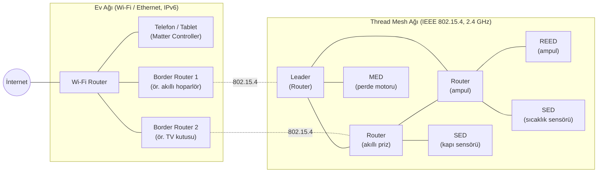

- **Border Router**'lar Thread mesh'i ile Wi-Fi/Ethernet ev ağını IP seviyesinde birbirine bağlar.
- **Router**'lar (genelde şebekeden beslenen cihazlar) mesh omurgasını oluşturur ve paketleri yönlendirir.
- **Leader**, router'lardan biridir; router kimliklerini dağıtır ve ağ verisini yönetir.
- **REED** (Router Eligible End Device), gerektiğinde router'a terfi edebilen cihazdır.
- **SED/MED** gibi uç cihazlar yalnızca **ebeveyn (parent)** router'larıyla konuşur.

### 1.9 Thread'in Tanımlamadıkları

Thread'in kapsamını doğru anlamak için neleri **tanımlamadığını** bilmek önemlidir:

- **Uygulama protokolü / veri modeli** → Matter, LwM2M, özel CoAP uygulamaları vb.
- **Bulut bağlantısı ve uzaktan erişim** → Ekosistem hub'ları/bulut servisleri.
- **Kullanıcı arayüzü ve cihaz eşleştirme deneyimi** → Ekosistem uygulamaları (Apple Home, Google Home, Home Assistant vb.).
- **Uçtan uca (end-to-end) uygulama güvenliği** → Thread bağlantı katmanında hop-by-hop güvenlik sağlar; uçtan uca güvenlik Matter (CASE/PASE oturumları) veya DTLS gibi üst katmanların işidir.
- **Wi-Fi ağının yapılandırılması** → Border Router'ın altyapı ağıyla etkileşimi Thread BR şartnamesinde tanımlanır ama ev ağı Thread'in kontrolünde değildir.

### 1.10 Bölüm Özeti

- Thread, 802.15.4 radyo üzerinde IPv6 taşıyan, düşük güçlü ve kendi kendini onaran bir mesh ağıdır.
- Uygulama katmanından bağımsızdır; bugün en yaygın üst katman Matter'dır.
- Merkezi tek hata noktası yoktur: Leader ve Border Router işlevleri yedeklidir.
- Sürümler geriye uyumludur; 1.2 enerji ve ölçek, 1.3 Border Router, 1.4 birlikte çalışabilirlik ve kimlik paylaşımı odaklıdır.

## 2. Protokol Yığını ve Genel Mimari

### 2.1 Katmanlar

Thread, mevcut standartları bir araya getirip eksik parçaları kendisi tanımlayan bir "sistem şartnamesi"dir. Yığın aşağıdan yukarıya şöyledir:

```text
+-----------------------------------------------------------------------+
|  UYGULAMA        Matter  |  CoAP uygulamaları  |  LwM2M  |  özel UDP  |
+-----------------------------------------------------------------------+
|  OTURUM/GÜVENLİK         (Matter CASE/PASE, DTLS — uygulamaya bağlı)  |
+-----------------------------------------------------------------------+
|  TAŞIMA          UDP   (TCP isteğe bağlı; Thread 1.3+ TCP desteği)    |
+--------------------------+--------------------------------------------+
|                          |  Thread Kontrol Düzlemi:                   |
|  AĞ  IPv6 + ICMPv6       |   MLE   (UDP 19788)  komşuluk / bağlanma   |
|      Thread yönlendirme  |   TMF   (CoAP, UDP 61631) ağ yönetimi      |
|                          |   MeshCoP (DTLS)  devreye alma             |
+--------------------------+--------------------------------------------+
|  UYARLAMA        6LoWPAN: başlık sıkıştırma, parçalama, mesh başlığı  |
+-----------------------------------------------------------------------+
|  BAĞLANTI (MAC)  IEEE 802.15.4-2006 (+2015 özellikleri): CSMA-CA,     |
|                  ACK, AES-CCM* güvenlik, dolaylı iletim, IE'ler       |
+-----------------------------------------------------------------------+
|  FİZİKSEL (PHY)  IEEE 802.15.4  2.4 GHz  O-QPSK  250 kbit/s  k11-26   |
+-----------------------------------------------------------------------+
```

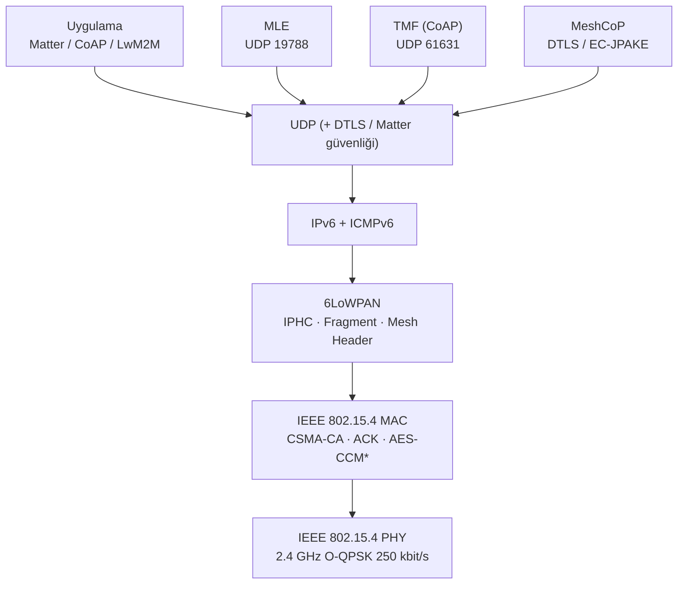

### 2.2 OSI Modeliyle Eşleme

| OSI katmanı | Thread'deki karşılığı | Standart / kaynak |
|---|---|---|
| 7 Uygulama | Matter, CoAP uygulamaları | CSA Matter, RFC 7252 |
| 6 Sunum | (Uygulamaya ait — TLV, CBOR vb.) | — |
| 5 Oturum | Matter CASE/PASE, DTLS 1.2 | RFC 6347 |
| 4 Taşıma | UDP (ağırlıklı), TCP | RFC 768, RFC 9293 |
| 3 Ağ | IPv6, ICMPv6, Thread yönlendirme, MLE, TMF, MPL | RFC 8200, RFC 4443, RFC 7731, Thread Spec |
| 2.5 Uyarlama | 6LoWPAN | RFC 4944, RFC 6282 |
| 2 Veri bağlantısı | IEEE 802.15.4 MAC | IEEE 802.15.4-2006 / -2015 |
| 1 Fiziksel | IEEE 802.15.4 O-QPSK PHY (2.4 GHz) | IEEE 802.15.4 |

### 2.3 Thread'in Kullandığı ve Tanımladığı Bileşenler

**Kullandığı (başkalarının tanımladığı) standartlar:**

| Bileşen | Kaynak | Thread'deki rolü |
|---|---|---|
| IEEE 802.15.4 PHY/MAC | IEEE | Radyo ve çerçeve erişimi |
| 6LoWPAN çerçeveleme ve parçalama | RFC 4944 | IPv6'yı 127 baytlık çerçevelere sığdırma |
| IPHC / NHC sıkıştırma | RFC 6282 | IPv6/UDP başlıklarını sıkıştırma |
| IPv6 adresleme | RFC 4291, RFC 4193 (ULA), RFC 4862 (SLAAC) | Adres yapısı |
| ICMPv6 | RFC 4443 | Ping, hata mesajları |
| CoAP | RFC 7252 | TMF yönetim mesajları |
| DTLS 1.2 | RFC 6347 | Devreye alma oturumları |
| EC-JPAKE | RFC 8236 (J-PAKE) temelli TLS uzantısı | Parola doğrulamalı anahtar değişimi |
| Trickle | RFC 6206 | Advertisement zamanlaması |
| MPL | RFC 7731 | Mesh içi çoklu yayın (multicast) iletimi |
| mDNS / DNS-SD / SRP | RFC 6762, RFC 6763, RFC 9665 | Servis keşfi (Border Router) |
| NAT64 / DNS64 | RFC 6146, RFC 6147, RFC 6052 | IPv4 erişimi (Border Router) |

**Thread'in kendi tanımladıkları:**

| Bileşen | Görevi |
|---|---|
| **MLE** (Mesh Link Establishment) | Komşu keşfi, bağlanma (attach), ebeveyn seçimi, bağlantı kalitesi ölçümü, yönlendirme bilgisinin yayılması, ağ parametrelerinin dağıtımı |
| **Thread yönlendirme protokolü** | Router'lar arası mesafe-vektör (distance-vector) yönlendirme (Route64 TLV) |
| **TMF** (Thread Management Framework) | CoAP tabanlı yönetim: adres sorgulama, router ID atama, ağ verisi kaydı, teşhis |
| **Network Data** | Ağ genelinde önekler, rotalar, servisler, sıkıştırma bağlamları |
| **MeshCoP** (Mesh Commissioning Protocol) | Commissioner, Border Agent, Joiner süreçleri; Operational Dataset yönetimi |
| **Adres mimarisi** | RLOC, ALOC, ML-EID, RLOC16 yapısı, adres sorgulama |
| **Güvenlik mimarisi** | Network Key'den MAC/MLE anahtarı türetme, anahtar rotasyonu, PSKc/PSKd |
| **Border Router davranışları** | OMR prefix, RA/RIO, SRP, NAT64, TREL (1.3+) |

### 2.4 Kontrol Düzlemi ve Veri Düzlemi

Thread'deki trafiği iki gruba ayırmak mimariyi anlamayı kolaylaştırır:

**Veri düzlemi (data plane)** — Uygulamanın asıl yükü: Matter komutları, sensör verileri, CoAP istekleri. IPv6/UDP paketleri olarak taşınır, 6LoWPAN ile sıkıştırılır, MAC katmanında şifrelenir.

**Kontrol düzlemi (control plane)** — Ağın kendisini ayakta tutan trafik:

| Protokol | Kapsam | Örnek işler |
|---|---|---|
| **MLE** | Tek atlama (link-local) | Parent Request/Response, Child ID Request/Response, Link Request/Accept, Advertisement, Data Response |
| **TMF** | Mesh geneli (RLOC/ALOC adresleri) | Address Query/Notification, Address Solicit/Release, Server Data, Diagnostic Get |
| **MeshCoP** | Mesh + Border Agent + harici commissioner | Commissioner Petition, Joiner DTLS, Joiner Entrust, Active/Pending Set |

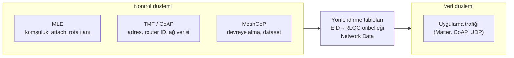

### 2.5 Bir Paketin Yolculuğu (Genel Bakış)

Bir uygulamanın Thread ağındaki başka bir cihaza UDP mesajı gönderdiğini düşünelim. Ayrıntılar ilgili bölümlerde verilecek; burada akışı kuşbakışı görüyoruz:

1. **Uygulama** veriyi UDP soketine yazar (ör. hedef: `fd4f:…:1234` port 5540).
2. **IPv6 katmanı** kaynak adresini seçer ve hedefin mesh içinde mi (on-mesh) yoksa dışarıda mı olduğuna bakar.
3. **Thread yönlendirme**: Hedef bir EID ise (ML-EID veya OMR adresi) **EID→RLOC** önbelleğine bakılır. Kayıt yoksa ağa **Address Query** gönderilir ve paket bekletilir. Hedef ağ dışındaysa Network Data'dan uygun **Border Router**'ın RLOC16'sı seçilir.
4. **Sonraki atlama (next hop)** yönlendirme tablosundan bulunur.
5. **6LoWPAN**: IPv6 ve UDP başlıkları sıkıştırılır; paket birden fazla atlama gidecekse **Mesh Header** (kaynak ve nihai hedef RLOC16) eklenir; paket 127 bayta sığmıyorsa **parçalanır** (FRAG1/FRAGN).
6. **MAC**: Her parça, hedef MAC adresi = sonraki atlama olacak şekilde çerçevelenir, **AES-CCM*** ile şifrelenip doğrulanır, **CSMA-CA** ile kanala erişilip gönderilir, **ACK** beklenir; gelmezse yeniden denenir.
7. **Ara router'lar** her çerçeveyi alır, MAC güvenliğini doğrular, Mesh Header'daki nihai hedefe bakar, *Hops Left* değerini azaltır ve sonraki atlamaya — paketi IPv6 seviyesinde birleştirmeden — iletir.
8. **Hedef router** paketi doğrudan veya (uyuyan çocuk cihaz ise) **dolaylı iletim** ile teslim eder.
9. **Hedef cihaz** parçaları birleştirir, başlıkları açar ve UDP yükünü uygulamaya verir.

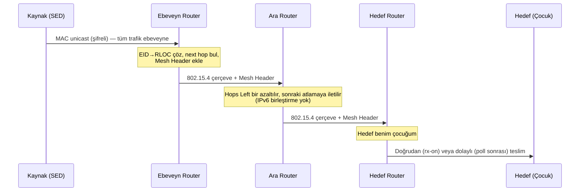

### 2.6 Önemli UDP Portları

| Port | Protokol | Açıklama |
|---|---|---|
| **19788** | MLE | Mesh Link Establishment (link-local) |
| **61631** | TMF (CoAP) | Thread yönetim mesajları (`0xF0BF`; 6LoWPAN ile 4 bite sıkıştırılabilir) |
| **1000** | MeshCoP Joiner | Joiner UDP portu (varsayılan; Discovery Response içinde ilan edilir) |
| **49191** | MeshCoP Border Agent | OTBR varsayılanı; gerçek port mDNS `_meshcop._udp` SRV kaydıyla ilan edilir |
| **5540** | Matter | Matter operasyonel mesajları (UDP/TCP) |
| **5353** | mDNS | Altyapı ağında (Wi-Fi/Ethernet) servis keşfi |
| **53** | DNS | Discovery Proxy / DNS sorguları (Border Router) |
| **53535–53554** | SRP | OpenThread SRP sunucusunun kullandığı aralık (Network Data'da ilan edilir) |

### 2.7 Bölüm Özeti

- Thread yığını: 802.15.4 PHY/MAC → 6LoWPAN → IPv6 → UDP → uygulama.
- Thread'e özgü kontrol protokolleri: MLE (link yönetimi), TMF (CoAP tabanlı ağ yönetimi), MeshCoP (devreye alma).
- Mesh içinde paketler IPv6 seviyesinde değil, 6LoWPAN **Mesh Header** ile RLOC16'lara göre iletilir; ara düğümler parçaları birleştirmez.
- Her atlamada MAC katmanı şifreleme/doğrulama yapar (hop-by-hop güvenlik).

## 3. Fiziksel Katman (IEEE 802.15.4 PHY)

### 3.1 Genel Bakış

Thread, IEEE 802.15.4 standardının **2.4 GHz O-QPSK** fiziksel katmanını kullanır. Bu bant dünya genelinde lisanssız (ISM) olduğu için aynı ürün her ülkede satılabilir. 802.15.4'ün sub-GHz (868/915 MHz) PHY'leri Thread şartnamesinde yer almaz.

| Parametre | Değer |
|---|---|
| Frekans bandı | 2400–2483.5 MHz (ISM) |
| Kanal sayfası (channel page) | 0 |
| Kanallar | 11–26 (16 kanal) |
| Kanal aralığı | 5 MHz |
| Kapladığı bant genişliği | ≈ 2 MHz |
| Modülasyon | O-QPSK, yarım-sinüs darbe şekillendirme |
| Yayılma (spreading) | DSSS: 4 bit → 32 chip |
| Chip hızı | 2 Mchip/s |
| Sembol hızı | 62.5 ksembol/s (1 sembol = 16 µs) |
| Bit hızı | **250 kbit/s** (1 bayt = 32 µs) |
| Maksimum PSDU (MAC çerçevesi) | **127 bayt** (`aMaxPHYPacketSize`) |
| Asgari alıcı hassasiyeti (standart) | −85 dBm (%1 PER, 20 baytlık PSDU) |
| Tipik çip hassasiyeti | −98 … −106 dBm |
| Tipik çıkış gücü | 0 … +10 dBm (FEM ile +20 dBm'e kadar) |

### 3.2 Kanallar ve Frekanslar

Kanal merkez frekansı şu formülle bulunur:

```text
Fc(k) = 2405 + 5 × (k − 11)  MHz      k = 11, 12, …, 26
```

| Kanal | Merkez (MHz) | Kanal | Merkez (MHz) | Kanal | Merkez (MHz) | Kanal | Merkez (MHz) |
|---|---|---|---|---|---|---|---|
| 11 | 2405 | 15 | 2425 | 19 | 2445 | 23 | 2465 |
| 12 | 2410 | 16 | 2430 | 20 | 2450 | 24 | 2470 |
| 13 | 2415 | 17 | 2435 | 21 | 2455 | 25 | 2475 |
| 14 | 2420 | 18 | 2440 | 22 | 2460 | 26 | 2480 |

Bir Thread ağı **tek bir kanalda** çalışır. Kanal, Operational Dataset'in parçasıdır (Bölüm 17) ve ağın tüm cihazları aynı kanalı kullanır. Kanal değişikliği, "Pending Dataset" mekanizmasıyla tüm ağda eşzamanlı yapılır.

> [!NOTE]
> Thread **frekans atlamalı (frequency hopping)** değildir. Bu, tasarımı basitleştirir ve uyuyan cihazların ağı bulmasını kolaylaştırır; karşılığında girişime karşı direnç, iyi kanal seçimi ve gerektiğinde ağ genelinde kanal değiştirme ile sağlanır.

### 3.3 Modülasyon ve Yayılma Spektrumu

802.15.4 2.4 GHz PHY'sinde veri şu adımlarla radyo sinyaline dönüşür:

1. **Bit → Sembol**: Her bayt iki adet 4 bitlik sembole bölünür (önce düşük dörtlü / LSB nibble).
2. **Sembol → Chip (DSSS)**: Her 4 bitlik sembol, 16 adet yarı-ortogonal 32 chip'lik PN dizisinden birine eşlenir. Böylece 4 bit, 32 chip ile temsil edilir (yayılma oranı 8).
3. **Chip → O-QPSK**: Çift numaralı chip'ler I (in-phase) koluna, tek numaralı chip'ler Q (quadrature) koluna yerleştirilir. Q kolu yarım chip süresi (0.5 µs) geciktirilir (Offset-QPSK).
4. **Yarım-sinüs darbe şekillendirme**: Her chip yarım sinüs darbesiyle şekillendirilir. Sonuç, MSK'ye benzeyen **sabit zarflı** bir sinyaldir; bu da verimli (doğrusal olmayan) güç yükselteçleri kullanılmasına izin verir — pil ömrü için önemlidir.

```text
 Bayt 0xA7  →  sembol 0x7, sembol 0xA  (önce düşük nibble)
 sembol 0x7 →  32 chip'lik PN dizisi #7
 32 chip    →  16 chip I kolunda + 16 chip Q kolunda (Q, Tc/2 kaydırılmış)
 1 sembol   =  32 chip / 2 Mchip/s = 16 µs
 250 kbit/s =  4 bit / 16 µs
```

**İşlem kazancı (processing gain)**: 32 chip / 4 bit → 10·log10(8) ≈ **9 dB**. Alıcı korelasyon yaparak gürültü ve dar bantlı girişime karşı bu kadar ek dayanıklılık kazanır. Bu nedenle 802.15.4 sinyalleri gürültü tabanına yakın seviyelerde bile çözülebilir.

### 3.4 PPDU (Fiziksel Paket) Yapısı

```text
+------------------+---------+-----------------+-----------------------------+
| Preamble         |   SFD   |      PHR        |           PSDU              |
| 4 bayt (0x00×4)  | 1 bayt  | 1 bayt          |   0–127 bayt                |
| 8 sembol         | 0xA7    | bit0-6: uzunluk |   (MAC çerçevesi = MPDU)    |
|                  |         | bit7: ayrılmış  |                             |
+------------------+---------+-----------------+-----------------------------+
|<------- SHR (5 bayt, 160 µs) ------>|<- 32 µs ->|<---- uzunluk × 32 µs ---->|
```

| Alan | Boyut | Açıklama |
|---|---|---|
| **Preamble** | 4 bayt | Tümü sıfır; alıcının bit/chip senkronizasyonu için |
| **SFD** (Start of Frame Delimiter) | 1 bayt | `0xA7`; çerçevenin başladığını işaretler |
| **PHR** (PHY Header) | 1 bayt | 7 bit çerçeve uzunluğu (0–127), 1 bit ayrılmış |
| **PSDU** | ≤127 bayt | MAC çerçevesi (MHR + yük + 2 bayt FCS) |

**Yayın süresi (airtime) hesabı:**

```text
Airtime = (5 + 1 + PSDU_uzunluğu) × 32 µs

127 baytlık en büyük çerçeve : (6 + 127) × 32 µs = 4256 µs ≈ 4.26 ms
5 baytlık Imm-ACK çerçevesi   : (6 + 5)   × 32 µs =  352 µs
```

### 3.5 Önemli PHY/MAC Zaman Sabitleri

| Sabit | Değer | Süre | Anlamı |
|---|---|---|---|
| Sembol süresi | 1 sembol | 16 µs | Temel zaman birimi |
| `aTurnaroundTime` | 12 sembol | 192 µs | RX↔TX geçiş süresi; ACK bu süre sonra gönderilir |
| `aUnitBackoffPeriod` | 20 sembol | 320 µs | CSMA-CA geri çekilme birimi |
| `aCCATime` | 8 sembol | 128 µs | Kanal boşluk değerlendirme (CCA) süresi |
| `macAckWaitDuration` | 54 sembol | 864 µs | ACK bekleme süresi |
| `aMaxSIFSFrameSize` | 18 bayt | — | Bu boyuta kadar çerçevelerden sonra kısa aralık |
| `macSIFSPeriod` | 12 sembol | 192 µs | Kısa çerçeveler arası boşluk (SIFS) |
| `macLIFSPeriod` | 40 sembol | 640 µs | Uzun çerçeveler arası boşluk (LIFS) |

### 3.6 Alıcı Ölçümleri: RSSI, LQI, ED ve Gürültü Tabanı

| Terim | Açıklama | Thread'de kullanımı |
|---|---|---|
| **RSSI** (Received Signal Strength Indicator) | Alınan çerçevenin sinyal gücü (dBm) | Link margin hesabı |
| **Gürültü tabanı (noise floor)** | Kanal boşken ölçülen arka plan gücü (tipik −95…−100 dBm) | Link margin hesabı |
| **Link Margin** | RSSI − gürültü tabanı (dB) | Link Quality (0–3) seviyesine dönüştürülür |
| **LQI** (Link Quality Indicator) | Alınan sinyalin kalitesi, 0–255; üreticiye özgü hesaplanır | Teşhis, Link Metrics |
| **ED** (Energy Detection) | Kanaldaki toplam enerji ölçümü | Energy Scan, CCA, kanal seçimi |

Thread, **Link Margin**'i şöyle bir **Link Quality (LQ)** seviyesine çevirir (ayrıntılar Bölüm 10):

| Link Margin | Link Quality | Bağlantı maliyeti (link cost) |
|---|---|---|
| > 20 dB | 3 (çok iyi) | 1 |
| > 10 dB | 2 (iyi) | 2 |
| > 2 dB | 1 (zayıf) | 4 |
| ≤ 2 dB | 0 (kullanılamaz) | ∞ (16) |

Eşikler arasında yaklaşık 2 dB'lik **histerezis** uygulanır; böylece sınırdaki bağlantılar seviyeler arasında sürekli zıplamaz.

### 3.7 CCA (Clear Channel Assessment)

Göndermeden önce kanalın boş olup olmadığına bakılır. 802.15.4 üç mod tanımlar:

| Mod | Ölçüt |
|---|---|
| **Mod 1** | Enerji eşiğin (ED threshold) üzerindeyse meşgul |
| **Mod 2** | 802.15.4 uyumlu bir sinyal (carrier) algılanırsa meşgul |
| **Mod 3** | Mod 1 ve/veya Mod 2 birlikte (AND / OR) |

Tipik CCA enerji eşiği yaklaşık **−75 dBm** civarındadır (platforma göre değişir). Eşik çok düşük seçilirse Wi-Fi gürültüsü yüzünden sürekli "kanal meşgul" hatası (CCA failure) alınır; çok yüksek seçilirse çakışmalar artar.

### 3.8 Wi-Fi ve Bluetooth ile Bir Arada Yaşama

Thread, Wi-Fi ve Bluetooth ile aynı 2.4 GHz bandını paylaşır. 20 MHz genişliğindeki Wi-Fi kanalları birçok Thread kanalını örter:

```text
MHz:   2400   2410   2420   2430   2440   2450   2460   2470   2480
        |------|------|------|------|------|------|------|------|
Wi-Fi1  [==== 2402–2422 ====]
Wi-Fi6                   [==== 2427–2447 ====]
Wi-Fi11                                   [==== 2452–2472 ====]
Wi-Fi13 (AB)                                        [==== 2462–2482 ====]
Thread   11  12  13  14 [15] 16  17  18  19 [20] 21  22  23  24 [25] 26
```

| Thread kanalı | Merkez | Wi-Fi 1/6/11 ile örtüşme | Not |
|---|---|---|---|
| **15** | 2425 MHz | Wi-Fi 1 ile 6 arasındaki boşlukta | Wi-Fi 1/6/11 planında iyi seçenek; BLE reklam kanalı 38'e (2426 MHz) yakın |
| **20** | 2450 MHz | Wi-Fi 6 ile 11 arasındaki boşlukta | İyi seçenek |
| **25** | 2475 MHz | Wi-Fi 11'in üstünde | Avrupa'da Wi-Fi 12/13 kullanılıyorsa örtüşür |
| **26** | 2480 MHz | Wi-Fi 11'in üstünde | ABD'de bant kenarı (2483.5 MHz) nedeniyle bazı ürünlerde düşük güç; BLE reklam kanalı 39 ile aynı frekans |
| 11–14, 16–19, 21–24 | — | Bir Wi-Fi kanalının içinde | Wi-Fi yoğunsa CCA hataları ve kayıplar artar |

**Bir arada yaşama (coexistence) yöntemleri:**

- **Kanal planlama**: Ortamın Wi-Fi kanallarını ölçüp (Energy Scan) en az örtüşen Thread kanalını seçmek.
- **PTA (Packet Traffic Arbitration)**: Aynı cihazda Wi-Fi ve 802.15.4 radyosu varsa (ör. Border Router, ESP32-C6, tri-radio çipler) radyolar 2/3 telli bir hakemlik arayüzüyle hangisinin göndereceğini koordine eder.
- **Anten izolasyonu**: Aynı kutudaki Wi-Fi ve Thread antenleri arasında fiziksel mesafe ve polarizasyon farkı.
- **Dinamik kanal yönetimi**: OpenThread'in *Channel Monitor* ve *Channel Manager* özellikleri kanalları periyodik örnekleyip gerekirse ağın kanalını değiştirebilir.

### 3.9 Bağlantı Bütçesi ve Menzil

**Bağlantı bütçesi (link budget)** = verici gücü + anten kazançları − alıcı hassasiyeti.

```text
Örnek: TX = +8 dBm, hassasiyet = −100 dBm, anten kazançları ≈ 0 dBi
Bütçe = 8 − (−100) = 108 dB
```

2.44 GHz'te serbest uzay yol kaybı (FSPL):

```text
FSPL(dB) ≈ 40.2 + 20·log10(d / 1 m)

d =  1 m  →  40 dB          d = 10 m  →  60 dB
d = 30 m  →  70 dB          d = 100 m →  80 dB
```

İç mekânda her duvar/kat için ek kayıplar eklenir (alçıpan ≈ 3–5 dB, tuğla ≈ 6–12 dB, betonarme ≈ 10–20 dB, metal yüzeyler çok daha fazla). Ayrıca çok yollu sönümlenme (multipath fading) için 10–20 dB pay bırakmak gerekir.

| Ortam | Tipik tek atlama menzili |
|---|---|
| İç mekân, birkaç duvar | 10–30 m |
| Açık alan, görüş hattı | 50–100+ m (FEM ile daha fazla) |

Mesh yapısı sayesinde tek atlama menzili sınırlı olsa da ağ, router ekledikçe kapsama alanını genişletir.

### 3.10 Etkin Veri Hızı (Throughput)

250 kbit/s ham hızdır; gerçek uygulama verimi çok daha düşüktür. Tek atlamada en büyük çerçeve için kaba bir hesap:

| Bileşen | Süre |
|---|---|
| Ortalama CSMA geri çekilme (BE = 3 → ortalama 3.5 × 320 µs) | ≈ 1120 µs |
| CCA + RX→TX geçişi | 128 + 192 = 320 µs |
| 127 baytlık çerçeve | 4256 µs |
| ACK öncesi geçiş + ACK çerçevesi | 192 + 352 = 544 µs |
| **Toplam** | **≈ 6.24 ms / çerçeve** |

127 baytlık çerçevenin içinde MAC başlığı, güvenlik başlığı, MIC, FCS, 6LoWPAN parçalama/sıkıştırma ve UDP başlıkları çıktıktan sonra yaklaşık **80–90 bayt** uygulama verisi kalır:

```text
Tek atlama, en iyi durum : 85 bayt × 8 / 6.24 ms ≈ 109 kbit/s
Çok atlama (aynı kanal)  : her atlama aynı kanalı paylaştığı için verim
                           kabaca atlama sayısıyla bölünür
3 atlama                 : ≈ 30–40 kbit/s
```

Gerçek ağlarda yeniden iletimler, Wi-Fi girişimi ve kontrol trafiği nedeniyle tipik uygulama verimi **onlarca kbit/s** düzeyindedir. Bu, sensör/aktüatör trafiği için fazlasıyla yeterlidir; ancak OTA yazılım güncellemeleri gibi büyük aktarımlar dakikalar sürebilir (Bölüm 26).

### 3.11 Bölüm Özeti

- Thread yalnızca 2.4 GHz, 16 kanallı, 250 kbit/s O-QPSK PHY kullanır; ağ tek kanalda çalışır.
- DSSS ≈ 9 dB işlem kazancı ve sabit zarflı modülasyon, düşük güç ve gürültüye dayanıklılık sağlar.
- En büyük çerçeve 127 bayttır ve ≈ 4.26 ms sürer; bu sınır üst katmanlarda sıkıştırma ve parçalamayı zorunlu kılar.
- Link margin → Link Quality (0–3) → link cost dönüşümü, yönlendirmenin temelidir.
- Wi-Fi ile çakışmayı azaltmak için 15, 20, 25 (ve bölgeye göre 26) numaralı kanallar genelde daha temizdir.

## 4. MAC Katmanı (IEEE 802.15.4 MAC)

### 4.1 Görevler

802.15.4 MAC katmanının Thread'deki sorumlulukları:

| Görev | Açıklama |
|---|---|
| **Kanal erişimi** | Slotsuz (unslotted) CSMA-CA ile çakışmaları azaltmak |
| **Çerçeveleme** | Başlık (MHR), yük ve FCS (CRC-16) oluşturmak |
| **Adresleme** | PAN ID, 16 bit kısa adres, 64 bit genişletilmiş adres |
| **Güvenilirlik** | Onay (ACK) ve yeniden iletim (retry) |
| **Güvenlik** | AES-128-CCM* ile şifreleme + bütünlük (MIC), tekrar (replay) koruması |
| **Dolaylı iletim** | Uyuyan cihazlar için ebeveynde kuyruklama ve "poll" ile teslim |
| **Tarama** | Active scan, energy scan |
| **Bilgi elemanları (IE)** | Thread 1.2+: CSL, Link Metrics gibi bilgilerin başlıkta taşınması |

### 4.2 Thread'in 802.15.4 MAC'i Kullanma Biçimi

802.15.4 çok geniş bir standarttır; Thread bunun yalnızca belirli bir alt kümesini kullanır:

- **Beacon'sız (non-beacon) mod**: Süper çerçeve (superframe), GTS (garantili zaman dilimi) yoktur. Kanal erişimi tamamen **slotsuz CSMA-CA** ile yapılır.
- **802.15.4 "association" kullanılmaz**: Bir cihazın ağa bağlanması MAC Association komutlarıyla değil, **MLE** (Bölüm 9) ile yapılır. Bu sayede bağlanma süreci güvenli ve IP tabanlıdır.
- **PAN Coordinator kavramı yoktur**: Thread'de "coordinator" rolü bulunmaz; Leader bir MAC kavramı değil, Thread ağ katmanı rolüdür.
- **Çerçeve sürümleri**: Thread 1.1 güvenli çerçeveler için 802.15.4-**2006** sürümünü kullanır. Thread 1.2 ve sonrası, IE (Information Element) ve Enhanced ACK gerektiren durumlarda 802.15.4-**2015** çerçeve sürümünü kullanır (ör. CSL, Link Metrics).
- **Genişletilmiş adres rastgeledir**: Thread cihazları ağda fabrika EUI-64'ünü değil, rastgele üretilmiş bir 64 bit **Extended Address** kullanır (gizlilik). Fabrika EUI-64'ü yalnızca devreye almada Joiner ID türetmek için kullanılır.

### 4.3 MAC Çerçeve Formatı

```text
           MHR (MAC Header)                                          MAC Payload      MFR
+-------+-----+-------+-------+-------+-------+-----------+-------+--------------+--------+
| Frame | Seq | Dest  | Dest  |  Src  |  Src  | Auxiliary | Header|   Payload    |  FCS   |
|Control| Num | PAN ID| Addr  | PAN ID| Addr  | Security  |  IEs  | (+Payload IE)| CRC-16 |
|   2   | 0/1 | 0/2   |0/2/8  | 0/2   | 0/2/8 | 0/5/6/10/14| değ. |   değişken   |   2    |
+-------+-----+-------+-------+-------+-------+-----------+-------+--------------+--------+
```

Tüm çok baytlı alanlar havada **little-endian** sırayla gönderilir.

#### Frame Control (2 bayt)

```text
 bit: 15 14 | 13 12 | 11 10 |  9  |  8  |  7  |  6  |  5  |  4  |  3  | 2 1 0
      SrcAM | Sürüm | DstAM | IEP | SNS | ayr.| PIC | AR  | FP  | Sec | Tür
```

| Bit(ler) | Alan | Değerler |
|---|---|---|
| 0–2 | **Frame Type** | `000` Beacon, `001` Data, `010` Ack, `011` MAC Command (diğerleri Thread'de kullanılmaz) |
| 3 | **Security Enabled** | 1 = Aux Security Header var, yük şifreli/doğrulanmış |
| 4 | **Frame Pending** | 1 = gönderende bu alıcı için bekleyen veri var (uyuyan cihazlar için kritik) |
| 5 | **AR** (Ack Request) | 1 = alıcı ACK göndermeli (unicast çerçeveler); yayın (broadcast) çerçevelerde 0 |
| 6 | **PAN ID Compression** | 1 = kaynak PAN ID atlanır (hedef PAN ID ile aynı kabul edilir) |
| 8 | **Sequence Number Suppression** | (2015) 1 = sıra numarası alanı yok |
| 9 | **IE Present** | (2015) 1 = başlıkta Information Element var |
| 10–11 | **Dest Addr Mode** | `00` yok, `10` kısa (16 bit), `11` genişletilmiş (64 bit) |
| 12–13 | **Frame Version** | `00` 2003, `01` 2006, `10` 2015 |
| 14–15 | **Src Addr Mode** | `00` yok, `10` kısa, `11` genişletilmiş |

#### Çözümlenmiş örnekler

| Havadaki baytlar | FCF değeri | Anlamı |
|---|---|---|
| `41 D8` | `0xD841` | Data, güvenliksiz, ACK yok, PAN sıkıştırma; hedef kısa (yayın `0xFFFF`), kaynak genişletilmiş, sürüm 2006 → tipik **MLE yayın** çerçevesi (ör. Parent Request) |
| `61 DC` | `0xDC61` | Data, güvenliksiz, ACK istekli, PAN sıkıştırma; hedef ve kaynak genişletilmiş, sürüm 2006 → tipik **MLE unicast** çerçevesi |
| `69 98` | `0x9869` | Data, **güvenli**, ACK istekli, PAN sıkıştırma; hedef ve kaynak kısa, sürüm 2006 → tipik **komşular arası veri** çerçevesi |
| `69 D8` | `0xD869` | Aynısı, kaynak genişletilmiş |
| `02 00` | `0x0002` | Imm-Ack (Frame Pending = 0) |
| `12 00` | `0x0012` | Imm-Ack (Frame Pending = 1) — "sende bekleyen veri var" |

#### Tam bir veri çerçevesi örneği

```text
69 98                 Frame Control: Data, Sec=1, AR=1, PIC=1, kısa→kısa, 2006
5A                    Sıra numarası = 90
34 12                 Hedef PAN ID = 0x1234
00 5C                 Hedef kısa adres = 0x5C00  (Router ID 23)
01 5C                 Kaynak kısa adres = 0x5C01 (Router 23'ün 1 numaralı çocuğu)
0D                    Security Control: seviye 5 (ENC-MIC-32), Key ID Mode 1
3A 00 00 00           Frame Counter = 58
01                    Key Index = 1  (Key Sequence 0)
.. .. .. ..           Şifreli yük (6LoWPAN: Mesh/Frag/IPHC + UDP + uygulama)
xx xx xx xx           MIC (32 bit)
yy yy                 FCS (CRC-16/ITU-T)
```

MAC ek yükü: başlık 9 bayt + güvenlik başlığı 6 bayt + MIC 4 bayt + FCS 2 bayt = **21 bayt**. Yani kısa adreslerle MAC yükü için en fazla **106 bayt** kalır (kaynak genişletilmiş adres ise ≈ 100 bayt).

### 4.4 Adresler

| Adres | Boyut | Thread'deki anlamı |
|---|---|---|
| **PAN ID** | 16 bit | Ağın MAC seviyesindeki kimliği; Operational Dataset'te bulunur. `0xFFFF` yayın PAN ID'sidir. |
| **Kısa adres (Short Address)** | 16 bit | Thread'de doğrudan **RLOC16** değeridir (Router ID + Child ID). `0xFFFF` yayın, `0xFFFE` "kısa adres yok" anlamına gelir. |
| **Genişletilmiş adres (Extended Address)** | 64 bit | Cihazın ağdaki rastgele 64 bitlik kimliği. Link-local IPv6 adresinin arayüz kimliği (IID) bundan türetilir. Ayrıca MAC güvenlik **nonce**'unda kullanılır. |

**Hangi adres ne zaman kullanılır?**

- Cihaz henüz RLOC16 almamışken (bağlanma sırasında) **genişletilmiş** adres kullanılır.
- MLE mesajları link-local IPv6 adresleriyle gönderildiği için MAC kaynağı genellikle **genişletilmiş** adrestir.
- Bağlanmış komşular arasındaki veri trafiğinde çerçeveyi küçültmek için **kısa** adresler tercih edilir.
- IPv6 çoklu yayın (multicast) paketleri MAC seviyesinde **`0xFFFF`** yayın adresine gönderilir ve ACK istenmez.

### 4.5 CSMA-CA (Slotsuz)

Thread cihazları göndermeden önce rastgele süre bekleyip kanalı dinler:


| Parametre | Varsayılan | Açıklama |
|---|---|---|
| `macMinBE` | 3 | İlk geri çekilme üssü (0–7 birim) |
| `macMaxBE` | 5 | En büyük geri çekilme üssü (0–31 birim) |
| `macMaxCSMABackoffs` | 4 | Vazgeçmeden önce en fazla CCA denemesi (toplam 5 CCA) |
| `macMaxFrameRetries` | 3 | ACK gelmezse yeniden iletim sayısı (OpenThread doğrudan iletim varsayılanı 3) |

> [!TIP]
> MAC sayaçlarında **TxErrCca** (kanal erişim hatası) oranı yüksekse kanal çok meşguldür (genellikle Wi-Fi); **TxRetry** oranı yüksekse bağlantı kalitesi zayıftır veya gizli düğüm (hidden node) problemi vardır. Bkz. Bölüm 21.

### 4.6 Onay (ACK) ve Yeniden İletim

- Unicast çerçevelerde AR = 1 olur. Alıcı çerçeveyi doğru aldıysa (FCS geçerli ve adres kendisine) **`aTurnaroundTime` = 192 µs** sonra ACK gönderir; CSMA uygulanmaz.
- **Imm-Ack** (2006): 5 baytlık MPDU (FCF 2 + Seq 1 + FCS 2). Güvenlik içermez; yalnızca sıra numarası eşleşmesi kontrol edilir.
- **Enhanced ACK** (2015, Thread 1.2+): IE taşıyabilen, güvenli olabilen ACK. CSL bilgisi (CSL IE) veya Link Metrics verisi taşımak için kullanılır.
- Yayın (broadcast) çerçeveler ACK'lenmez. Bu yüzden MLE/MPL gibi üst katmanlar kendi tekrar mekanizmalarını kullanır.
- Gönderen ACK gelmezse çerçeveyi **aynı sıra numarasıyla** yeniden gönderir; alıcı, yinelenen çerçeveleri sıra numarası + kaynak adres ile ayıklar (RxDuplicated sayacı).

### 4.7 Dolaylı İletim (Indirect Transmission) ve Veri Sorgulama (Data Poll)

Uyuyan cihazlar (SED) radyolarını çoğu zaman kapalı tutar; ebeveyn onlara istediği an veri gönderemez. Çözüm **dolaylı iletim**dir:

1. Ebeveyn, SED'e giden paketi **kuyrukta** tutar.
2. SED periyodik olarak uyanıp ebeveynine **MAC Data Request** komutu (komut kimliği `0x04`) gönderir — buna **poll** (sorgulama) denir.
3. Ebeveyn ACK'deki **Frame Pending** bitini 1 yaparak "senin için veri var" der.
4. SED alıcısını açık tutar; ebeveyn veriyi gönderir.
5. Kuyrukta başka çerçeve varsa veri çerçevesindeki Frame Pending biti 1 olur; SED dinlemeye devam eder veya tekrar poll eder.

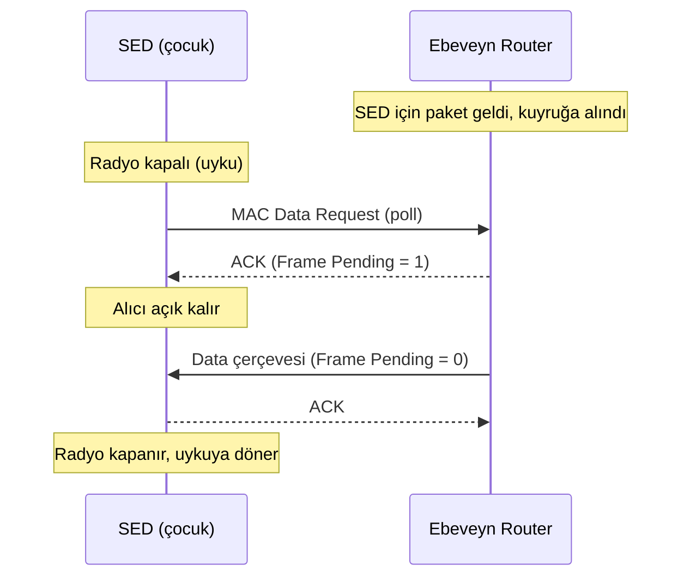

**Ebeveynin tampon yükümlülüğü:** Thread, ebeveynin her uyuyan çocuğu için en az bir tam IPv6 datagramını (1280 bayt) tutabilmesini ister. Thread 1.2+ ebeveynler bu kapasiteyi **Connectivity TLV** içindeki *SED Buffer Size* ve *SED Datagram Count* alanlarıyla ilan eder.

**Poll yanıtı gecikmesi:** Data Request ile veri çerçevesi arasındaki süre kısa olmalıdır; SED bu süre boyunca alıcısını açık tutar. Bu yüzden ebeveyn yazılımları poll'a hızlı cevap verecek şekilde optimize edilir.

### 4.8 MAC Komutları

Thread yalnızca birkaç MAC komutu kullanır:

| Kimlik | Komut | Thread'de kullanımı |
|---|---|---|
| `0x04` | **Data Request** | SED'in ebeveynini sorgulaması (poll) |
| `0x07` | **Beacon Request** | Active scan (çevredeki 802.15.4 ağlarını bulma) |
| `0x01`–`0x03`, `0x05`, `0x06`, `0x08`, `0x09` | Association, Disassociation, Orphan, Coordinator Realignment, GTS vb. | **Kullanılmaz** (MLE ile değiştirilmiştir) |

**Thread Beacon (tarihsel):** Thread 1.0'da ağlar, Beacon Request'e MAC beacon ile cevap verip beacon yükünde *Protocol ID (3)*, sürüm, "Joining Permitted" ve "Native Commissioning" bayrakları, *Network Name*, *Extended PAN ID* ve *Steering Data* taşırdı. Thread 1.1 ve sonrası ağ keşfi için **MLE Discovery Request/Response** kullanır (Bölüm 9.12); beacon yükü geriye uyumluluk için isteğe bağlıdır.

### 4.9 MAC Güvenliği

Thread'de ağ trafiği **her atlamada** MAC katmanında şifrelenir ve doğrulanır.

#### Güvenlik seviyeleri

| Seviye | Ad | Şifreleme | MIC |
|---|---|---|---|
| 0 | None | Hayır | — |
| 1 / 2 / 3 | MIC-32 / 64 / 128 | Hayır | 4 / 8 / 16 bayt |
| 4 | ENC | Evet | — |
| **5** | **ENC-MIC-32** | **Evet** | **4 bayt** ← Thread bunu kullanır |
| 6 / 7 | ENC-MIC-64 / 128 | Evet | 8 / 16 bayt |

#### Auxiliary Security Header

```text
+------------------+----------------+--------------------------------------+
| Security Control | Frame Counter  | Key Identifier                       |
|     1 bayt       |  4 bayt (LE)   | Mode 0: yok                          |
|                  |                | Mode 1: Key Index (1)                |
|                  |                | Mode 2: Key Source (4) + Index (1)   |
|                  |                | Mode 3: Key Source (8) + Index (1)   |
+------------------+----------------+--------------------------------------+

Security Control:
 bit:   7      6           5              4  3          2 1 0
      ayr.  ASN-in-Nonce  FC Suppression  Key ID Mode   Security Level
```

| Kullanım | Key ID Mode | Anahtar | Security Control | Başlık boyutu |
|---|---|---|---|---|
| Normal veri çerçeveleri | **1** | MAC Key (Network Key'den türetilmiş) | `0x0D` | 6 bayt |
| Joiner Entrust (devreye almada) | **0** | **KEK** (DTLS oturumundan türetilmiş) | `0x05` | 5 bayt |
| MLE mesajları | MAC'te güvenliksiz; güvenlik **MLE katmanında** (Bölüm 9.3) | MLE Key | — | — |

**Key Index** değeri, mevcut **Key Sequence**'ten türetilir:

```text
Key Index = (Key Sequence mod 128) + 1        → 1 … 128
```

Alıcı, Key Index'e bakarak çerçevenin mevcut, önceki veya sonraki anahtar dizisiyle şifrelendiğini anlar ve ilgili anahtarı kullanır (anahtar rotasyonu, Bölüm 15).

#### AES-CCM* nonce'u (13 bayt)

```text
+-----------------------------------+--------------------+----------------+
| Kaynak Extended Address (8 bayt)  | Frame Counter (4)  | Sec. Level (1) |
+-----------------------------------+--------------------+----------------+
```

> [!IMPORTANT]
> Nonce her zaman gönderenin **64 bitlik Extended Address**'ini içerir — çerçeve kısa adresle gönderilse bile. Bu yüzden bir cihaz, bir komşudan gelen kısa adresli güvenli çerçeveyi çözebilmek için o komşunun Extended Address'ini önceden (MLE ile) öğrenmiş olmalıdır. Bu, MLE bağlantı kurulumunun neden zorunlu olduğunun bir sebebidir.

**Şifrelenen ve doğrulanan kısımlar:**

- **Doğrulanır (AAD)**: MHR (Frame Control, adresler, Aux Security Header, IE'ler).
- **Şifrelenir + doğrulanır**: MAC yükü (6LoWPAN ile sıkıştırılmış IPv6 paketi).
- **MIC** (4 bayt) yükün sonuna, FCS'den önce eklenir.

#### Frame Counter ve tekrar (replay) koruması

- Her cihaz, gönderdiği her güvenli çerçeve için 32 bitlik **Frame Counter**'ı bir artırır.
- Alıcı, her komşu için en son kabul ettiği frame counter'ı saklar ve **daha küçük veya eşit** değerli çerçeveleri reddeder.
- Komşuların başlangıç sayaçları MLE ile değiş tokuş edilir (*Link-layer Frame Counter TLV*).
- Key Sequence değiştiğinde (yeni anahtar) sayaçlar sıfırlanır; çünkü (anahtar, nonce) çifti benzersiz kalmaya devam eder.
- Cihazlar yeniden başlatmada sayacın geri gitmemesi için değeri kalıcı belleğe **ileriye dönük bir payla** yazar (OpenThread birkaç yüz/bin değer ileriyi saklar); aksi hâlde yeniden başlatma sonrası gönderilen çerçeveler komşular tarafından reddedilirdi.

### 4.10 Bilgi Elemanları (Information Elements — IE)

802.15.4-2015 çerçevelerinde, başlığa esnek alanlar eklemek için IE'ler kullanılır. Thread 1.2+ bunları şu amaçlarla kullanır:

| IE | Element ID | İçerik | Kullanım |
|---|---|---|---|
| **CSL IE** | `0x1A` | CSL Phase (2 bayt), CSL Period (2 bayt) — 10 sembol (160 µs) biriminde | SSED'in örnekleme zamanlamasını ebeveynine bildirmesi (Bölüm 18) |
| **Vendor Specific Header IE** | `0x00` | Thread Group OUI'si + içerik | Enhanced-ACK tabanlı Link Metrics raporları |
| **Header Termination 1** | `0x7E` | — | Header IE'lerin bittiğini ve Payload IE'lerin başladığını gösterir |
| **Header Termination 2** | `0x7F` | — | Header IE'lerin bittiğini ve doğrudan yükün başladığını gösterir |

Header IE tanımlayıcısı 2 bayttır: 7 bit uzunluk, 8 bit Element ID, 1 bit tür (0 = header IE).

### 4.11 Taramalar

| Tarama | Nasıl? | Thread'de amacı |
|---|---|---|
| **Energy Scan** | Her kanalda belirli süre ED ölçümü | En sessiz kanalı seçmek; commissioner'ın uzaktan Energy Scan istemesi (`c/es`) |
| **Active Scan** | Her kanalda Beacon Request yayını, beacon dinleme | Çevredeki 802.15.4 ağlarını listelemek (`scan` komutu) |
| **MLE Discovery Scan** | Her kanalda MLE Discovery Request yayını | Thread ağlarını ve devreye almaya açık ağları bulmak (`discover` komutu, Joiner) |

### 4.12 MAC Seviyesinde Alım Filtreleri

Bir çerçeve kabul edilmeden önce sırasıyla şu kontrollerden geçer:

1. **FCS** doğru mu? (Değilse: RxErrFcs)
2. **Hedef PAN ID** kendi PAN ID'm veya `0xFFFF` mi?
3. **Hedef adres** kendi kısa/genişletilmiş adresim veya `0xFFFF` mi? (Değilse: RxDestAddrFiltered)
4. **Kaynak adres** geçerli mi, (filtre etkinse) izin listesinde mi?
5. Güvenli çerçeveyse: **anahtar** bulunuyor mu, **frame counter** yeni mi, **MIC** doğru mu? (Değilse: RxErrSec)
6. **Yinelenen çerçeve** mi? (sıra numarası + kaynak; RxDuplicated)
7. Gönderen bilinen bir **komşu** mu? Değilse ve çerçeve güvenliyse genellikle reddedilir (RxErrUnknownNeighbor) — istisna: MLE ve devreye alma mesajları.

### 4.13 Bölüm Özeti

- Thread, 802.15.4 MAC'in beacon'sız, slotsuz CSMA-CA modunu kullanır; association yerine MLE vardır.
- Kısa MAC adresi = RLOC16; genişletilmiş adres rastgeledir ve güvenlik nonce'unun parçasıdır.
- Veri çerçeveleri seviye 5 (AES-CCM*, 4 baytlık MIC), Key ID Mode 1 ile korunur; MAC ek yükü ≈ 21 bayttır.
- Uyuyan cihazlara veri dolaylı iletimle (poll + Frame Pending) ulaştırılır.
- Thread 1.2+ Enhanced ACK ve Header IE'leri ile CSL ve Link Metrics gibi gelişmiş özellikleri taşır.

## 5. 6LoWPAN Uyarlama Katmanı

### 5.1 Neden 6LoWPAN?

IPv6 ile 802.15.4 arasında ciddi bir boyut uyumsuzluğu vardır:

| Ölçü | Değer |
|---|---|
| IPv6 asgari MTU (her bağlantının taşıması gereken) | **1280 bayt** |
| 802.15.4 en büyük çerçeve | **127 bayt** |
| MAC ek yükü (güvenli, kısa adres) | ≈ 21 bayt |
| IPv6 başlığı | 40 bayt |
| UDP başlığı | 8 bayt |

Sıkıştırma olmadan 127 baytın 69'u başlıklara giderdi. **6LoWPAN** (IPv6 over Low-Power Wireless Personal Area Networks) bu sorunu üç araçla çözer:

1. **Başlık sıkıştırma** (IPHC/NHC — RFC 6282): 48 baytlık IPv6+UDP başlığını çoğu durumda 6–10 bayta indirir.
2. **Parçalama** (Fragmentation — RFC 4944): 1280 bayta kadar IPv6 paketlerini birden çok 802.15.4 çerçevesine böler.
3. **Mesh başlığı** (Mesh Header — RFC 4944): Paketin asıl kaynağını ve nihai hedefini taşıyarak çok atlamalı iletimi IPv6 katmanına çıkmadan yapmayı sağlar.

### 5.2 Dispatch (Gönderim Türü) Baytları

6LoWPAN yükünün ilk baytı(ları), hangi başlığın geldiğini belirtir:

| Bit deseni | Anlamı | Thread'de |
|---|---|---|
| `00xxxxxx` | NALP — 6LoWPAN çerçevesi değil | — |
| `01000001` (`0x41`) | Sıkıştırılmamış IPv6 başlığı | Nadiren |
| `011xxxxx` | **IPHC** — sıkıştırılmış IPv6 başlığı (RFC 6282) | Evet (her pakette) |
| `10xxxxxx` | **Mesh Header** | Evet (çok atlamalı iletimde) |
| `11000xxx` | **FRAG1** — ilk parça | Evet |
| `11100xxx` | **FRAGN** — sonraki parçalar | Evet |
| `01010000` | LOWPAN_BC0 (yayın başlığı) | Hayır (Thread MPL kullanır) |

Başlıkların sırası sabittir:

```text
[ Mesh Header ] [ Fragment Header ] [ IPHC (+ inline alanlar) ] [ NHC (UDP) ] [ yük ]
```

### 5.3 IPHC: IPv6 Başlık Sıkıştırma

IPHC'nin temel fikri: **alt katmanlardan veya paylaşılan bağlamdan (context) çıkarılabilen hiçbir bilgiyi gönderme.**

#### IPHC kodlaması (2 bayt temel)

```text
  Bayt 0                          Bayt 1
  0   1   1 | TF  | NH | HLIM     CID | SAC | SAM | M | DAC | DAM
 bit7     5 | 4 3 |  2 | 1 0      7   |  6  | 5 4 | 3 |  2  | 1 0
```

| Alan | Bit | Değerler |
|---|---|---|
| **TF** (Traffic Class + Flow Label) | 2 | `00` ECN+DSCP+FL inline (4 bayt) · `01` ECN+FL (3 bayt) · `10` ECN+DSCP (1 bayt) · `11` tamamen atlanmış (0 bayt) |
| **NH** (Next Header) | 1 | `0` Next Header inline (1 bayt) · `1` NHC ile sıkıştırılmış |
| **HLIM** (Hop Limit) | 2 | `00` inline · `01` = 1 · `10` = 64 · `11` = 255 |
| **CID** | 1 | `1` = ek bağlam kimliği baytı var (kaynak ve hedef için 4'er bit) |
| **SAC** | 1 | `0` durumsuz (stateless) · `1` bağlam tabanlı (stateful) kaynak |
| **SAM** | 2 | Kaynak adres modu (aşağıda) |
| **M** | 1 | `1` hedef çoklu yayın (multicast) |
| **DAC** | 1 | Hedef için durumsuz/bağlam tabanlı |
| **DAM** | 2 | Hedef adres modu |

#### Tekil (unicast) adres sıkıştırma modları

| SAC/DAC | SAM/DAM | Satır içi (inline) | Adres nasıl elde edilir? |
|---|---|---|---|
| 0 | `00` | 16 bayt | Tam adres |
| 0 | `01` | 8 bayt | `fe80::` + 64 bit IID |
| 0 | `10` | 2 bayt | `fe80::ff:fe00:XXXX` |
| 0 | `11` | 0 bayt | `fe80::` + IID MAC adresinden türetilir |
| 1 | `00` | 0 bayt | Belirtilmemiş adres `::` (yalnızca kaynak için) |
| 1 | `01` | 8 bayt | Bağlam öneki + 64 bit IID |
| 1 | `10` | 2 bayt | Bağlam öneki + `0000:00ff:fe00:XXXX` |
| 1 | `11` | 0 bayt | Bağlam öneki + IID MAC (veya Mesh Header) adresinden türetilir |

**IID'nin MAC adresinden türetilmesi:**

```text
Genişletilmiş MAC adresi : 1A:2B:3C:4D:5E:6F:70:81
IID                      : 182B:3C4D:5E6F:7081      (ilk bayttaki U/L biti, 0x02, ters çevrilir)

Kısa MAC adresi (RLOC16) : 0x5C01
IID                      : 0000:00FF:FE00:5C01
```

Mesh Header varsa, "MAC adresinden türetme" kuralında MAC çerçevesinin adresleri yerine Mesh Header'daki **asıl kaynak (originator)** ve **nihai hedef (final destination)** adresleri kullanılır. Bu sayede çok atlamalı paketlerde de RLOC adresleri 0 bayta sıkışır.

#### Çoklu yayın (multicast) hedef sıkıştırma (M = 1)

| DAC | DAM | Inline | Biçim |
|---|---|---|---|
| 0 | `00` | 16 bayt | Tam adres |
| 0 | `01` | 6 bayt | `ffXX::00XX:XXXX:XXXX` |
| 0 | `10` | 4 bayt | `ffXX::00XX:XXXX` |
| 0 | `11` | 1 bayt | `ff02::00XX` (ör. `ff02::1`, `ff02::2`) |
| 1 | `00` | 6 bayt | Önek tabanlı çoklu yayın (RFC 3306): `ffXX:XXLL:<bağlam öneki>:XXXX:XXXX` |

Örnek: Thread'in **Realm-Local All Thread Nodes** adresi `ff33:40:<mesh-local önek>::1`, bağlam 0 kullanılarak 6 bayta sıkıştırılabilir.

### 5.4 Bağlamlar (Contexts)

Bağlam tabanlı sıkıştırma, ağdaki tüm düğümlerin paylaştığı **önek tablosuna** dayanır:

| Bağlam ID | İçerik | Kaynağı |
|---|---|---|
| **0** | **Mesh-Local Prefix** (her zaman) | Operational Dataset |
| 1–15 | Diğer önekler (ör. OMR öneki, Domain öneki) | Network Data'daki **6LoWPAN Context** alt-TLV'leri (Bölüm 12) |

- Bağlam kimliklerini **Leader** atar ve Network Data ile dağıtır.
- Context alt-TLV'sindeki **C (Compress)** bayrağı, o bağlamın sıkıştırma için kullanılıp kullanılamayacağını belirtir. Bir önek kaldırılırken bağlam önce C=0 yapılır, kimlik bir süre (Thread'de 48 saat) yeniden kullanılmaz; böylece eski bağlamla sıkıştırılmış paketler yanlış açılmaz.
- CID = 0 olduğunda ek bayt gönderilmez ve varsayılan bağlam 0 (mesh-local) kullanılır.

### 5.5 NHC: UDP Başlık Sıkıştırma

UDP başlığı (8 bayt) da sıkıştırılır:

```text
  1 1 1 1 0 | C | P P
```

| Alan | Değer | Anlamı |
|---|---|---|
| **C** | 0 | Sağlama toplamı (checksum) inline (2 bayt) — **Thread'de checksum atlanmaz** |
| **P** | `00` | Her iki port inline (4 bayt) |
| | `01` | Kaynak inline (2), hedef `0xF0XX` → 1 bayt |
| | `10` | Kaynak `0xF0XX` → 1 bayt, hedef inline (2) |
| | `11` | Her iki port `0xF0BX` → 4'er bit (toplam 1 bayt) |

Uzunluk alanı her zaman atlanır (alt katmandan hesaplanır).

> [!TIP]
> TMF'nin portu **61631 = `0xF0BF`** özellikle bu yüzden seçilmiştir: `0xF0B0–0xF0BF` aralığında olduğu için iki uçta da TMF portu kullanıldığında portlar tek bayta sığar. MLE portu 19788 (`0x4D4C`, ASCII "ML") ise sıkıştırılamaz ve inline taşınır. Matter'ın 5540 portu da inline taşınır.

### 5.6 Sıkıştırma Örneği: Router'lar Arası TMF Mesajı

RLOC adresinden RLOC adresine, TMF portundan TMF portuna giden bir CoAP mesajı düşünelim (iki router komşu olsun):

```text
Sıkıştırılmamış:
  IPv6 başlığı 40 bayt  (kaynak fdde:ad00:beef:0:0:ff:fe00:5c00,
                          hedef  fdde:ad00:beef:0:0:ff:fe00:9400,
                          hop limit 64, next header UDP)
  UDP  başlığı  8 bayt  (61631 → 61631)
  Toplam       48 bayt

Sıkıştırılmış:
  7E          IPHC bayt 0: 011 | TF=11 | NH=1 | HLIM=10 (64)
  77          IPHC bayt 1: CID=0 | SAC=1 SAM=11 | M=0 | DAC=1 DAM=11
  F3          NHC UDP: 11110 | C=0 | P=11
  FF          Kaynak port 0xF0B[F], hedef port 0xF0B[F]
  xx xx       UDP checksum
  Toplam       6 bayt   (%87.5 tasarruf)
```

Burada kaynak/hedef adresler, bağlam 0'ın (mesh-local önek) ve MAC çerçevesindeki kısa adreslerin (RLOC16) birleşiminden tamamen türetilir.

### 5.7 Mesh Header

Bir paket kaynaktan hedefe **birden fazla radyo atlaması** ile gidecekse, 6LoWPAN Mesh Header eklenir. MAC başlığı yalnızca *o anki atlamanın* adreslerini (gönderen → sonraki atlama) taşırken, Mesh Header *uçtan uca* adresleri taşır:

```text
  1 0 | V | F | Hops Left (4 bit) | Originator Addr | Final Destination Addr
 bit7 6   5   4                 0 |   2 veya 8 bayt |   2 veya 8 bayt

  V = 1 → originator kısa (16 bit)    F = 1 → final kısa (16 bit)
```

Thread'de Mesh Header her zaman **RLOC16** (kısa) adresler kullanır → toplam **5 bayt**:

```text
B? 5C 01 94 02
│  │     └──── Final Destination = 0x9402  (Router 37'nin 2 numaralı çocuğu)
│  └────────── Originator        = 0x5C01  (Router 23'ün 1 numaralı çocuğu)
└───────────── 10 1 1 xxxx → V=1, F=1, Hops Left = xxxx
```

- **Hops Left**: Paketi başlatan router tarafından uygun bir değerle başlatılır, her atlamada 1 azaltılır; 0'a ulaşan paket atılır (döngü koruması). 4 bit yetmezse `0xF` değeri ve ek bir "deep hops left" baytı kullanılabilir.
- **Ara router'lar paketi IPv6 seviyesinde açmaz/birleştirmez**: Mesh Header'daki nihai hedefe göre sonraki atlamayı seçer ve çerçeveyi (parça olsa bile) iletir. Bu, bellek ve gecikme açısından büyük kazançtır.
- Komşuya giden (tek atlamalı) paketlerde Mesh Header eklenmez.

### 5.8 Parçalama (Fragmentation)

127 bayta sığmayan IPv6 paketleri parçalanır:

```text
FRAG1 (ilk parça) — 4 bayt:
  1 1 0 0 0 | datagram_size (11 bit) | datagram_tag (16 bit)

FRAGN (sonraki parçalar) — 5 bayt:
  1 1 1 0 0 | datagram_size (11 bit) | datagram_tag (16 bit) | datagram_offset (8 bit, 8 bayt birim)
```

| Alan | Açıklama |
|---|---|
| **datagram_size** | Sıkıştırılmamış IPv6 paketinin toplam boyutu (en fazla 2047) |
| **datagram_tag** | Aynı paketin parçalarını eşleştiren etiket (kaynak başına artan) |
| **datagram_offset** | Bu parçanın, sıkıştırılmamış paketteki konumu (8 baytlık birimlerle) |

Kurallar:

- İlk parça sıkıştırılmış IPHC başlığını içerir; sonrakiler yalnızca ham yük taşır.
- Son parça hariç parçaların taşıdığı (sıkıştırılmamış karşılık) veri 8'in katı olmalıdır.
- Alıcı tüm parçaları **yeniden birleştirme (reassembly)** tamponunda toplar; bir zaman aşımı içinde tamamlanmazsa (OpenThread varsayılanı birkaç saniye) paket atılır.
- **Tek bir parçanın kaybı bütün paketin kaybı demektir.** Parça sayısı arttıkça paket kaybı olasılığı katlanarak artar.

> [!WARNING]
> Uygulama tasarımında yükleri mümkün olduğunca **tek çerçeveye sığacak** şekilde küçük tutun (yaklaşık 60–80 bayt uygulama verisi). Matter'ın sertifika içeren CASE el sıkışması gibi büyük mesajlar kaçınılmaz olarak 10+ parçaya bölünür; bu mesajlar zayıf bağlantılarda en çok sorun yaşayan trafiktir.

### 5.9 Tam Bir Çerçevenin Anatomisi

Çok atlamalı, parçalanmamış, OMR adresinden OMR adresine giden bir Matter mesajı:

| Katman | Alan | Bayt |
|---|---|---|
| PHY | Preamble + SFD + PHR | 6 (PSDU'ya dahil değil) |
| MAC | Frame Control + Seq + PAN ID + Dest(kısa) + Src(kısa) | 9 |
| MAC | Aux Security Header (Key ID Mode 1) | 6 |
| 6LoWPAN | Mesh Header | 5 |
| 6LoWPAN | IPHC (2) + CID baytı (1) + kaynak IID (8) + hedef IID (8) | 19 |
| 6LoWPAN | NHC UDP (1) + portlar inline (4) + checksum (2) | 7 |
| Uygulama | Matter mesaj başlığı + şifreli yük + Matter MIC (16) | ≈ 30 + yük |
| MAC | MIC | 4 |
| MAC | FCS | 2 |
| **Toplam ek yük (yük hariç)** | | **≈ 82 bayt** → uygulama yükü için ≈ 45 bayt kalır |

OMR adreslerinin IID'leri MAC/Mesh adreslerinden türetilemediği için inline taşınır. Bu yüzden mesh-local RLOC trafiğine göre daha fazla yer kaplar.

### 5.10 Thread'de Yönlendirme Hangi Katmanda?

6LoWPAN literatüründe iki yaklaşım vardır:

- **Mesh-under**: Yönlendirme tamamen bağlantı katmanında yapılır; tüm mesh tek bir IP bağlantısı (link) gibi görünür.
- **Route-over**: Her atlama bir IP yönlendirmesidir; her radyo atlaması ayrı bir IP bağlantısıdır.

Thread ikisinin karışımıdır:

- IP semantiği açısından **link-local kapsam tek radyo atlamasıdır** (route-over benzeri). Mesh genelini kapsayan ayrı bir kapsam, **realm-local** (scope 3), tanımlanmıştır.
- Yönlendirme kararı Thread ağ katmanında RLOC16'ya göre verilir; ancak paketin atlamalar boyunca taşınması 6LoWPAN **Mesh Header** ile, IPv6 paketini her atlamada yeniden oluşturmadan yapılır (mesh-under benzeri verimlilik).

### 5.11 Bölüm Özeti

- 6LoWPAN, IPv6'yı 127 baytlık çerçevelere sıkıştırma, parçalama ve mesh başlığı ile uyarlar.
- IPHC, adresleri bağlam (context 0 = mesh-local önek) ve MAC adreslerinden türeterek 40 baytlık IPv6 başlığını 2 bayta kadar indirebilir.
- TMF portu 61631 bilerek `0xF0BX` aralığından seçilmiştir; UDP portları 4 bite sığar.
- Mesh Header (5 bayt) uçtan uca RLOC16'ları taşır; ara router'lar parçaları birleştirmeden iletir.
- Parça kaybı tüm paketi kaybettirir; uygulama yükleri küçük tutulmalıdır.

## 6. Thread'de IPv6 Adresleme

### 6.1 Temel Fikir: Kimlik ve Konum Ayrımı

Thread adres mimarisinin kalbinde **kimlik (identifier)** ile **konum (locator)** ayrımı yatar:

- **EID (Endpoint Identifier)**: Cihazın "kim" olduğunu söyleyen, topoloji değişse de **sabit kalan** adres. Uygulamalar bunu kullanır. (ML-EID, OMR/GUA adresi, DUA)
- **RLOC (Routing Locator)**: Cihazın ağda "nerede" olduğunu söyleyen, **topolojiye bağlı** adres. Ebeveyn veya router kimliği değişince değişir. Yalnızca Thread'in iç kontrol trafiği tarafından kullanılır.

Thread, bir EID'ye paket gönderirken önce o EID'nin güncel RLOC'unu bulur (**EID→RLOC eşlemesi**), sonra paketi RLOC16'ya göre yönlendirir. Bu sayede cihazlar ebeveyn değiştirdiğinde uygulamalar hiçbir şey fark etmez.

### 6.2 Kapsamlar (Scopes)

| Kapsam | Değer | Thread'deki anlamı |
|---|---|---|
| **Link-local** | 2 | **Tek radyo atlaması** (doğrudan komşular) |
| **Realm-local** | 3 | **Tüm Thread ağı** (partition) — mesh geneli |
| Admin-local | 4 | Thread ağının ötesi; Backbone Router ile (Thread 1.2+) |
| Site-local | 5 | Bina/site; Border/Backbone Router üzerinden |
| Global | 14 (`e`) | İnternet |

### 6.3 Tekil (Unicast) Adres Türleri

Örneklerde mesh-local önek `fdde:ad00:beef:0::/64` kabul edilmiştir.

| Tür | Biçim | Örnek | Kullanım |
|---|---|---|---|
| **Link-Local** | `fe80::/64` + IID (Extended Address'ten, U/L biti ters) | `fe80::182b:3c4d:5e6f:7081` | MLE, tek atlama komşu iletişimi |
| **ML-EID** (Mesh-Local EID) | Mesh-local önek + **rastgele** IID | `fdde:ad00:beef:0:6c1f:c63a:9a2e:3b07` | Mesh içi uygulama iletişimi; topolojiden bağımsız |
| **RLOC** | Mesh-local önek + `0:ff:fe00:` + RLOC16 | `fdde:ad00:beef:0:0:ff:fe00:5c01` | Thread kontrol trafiği (TMF); topolojiye bağlı |
| **ALOC** | Mesh-local önek + `0:ff:fe00:` + ALOC16 (`0xFCxx`) | `fdde:ad00:beef:0:0:ff:fe00:fc00` | Servis/rol adresi (anycast): Leader, commissioner vb. |
| **OMR / GUA** | Network Data'daki on-mesh önek + SLAAC IID | `fd4f:2d3c:ee9b:1:8a43:...` veya `2001:db8:...` | Ağ dışıyla iletişim (Matter bunu kullanır) |
| **DUA** (1.2+) | Domain öneki + IID | `fd00:7d03:7d03:7d03:...` | Thread Domain genelinde sabit adres |

> [!NOTE]
> Mesh-local önek **ULA** (`fd00::/8`) aralığındandır ve Operational Dataset'in parçasıdır. Mesh-local adresler (ML-EID, RLOC, ALOC) **asla Thread ağı dışına yönlendirilmez**; Border Router bunları dışarı sızdırmaz.

### 6.4 RLOC16 Yapısı

**RLOC16**, 16 bitlik yönlendirme konum değeridir ve aynı zamanda cihazın **MAC kısa adresidir**.

```text
 bit: 15 14 13 12 11 10 |  9  |  8  7  6  5  4  3  2  1  0
      Router ID (6 bit) | 0   |        Child ID (9 bit)
```

| Değer | Anlamı |
|---|---|
| Router ID | 0–62 (63 geçersiz) |
| Child ID = 0 | Router'ın kendisi |
| Child ID = 1–511 | O router'ın çocuklarından biri |

Örnekler:

| Cihaz | Router ID | Child ID | RLOC16 |
|---|---|---|---|
| Router 0 | 0 | 0 | `0x0000` |
| Router 1 | 1 | 0 | `0x0400` |
| Router 23 | 23 | 0 | `0x5C00` |
| Router 23'ün 1. çocuğu | 23 | 1 | `0x5C01` |
| Router 37'nin 2. çocuğu | 37 | 2 | `0x9402` |
| Router 62 | 62 | 0 | `0xF800` |

**Pratik çıkarım:** Bir RLOC16'nın ebeveyn router'ını bulmak için alt 10 biti sıfırlamak yeterlidir: `0x9402 & 0xFC00 = 0x9400` → Router 37. Yönlendirme bu sayede çocukların ayrı ayrı tabloda tutulmasını gerektirmez.

Router ID 63 hiçbir zaman atanmadığı için `0xFC00–0xFFFF` aralığı serbest kalır; bu aralık **ALOC16** değerleri için kullanılır.

### 6.5 ALOC (Anycast Locator) Tablosu

| ALOC16 | Servis / rol |
|---|---|
| `0xFC00` | **Leader** |
| `0xFC01`–`0xFC0F` | DHCPv6 Agent (bağlam ID 1–15'e göre) |
| `0xFC10`–`0xFC2F` | **Service ALOC** (Network Data'daki Service ID'ye göre; ör. SRP anycast) |
| `0xFC30`–`0xFC37` | **Commissioner** (Commissioner Session ID'ye göre) |
| `0xFC38` | **Primary Backbone Router** (Thread 1.2+) |
| `0xFC40`–`0xFC4E` | Neighbor Discovery Agent (bağlam ID'ye göre) |

Bir cihaz Leader'a mesaj göndermek istediğinde Leader'ın kim olduğunu bilmek zorunda değildir: `<mesh-local önek>::ff:fe00:fc00` adresine gönderir. Yönlendirme katmanı, Leader Data TLV'sindeki **Leader Router ID**'yi kullanarak bunu doğru router'a ulaştırır.

### 6.6 Çoklu Yayın (Multicast) Adresleri

| Adres | Ad | Kimler alır? |
|---|---|---|
| `ff02::1` | Link-Local All Nodes | Tek atlamadaki tüm FTD'ler ve MED'ler (rx-on cihazlar) |
| `ff02::2` | Link-Local All Routers | Tek atlamadaki tüm FTD'ler (router, REED, FED) |
| `ff03::1` | Realm-Local All Nodes | Tüm ağdaki FTD'ler ve MED'ler |
| `ff03::2` | Realm-Local All Routers | Tüm ağdaki FTD'ler |
| `ff03::fc` | Realm-Local All MPL Forwarders | Çoklu yayını ileten cihazlar (MPL) |
| `ff32:40:<ML önek>::1` | **Link-Local All Thread Nodes** | Tek atlamadaki **tüm** Thread cihazları (SED'ler dahil) |
| `ff33:40:<ML önek>::1` | **Realm-Local All Thread Nodes** | Ağdaki **tüm** Thread cihazları (SED'ler dahil) |

Neden iki ayrı "tümü" adresi var? Çünkü uyuyan cihazlara çoklu yayın ulaştırmak pahalıdır (ebeveyn her SED'e ayrı ayrı dolaylı iletim yapmak zorundadır). `ff02::1` / `ff03::1` gibi standart adresler SED'leri kapsamaz; gerçekten herkese ulaşılması gerekiyorsa "All Thread Nodes" adresleri kullanılır.

`ff33:40:<önek>::1` biçimi, RFC 3306 **önek tabanlı çoklu yayın** adresidir: `ff3` (önek tabanlı, geçici), kapsam `3`, `40` = önek uzunluğu 64 bit, ardından mesh-local önek ve grup kimliği 1.

### 6.7 Adreslerin Yapılandırılması

| Adres | Nasıl oluşur? |
|---|---|
| Link-local | Extended Address'ten otomatik |
| ML-EID | Ağa ilk katılımda rastgele üretilir, kalıcı saklanır |
| RLOC / ALOC | RLOC16 atanınca / rol üstlenilince otomatik |
| OMR / GUA (SLAAC) | Network Data'da **`a` (SLAAC)** bayraklı bir on-mesh önek görünce cihaz kendi IID'siyle adres oluşturur (RFC 4862; IID için genellikle RFC 7217 kararlı-gizli yöntem) |
| DHCPv6 | Önekte **`d` (DHCP)** bayrağı varsa DHCPv6 Agent ALOC'una istek |
| DUA | Domain önekinden türetilir ve Primary BBR'ye kaydedilir (Bölüm 20) |

Thread, standart IPv6 **Neighbor Discovery**'yi (Router Advertisement, Neighbor Solicitation/Advertisement, DAD) mesh içinde kullanmaz. Onların yerine:

- Önekler ve rotalar **Network Data** ile yayılır (RA yerine).
- Adres çözümleme **Address Query / Address Notification** ile yapılır (NS/NA yerine).
- Çakışan adresler **Address Error** ile bildirilir (DAD yerine).

### 6.8 Uç Cihazların Adres Kaydı

MTD çocuklar (MED, SED) ağ genelindeki adres sorgularını kendileri cevaplamaz; çünkü `ff03::2`'ye abone değildirler ve SED'ler çoğu zaman uykudadır. Bunun yerine adreslerini **ebeveynlerine kaydederler**:

- Kayıt, MLE **Child ID Request** veya **Child Update Request** içindeki **Address Registration TLV** ile yapılır.
- Adres bir bağlam öneki ile sıkıştırılabiliyorsa yalnızca 8 baytlık IID + bağlam kimliği gönderilir; değilse 16 baytın tamamı.
- Ebeveyn, çocukları adına Address Query'leri cevaplar (vekil — proxy).
- Ebeveyn, çocuklarının çoklu yayın aboneliklerini de bu yolla öğrenir.

FTD çocuklar (FED, REED) ise sorguları kendileri cevaplar ve kendi EID→RLOC önbelleklerini tutar.

### 6.9 EID → RLOC Çözümleme: Address Query

Bir cihaz bir EID'ye (ör. ML-EID veya OMR adresi) paket göndermek istediğinde:

1. **EID→RLOC önbelleğine** (Address Cache) bakar. Kayıt varsa RLOC16 bellidir.
2. Kayıt yoksa paketi bekletir ve **Address Query** (`a/aq`) mesajını `ff03::2` (Realm-Local All Routers) adresine çoklu yayınla gönderir. Mesaj **Target EID TLV** içerir.
3. Adresin sahibi (veya sahibi MTD ise ebeveyni) **Address Notification** (`a/an`) ile tekil olarak cevap verir. İçerik: Target EID, **RLOC16**, **ML-EID IID**, (çocuk adına cevap veriliyorsa) **Last Transaction Time**.
4. Sorgulayan önbelleğe yazar ve bekleyen paketi gönderir.

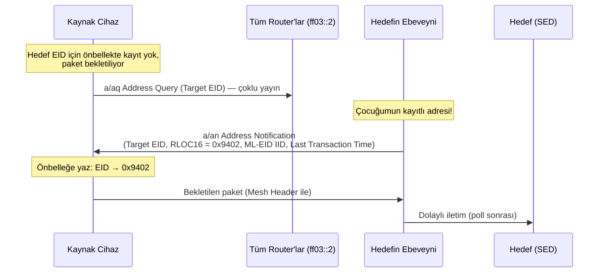

**Zamanlayıcılar (OpenThread varsayılanları):**

| Parametre | Değer | Anlamı |
|---|---|---|
| Address Query zaman aşımı | 3 s | Cevap beklenen süre |
| İlk yeniden deneme gecikmesi | 15 s | Cevapsız sorgudan sonra aynı EID için bekleme |
| En büyük yeniden deneme gecikmesi | 8 saat | Gecikme her başarısızlıkta katlanarak artar |

**Diğer önbellek doldurma yolları:**

- **Snoop (dinleme)**: Router'lar, ilettikleri paketlerin Mesh Header'ındaki kaynak RLOC16 ile IPv6 kaynak adresini eşleştirip önbelleğe ekleyebilir (cevap trafiği için sorgu gerekmez).
- **Mesh-local RLOC adresleri** sorgu gerektirmez; RLOC16 doğrudan adresin içindedir.

### 6.10 Çakışma Tespiti: Address Error

İki farklı cihaz aynı EID'yi kullanıyorsa Address Query'ye **farklı ML-EID IID**'leriyle iki Address Notification gelir. Bu durumda sorgulayan, ilgili cihazlara **Address Error** (`a/ae`) gönderir; Target EID ve ML-EID IID'si eşleşen cihaz o adresi bırakır. Ebeveynler de çocukları adına benzer kontroller yapar.

### 6.11 Hangi Adres Ne İçin Kullanılmalı?

| Senaryo | Önerilen adres | Neden |
|---|---|---|
| Thread ağı içindeki iki uygulama | ML-EID (veya OMR) | Topolojiden bağımsız, sabit |
| Ağ dışından (Wi-Fi'daki telefon) erişim | OMR / GUA | Border Router üzerinden yönlendirilebilir |
| Matter iletişimi | OMR (DNS-SD/SRP ile ilan edilen) | Hem mesh içi hem dışı erişilebilir |
| Thread yönetim mesajları (TMF) | RLOC / ALOC | Topolojiye göre doğrudan yönlendirilebilir |
| MLE | Link-local | Tek atlama, ağ adresleri olmadan da çalışır |
| Uygulama bildirimi tüm cihazlara | `ff33:40:<önek>::1` veya uygulamaya özgü grup | SED'ler dahil herkese |

### 6.12 Örnek: Bir Router'ın Adres Listesi

```text
> ipaddr -v
fdde:ad00:beef:0:0:ff:fe00:fc00 origin:thread    (ALOC — bu cihaz Leader)
fdde:ad00:beef:0:0:ff:fe00:5c00 origin:thread    (RLOC — Router 23)
fd4f:2d3c:ee9b:1:a7b9:56f2:e01:93c1 origin:slaac (OMR adresi)
fdde:ad00:beef:0:6c1f:c63a:9a2e:3b07 origin:thread (ML-EID)
fe80:0:0:0:182b:3c4d:5e6f:7081 origin:thread     (Link-local)
Done

> ipmaddr
ff33:40:fdde:ad00:beef:0:0:1     (Realm-Local All Thread Nodes)
ff32:40:fdde:ad00:beef:0:0:1     (Link-Local All Thread Nodes)
ff02::2
ff03::2
ff03::fc
ff02::1
ff03::1
Done
```

### 6.13 Bölüm Özeti

- Thread kimlik (EID) ile konumu (RLOC) ayırır; uygulamalar EID, ağ katmanı RLOC kullanır.
- RLOC16 = Router ID (6 bit) + Child ID (9 bit); aynı zamanda MAC kısa adresidir.
- ALOC'lar (`0xFCxx`) Leader, commissioner, servis gibi rollere anycast erişim sağlar.
- Standart IPv6 ND yerine Network Data, Address Query/Notification ve Address Error kullanılır.
- SED'leri de kapsayan çoklu yayın için "All Thread Nodes" (`ff32:40:…::1`, `ff33:40:…::1`) adresleri vardır.

## 7. Cihaz Türleri ve Roller

### 7.1 İki Boyut: Cihaz Türü ve Rol

Thread'de bir cihazı tanımlarken iki ayrı boyut vardır:

- **Cihaz türü (device type)** — cihazın **yeteneği**; donanım/yazılım tasarımıyla belirlenir: FTD veya MTD.
- **Rol (role)** — cihazın **o anki işlevi**; ağın durumuna göre dinamik olarak değişir: Router, Leader, Child, Detached…

Örneğin bir akıllı priz (FTD) ağa ilk katıldığında **Child** (REED) rolündedir; ağa router gerekirse **Router** olur; Leader kaybolursa **Leader** olabilir.

### 7.2 Full Thread Device (FTD)

FTD'nin radyosu **her zaman açıktır** (rx-on-when-idle), router tablosu tutabilir, `ff03::2`/`ff02::2` adreslerine abonedir ve EID→RLOC önbelleği tutar.

| FTD türü | Açıklama |
|---|---|
| **Router** | Paketleri yönlendirir, çocuk cihazlara ebeveynlik yapar, MLE Advertisement gönderir, commissioning'de Joiner Router olabilir. |
| **REED** (Router Eligible End Device) | Router olabilecek ama şu anda **çocuk** rolünde olan FTD. Ağa router gerektiğinde (router sayısı azsa ya da yakınındaki bir cihaz ebeveyn arıyorsa) router'a terfi eder. |
| **FED** (Full End Device) | Router olmayacak şekilde yapılandırılmış FTD. Tam ağ verisini tutar, çoklu yayınları alır ama yönlendirme yapmaz. |

### 7.3 Minimal Thread Device (MTD)

MTD tüm trafiğini **ebeveyni üzerinden** gönderir ve alır; yönlendirme yapmaz, router olamaz.

| MTD türü | Radyo | Ebeveynden veri alma | Tipik cihaz |
|---|---|---|---|
| **MED** (Minimal End Device) | Her zaman açık | Doğrudan (anında) | Şebekeden beslenen ama router olması istenmeyen cihazlar |
| **SED** (Sleepy End Device) | Çoğu zaman kapalı | Dolaylı: periyodik **poll** ile | Pilli sensörler, kapı/pencere sensörleri, uzaktan kumandalar |
| **SSED** (Synchronized SED, Thread 1.2+) | Çoğu zaman kapalı; belirli aralıklarla kısa süre dinler | **CSL**: ebeveyn, SED'in dinleme anına denk gelecek şekilde gönderir | Düşük gecikme gereken pilli cihazlar (kilit, perde, termostat) |

### 7.4 Mode TLV: Cihazın Kendini Tanıtması

Cihaz, ebeveynine MLE mesajlarında **Mode TLV** ile kendini tanıtır:

```text
 bit:  7  6  5  4 |  3  |  2  |  1  |  0
       ayrılmış   |  R  | ayr.|  D  |  N
```

| Bit | Maske | Ad | Anlamı |
|---|---|---|---|
| R | `0x08` | Receiver On When Idle | Radyo boştayken açık (MED/FTD). 0 ise uyuyan cihaz. |
| (S) | `0x04` | (eski: Secure Data Requests) | Thread 1.0'dan kalma; artık kullanılmaz |
| D | `0x02` | Full Thread Device | 1 = FTD |
| N | `0x01` | Full Network Data | 1 = tam ağ verisini ister; 0 = yalnızca "stable" (kalıcı) alt kümeyi |

| Cihaz | Mode | OpenThread gösterimi |
|---|---|---|
| Router / REED / FED | `0x0B` (R+D+N) | `rdn` |
| MED | `0x09` (R+N) veya `0x08` | `rn` / `r` |
| SED | `0x00` veya `0x01` | `-` / `n` |

### 7.5 Roller ve Durum Makinesi

| Rol | Anlamı |
|---|---|
| **Disabled** | Thread yığını durdurulmuş |
| **Detached** | Yığın çalışıyor ama hiçbir partition'a bağlı değil; ebeveyn veya partition arıyor |
| **Child** | Bir ebeveyne bağlı uç cihaz (REED, FED, MED, SED, SSED) |
| **Router** | Aktif router (Router ID'si var) |
| **Leader** | Partition'ın lideri olan router |

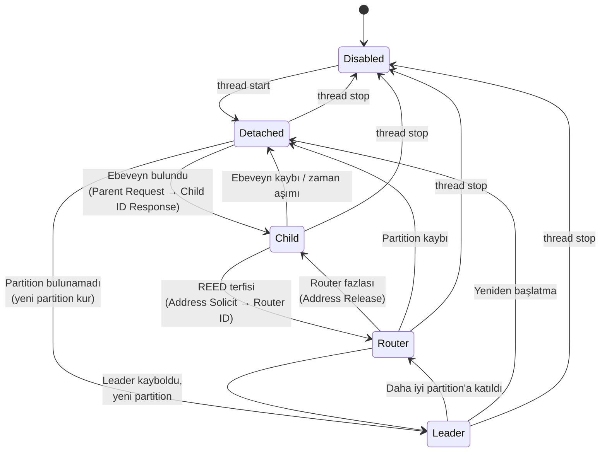

### 7.6 Rol Geçiş Kuralları

**REED → Router (terfi / upgrade):**

- Ağdaki aktif router sayısı **`ROUTER_UPGRADE_THRESHOLD` = 16**'nın altındaysa REED, 0 ile **`ROUTER_SELECTION_JITTER` = 120 s** arasında rastgele bir süre bekleyip Leader'a **Address Solicit** gönderir.
- Bir cihaz REED'i ebeveyn olarak seçip ona **Child ID Request** gönderirse, REED hemen terfi etmeye çalışır (çocuğu kabul edebilmek için router olmalıdır).
- Rastgele bekleme, aynı anda çok sayıda REED'in router olmasını engeller.

**Router → REED (düşürme / downgrade):**

- Router sayısı **`ROUTER_DOWNGRADE_THRESHOLD` = 23**'ün üzerindeyse,
- router'ın **hiç çocuğu yoksa**,
- ve yeterli sayıda (OpenThread'de 7+) iyi kaliteli router komşusu varsa (yani ağ bu router'a ihtiyaç duymuyorsa),
- router rastgele bir beklemenin ardından **Address Release** ile Router ID'sini bırakıp REED olur.

Bu iki eşik arasındaki boşluk (16–23) **histerezis** sağlar; router sayısı sürekli salınmaz.

**Mutlak sınır:** Bir partition'da en fazla **32 aktif router** olabilir (`MAX_ROUTERS`). Leader, 32 router varken yeni Address Solicit isteklerini reddeder.

### 7.7 Leader

Leader, partition'daki router'lardan biridir ve şu ek görevleri üstlenir:

- **Router ID yönetimi**: Router ID atama (Address Solicit) ve geri alma (Address Release); ID Sequence'ı artırma.
- **Network Data yönetimi**: Border Router'ların ve servislerin kayıtlarını toplama, birleştirme, sürüm numaralarını artırma ve dağıtma.
- **6LoWPAN bağlam (context) ID'lerini** atama.
- **Commissioner oturumu yetkilendirme**: Aynı anda yalnızca bir aktif commissioner'a izin verme.
- **Partition kimliği**: Partition ID ve ağırlık (weighting) değerlerinin sahibi olma.
- **Operational Dataset** değişikliklerini (Active/Pending Set) kabul etme ve dağıtma.

Leader tek hata noktası değildir: Leader kaybolursa diğer router'lar bunu fark eder ve içlerinden biri yeni Leader olur (Bölüm 11).

### 7.8 Diğer İşlevsel Roller

Aşağıdaki roller ağ rollerinin **üzerine eklenen** işlevlerdir; bir router aynı anda birkaçını üstlenebilir:

| İşlev | Açıklama | Genelde kimde? |
|---|---|---|
| **Border Router** | Thread ağını Wi-Fi/Ethernet gibi diğer IP ağlarına bağlar; önek ve rota ilan eder | Hub, akıllı hoparlör, TV kutusu, Wi-Fi router |
| **Border Agent** | Harici commissioner'ın (ör. telefon uygulaması) Thread ağına güvenli erişimini sağlar | Border Router |
| **Commissioner** | Yeni cihazların ağa katılmasını yetkilendirir; ağda aynı anda bir tane aktif olabilir | Telefon uygulaması, hub |
| **Joiner** | Ağa katılmaya çalışan yeni cihaz | Yeni cihaz |
| **Joiner Router** | Joiner'a komşu olan ve onun DTLS trafiğini commissioner'a aktaran router | Herhangi bir router |
| **Backbone Router (BBR)** | Thread 1.2+: Thread ağını omurga (backbone) bağlantısına çoklu yayın ve DUA açısından bağlar; Primary/Secondary | Border Router |
| **SRP Server** | Thread cihazlarının DNS-SD servis kaydı yaptığı sunucu | Border Router |
| **DHCPv6 Agent / ND Agent** | İlgili önekler için adres dağıtımı / komşu keşfi vekilliği | Border Router (nadir) |

### 7.9 Karşılaştırma Tablosu

| Özellik | Router | REED | FED | MED | SED | SSED |
|---|---|---|---|---|---|---|
| Cihaz türü | FTD | FTD | FTD | MTD | MTD | MTD |
| Radyo boştayken | Açık | Açık | Açık | Açık | Kapalı | Kapalı (periyodik kısa dinleme) |
| Paket yönlendirme | Evet | Hayır | Hayır | Hayır | Hayır | Hayır |
| Çocuk kabul etme | Evet | Hayır (önce terfi) | Hayır | Hayır | Hayır | Hayır |
| Router olabilir | — | Evet | Hayır | Hayır | Hayır | Hayır |
| Ebeveyni var | Hayır | Evet | Evet | Evet | Evet | Evet |
| Ağ verisi | Tam | Tam | Tam | Tam / stable | Genelde stable | Genelde stable |
| Adres kaydı ebeveyne | — | Hayır | Hayır | Evet | Evet | Evet |
| Gecikme (aşağı yön) | Anında | Anında | Anında | Anında | Poll periyoduna bağlı | CSL periyoduna bağlı |
| Güç tüketimi | Yüksek (mA) | Yüksek | Yüksek | Yüksek | Çok düşük (µA) | Çok düşük (µA) |
| Tipik güç kaynağı | Şebeke | Şebeke | Şebeke | Şebeke | Pil | Pil |

### 7.10 Ürünlerde Tipik Rol Eşlemesi

| Ürün | Tipik Thread rolü |
|---|---|
| Akıllı priz, duvar anahtarı, ampul | Router / REED |
| Hoparlör, TV kutusu, hub, Wi-Fi router | Border Router + Router (sıklıkla Leader) |
| Kapı/pencere sensörü, hareket sensörü, su kaçağı sensörü | SED |
| Sıcaklık/nem sensörü | SED |
| Akıllı kilit | SED veya SSED (hızlı tepki için) |
| Pilli perde/jaluzi motoru | SED / SSED |
| Pilli termostat | SED / SSED (şebekeden besleniyorsa Router) |
| Duvara takılı uzaktan kumanda / düğme | SED |

> [!TIP]
> Pilli bir cihazı asla router/REED olarak yapılandırmayın: radyosu sürekli açık kalır ve pil günler içinde biter. Tersine, şebekeden beslenen cihazların REED/router olması ağın kapsama ve dayanıklılığını artırır.

### 7.11 Bölüm Özeti

- Cihaz türü (FTD/MTD) yeteneği, rol (Router/Leader/Child…) anlık işlevi belirtir.
- FTD'ler: Router, REED, FED; MTD'ler: MED, SED, SSED.
- REED'ler router sayısı 16'nın altına düşünce terfi eder; 23'ün üstündeyken gereksiz router'lar REED'e döner; üst sınır 32 router.
- Leader, router ID'leri ve ağ verisini yöneten ama yerine başkası geçebilen bir router'dır.
- Border Router, Border Agent, Commissioner, BBR, SRP Server gibi işlevler ağ rollerinin üzerine eklenir.

## 8. Ağ Topolojisi ve Ölçek

### 8.1 İki Katmanlı Yapı

Thread topolojisi iki katmandan oluşur:

1. **Router omurgası (mesh)**: Router'lar birbirleriyle tam bir mesh oluşturur. Her router, mesafe-vektör yönlendirmesi sayesinde diğer **her router'a** giden en iyi yolu bilir.
2. **Uç cihaz yıldızları (star)**: Her router çevresindeki çocuk cihazların (REED, FED, MED, SED, SSED) ebeveynidir. Çocuklar yalnızca ebeveynleriyle konuşur.

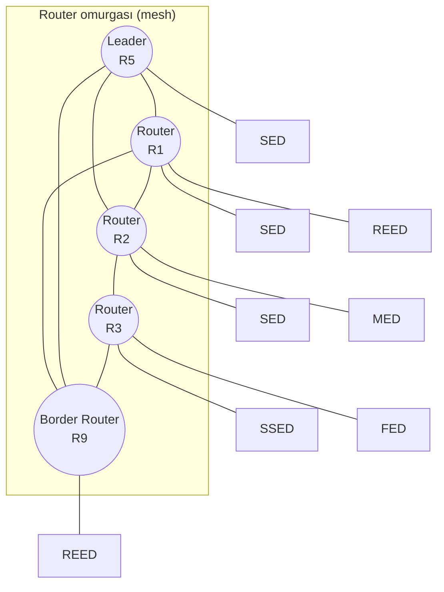

Bu yapının avantajları:

- **Yönlendirme tabloları küçüktür**: Router'lar yalnızca en fazla 32 router için rota tutar; çocuklar RLOC16'nın içinde ebeveynin Router ID'siyle adreslenir.
- **Uç cihazlar basittir**: Yönlendirme yapmaz, yalnızca ebeveynlerini bilirler; bu da düşük güç ve az bellek demektir.
- **Kendi kendini onarma**: Router kaybolursa diğer router'lar rotaları yeniden hesaplar; o router'ın çocukları başka bir ebeveyne bağlanır.

### 8.2 Ölçek Sınırları

| Sınır | Değer | Kaynağı |
|---|---|---|
| Atanabilir Router ID'leri | 0–62 (63 adet) | RLOC16'nın 6 bitlik Router ID alanı (63 geçersiz) |
| Aynı anda aktif router | **32** | `MAX_ROUTERS`; Route64 TLV ve yönlendirme yükü |
| Router başına çocuk (adres alanı) | 511 | 9 bitlik Child ID |
| Router başına çocuk (pratik) | Onlarca (uygulamaya ve RAM'e bağlı; OpenThread'de derleme zamanı ayarı) | Tampon ve tablo bellek ihtiyacı |
| Toplam cihaz (pratik) | **250–300+** | Thread Group'un sıkça verdiği hedef değer |

> [!NOTE]
> 32 router × (örneğin) 10–20 çocuk ile yüzlerce cihaz mümkündür. Daha büyük kurulumlar (ör. bina otomasyonu) için birden fazla Thread ağı kullanılır ve bunlar Thread 1.2'nin **Thread Domain / Backbone Router** veya Thread 1.3'ün **TREL** özellikleriyle IP omurgası üzerinden birleştirilir.

### 8.3 Ağ Kimlik Parametreleri

Bir Thread ağı şu parametrelerle tanımlanır (hepsi **Operational Dataset**'in parçası, Bölüm 17):

| Parametre | Boyut | Açıklama |
|---|---|---|
| **Network Name** | ≤ 16 bayt (UTF-8) | İnsan tarafından okunabilir ad, ör. "MyHome" |
| **Extended PAN ID** | 8 bayt | Ağın küresel olarak benzersiz kimliği (ağı ayırt etmenin asıl yolu) |
| **PAN ID** | 2 bayt | MAC seviyesindeki kimlik |
| **Channel** | 11–26 | Çalışılan kanal |
| **Mesh-Local Prefix** | /64 | Mesh-local adreslerin öneki (ULA) |
| **Network Key** | 16 bayt | Ağ anahtarı (tüm güvenlik bundan türetilir) |
| **PSKc** | 16 bayt | Commissioner kimlik doğrulama anahtarı |
| **Security Policy** | 3–4 bayt | Anahtar rotasyon süresi ve izin bayrakları |
| **Active Timestamp** | 8 bayt | Dataset'in sürümü |

### 8.4 Ağın Kurulması

İlk cihaz (genellikle bir Border Router) ağı şöyle kurar:

1. Yeni bir Operational Dataset oluşturur (rastgele Network Key, Extended PAN ID, PAN ID, mesh-local önek; enerji taramasıyla seçilmiş kanal).
2. Thread'i başlatır; cihaz **Detached** durumundadır.
3. **Parent Request** gönderir; kimse cevap vermez (ağda başka cihaz yok).
4. Bağlanma denemeleri tükenince cihaz **yeni bir partition kurar** ve **Leader** olur:
    - Rastgele bir **Partition ID** seçer.
    - Kendine bir **Router ID** atar.
    - Network Data'yı başlatır (Border Router ise öneklerini ve servislerini ekler).
    - MLE **Advertisement** göndermeye başlar.
5. Sonra gelen cihazlar bu ağa çocuk olarak bağlanır, gerektiğinde router'a terfi eder.

### 8.5 Partition (Bölüm/Ada) Kavramı

Bir **partition**, radyo bağlantısıyla birbirine ulaşabilen ve aynı Leader'ı paylaşan Thread cihazları kümesidir. Normalde bir Thread ağı tek partition'dır. Ancak:

- Ağın iki bölgesi arasındaki bağlantı koparsa (ör. aradaki router'lar kapanırsa), kopan taraf kendi Leader'ını seçer ve **ikinci bir partition** oluşur. İki partition aynı Network Key, kanal ve PAN ID'yi kullanır ama birbirinden habersizdir.
- Bağlantı geri geldiğinde partition'lar Advertisement'lar aracılığıyla birbirini fark eder ve **birleşir** (merge): "daha iyi" partition kazanır, diğerinin cihazları ona katılır (Bölüm 11).

Partition'ı karakterize eden değerler **Leader Data TLV**'de taşınır: Partition ID, Weighting, Data Version, Stable Data Version, Leader Router ID.

### 8.6 Kendi Kendini Onarma

| Olay | Ağın tepkisi |
|---|---|
| Bir router kapanır | Komşuları ondan Advertisement alamaz; bağlantı kalitesi düşer ve en geç `MAX_NEIGHBOR_AGE` (100 s) sonra komşu silinir; rotalar alternatif yollardan yeniden hesaplanır. |
| O router'ın çocukları | MED'ler ACK alamayınca, SED'ler poll'larına cevap alamayınca veya *child supervision* zaman aşımıyla durumu fark eder ve yeni ebeveyn arar. |
| Router ID'si | Leader, router'dan uzun süre haber alamazsa ID'yi serbest bırakır; ID bir süre (`ID_REUSE_DELAY` = 100 s) yeniden kullanılmaz. |
| Leader kapanır | Router'lar Leader'a rotayı kaybeder; `NETWORK_ID_TIMEOUT` (120 s) sonra bir router yeni Leader olur, diğerleri ona bağlanır. |
| Border Router kapanır | Leader, BR'nin Network Data girdilerini kaldırır; diğer BR'ler (varsa) devralır. |
| Kanal çok gürültülü | Commissioner/BR kanal yöneticisi Pending Dataset ile ağı yeni kanala taşıyabilir. |

### 8.7 Birden Fazla Thread Ağı

Aynı ortamda birden fazla bağımsız Thread ağı bulunabilir: farklı Extended PAN ID ve Network Key ile, aynı veya farklı kanallarda. Örnek: bir evde Apple, Google ve Amazon Border Router'ları **kimlik bilgilerini paylaşmazsa** her biri kendi Thread ağını kurar.

Bu durumun sonuçları:

- Cihazlar ağlar arasında bölünür; her ağın mesh'i daha seyrek olur (daha az router, daha zayıf kapsama).
- Bir ağın cihazları diğer ağın router'larını kullanamaz.
- Aynı kanaldaysalar birbirlerinin yayınlarıyla kanalı paylaşırlar (ek girişim).

Çözüm: Ekosistemlerin aynı Thread ağını paylaşması. Bunun için işletim sistemlerinin kimlik bilgisi paylaşım API'leri ve Thread 1.4'ün **ePSKc** mekanizması geliştirilmiştir (Bölüm 16 ve 19).

### 8.8 Ölçekleme Değerlendirmeleri

- **Advertisement boyutu**: Route64 TLV, her aktif router için 1 bayt + 9 bayt sabit içerir. 32 router'da Advertisement yaklaşık 60–70 bayttır ve tek çerçeveye sığar.
- **Router sayısı ve kontrol trafiği**: Daha çok router daha çok Advertisement ve daha çok çoklu yayın tekrarı demektir. 16–23 eşikleri bu dengeyi kurar.
- **Çocuk tabloları ve tamponlar**: Ebeveynin her SED için paket tutması gerekir; çok sayıda SED'i olan router'ın RAM'i yeterli olmalıdır.
- **Atlama sayısı**: Her atlama gecikme ekler ve aynı kanal paylaşıldığı için verimi düşürür. İyi bir tasarımda cihazların büyük çoğunluğu Border Router'a 2–4 atlama uzaklıktadır.
- **Network Data boyutu**: En fazla 254 bayt; çok sayıda önek/servis ilanı bu sınıra takılabilir.

### 8.9 Bölüm Özeti

- Thread: router'lardan oluşan bir mesh + router'ların etrafında uç cihaz yıldızları.
- Partition başına en fazla 32 aktif router; pratikte 250+ cihaz.
- Ağ kimliği Extended PAN ID, Network Name, PAN ID, kanal ve Network Key ile tanımlanır.
- Kopan bölgeler ayrı partition'lar oluşturur; bağlantı gelince birleşirler.
- Bir evde birden çok bağımsız Thread ağı oluşması verimsizdir; kimlik paylaşımıyla tek ağ hedeflenmelidir.

## 9. MLE — Mesh Link Establishment

### 9.1 MLE Nedir, Ne İşe Yarar?

**MLE (Mesh Link Establishment)**, Thread'in tek atlamalı (link seviyesindeki) kontrol protokolüdür. 802.15.4 MAC'in "association" mekanizmasının yerini alır ve çok daha fazlasını yapar:

| Görev | İlgili MLE mesajları |
|---|---|
| Ağa bağlanma (attach) ve ebeveyn seçimi | Parent Request, Parent Response, Child ID Request, Child ID Response |
| Router'lar arası bağlantı kurma | Link Request, Link Accept, Link Accept And Request, Link Reject |
| Yönlendirme bilgisinin yayılması | Advertisement (Route64 TLV) |
| Çocuk bakımı ve canlı tutma | Child Update Request / Response |
| Ağ verisi ve dataset dağıtımı | Data Request, Data Response |
| Ağ keşfi | Discovery Request, Discovery Response |
| Kanal/PAN değişikliği duyurusu | Announce |
| Bağlantı kalitesi ölçümü (1.2+) | Link Metrics Management Request/Response, Link Probe |
| Güvenlik senkronizasyonu | Frame counter TLV'leri, Challenge/Response |

**Neden MAC association veya standart IPv6 ND değil?**

- MLE kendi güvenliğine sahiptir; MAC frame counter'ı henüz bilinmeyen bir komşuyla bile güvenli konuşabilir.
- Her iki yöndeki bağlantı kalitesini (çift yönlü link quality) ölçüp paylaşabilir.
- Frame counter, ağ verisi, dataset, ağ sürümü gibi Thread'e özgü bilgileri TLV'lerle esnekçe taşır.
- IPv6/UDP üzerinde çalıştığı için IP tabanlı mimariyle tutarlıdır.

### 9.2 Taşıma

| Özellik | Değer |
|---|---|
| Protokol | UDP |
| Port | **19788** (kaynak ve hedef) |
| Adresler | **Link-local** tekil (`fe80::…`) veya çoklu yayın (`ff02::1`, `ff02::2`) |
| Hop Limit | 255 (yalnızca tek atlamalık mesajların kabul edilmesi için; gelen MLE paketinin hop limit'i 255 değilse reddedilir) |
| MAC güvenliği | **Yok** — güvenlik MLE katmanında uygulanır (MAC çerçevesi güvenliksiz gönderilir) |
| MLE güvenliği | AES-128-CCM, 4 baytlık MIC, MLE Key ile |

### 9.3 Mesaj Formatı

```text
+----------+------------------------------------+---------+-----------------+------+
| Security | Auxiliary Security Header          | Command | TLV'ler         | MIC  |
| Suite    | (802.15.4 biçiminde)               | Type    |                 |      |
| 1 bayt   | SecCtl(1) FC(4) KeySrc(4) KeyIdx(1)| 1 bayt  | değişken        | 4    |
+----------+------------------------------------+---------+-----------------+------+
           |<------ yalnızca suite = 0 ------->|<---- şifreli (suite = 0) ---->|
```

| Alan | Açıklama |
|---|---|
| **Security Suite** | `0` = 802.15.4 tarzı güvenlik kullanılıyor · `255` = güvenlik yok (yalnızca Discovery Request/Response) |
| **Security Control** | Tipik değer `0x15`: güvenlik seviyesi 5 (ENC-MIC-32) + **Key ID Mode 2** |
| **Frame Counter** | Gönderenin **MLE** frame counter'ı (MAC sayacından ayrıdır) |
| **Key Source** | Mevcut **Key Sequence** değeri (4 bayt) — alıcı hangi anahtarın kullanıldığını kesin bilir |
| **Key Index** | `(Key Sequence mod 128) + 1` |
| **Command Type** | Mesaj türü (aşağıdaki tablo) |
| **TLV'ler** | Type (1) + Length (1) + Value |
| **MIC** | 4 baytlık bütünlük kodu |

**Şifreleme ayrıntıları:**

- Anahtar: **MLE Key** (Network Key ve Key Sequence'ten türetilir; Bölüm 15).
- Nonce: Gönderenin Extended Address'i (link-local IPv6 kaynak adresinin IID'sinden U/L biti geri çevrilerek elde edilir) + Frame Counter + güvenlik seviyesi.
- Ek doğrulanan veri (AAD): IPv6 **kaynak ve hedef adresleri** + Auxiliary Security Header. Böylece mesaj başka bir adrese yönlendirilip yeniden oynatılamaz.
- Şifrelenen kısım: Command Type + TLV'ler.

Key ID Mode 2'nin (anahtar dizisinin tamamını taşıyan) kullanılması, bir cihazın uzun süre uyuduktan veya ağdan ayrı kaldıktan sonra bile ağın güncel anahtar dizisini öğrenebilmesini sağlar.

### 9.4 Komut Türleri

| Değer | Komut | Yön / adres | Amaç |
|---|---|---|---|
| 0 | **Link Request** | Router → router(lar) | Bağlantı kurma isteği |
| 1 | **Link Accept** | Tekil | İsteği kabul (ve frame counter bilgisi) |
| 2 | **Link Accept And Request** | Tekil | Kabul + karşı tarafa istek |
| 3 | **Link Reject** | Tekil | Reddetme |
| 4 | **Advertisement** | `ff02::1` | Router/Leader varlığı, Route64 |
| 5 | (Update — kullanılmıyor) | — | — |
| 6 | (Update Request — kullanılmıyor) | — | — |
| 7 | **Data Request** | Tekil | Ağ verisi / dataset isteği |
| 8 | **Data Response** | Tekil veya `ff02::1` | Ağ verisi / dataset yanıtı veya duyurusu |
| 9 | **Parent Request** | `ff02::2` | Ebeveyn arama |
| 10 | **Parent Response** | Tekil | Ebeveyn adayı olma teklifi |
| 11 | **Child ID Request** | Tekil | Seçilen ebeveyne bağlanma isteği |
| 12 | **Child ID Response** | Tekil | Bağlanma onayı, RLOC16 ataması |
| 13 | **Child Update Request** | Tekil | Çocuk bilgilerini güncelleme / canlı tutma |
| 14 | **Child Update Response** | Tekil | Yanıt |
| 15 | **Announce** | Yayın (başka kanal) | Ağın kanal/PAN bilgisini duyurma |
| 16 | **Discovery Request** | `ff02::2` (güvenliksiz) | Ağ keşfi |
| 17 | **Discovery Response** | Tekil (güvenliksiz) | Ağ bilgisi |
| 18 | **Link Metrics Management Request** | Tekil | (1.2) Ölçüm serisi yapılandırma |
| 19 | **Link Metrics Management Response** | Tekil | (1.2) Yanıt |
| 20 | **Link Probe** | Tekil | (1.2) Ölçüm için sonda mesajı |

### 9.5 MLE TLV'leri

| Tür | TLV | Uzunluk | İçerik / kullanım |
|---|---|---|---|
| 0 | **Source Address** | 2 | Gönderenin RLOC16'sı |
| 1 | **Mode** | 1 | R/D/N bitleri (Bölüm 7.4) |
| 2 | **Timeout** | 4 | Çocuğun zaman aşımı (s) |
| 3 | **Challenge** | 4–8 | Rastgele sayı (tazelik kanıtı istemi) |
| 4 | **Response** | 4–8 | Alınan Challenge'ın aynen geri gönderilmesi |
| 5 | **Link-layer Frame Counter** | 4 | Gönderenin MAC frame counter'ı |
| 6 | (Link Quality) | — | Kullanımdan kalktı |
| 7 | (Network Parameter) | — | Kullanımdan kalktı |
| 8 | **MLE Frame Counter** | 4 | Gönderenin MLE frame counter'ı |
| 9 | **Route64** | değişken | ID Sequence, Router Mask, router başına link kalitesi ve rota maliyeti |
| 10 | **Address16** | 2 | Ebeveynin çocuğa atadığı RLOC16 |
| 11 | **Leader Data** | 8 | Partition ID, Weighting, Data Version, Stable Data Version, Leader Router ID |
| 12 | **Network Data** | değişken | Thread Network Data (Bölüm 12) |
| 13 | **TLV Request** | değişken | Karşı taraftan istenen TLV türlerinin listesi |
| 14 | **Scan Mask** | 1 | Parent Request'e kimlerin cevap vereceği (R: router'lar, E: REED'ler) |
| 15 | **Connectivity** | 7–10 | Ebeveyn adayının bağlantı durumu (Parent Priority, LQ sayıları, Leader maliyeti…) |
| 16 | **Link Margin** | 1 | Alınan mesajın link margin değeri (dB) |
| 17 | **Status** | 1 | Hata/durum kodu |
| 18 | **Version** | 2 | Thread sürümü (2=1.1, 3=1.2, 4=1.3, 5=1.4) |
| 19 | **Address Registration** | değişken | Çocuğun IPv6 adres listesi |
| 20 | **Channel** | 3 | Kanal sayfası + kanal (Announce) |
| 21 | **PAN ID** | 2 | PAN ID (Announce) |
| 22 | **Active Timestamp** | 8 | Active Operational Dataset zaman damgası |
| 23 | **Pending Timestamp** | 8 | Pending Dataset zaman damgası |
| 24 | **Active Operational Dataset** | değişken | Dataset TLV'leri |
| 25 | **Pending Operational Dataset** | değişken | Dataset TLV'leri (+ Delay Timer) |
| 26 | **Thread Discovery** | değişken | MeshCoP Discovery Request/Response alt-TLV'leri |
| 27 | **Supervision Interval** | 2 | Çocuk denetim aralığı (s) |
| 80 | **CSL Channel** | 3 | (1.2) CSL dinleme kanalı |
| 85 | **CSL Synchronized Timeout** | 4 | (1.2) CSL senkron zaman aşımı |
| 86 | **CSL Clock Accuracy** | 2 | (1.2) Saat doğruluğu (ppm) ve belirsizlik |
| 87 | **Link Metrics Query** | değişken | (1.2) Tek seferlik ölçüm sorgusu |
| 88 | **Link Metrics Management** | değişken | (1.2) Ölçüm serisi yapılandırma |
| 89 | **Link Metrics Report** | değişken | (1.2) Ölçüm raporu |
| 90 | **Link Probe** | değişken | (1.2) Sonda verisi |

### 9.6 Önemli TLV'lerin Ayrıntısı

#### Leader Data TLV (8 bayt)

```text
+---------------------+-----------+--------------+--------------------+------------------+
| Partition ID (4)    | Weighting | Data Version | Stable Data Version| Leader Router ID |
|                     |    (1)    |     (1)      |        (1)         |       (1)        |
+---------------------+-----------+--------------+--------------------+------------------+
```

Her Advertisement, Parent Response, Child ID Response ve Data Response bu TLV'yi taşır. Cihazlar bu sayede partition'ı, Leader'ı ve ağ verisinin güncel olup olmadığını hemen anlar.

#### Connectivity TLV

```text
+-------+-----------+-----------+-----------+-------------+--------+---------+--------------+-------------+
| Flags | LQ3 count | LQ2 count | LQ1 count | Leader Cost | ID Seq | Active  | SED Buffer   | SED Datagram|
|  (1)  |    (1)    |    (1)    |    (1)    |     (1)     |  (1)   | Routers | Size (2, ops)| Count (1,ops)|
+-------+-----------+-----------+-----------+-------------+--------+---------+--------------+-------------+
 Flags: bit 7-6 = Parent Priority (+1 yüksek, 0 orta, −1 düşük, −2 = ayrılmış)
```

Ebeveyn adayının ne kadar "iyi bağlı" olduğunu gösterir: kaç router komşusuyla LQ3/LQ2/LQ1 bağlantısı var, Leader'a maliyeti ne, aktif router sayısı kaç ve SED'ler için ne kadar tampon ayırabilir.

#### Route64 TLV

```text
+--------+--------------------------+------------------------------------------+
| ID Seq | Router ID Mask (8 bayt)  | Route Data (atanmış her Router ID için 1)|
|  (1)   | bit i = Router ID i      |  bit 7-6: LQ Out  bit 5-4: LQ In         |
|        | atanmış mı?              |  bit 3-0: Route Cost (0 = ulaşılamaz)    |
+--------+--------------------------+------------------------------------------+
```

Yönlendirmenin temelidir; ayrıntıları Bölüm 10'da.

#### Address Registration TLV

Her girdi ya sıkıştırılmış ya da tam adres içerir:

```text
Sıkıştırılmış :  [C=1 | Context ID (4 bit)] [IID (8 bayt)]       → 9 bayt
Tam            :  [C=0 | ayrılmış        ] [IPv6 adresi (16 bayt)] → 17 bayt
```

#### Scan Mask TLV

| Bit | Maske | Anlamı |
|---|---|---|
| R | `0x80` | Router'lar cevap versin |
| E | `0x40` | REED'ler (end device olarak çalışan FTD'ler) cevap versin |

### 9.7 Bağlanma (Attach) Süreci

Ağa ilk kez katılan ya da ebeveynini kaybetmiş bir cihaz (Operational Dataset'i biliyor olmalıdır) şu adımları izler:

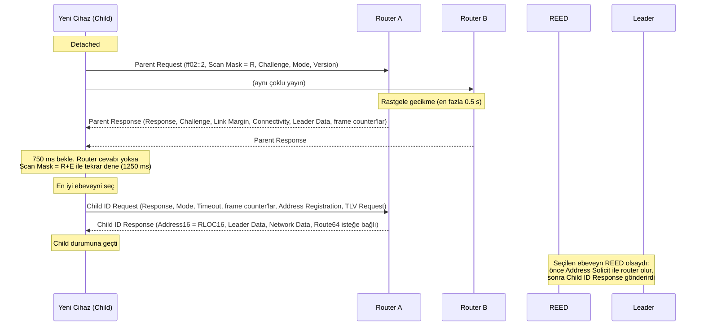

#### Adım 1 — Parent Request

- Hedef: `ff02::2` (link-local tüm router'lar).
- İlk denemede **Scan Mask = R**: yalnızca router'lar cevap verir. Cihaz `PARENT_REQUEST_ROUTER_TIMEOUT` (750 ms) bekler.
- Uygun router cevabı yoksa ikinci denemede **Scan Mask = R + E**: REED'ler de cevap verir; bekleme `PARENT_REQUEST_REED_TIMEOUT` (1250 ms).
- Mesaj içinde rastgele **Challenge** bulunur; cevaplar bu Challenge'ı **Response** TLV'sinde geri getirmek zorundadır (eski mesajların tekrar oynatılmasına karşı koruma).

#### Adım 2 — Parent Response

Ebeveyn adayları, çoklu yayın fırtınasını önlemek için rastgele bir gecikmeyle (router'lar için en fazla 500 ms, REED'ler dahil en fazla 1000 ms) cevap verir. Cevap şunları içerir:

- **Response** (gelen Challenge), yeni bir **Challenge** (çocuğun bir sonraki mesajında cevaplaması için),
- **Link-layer** ve **MLE Frame Counter**,
- Parent Request'in alındığı **Link Margin**,
- **Connectivity** ve **Leader Data**,
- **Version** (ve 1.2+'da CSL saat doğruluğu).

#### Adım 3 — Ebeveyn seçimi

Çocuk, gelen cevapları karşılaştırır. Tipik öncelik sırası (OpenThread'in uyguladığı mantığa yakın):

1. **İki yönlü bağlantı kalitesi** (çocuğun ölçtüğü RSS ile ebeveynin bildirdiği Link Margin'in kötüsü) — yüksek olan tercih edilir.
2. Router'lar REED'lere tercih edilir (REED'in terfi etmesi gerekmesin).
3. **Parent Priority** (Connectivity TLV) yüksek olan.
4. Ebeveynin **LQ3 komşu sayısı** fazla olan (iyi bağlı ebeveyn).
5. Thread sürümü, SED tampon kapasitesi, CSL doğruluğu gibi ikincil kriterler.

Partition seçimi de devrededir: Birden fazla partition'dan cevap gelirse genellikle "daha iyi" partition (Bölüm 11) tercih edilir.

#### Adım 4 — Child ID Request / Response

Child ID Request şunları taşır: **Response**, frame counter'lar, **Mode**, **Timeout**, **Version**, MTD ise **Address Registration**, istenen TLV'ler (**TLV Request**: Address16, Network Data, gerekirse Route64), bilinen **Active/Pending Timestamp**.

Ebeveyn kabul ederse **Child ID Response** ile:

- **Address16**: Çocuğa atanan RLOC16 (ebeveynin Router ID'si + yeni Child ID),
- **Leader Data**, **Network Data** (çocuk N=0 ise yalnızca stable kısım),
- İstenmişse **Route64**,
- Çocuğun dataset'i eskiyse **Active/Pending Operational Dataset**,
- (1.2+) **Supervision Interval**, CSL parametreleri.

Bu noktadan sonra çocuk RLOC16'sını kullanır, MAC güvenli çerçeveleriyle haberleşir ve **Child** rolündedir.

#### Yeniden bağlanma ve "daha iyi ebeveyn" araması

- **Ebeveyn kaybı**: Çocuk, ebeveyninden belirli sayıda ardışık ACK alamazsa veya child supervision zaman aşımı dolarsa yeniden bağlanma başlatır. İlk denemelerde aynı partition'a bağlanmaya çalışır.
- **Child Update ile geri dönüş**: Ebeveyn kısa süreli bir kesinti yaşadıysa çocuk önce Child Update Request ile mevcut ebeveynine geri dönmeyi dener; başarılı olursa tam attach gerekmez.
- **Parent Search**: FTD çocuklar periyodik olarak (OpenThread'de dakikalar mertebesinde) çevreyi dinleyip belirgin şekilde daha iyi bir ebeveyn varsa ona geçebilir.

### 9.8 Router'lar Arası Bağlantı Kurulumu

Bir cihaz router olduğunda (veya yeniden başladığında) komşu router'larla **çift yönlü, güvenli bağlantılar** kurmalıdır:

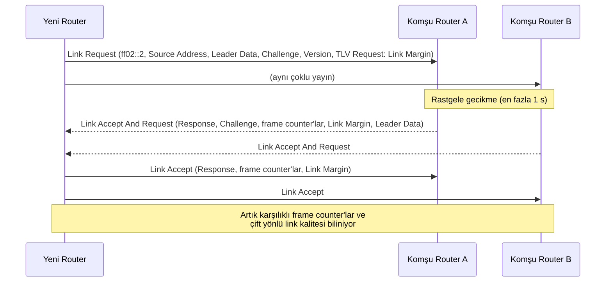

- **Challenge/Response** çifti, mesajın taze olduğunu ve karşı tarafın gerçekten ağ anahtarına sahip olduğunu kanıtlar.
- **Frame counter TLV'leri**, MAC katmanındaki tekrar korumasının başlangıç noktalarını belirler.
- **Link Margin TLV**, karşı tarafın bu cihazı ne kadar iyi duyduğunu bildirir (çift yönlü link kalitesi için).
- Bir router, Advertisement'ından haberdar olduğu ama bağlantısı olmayan bir router'a doğrudan tekil Link Request de gönderebilir.

### 9.9 Advertisement ve Trickle Zamanlayıcısı

Router'lar ve Leader, `ff02::1` adresine periyodik **Advertisement** gönderir. İçerik: **Source Address**, **Leader Data**, **Route64**.

Gönderim aralığı **Trickle** algoritmasıyla (RFC 6206) belirlenir:

| Parametre | Değer |
|---|---|
| `Imin` | 1 saniye |
| `Imax` | 32 saniye |

- Ağ kararlıyken aralık her seferinde ikiye katlanarak 32 saniyeye kadar uzar → kontrol trafiği azalır.
- Router kümesi değiştiğinde (yeni router, kaybolan router, ID Sequence değişimi) Trickle **sıfırlanır** ve aralık tekrar 1 saniyeye düşer → değişiklik hızla yayılır.

**REED'ler** de çok daha seyrek Advertisement gönderir (yaklaşık 570–630 saniyede bir; Route64 olmadan). Bu sayede router'lar çevredeki REED'lerden haberdar olur.

**Komşu yaşlanması**: Bir router, bir komşu router'dan `MAX_NEIGHBOR_AGE` (100 s) boyunca hiçbir şey duymazsa o komşuyu tablodan siler.

### 9.10 Child Update

**Child Update Request/Response** çifti çocuk-ebeveyn ilişkisini günceller:

| Kim gönderir? | Ne zaman? | İçerik |
|---|---|---|
| Çocuk | Mode değişince (ör. MED → SED), adres listesi değişince, Timeout değişince, canlı tutma (keep-alive) için, ebeveyn yeniden başladıysa | Mode, Address Registration, Timeout, Leader Data, (CSL TLV'leri) |
| Ebeveyn | Kendi yeniden başlatması sonrası çocuklarını doğrulamak, ağ verisi değişikliğini SED'e bildirmek | Source Address, Leader Data, Challenge |

**Zaman aşımı (child timeout)**: Çocuk, Timeout TLV ile bildirdiği süre içinde ebeveyniyle en az bir kez konuşmazsa ebeveyn onu çocuk tablosundan siler. SED'lerin MAC poll'ları da ebeveyn tarafından etkinlik olarak sayılır; bu yüzden düzenli poll eden bir SED'in ayrıca MLE keep-alive göndermesi gerekmez (Thread 1.2+'da "Enhanced Keep-Alive").

### 9.11 Data Request / Data Response ve Ağ Verisinin Yayılması

Network Data değiştiğinde yeni sürümün tüm ağa yayılması şöyle olur:

1. Leader ağ verisini günceller, **Data Version** (ve gerekiyorsa **Stable Data Version**) değerini artırır.
2. Leader, yeni ağ verisini içeren **Data Response**'u `ff02::1`'e çoklu yayınla gönderir.
3. Bunu duyan router'lar ağ verisini günceller ve kısa bir rastgele gecikmeden sonra **kendileri de** Data Response çoklu yayını yapar → veri dalga gibi tüm mesh'e yayılır.
4. Advertisement'lardaki Leader Data TLV'sinde daha yeni sürüm gören, ama Data Response'u kaçırmış bir router, **Data Request** ile komşusundan güncel veriyi ister.
5. Rx-on çocuklar (MED/FED) çoklu yayınları doğrudan alır; SED'ler ise ebeveynlerinden gelen Child Update mesajındaki Leader Data'da yeni sürümü görüp **Data Request** gönderir.

Aynı mekanizma **Active/Pending Operational Dataset** dağıtımında da kullanılır (Active/Pending Timestamp TLV'leri ile sürüm karşılaştırması).

### 9.12 Discovery Request / Discovery Response

Ağ keşfi için kullanılan, **güvenliksiz** (Security Suite = 255) mesajlardır; çünkü keşif yapan cihaz henüz ağ anahtarını bilmez.

- **Discovery Request**: Her kanalda `ff02::2`'ye (MAC'te `0xFFFF` yayın, PAN ID `0xFFFF`) gönderilir. Thread Discovery TLV içinde *Discovery Request* alt-TLV'si vardır: sürüm ve **Joiner (J)** bayrağı (yalnızca devreye almaya açık ağlar cevap versin).
- **Discovery Response**: Router'lar cevap verir. İçerik: *Discovery Response* alt-TLV'si (sürüm, **Native Commissioner (N)** bayrağı), **Extended PAN ID**, **Network Name**, varsa **Steering Data**, **Joiner UDP Port**, **Commissioner UDP Port**.
- Joiner, Steering Data içinde kendi Joiner ID'sinin olup olmadığını kontrol ederek hangi ağa katılmaya çalışacağına karar verir (Bölüm 16).

### 9.13 Announce

**Announce**, ağın şu anki kanalını ve PAN ID'sini **diğer kanallarda** duyurmak için kullanılır. İçerik: **Channel**, **Active Timestamp**, **PAN ID**.

Kullanım senaryoları:

- Ağ kanal değiştirdikten sonra değişikliği kaçıran (ör. uzun süre uyuyan veya kapalı olan) cihazlar eski kanalda kalır. Announce mesajları onları yeni kanala çağırır.
- Bir cihaz, daha yeni Active Timestamp'li bir Announce aldığında belirtilen kanala geçip bağlanmayı dener.
- Commissioner, **Announce Begin** (`c/ab`) yönetim komutuyla belirli cihazlara belirtilen kanal maskesinde Announce göndermelerini söyleyebilir.
- Announce, MLE anahtarıyla korunur; dolayısıyla yalnızca ağ anahtarını bilenler geçerli Announce üretebilir.

### 9.14 Örnek: Parent Request'in Çözümlenmesi

```text
--- IPv6/UDP (6LoWPAN ile sıkıştırılmış) ---
Kaynak  fe80::182b:3c4d:5e6f:7081  port 19788
Hedef   ff02::2                     port 19788,  Hop Limit 255

--- MLE ---
00                      Security Suite = 0 (güvenli)
15                      Security Control: seviye 5, Key ID Mode 2
2A 01 00 00             MLE Frame Counter = 298 (LE)
00 00 00 00             Key Source = Key Sequence 0
01                      Key Index = 1
=== buradan sonrası MLE Key ile şifreli ===
09                      Command = Parent Request
01 01 0B                Mode TLV: R + D + N (rdn)
03 08 9F 31 C4 7A 0E 55 D2 18   Challenge TLV (8 bayt rastgele)
0E 01 80                Scan Mask TLV: R (yalnızca router'lar)
12 02 00 04             Version TLV: 4 (Thread 1.3)
=== şifreli kısım sonu ===
xx xx xx xx             MIC (4 bayt)
```

### 9.15 MLE Zaman Sabitleri

| Sabit | Değer | Açıklama |
|---|---|---|
| `ADVERTISEMENT_I_MIN` | 1 s | Trickle en küçük aralık |
| `ADVERTISEMENT_I_MAX` | 32 s | Trickle en büyük aralık |
| `MAX_NEIGHBOR_AGE` | 100 s | Router komşusu yaşlanma süresi |
| `PARENT_REQUEST_ROUTER_TIMEOUT` | 750 ms | Yalnızca router'lara Parent Request sonrası bekleme |
| `PARENT_REQUEST_REED_TIMEOUT` | 1250 ms | Router + REED Parent Request sonrası bekleme |
| Parent Response gecikmesi | ≤ 500 ms (router) / ≤ 1000 ms (REED dahil) | Rastgele yanıt gecikmesi |
| Link Request yanıt gecikmesi | ≤ 1 s | Çoklu yayın Link Request'e rastgele yanıt |
| `ROUTER_SELECTION_JITTER` | 120 s | REED terfisi öncesi rastgele bekleme üst sınırı |
| REED Advertisement aralığı | ≈ 570–630 s | REED'lerin varlık ilanı |
| Varsayılan child timeout | 240 s (OpenThread) | Çocuğun ebeveyniyle konuşması gereken süre |

### 9.16 Bölüm Özeti

- MLE, UDP 19788 üzerinde link-local çalışan, kendi AES-CCM güvenliğine sahip Thread kontrol protokolüdür.
- Attach süreci: Parent Request → Parent Response → ebeveyn seçimi → Child ID Request → Child ID Response.
- Router'lar Link Request/Accept ile komşuluk kurar; Advertisement'lar Trickle ile 1–32 s aralıkla Route64 yayar.
- Challenge/Response ve frame counter TLV'leri tazelik ve tekrar koruması sağlar.
- Data Request/Response ağ verisini ve dataset'leri; Discovery ağ keşfini; Announce kanal değişikliklerini taşır.

## 10. Yönlendirme (Routing)

### 10.1 Genel Bakış

Thread yönlendirmesi üç temel ilkeye dayanır:

1. **Router'lar arası proaktif mesafe-vektör (distance-vector)**: Her router, ağdaki **her router'a** giden en düşük maliyetli yolu ve bu yolun **sonraki atlamasını** bilir. Bilgi MLE Advertisement'lardaki **Route64 TLV** ile yayılır.
2. **Uç cihazlar yönlendirme yapmaz**: Her şeyi ebeveynlerine gönderirler. Bir çocuğa giden paket, onun ebeveyn router'ına yönlendirilir (RLOC16'nın üst 6 biti).
3. **Bağlantı kalitesine dayalı maliyet**: Rota maliyeti atlama sayısı değil, **çift yönlü bağlantı kalitesine** göre hesaplanan link maliyetlerinin toplamıdır.

En fazla 32 router olduğundan tablolar küçüktür ve tüm ağın rotaları birkaç Advertisement turunda yakınsar.

### 10.2 Link Margin → Link Quality → Link Cost

Her router, komşusundan aldığı çerçevelerin RSS değerlerinin ortalamasını tutar ve **link margin** (RSS − gürültü tabanı) hesaplar:

| Link Margin (histerezisli) | Link Quality (LQ) | Link Cost |
|---|---|---|
| > 20 dB | **3** | **1** |
| > 10 dB | **2** | **2** |
| > 2 dB | **1** | **4** |
| ≤ 2 dB | **0** | **∞** (kullanılmaz) |

**Çift yönlü kalite:** Radyo bağlantıları asimetrik olabilir (A, B'yi iyi duyar ama B, A'yı zayıf duyar). Bu yüzden Thread iki değeri birlikte kullanır:

- **LQ In**: Bu router'ın komşudan gelen çerçeveler için ölçtüğü kalite.
- **LQ Out**: Komşunun bu router'dan gelen çerçeveler için ölçtüğü ve Route64 TLV'sinde bildirdiği kalite.
- **Link cost** = `cost( min(LQ In, LQ Out) )`.

### 10.3 Route64 TLV Ayrıntısı

```text
+--------+-------------------------------+-------------------------------------------+
| ID Seq | Router ID Mask (64 bit)       | Route Data (Mask'te 1 olan her ID için)    |
| 1 bayt | bit 0 (ilk baytın MSB'si)=ID 0| 1 bayt: [LQ Out:2][LQ In:2][Route Cost:4] |
+--------+-------------------------------+-------------------------------------------+
```

- **ID Sequence**: Leader'ın router ID kümesindeki her değişiklikte artırdığı sıra numarası. Daha büyük ID Sequence içeren Route64, daha güncel router kümesini temsil eder.
- **Router ID Mask**: Hangi Router ID'lerin şu anda atanmış olduğu.
- **Route Data**: Mask'te atanmış görünen her router için, gönderenin o router'a ilişkin bilgisi:
    - Komşuysa **LQ Out** ve **LQ In** (komşu değilse 0),
    - Gönderenin o router'a olan **rota maliyeti** (4 bit; 0 = ulaşılamaz/sonsuz).

**Örnek** — Router 1, Router 2, 3 ve 4'ün atanmış olduğu bir ağda Router 1'in Advertisement'ı:

```text
09 0D                       Route64 TLV, uzunluk 13
07                          ID Sequence = 7
78 00 00 00 00 00 00 00     Router Mask: ID 1, 2, 3, 4 atanmış (0b0111_1000)
xx                          ID 1 (gönderenin kendisi)
F1                          ID 2: LQ Out=3, LQ In=3, maliyet 1   (doğrudan, mükemmel)
53                          ID 3: LQ Out=1, LQ In=1, maliyet 3   (komşu ama R2 üzerinden daha ucuz)
04                          ID 4: komşu değil,       maliyet 4   (R2 üzerinden)
```

### 10.4 Rota Hesaplama

Router X, hedef router D için şu değerleri karşılaştırır:

```text
Doğrudan yol (D komşuysa) : linkCost(X, D)
N üzerinden yol           : linkCost(X, N) + routeCost_N(D)     (N: her komşu router,
                                                                 routeCost_N(D): N'nin Route64'te ilan ettiği maliyet)
En iyi yol                : bunların en küçüğü; eşitlikte doğrudan bağlantı tercih edilir
Maliyet ≥ 16 (MAX_ROUTE_COST) ise hedef "ulaşılamaz" kabul edilir
```

**Örnek ağ:**

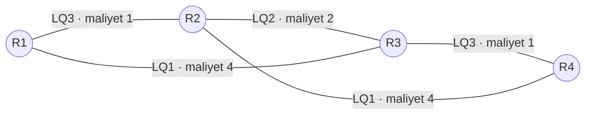

**R1'in yönlendirme tablosu:**

| Hedef | Doğrudan | R2 üzerinden | R3 üzerinden | Seçim | Sonraki atlama | Maliyet |
|---|---|---|---|---|---|---|
| R2 | 1 | — | 4 + 3 = 7 | Doğrudan | R2 | 1 |
| R3 | 4 | 1 + 2 = 3 | — | R2 üzerinden | R2 | 3 |
| R4 | — | 1 + 3 = 4 | 4 + 1 = 5 | R2 üzerinden | R2 | 4 |

(R2'nin R4'e maliyeti: doğrudan 4 veya R3 üzerinden 2 + 1 = 3 → **3**.)

Görüldüğü gibi, R1 ile R3 doğrudan komşu olsa da bağlantıları zayıf olduğu için trafik iki atlamalı ama daha kaliteli yoldan gider. Bu, Thread'in "atlama sayısı" yerine "bağlantı kalitesi" optimize ettiğinin somut örneğidir.

### 10.5 Rota Bilgisinin Yayılması ve Yakınsama

- Her router Advertisement'ında kendi en iyi maliyetlerini ilan eder; komşular bunları kendi link maliyetleriyle toplar.
- Bir değişiklik (yeni router, kopan bağlantı) Trickle zamanlayıcısını sıfırlayarak Advertisement sıklığını artırır; yeni bilgi hızla yayılır.
- Komşu bir router'dan `MAX_NEIGHBOR_AGE` (100 s) boyunca haber alınamazsa bağlantı silinir ve o router üzerinden geçen rotalar yeniden hesaplanır.
- **Sonsuza sayma (count-to-infinity)** problemi, 4 bitlik maliyet alanı ve 16'da kesilen maksimum maliyet ile sınırlandırılır; ulaşılamayan hedef birkaç Advertisement turunda "sonsuz" olarak işaretlenir.
- **ID Sequence**, silinmiş router ID'lerinin eski bilgilerle yeniden canlanmasını önler: Daha küçük ID Sequence içeren Route64 bilgisi router kümesi açısından dikkate alınmaz.

### 10.6 Paket İletme Algoritması

Bir router'ın IPv6 paketi için verdiği kararın sadeleştirilmiş hâli:

```text
1. Hedef link-local mi? (fe80::/ff02::)
      → Doğrudan komşuya / yerel yayın olarak gönder. (Yönlendirilmez.)

2. Hedef RLOC16'yı belirle:
   a) Hedef RLOC veya ALOC ise   → RLOC16 adresin son 16 bitidir
                                    (ALOC: Leader → Leader Router ID, Service → en yakın sunucu …)
   b) Hedef mesh-içi bir EID ise → EID→RLOC önbelleği
                                    (yoksa Address Query gönder, paketi beklet)
   c) Hedef ağ dışında ise       → Network Data'daki rotalardan uygun Border Router'ı seç
                                    (en uzun önek eşleşmesi, sonra tercih, sonra yol maliyeti)

3. Hedef RLOC16 benim çocuğum mu?
      → Rx-on ise doğrudan; uyuyan ise dolaylı iletim kuyruğuna koy.

4. Hedef RLOC16 kendim miyim?   → Yerel olarak teslim et.

5. Hedef router = RLOC16 & 0xFC00
   Sonraki atlama = yönlendirme tablosundan (hedef router veya ona giden yol)

6. Sonraki atlama nihai hedef değilse 6LoWPAN Mesh Header ekle
      (Originator = kendi RLOC16'm veya paketi bana veren çocuğun RLOC16'sı,
       Final Destination = hedef RLOC16)

7. Gerekirse parçala, MAC çerçevesi oluştur (hedef = sonraki atlamanın RLOC16'sı), şifrele, gönder.
```

**Ara router'daki işlem** çok daha basittir: Mesh Header'daki *Final Destination*'a bakıp sonraki atlamayı bulur, *Hops Left*'i bir azaltır ve çerçeveyi iletir. IPv6 başlığını açmaz, parçaları birleştirmez.

### 10.7 Uç Cihazların ve Çocukların Yönlendirilmesi

- **Çocuktan çıkan paket**: Çocuk (MED/SED/FED/REED), hedef ne olursa olsun paketi MAC seviyesinde **ebeveynine** gönderir. Ebeveyn, paketi kendi göndermiş gibi yönlendirir (Mesh Header'da Originator olarak çocuğun RLOC16'sı yazılır).
- **Çocuğa giden paket**: Paket, RLOC16'nın üst bitlerinden belirlenen **ebeveyn router'a** yönlendirilir; ebeveyn teslim eder.
- **FTD çocuklar (REED/FED)** kendi EID→RLOC önbelleklerini tutar ve Address Query yapabilir; ancak paketleri yine ebeveynlerine gönderir.
- Bir çocuk ebeveyn değiştirdiğinde RLOC16'sı değişir. Eski RLOC16'yı önbelleğinde tutan cihazlar paketi eski ebeveyne gönderir; eski ebeveyn o çocuğu artık tanımadığı için paketi teslim edemez. Kaynaktaki önbellek kaydı geçersiz hâle gelip yenilendiğinde (yeni Address Query veya dinlenen trafikten öğrenme ile) doğru RLOC16 elde edilir; yeni sorguya artık çocuğun **yeni** ebeveyni cevap verir.

### 10.8 Ağ Dışına Yönlendirme (Border Router Seçimi)

Network Data, ağ dışına çıkış noktalarını iki biçimde ilan eder (Bölüm 12):

- **Prefix TLV + Border Router alt-TLV'si**: Bir on-mesh önek ve o önekle ilgili BR'ler (`r` = varsayılan rota bayrağı).
- **Prefix TLV + Has Route alt-TLV'si**: Belirli bir dış önek için rota sunan BR'ler (ör. `::/0`, `fc00::/7`, NAT64 öneki).

Bir cihaz ağ dışına paket gönderirken:

1. Hedefle **en uzun eşleşen** Has Route öneki bulunur (yoksa `r` bayraklı varsayılan rota).
2. Birden fazla BR varsa **tercih** (preference: high > medium > low) karşılaştırılır.
3. Tercihler eşitse **yol maliyeti en düşük** (en yakın) BR seçilir.
4. Paket o BR'nin RLOC16'sına yönlendirilir; BR paketi altyapı ağına (Wi-Fi/Ethernet) iletir.

### 10.9 Uçtan Uca Örnek

SED `0x5C01` (Router 23'ün çocuğu), SED `0x9402`'ye (Router 37'nin çocuğu) bir UDP paketi göndersin. Router'lar: 23 → 12 → 37.

| Adım | Cihaz | İşlem | MAC kaynak → hedef | Mesh Header |
|---|---|---|---|---|
| 1 | SED 0x5C01 | Paketi ebeveynine gönderir | 0x5C01 → 0x5C00 | (yok) |
| 2 | Router 23 | EID→RLOC: 0x9402; hedef router 37; sonraki atlama 12 | 0x5C00 → 0x3000 | Orig 0x5C01, Final 0x9402, Hops Left = n |
| 3 | Router 12 | Mesh Header'a bakar; sonraki atlama 37 | 0x3000 → 0x9400 | Hops Left = n − 1 |
| 4 | Router 37 | Hedef kendi çocuğu; SED olduğu için kuyruğa alır | — | — |
| 5 | SED 0x9402 | Poll gönderir, ACK'de Frame Pending = 1 görür | 0x9402 → 0x9400 (Data Request) | — |
| 6 | Router 37 | Paketi teslim eder (Mesh Header kaldırılmış) | 0x9400 → 0x9402 | (yok) |

Her MAC atlamasında çerçeve, gönderenin Extended Address'i ve kendi frame counter'ı ile yeniden şifrelenir (hop-by-hop güvenlik).

### 10.10 Döngü ve Hata Durumları

| Durum | Koruma / tepki |
|---|---|
| Geçici yönlendirme döngüsü | Mesh Header **Hops Left** 0'a inince paket atılır |
| Hedef router ulaşılamaz | Paket atılır; kaynağa ICMPv6 Destination Unreachable dönebilir |
| EID→RLOC kaydı eski | Paket eski ebeveyne gider ve teslim edilemez; önbellek kaydı yenilenince (yeni Address Query) trafik düzelir |
| Address Query cevapsız | Paket atılır; aynı EID için yeniden sorgu artan gecikmelerle yapılır |
| Çok fazla yeniden iletim | Link kalitesi düşer → maliyet artar → alternatif yol seçilir |

### 10.11 Bölüm Özeti

- Router'lar arası yönlendirme, Route64 TLV ile yayılan mesafe-vektör algoritmasıdır.
- Maliyet, çift yönlü link kalitesine göre 1/2/4/∞ değerlerinden oluşur; atlama sayısı değil kalite optimize edilir.
- Çocuklara giden trafik ebeveyn router'a yönlendirilir; çocuklar her şeyi ebeveynlerine gönderir.
- Ara router'lar yalnızca Mesh Header'a bakar; IPv6 paketini açmaz.
- Ağ dışı trafik Network Data'daki rotalardan, en uzun önek → tercih → yol maliyeti sırasıyla seçilen Border Router'a gider.

## 11. Leader, Partition ve Router ID Yönetimi

### 11.1 Leader'ın Görevleri

| Görev | Mekanizma |
|---|---|
| Router ID atama / geri alma | TMF `a/as` (Address Solicit), `a/ar` (Address Release) |
| Router ID kümesini ve ID Sequence'ı yönetme | Route64 TLV'deki ID Sequence + Router Mask |
| Network Data'yı toplama ve dağıtma | TMF `a/sd` (Server Data) ile kayıt, MLE Data Response ile dağıtım |
| 6LoWPAN bağlam ID'lerini atama | Network Data'daki Context alt-TLV'leri |
| Commissioner oturumunu yetkilendirme | MeshCoP `c/lp` (Leader Petition), `c/la` (Leader Keep Alive) |
| Operational Dataset değişikliklerini yönetme | MeshCoP `c/as`, `c/ps` (Active/Pending Set) |
| Partition kimliğini taşıma | Leader Data TLV: Partition ID, Weighting, Leader Router ID |
| Leader ALOC'unu (`0xFC00`) sahiplenme | Diğer cihazlar Leader'a bu adresle ulaşır |

> [!NOTE]
> Leader bir "yönetici" ama "darboğaz" değildir: Veri trafiği Leader üzerinden geçmek zorunda değildir. Leader yalnızca kontrol düzlemindeki merkezi kayıtları tutar ve bu kayıtlar tüm router'lara kopyalandığı için (Network Data, Route64) Leader kaybolsa bile ağ çalışmaya devam eder.

### 11.2 Leader Nasıl Belirlenir?

Thread'de açık bir "seçim" (election) protokolü yoktur. Leader, **partition'ı kuran router**dır:

1. Bir router veya REED, bağlı olduğu partition'ın Leader'ına ulaşamadığını fark eder.
2. Başka bir partition'a bağlanmayı dener (Parent Request).
3. Hiçbir partition bulamazsa **kendi partition'ını kurar ve Leader olur**: rastgele yeni bir Partition ID seçer, Router ID kümesini başlatır, Network Data'yı (bildiği kadarıyla) oluşturur.
4. Aynı anda birden fazla router bunu yaparsa geçici olarak birden fazla partition oluşur; bunlar Bölüm 11.4'teki kurallarla tek partition'da birleşir.

### 11.3 Leader Data TLV ve Partition Kimliği

| Alan | Boyut | Açıklama |
|---|---|---|
| **Partition ID** | 4 bayt | Leader'ın partition kurarken seçtiği rastgele sayı |
| **Weighting** | 1 bayt | Partition ağırlığı (varsayılan 64). Leader'ın ağırlığı (leader weight) ile belirlenir |
| **Data Version** | 1 bayt | Tam Network Data sürümü; her değişiklikte artar (mod 256) |
| **Stable Data Version** | 1 bayt | Yalnızca kalıcı (stable) Network Data sürümü |
| **Leader Router ID** | 1 bayt | Leader'ın Router ID'si (Leader ALOC'unun yönlendirileceği router) |

Thread 1.3.1/1.4 ile Leader ağırlığı, cihazın özelliklerine (güç kaynağı tipi — pil/şebeke/kesintisiz, Border Router olup olmadığı vb.) göre otomatik hesaplanabilir. Böylece şebekeye bağlı, kararlı ve BR işlevli cihazların Leader olması teşvik edilir.

### 11.4 Partition Karşılaştırma ve Birleşme

İki partition karşılaştırılırken (OpenThread'in uyguladığı sıra):

1. **Singleton kontrolü**: Yalnızca tek router'dan oluşan (singleton) partition, birden fazla router'ı olan partition'a karşı kaybeder.
2. **Weighting**: Yüksek ağırlıklı partition kazanır.
3. **Partition ID**: Ağırlıklar eşitse sayısal olarak büyük Partition ID kazanır.

Bir router, Advertisement'larda kendi partition'ından **daha iyi** bir partition'ın Leader Data'sını görürse o partition'a geçmeye çalışır:

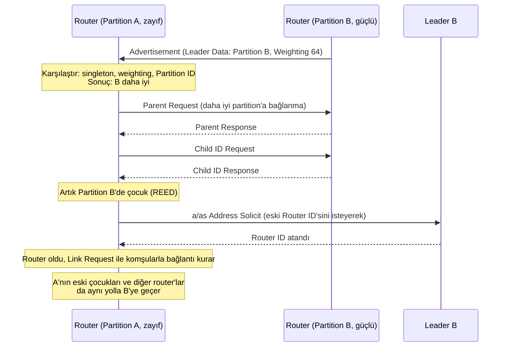

Birleşme sırasında kısa süreli paket kayıpları olabilir; ancak cihazların EID'leri (ML-EID, OMR) değişmediği için uygulamalar birleşme sonrası kesintisiz devam eder.

### 11.5 Router ID Atama: Address Solicit

Bir REED router olmak istediğinde Leader'a **Address Solicit** gönderir:

```text
CoAP CON POST  coap://[<Leader ALOC>]:61631/a/as
Yük (TMF TLV'leri):
  Ext MAC Address TLV   — isteyenin Extended Address'i
  Status TLV            — terfi nedeni
  RLOC16 TLV (isteğe)   — tercih edilen (genellikle önceki) Router ID
```

**Terfi nedenleri (Status TLV değerleri):**

| Değer | Neden |
|---|---|
| 2 | **Too Few Routers** — router sayısı eşik altında |
| 3 | **Have Child ID Request** — bir cihaz beni ebeveyn seçti |
| 4 | **Parent Partition Change** — partition değişimi sonrası eski rolüme dönüyorum |

**Leader'ın yanıtı:**

```text
Status TLV       — 0 = Success, 1 = No Address Available
RLOC16 TLV       — atanan Router ID (RLOC16 = ID << 10)
Router Mask TLV  — güncel ID Sequence + atanmış Router ID maskesi
```

Leader'ın karar mantığı:

- Aktif router sayısı 32 ise → **No Address Available**.
- İstenen Router ID boştaysa ve yakın zamanda serbest bırakılmamışsa → o ID verilir (cihaz eski kimliğini korur).
- Aksi hâlde boştaki ID'lerden biri (rastgele) seçilir.
- Router kümesi değiştiği için **ID Sequence** artırılır ve yeni küme Advertisement'larla yayılır.

### 11.6 Router ID Geri Alma: Address Release

- Router, REED'e dönerken (downgrade) Leader'a **Address Release** (`a/ar`) gönderir: RLOC16 TLV + Ext MAC Address TLV.
- Leader bir router'dan uzun süre haber alamazsa (yönlendirme bilgisine göre o router'a rota yoksa; `MAX_LEADER_TO_ROUTER_TIMEOUT` = 90 s) ID'yi kendisi serbest bırakır.
- Serbest bırakılan ID, **`ID_REUSE_DELAY` = 100 s** boyunca başka bir cihaza verilmez. Böylece eski ID'ye ait bayat rota bilgileri ağdan silinmeye fırsat bulur.

### 11.7 Leader Kaybı ve Kurtarma

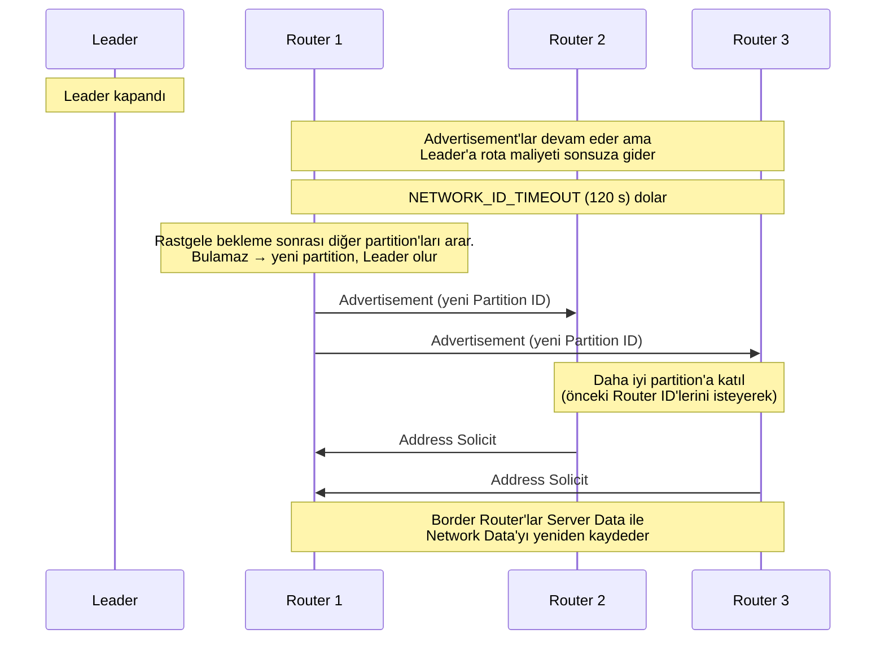

- Yeni Leader, eski Network Data'yı ilk etapta kendi kopyasından yeniden oluşturabilir; Border Router'lar ve servis sağlayıcılar kayıtlarını `a/sd` ile yeniler.
- Cihazların ML-EID ve OMR adresleri değişmez; çoğu router eski Router ID'sini geri alır.
- Kesinti tipik olarak birkaç dakika mertebesindedir (zaman aşımı + yakınsama).

**Leader'ın kendisi yeniden başlarsa:** Leader durumunu kalıcı bellekte saklar; açıldığında önceki partition'ı ve Router ID'sini geri yüklemeye çalışır (komşularına Link Request göndererek). Bu sayede kısa süreli bir yeniden başlatma ağı bölmeden atlatılır.

### 11.8 Network Data Yönetimi (Leader Tarafı)

- Border Router'lar ve servis sağlayıcılar kendi **yerel Network Data** parçalarını Leader'a **Server Data Notification** (`a/sd`) ile bildirir.
- Leader bunları birleştirir; her girdinin sahibini (RLOC16) bilir.
- Değişiklik olduğunda **Data Version** (kalıcı kısım değiştiyse **Stable Data Version** da) artırılır ve Data Response ile dağıtılır.
- Router ID'si serbest bırakılan bir cihazın girdileri Network Data'dan kaldırılır.
- Yeni bir on-mesh önek için **bağlam ID'si** (1–15) atanır; önek kaldırıldığında bağlam önce "sıkıştırmada kullanılmaz" (C = 0) yapılır ve ID belirli bir süre (48 saat) yeniden kullanılmaz.
- Network Data'nın 254 baytı aşmasına izin verilmez; yer yoksa kayıt reddedilir.

### 11.9 Commissioner Oturumunun Yönetimi

- Leader, Network Data içindeki **Commissioning Data TLV**'yi tutar: Border Agent Locator, Commissioner Session ID, Steering Data, Joiner UDP Port.
- Bir commissioner, Border Agent aracılığıyla **Leader Petition** (`c/lp`) gönderir; Leader aktif commissioner yoksa kabul eder ve yeni bir **Commissioner Session ID** verir.
- Commissioner belirli aralıklarla **Keep Alive** göndermezse Leader oturumu kapatır ve Commissioning Data'yı temizler. Ayrıntılar Bölüm 16'da.

### 11.10 Bölüm Özeti

- Leader, partition'ı kuran router'dır; açık bir seçim protokolü yoktur.
- Partition karşılaştırma: singleton < çok router'lı, sonra yüksek weighting, sonra büyük Partition ID.
- Router ID'ler Address Solicit/Release ile yönetilir; en fazla 32 aktif router, serbest ID'ler 100 s bekletilir.
- Leader kaybolursa 120 s sonra yeni Leader oluşur, router'lar eski ID'lerini geri isteyerek katılır.
- Network Data, bağlam ID'leri ve commissioner oturumu Leader'da merkezileşir ama tüm ağa kopyalanır.

## 12. Network Data (Ağ Verisi)

### 12.1 Nedir?

**Thread Network Data**, ağ genelinde paylaşılan yapılandırma bilgisidir. Standart IPv6'daki Router Advertisement'ın Thread'deki karşılığı gibi düşünülebilir, ama çok daha fazlasını taşır:

| İçerik | Örnek |
|---|---|
| **On-mesh önekler** | OMR öneki `fd4f:2d3c:ee9b:1::/64` — cihazlar bundan SLAAC adresi üretir |
| **Dış rotalar** | `::/0` (internet), `fc00::/7`, NAT64 öneki `64:ff9b::/96` |
| **Border Router bilgileri** | Hangi BR hangi öneği sunuyor, tercih değeri, bayraklar |
| **6LoWPAN bağlamları** | Önek ↔ bağlam ID eşlemesi (sıkıştırma için) |
| **Servisler** | SRP sunucusu (anycast/unicast), Backbone Router, diğer servisler |
| **Commissioning Data** | Aktif commissioner, Border Agent konumu, Steering Data |

### 12.2 Yaşam Döngüsü

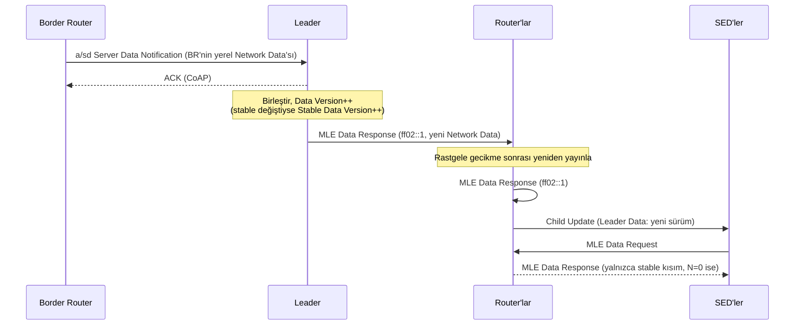

- **Kayıt**: Veri sağlayıcılar (BR'ler, servis sunucuları) yerel Network Data'larını **Server Data Notification** (`a/sd`) ile Leader'a gönderir. Bir şeyi kaldırmak için güncellenmiş (eksiltilmiş) yerel veriyi yeniden gönderirler.
- **Birleştirme**: Leader tüm parçaları birleştirir, sürüm numaralarını artırır.
- **Dağıtım**: MLE Data Response çoklu yayınları ve Data Request/Response çiftleriyle (Bölüm 9.11).
- **Temizlik**: Router ID'si geçersiz olan sağlayıcıların girdileri Leader tarafından silinir.

### 12.3 Stable ve Temporary Veri

Her Network Data TLV'sinde bir **Stable (S)** biti vardır:

- **Stable (kalıcı)**: Uzun süre geçerli kalması beklenen bilgi (ör. OMR öneki, SLAAC bayrakları, bağlamlar). SED'ler (N = 0) yalnızca bunu alır.
- **Temporary (geçici)**: Sık değişebilen bilgi (ör. Commissioning Data, bazı rota tercihleri).

Bu ayrım, uyuyan cihazların her küçük değişiklik için uyanıp veri çekmesini önler. SED'ler yalnızca **Stable Data Version** değiştiğinde güncelleme yapar.

### 12.4 TLV Biçimi

```text
+---------------------------+--------+------------------+
| Type (7 bit) | Stable (1) | Length | Value (alt TLV'ler)|
+---------------------------+--------+------------------+
```

| Tür | TLV | Nerede |
|---|---|---|
| 0 | **Has Route** | Prefix TLV içinde alt-TLV |
| 1 | **Prefix** | Üst seviye |
| 2 | **Border Router** | Prefix TLV içinde alt-TLV |
| 3 | **6LoWPAN ID** (Context) | Prefix TLV içinde alt-TLV |
| 4 | **Commissioning Data** | Üst seviye |
| 5 | **Service** | Üst seviye |
| 6 | **Server** | Service TLV içinde alt-TLV |

Network Data'nın toplam boyutu en fazla **254 bayttır**.

### 12.5 Prefix TLV

```text
+-----------+---------------+-------------------+----------------------------+
| Domain ID | Prefix Length | Prefix (bit uzun. | Alt-TLV'ler: Border Router,|
|   (1)     |     (1)       | yuvarlanmış bayt) | Has Route, 6LoWPAN ID      |
+-----------+---------------+-------------------+----------------------------+
```

Bir önek altında birden çok alt-TLV ve her alt-TLV'de birden çok sağlayıcı girdisi (farklı BR'ler) bulunabilir.

### 12.6 Border Router Alt-TLV'si

Her girdi 4 bayttır: **RLOC16 (2)** + **Bayraklar (2)**.

```text
 bit: 15 14 | 13 | 12 | 11 | 10 |  9 |  8 |  7 |  6 | 5 … 0
      Pref  |  p |  a |  d |  c |  r |  o |  n |  D | ayrılmış
```

| Bayrak | OpenThread harfi | Anlamı |
|---|---|---|
| **Pref** (2 bit) | high/med/low | Bu BR'nin tercih değeri (`01` high, `00` medium, `11` low) |
| **p** (Preferred) | `p` | SLAAC/DHCP ile üretilen adresler "preferred" olarak kullanılabilir |
| **a** (SLAAC) | `a` | Cihazlar bu önekten **SLAAC** ile adres üretmeli |
| **d** (DHCP) | `d` | Adresler DHCPv6 ile alınır |
| **c** (Configure) | `c` | Diğer yapılandırmalar DHCPv6 ile alınabilir |
| **r** (Default Route) | `r` | Bu BR, bu önekten kaynaklanan paketler için **varsayılan rota** sunar |
| **o** (On-Mesh) | `o` | Önek **mesh üzerindedir**: bu önekteki hedefler Thread ağı içindedir |
| **n** (ND DNS) | `n` | DNS bilgisi ND ile sağlanır |
| **D** (Domain Prefix) | `D` | (1.2) Bu önek bir **Thread Domain** önekidir (DUA için) |

Tipik OMR öneki girdisi: `paros` = Preferred + SLAAC + default Route + On-mesh + Stable.

### 12.7 Has Route Alt-TLV'si

Her girdi 3 bayttır: **RLOC16 (2)** + **Bayraklar (1)**.

| Bayrak | Anlamı |
|---|---|
| **Pref** (2 bit, bit 7–6) | Rota tercihi (high/medium/low) |
| **N** (NAT64, bit 5) | (1.3) Bu önek bir **NAT64** önekidir |
| **P** (Advertising PIO, bit 4) | (1.4) BR, altyapı ağında ilgili PIO ilanı yapıyor |

Has Route, "bu önekteki hedeflere benim üzerimden ulaşabilirsiniz" anlamına gelir. Örnekler:

| Önek | Anlamı |
|---|---|
| `::/0` | İnternet'e (varsayılan) rota — altyapı ağında global IPv6 bağlantısı varsa |
| `fc00::/7` | Tüm ULA hedeflerine rota — altyapı ağındaki ULA adreslerine erişim |
| `fd12:3456:789a:1::/64` | Altyapı ağının on-link öneki |
| `64:ff9b::/96` veya `fdxx:…::/96` + N | NAT64 öneki (IPv4 hedefleri) |

### 12.8 6LoWPAN ID (Context) Alt-TLV'si

```text
+--------------------------------+----------------+
| ayr.(3) | C (1) | Context ID(4) | Context Length |
+--------------------------------+----------------+
```

- **C (Compress)**: 1 = bu bağlam sıkıştırmada kullanılabilir.
- **Context ID**: 1–15 (0, mesh-local önek için ayrılmıştır).
- **Context Length**: Bağlam olarak kullanılacak önek uzunluğu (bit).

### 12.9 Service ve Server TLV'leri

```text
Service TLV:
+---+------------+------------------------+--------------+--------------+-----------------+
| T | Service ID | Enterprise Number (4)  | Service Data | Service Data | Server alt-TLV'leri |
|(1)|   (4 bit)  | (T=1 ise atlanır)      | Length (1)   |              |                 |
+---+------------+------------------------+--------------+--------------+-----------------+

Server alt-TLV'si:
+------------------+-------------+
| Server RLOC16 (2)| Server Data |
+------------------+-------------+
```

- **T = 1** ise kurum numarası atlanır ve **Thread Group'un IANA Enterprise Number'ı 44970** kabul edilir.
- **Service ID** (0–15), Leader tarafından atanır ve **Service ALOC** (`0xFC10` + Service ID) ile servise anycast erişim sağlar.

**Thread'in tanımladığı servisler (Enterprise 44970):**

| Service Data (ilk bayt) | Servis | İçerik |
|---|---|---|
| `0x01` | **Backbone Router** | Server Data: BBR sıra numarası, yeniden kayıt gecikmesi, MLR zaman aşımı |
| `0x5C` | **DNS/SRP Anycast** | Service Data: sıra numarası. Sunucuya Service ALOC ile ulaşılır |
| `0x5D` | **DNS/SRP Unicast** | Sunucunun IPv6 adresi ve portu (Service Data'da veya Server Data'da) |

Cihazlar SRP sunucusunu bu girdilerden keşfeder (Bölüm 19).

### 12.10 Commissioning Data TLV

Aktif commissioner varken Leader tarafından eklenir (geçici veri):

| Alt-TLV | Anlamı |
|---|---|
| **Border Agent Locator** | Commissioner'a giden trafiğin aktarılacağı Border Agent'ın RLOC16'sı |
| **Commissioner Session ID** | Aktif oturumun kimliği |
| **Steering Data** | Hangi joiner'ların kabul edileceğini gösteren Bloom filtresi |
| **Joiner UDP Port** | Joiner'ların DTLS için kullanacağı port |

Router'lar Discovery Response'larda Steering Data ve Joiner UDP Port'u bu TLV'den alır.

### 12.11 Örnek: `netdata show` Çıktısı

```text
> netdata show
Prefixes:
fd4f:2d3c:ee9b:1::/64 paros med 5c00
Routes:
fc00::/7 s med 5c00
fd4f:2d3c:ee9b:2:0:0::/96 sn low 5c00
Services:
44970 5d fddead00beef00006c1fc63a9a2e3b07d11f s 5c00
44970 01 36000500000e10 s 5c00
Contexts:
fd4f:2d3c:ee9b:1::/64 1 c
Commissioning:
37104 5c00 - -
Done
```

| Satır | Yorum |
|---|---|
| `fd4f:2d3c:ee9b:1::/64 paros med 5c00` | OMR öneki; Router 23 (`0x5C00`) sunuyor; SLAAC ile adres üret, varsayılan rota, on-mesh, stable, tercih orta |
| `fc00::/7 s med 5c00` | ULA hedefleri için dış rota (s = stable), tercih orta |
| `fd4f:2d3c:ee9b:2:0:0::/96 sn low 5c00` | NAT64 öneki (n = NAT64), düşük tercih — BR'nin kendi ULA /48'inden türetilmiş |
| `44970 5d …d11f s 5c00` | DNS/SRP unicast servisi: Server Data = sunucunun ML-EID adresi (`fdde:ad00:beef:0:6c1f:c63a:9a2e:3b07`) + port `0xD11F` (53535) |
| `44970 01 36000500000e10` | Backbone Router servisi: sıra numarası `0x36`, yeniden kayıt gecikmesi 5 s, MLR zaman aşımı 3600 s |
| `fd4f:2d3c:ee9b:1::/64 1 c` | OMR öneki bağlam ID 1, sıkıştırmaya açık |
| `37104 5c00 - -` | Commissioner oturum ID 37104, Border Agent `0x5C00` |

> [!NOTE]
> `netdata show` çıktı biçimi OpenThread sürümleri arasında küçük farklılıklar gösterebilir; ham TLV görmek için `netdata show -x` kullanılabilir.

### 12.12 Cihazın Network Data'yı Kullanması

Bir cihaz yeni Network Data aldığında:

1. **On-mesh öneklerde `a` bayrağı varsa** SLAAC adresi üretir; önek kaybolursa adresi kaldırır.
2. **Bağlam tablosunu** günceller (sıkıştırma/açma için).
3. **Rota tablosunu** (dış rotalar, tercihler, BR RLOC16'ları) günceller.
4. **Servisleri** (SRP sunucusu, BBR) keşfeder; gerekirse SRP kaydını yeni sunucuya taşır.
5. **Commissioning Data** varsa (router'lar) Discovery Response'larda kullanır.

### 12.13 Bölüm Özeti

- Network Data; önekler, rotalar, bağlamlar, servisler ve devreye alma bilgisinden oluşan ağ geneli yapılandırmadır.
- Sağlayıcılar `a/sd` ile Leader'a kaydeder; Leader birleştirip MLE ile dağıtır.
- Stable/Temporary ayrımı uyuyan cihazları gereksiz güncellemelerden korur.
- Border Router alt-TLV'si (`paros` gibi bayraklar) on-mesh önekleri, Has Route alt-TLV'si dış rotaları tanımlar.
- Service TLV'leri (Enterprise 44970) SRP sunucusu ve Backbone Router gibi servislerin keşfini sağlar.

## 13. TMF — Thread Management Framework ve CoAP

### 13.1 TMF Nedir?

**TMF (Thread Management Framework)**, Thread ağının mesh genelindeki yönetim mesajlarını taşıyan çerçevedir. MLE tek atlamalık işleri yaparken TMF; adres çözümleme, router ID yönetimi, ağ verisi kaydı, devreye alma ve teşhis gibi **çok atlamalı** yönetim işlerini yapar.

| Özellik | Değer |
|---|---|
| Uygulama protokolü | **CoAP** (RFC 7252) |
| Taşıma | UDP, port **61631** (`0xF0BF`) |
| Adresler | RLOC, ALOC (ör. Leader ALOC), `ff03::2` gibi realm-local çoklu yayın |
| Yük | Thread TLV'leri (Network Layer TLV'leri, MeshCoP TLV'leri, Network Diagnostic TLV'leri) |
| Güvenlik | Ayrı bir şifreleme yok; **MAC katmanı güvenliğine** dayanır. TMF mesajları yalnızca bağlantı katmanı güvenliği ile mesh'ten gelmişse kabul edilir |

### 13.2 CoAP'a Kısa Bakış

CoAP, kısıtlı cihazlar için tasarlanmış, HTTP benzeri (GET/POST/PUT/DELETE) ama UDP üzerinde çalışan, ikili ve kompakt bir protokoldür.

```text
 0                   1                   2                   3
+---+---+-------+---------------+-------------------------------+
|Ver| T |  TKL  |     Code      |          Message ID           |
+---+---+-------+---------------+-------------------------------+
|   Token (0–8 bayt) ...
+---------------------------------------------------------------+
|   Options (delta kodlamalı) ...
+---------------+-----------------------------------------------+
| 0xFF (yük ayracı) |  Payload ...
+---------------+-----------------------------------------------+
```

| Alan | Açıklama |
|---|---|
| **Ver** | 1 |
| **T** (Type) | 0 = CON (onay ister), 1 = NON (onaysız), 2 = ACK, 3 = RST |
| **TKL** | Token uzunluğu |
| **Code** | `0.01` GET, `0.02` POST, `0.03` PUT, `0.04` DELETE; yanıtlar `2.04` Changed, `2.05` Content, `4.04` Not Found … |
| **Message ID** | Tekrar tespiti ve ACK eşleştirme |
| **Token** | İstek/yanıt eşleştirme |
| **Options** | Uri-Path (11), Content-Format (12) vb.; delta kodlamalı |

**Güvenilirlik (CON mesajlar):** Varsayılan `ACK_TIMEOUT` = 2 s, `ACK_RANDOM_FACTOR` = 1.5, `MAX_RETRANSMIT` = 4; ACK gelmezse bekleme süresi her denemede ikiye katlanarak yeniden gönderilir.

TMF'de tekil istekler genellikle **CON**, çoklu yayınlar (ör. Address Query) **NON** olarak gönderilir.

### 13.3 TMF URI'leri

#### Adres ve ağ yönetimi (`a/…`)

| URI | Ad | Yön | Amaç |
|---|---|---|---|
| `a/aq` | Address Query | `ff03::2` (NON) | Bir EID'nin RLOC16'sını sorma |
| `a/an` | Address Notification | Tekil (CON) | Address Query cevabı |
| `a/ae` | Address Error Notification | Tekil/çoklu | Çakışan adres bildirimi |
| `a/as` | Address Solicit | Leader ALOC (CON) | Router ID isteme |
| `a/ar` | Address Release | Leader ALOC (CON) | Router ID bırakma |
| `a/sd` | Server Data Notification | Leader ALOC (CON) | Yerel Network Data'yı kaydetme |

#### Devreye alma ve dataset (`c/…`, MeshCoP)

| URI | Ad | Amaç |
|---|---|---|
| `c/cp` | Commissioner Petition | Commissioner olma isteği (Border Agent'a) |
| `c/ca` | Commissioner Keep Alive | Commissioner oturumunu canlı tutma |
| `c/lp` | Leader Petition | Border Agent → Leader petition aktarımı |
| `c/la` | Leader Keep Alive | Border Agent → Leader keep alive aktarımı |
| `c/cs` / `c/cg` | Commissioner Set / Get | Commissioning Data'yı (Steering Data vb.) yazma/okuma |
| `c/as` / `c/ag` | Active Set / Get | Active Operational Dataset'i değiştirme/okuma |
| `c/ps` / `c/pg` | Pending Set / Get | Pending Operational Dataset'i değiştirme/okuma |
| `c/dc` | Dataset Changed | Dataset değiştiğini commissioner'a bildirme |
| `c/rx` | Relay Receive | Joiner Router → Commissioner: Joiner'dan gelen DTLS kaydını aktarma |
| `c/tx` | Relay Transmit | Commissioner → Joiner Router: Joiner'a gidecek DTLS kaydını aktarma |
| `c/jf` | Joiner Finalize | Joiner → Commissioner (DTLS içinde): katılım sonlandırma |
| `c/je` | Joiner Entrust | Joiner Router → Joiner: ağ kimlik bilgilerini (KEK ile) teslim |
| `c/ab` | Announce Begin | Cihazlara Announce gönderme emri |
| `c/es` / `c/er` | Energy Scan / Report | Uzaktan enerji taraması ve raporu |
| `c/pq` / `c/pc` | PAN ID Query / Conflict | PAN ID çakışması sorgusu ve bildirimi |
| `c/ur` / `c/ut` | Proxy Receive / Transmit | Harici commissioner'ın mesh içindeki cihazlarla UDP üzerinden konuşması (Border Agent vekilliği) |

#### Teşhis (`d/…`)

| URI | Ad | Amaç |
|---|---|---|
| `d/dg` | Diagnostic Get | Bir cihazdan teşhis TLV'leri isteme (tekil) |
| `d/dq` | Diagnostic Get Query | Çoklu yayınla teşhis sorgusu |
| `d/da` | Diagnostic Get Answer | Sorguya cevap |
| `d/dr` | Diagnostic Reset | Sayaçları sıfırlama |

#### Thread 1.2+ Backbone (`n/…`, `b/…`)

| URI | Ad | Amaç |
|---|---|---|
| `n/dr` | DUA Registration | Domain Unicast Address'i Primary BBR'ye kaydetme |
| `n/mr` | Multicast Listener Registration | Çoklu yayın aboneliğini Primary BBR'ye kaydetme |
| `b/bq` | Backbone Query | BBR'ler arası (omurga üzerinden) DUA çakışma/konum sorgusu |
| `b/ba` | Backbone Answer | Backbone Query cevabı |
| `b/bmr` | Backbone MLR | BBR'ler arası MLR bilgisi |

### 13.4 Ağ Katmanı TMF TLV'leri

| Tür | TLV | Uzunluk | Kullanım |
|---|---|---|---|
| 0 | **Target EID** | 16 | Sorgulanan/bildirilen IPv6 adresi |
| 1 | **Extended MAC Address** | 8 | Cihazın Extended Address'i |
| 2 | **RLOC16** | 2 | Routing locator |
| 3 | **ML-EID** | 8 | ML-EID'nin IID kısmı (çakışma tespiti için) |
| 4 | **Status** | 1 | Durum/neden kodu |
| 6 | **Last Transaction Time** | 4 | Çocukla son iletişimden beri geçen süre |
| 7 | **Router Mask** | 9 | ID Sequence + 64 bit router maskesi |
| 8 | **ND Option** | değişken | Neighbor Discovery seçenekleri |
| 9 | **ND Data** | değişken | ND verisi |
| 10 | **Thread Network Data** | değişken | Server Data Notification içinde yerel Network Data |
| 11 | **Timeout** | 4 | Zaman aşımı değerleri |
| 12 | **Network Name** | ≤ 16 | Ağ adı |
| 14 | **IPv6 Addresses** | değişken | Adres listesi (ör. MLR) |
| 15 | **Commissioner Session ID** | 2 | Oturum kimliği |

### 13.5 Örnek: Address Query Mesajının Baytları

```text
--- CoAP ---
52              Ver=1, Type=NON(1), TKL=2
02              Code = 0.02 (POST)
7B 1C           Message ID = 0x7B1C
A3 E9           Token
B1 61           Option: Uri-Path (delta 11, uzunluk 1) = "a"
02 61 71        Option: Uri-Path (delta 0, uzunluk 2)  = "aq"
FF              Yük ayracı
--- TMF TLV ---
00 10           Target EID TLV, uzunluk 16
FD 4F 2D 3C EE 9B 00 01 8A 43 51 C0 07 6E 21 9D    (hedef OMR adresi)
```

Bu mesaj UDP 61631 → 61631, IPv6 hedefi `ff03::2` ile gönderilir. 6LoWPAN tarafında iki port birlikte tek bayta, `ff03::2` hedefi ise `ffXX::00XX:XXXX` biçimiyle 4 bayta sıkıştırılır (tek baytlık mod yalnızca `ff02::00XX` adresleri içindir).

**Cevap (Address Notification, CON POST `a/an`):**

```text
42 02 4F 10 C5 07  B1 61 02 61 6E  FF
00 10 <16 bayt Target EID>           Target EID TLV
02 02 94 02                          RLOC16 TLV = 0x9402
03 08 <8 bayt ML-EID IID>            ML-EID TLV
06 04 00 00 01 2C                    Last Transaction Time = 300 s (vekil cevap)
```

### 13.6 Örnek Akış: Address Solicit

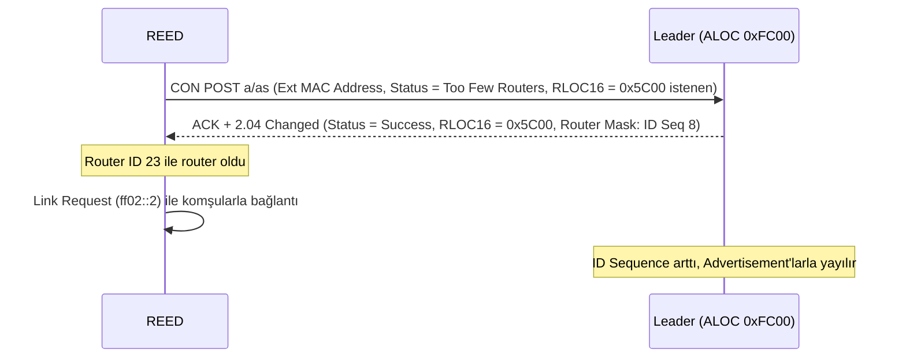

### 13.7 TMF'nin Güvenlik Sınırları

- TMF mesajları ağ içinde yalnızca **MAC güvenliği** ile korunur. Ağ anahtarına sahip her cihaz TMF mesajı üretebilir; bu yüzden Thread'in güven modeli "ağdaki her cihaz güvenilirdir" varsayımına dayanır (Bölüm 15).
- Ağ dışından (Border Router'ın altyapı tarafından) gelen paketlerin TMF portuna ulaşması engellenir. Harici commissioner'ın TMF/MeshCoP işlemleri yalnızca **Border Agent ile kurulan DTLS oturumu** üzerinden yapılabilir.
- MeshCoP yönetim komutları (Active/Pending Set gibi) ek olarak **Commissioner Session ID** doğrulaması gerektirir.

### 13.8 Bölüm Özeti

- TMF, UDP 61631 üzerinde CoAP ile taşınan, mesh geneli Thread yönetim mesajlarıdır.
- URI ön ekleri: `a/` adres ve ağ, `c/` devreye alma ve dataset, `d/` teşhis, `n/` ve `b/` Thread 1.2 omurga işlemleri.
- Tekil istekler CON, çoklu yayınlar NON olarak gönderilir.
- TMF mesajlarının yükü Thread TLV'leridir; güvenliği MAC katmanından gelir.

## 14. Çoklu Yayın (Multicast) ve MPL

### 14.1 Kapsama Göre Çoklu Yayın

| Kapsam | Örnek adres | Nasıl iletilir? |
|---|---|---|
| **Link-local (2)** | `ff02::1`, `ff02::2`, `ff32:40:<önek>::1` | Tek bir MAC yayın çerçevesi (`0xFFFF`); **iletilmez** |
| **Realm-local (3)** | `ff03::1`, `ff03::2`, `ff03::fc`, `ff33:40:<önek>::1` | Router'lar tarafından **MPL** ile tüm mesh'e yayılır |
| **Admin-local (4) ve üstü** | `ff04::…`, `ff05::…`, `ff35:…` | Mesh içinde MPL ile yayılır; Border/Backbone Router ile ağ dışına/dışından taşınır (abonelik kaydı gerekir) |

MAC seviyesinde çoklu yayın çerçeveleri **ACK'lenmez**. Bu yüzden güvenilirlik, tekrar gönderimle sağlanır.

### 14.2 MPL (Multicast Protocol for Low-Power and Lossy Networks)

Thread, realm-local ve daha geniş kapsamlı çoklu yayınları mesh'te yaymak için **MPL**'i (RFC 7731) kullanır. MPL, kontrollü bir "taşma" (flooding) protokolüdür:

1. **Seed (tohum)**: Çoklu yayını başlatan cihaz. Her pakete **MPL Option** (IPv6 Hop-by-Hop seçeneği) ekler:
    - **Seed ID**: Thread'de gönderenin **RLOC16**'sı (2 bayt),
    - **Sequence**: Seed başına artan 8 bitlik sıra numarası.
2. **Forwarder (iletici)**: Router'lar yeni (daha önce görmediği Seed ID + Sequence çiftine sahip) bir MPL paketini alınca:
    - Paketi yerel olarak işler (aboneyse uygulamaya verir),
    - **Seed set** tablosuna kaydeder (yinelenen paketleri tanımak için),
    - Paketi rastgele kısa gecikmelerle **birkaç kez** yeniden yayınlar.
3. Zaten görülmüş (Seed ID, Sequence) çiftine sahip paketler atılır.

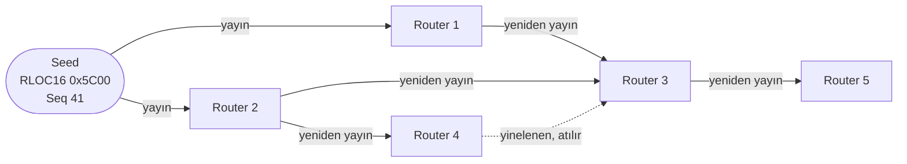

**Kapsülleme kuralı:**

- Hedef **realm-local** ise MPL Option doğrudan paketin Hop-by-Hop başlığına eklenir.
- Hedef **realm-local'dan geniş** bir kapsamdaysa (ör. `ff05::…`), orijinal paket bir dış IPv6 başlığıyla **kapsüllenir** (IPv6-in-IPv6); dış başlığın hedefi `ff03::fc` (Realm-Local All MPL Forwarders) olur ve MPL Option dış başlığa eklenir. Paket mesh'ten çıkarken (BR'de) dış başlık atılır.

### 14.3 Çoklu Yayının Uç Cihazlara Ulaştırılması

| Cihaz | Nasıl alır? |
|---|---|
| Router, REED, FED | Yayın çerçevelerini doğrudan dinler |
| **MED** | Radyosu açık olduğu için yayın çerçevelerini doğrudan dinler |
| **SED / SSED** | Radyosu kapalıdır. Ebeveyn, SED'in **abone olduğu** adreslere (ve "All Thread Nodes" adreslerine) gelen çoklu yayınları **her SED için ayrı ayrı** kuyruğa koyar ve **dolaylı iletim** ile (MAC'te tekil çerçeve olarak) teslim eder |

SED'ler abone oldukları çoklu yayın adreslerini **Address Registration TLV** ile ebeveynlerine bildirir.

> [!WARNING]
> Çoklu yayın, Thread ağındaki **en pahalı** trafik türlerinden biridir: Her router paketi birkaç kez yayınlar ve her uyuyan alıcı için ebeveyn ayrı bir dolaylı iletim yapar. Sık periyodik çoklu yayınlar (ör. her saniye durum yayını) hem kanal kapasitesini hem SED pillerini tüketir. Mümkünse tekil (unicast) iletişim veya abonelik (subscription) modelleri tercih edilmelidir.

### 14.4 Hangi Adres Kime Ulaşır?

| Hedef | Router | REED/FED | MED | SED/SSED |
|---|---|---|---|---|
| `ff02::1` (link-local all nodes) | ✔ (komşu ise) | ✔ (komşu ise) | ✔ (komşu ise) | ✘ |
| `ff02::2` (link-local all routers) | ✔ (komşu ise) | ✔ (komşu ise) | ✘ | ✘ |
| `ff32:40:<önek>::1` (link-local all Thread nodes) | ✔ | ✔ | ✔ | ✔ (ebeveyn iletir) |
| `ff03::1` (realm-local all nodes) | ✔ | ✔ | ✔ | ✘ |
| `ff03::2` (realm-local all routers) | ✔ | ✔ | ✘ | ✘ |
| `ff33:40:<önek>::1` (realm-local all Thread nodes) | ✔ | ✔ | ✔ | ✔ (ebeveyn iletir) |
| Uygulama grubu (ör. `ff05::abcd`) | Aboneyse | Aboneyse | Aboneyse | Aboneyse (ebeveyne kayıtlıysa) |

### 14.5 Ağ Dışından Çoklu Yayın (Thread 1.2+)

Bir altyapı ağındaki (Wi-Fi/Ethernet) cihaz, Thread cihazlarının abone olduğu bir gruba çoklu yayın gönderirse:

1. Thread cihazı, admin-local veya daha geniş kapsamlı (scope ≥ 4) bir gruba abone olduğunda bunu **Primary Backbone Router**'a **MLR** (Multicast Listener Registration, `n/mr`) ile kaydeder.
2. Primary BBR, omurga (altyapı) arayüzünde bu grup için **MLD** ile dinleyici olur.
3. Altyapıdan gelen eşleşen çoklu yayınlar, BBR tarafından MPL kapsülleme ile mesh'e aktarılır.
4. Kayıtların bir ömrü vardır (MLR timeout; BBR servis verisinde ilan edilir); cihazlar kayıtlarını periyodik yeniler.

Thread'den dışarı giden çoklu yayınlar için Border Router, scope ≥ 4 olan paketleri (kapsülü açarak) altyapı arayüzüne iletir.

### 14.6 Matter Grupları ve Çoklu Yayın

Matter'ın **grup iletişimi** (ör. "tüm salon lambalarını kapat") IPv6 çoklu yayını kullanır:

- Matter grup adresleri **site-local kapsamlı** (scope 5), önek tabanlı çoklu yayın adresleridir (`ff35:40:fd…` biçiminde; fabric kimliği ve grup kimliğinden türetilir).
- Thread cihazları bu adreslere abone olur ve (Thread 1.2+ BBR mevcutsa) MLR ile kaydeder.
- Telefon/hub'dan gönderilen grup komutu Border Router'dan Thread ağına MPL ile yayılır.
- Grup mesajları Matter'ın grup anahtarlarıyla (operational group key) uygulama katmanında şifrelenir.

### 14.7 Bölüm Özeti

- Link-local çoklu yayın tek atlamadır; realm-local ve daha geniş kapsamlar MPL ile mesh'e yayılır.
- MPL; Seed ID (RLOC16) + sıra numarası ile yinelenenleri ayıklar, router'lar paketi birkaç kez yeniden yayınlar.
- SED'lere çoklu yayın, ebeveyn tarafından her cihaza ayrı dolaylı iletimle ulaştırılır; pahalıdır.
- "All Thread Nodes" adresleri SED'leri de kapsar; `ff02::1`/`ff03::1` kapsamaz.
- Thread 1.2+ BBR ve MLR ile ağ dışından gelen çoklu yayınlar abone cihazlara taşınır; Matter grupları bunu kullanır.

## 15. Güvenlik Mimarisi

### 15.1 Güvenlik Hedefleri ve Temel Model

Thread'in güvenlik tasarımı şu hedeflere dayanır:

| Hedef | Nasıl sağlanır? |
|---|---|
| **Gizlilik** | Tüm ağ trafiği MAC katmanında AES-128-CCM* ile şifrelenir |
| **Bütünlük ve kimlik doğrulama** | Her çerçevede MIC; yalnızca ağ anahtarını bilenler geçerli çerçeve üretebilir |
| **Tekrar (replay) koruması** | Frame counter'lar, MLE Challenge/Response |
| **Yetkisiz katılımın engellenmesi** | Ağa katılım ya PAKE tabanlı (EC-JPAKE + PSKd) devreye alma ya da güvenli bant dışı kanal (Matter/BLE) ile kimlik bilgisi aktarımı gerektirir |
| **Yetkili yönetim** | Commissioner olmak için PSKc ile kimlik doğrulama; aynı anda tek commissioner |
| **Anahtar tazeliği** | Periyodik anahtar rotasyonu (Key Sequence) |

**Temel model — "ağ üyeliği = güven":** Thread'de bütün cihazlar aynı **Network Key**'i paylaşır. Ağa kabul edilmiş her cihaz, ağ katmanında diğerleriyle eşit güven seviyesindedir. Bu basit ve verimli bir modeldir, fakat iki önemli sonucu vardır:

1. Thread güvenliği **hop-by-hop**'tur: Her atlamada çerçeve çözülüp yeniden şifrelenir; ara router'lar yükü düz metin olarak görebilir.
2. **Uçtan uca (end-to-end) uygulama güvenliği** Thread'in değil, üst katmanın işidir. Matter bunu CASE/PASE oturumlarıyla sağlar: Thread ağına sızmış bir cihaz bile Matter mesajlarını okuyamaz/değiştiremez.

### 15.2 Anahtar Hiyerarşisi

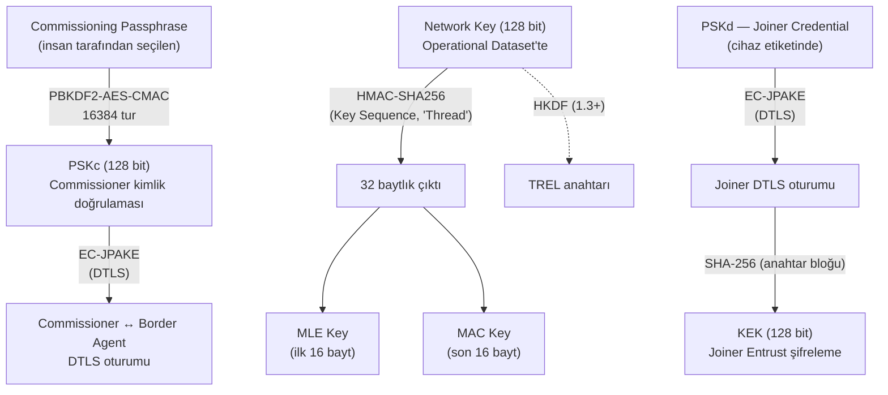

| Anahtar | Boyut | Nereden gelir? | Ne korur? |
|---|---|---|---|
| **Network Key** | 128 bit | Ağ kurulurken rastgele üretilir; Operational Dataset ile dağıtılır | Tüm türetilmiş anahtarların kökü |
| **MAC Key** | 128 bit | Network Key + Key Sequence | 802.15.4 veri çerçeveleri |
| **MLE Key** | 128 bit | Network Key + Key Sequence | MLE mesajları |
| **PSKc** | 128 bit | Passphrase + Extended PAN ID + Network Name | Commissioner ↔ Border Agent DTLS |
| **PSKd** | 6–32 karakter | Cihaz üreticisi (etiket/QR) | Joiner ↔ Commissioner DTLS |
| **KEK** | 128 bit | Joiner DTLS oturumu | Joiner Entrust mesajı (kimlik bilgisi teslimi) |
| **TREL Key** | 128 bit | Network Key'den HKDF ile | Thread 1.3 TREL (Wi-Fi/Ethernet üzerinden Thread) |

### 15.3 MAC ve MLE Anahtarlarının Türetilmesi

```text
HMAC-SHA256( anahtar = Network Key,
             veri    = Key Sequence (4 bayt, big-endian) ‖ "Thread" (ASCII: 54 68 72 65 61 64) )
    → 32 bayt
         bayt  0–15 : MLE Key
         bayt 16–31 : MAC Key
```

**Hesaplanmış örnek** (Network Key = `00112233445566778899aabbccddeeff`):

| Key Sequence | MLE Key | MAC Key |
|---|---|---|
| 0 | `5445f4158fd75912175809f8b57a66a4` | `de89c53af382b421e0fde5a9bae3bef0` |
| 1 | `8f4cd1a27d95c07d12db8974bd615c13` | `9be0d1af7bd87350deabcdd07febb9d5` |

Bu tasarımın avantajları:

- Network Key hiçbir zaman doğrudan çerçeve şifrelemede kullanılmaz.
- Key Sequence artırıldığında **yeni anahtarlar** hiçbir mesaj gönderilmeden her cihazda yerel olarak hesaplanır.
- MAC ve MLE için ayrı anahtarlar, iki katmanın kriptografik olarak birbirinden ayrılmasını sağlar.

### 15.4 Key Sequence ve Anahtar Rotasyonu

- **Key Sequence**: 32 bitlik sayaç. Her cihaz mevcut değeri bilir.
- **Key Index** (MAC ve MLE başlıklarında): `(Key Sequence mod 128) + 1`.
- **Key Rotation Time**: Security Policy'deki süre (saat cinsinden; varsayılan **672 saat = 28 gün**). Süre dolunca cihaz Key Sequence'ı **kendiliğinden** bir artırır.
- **Key Switch Guard Time**: Bir cihazın, kısa süre içinde birden çok kez anahtar değiştirmesini engelleyen koruma süresi (OpenThread'de rotasyon süresinin yaklaşık %93'ü).

**Geçiş sırasında uyum:** Ağdaki cihazların saatleri tam senkron değildir. Bu yüzden:

- Alıcılar **önceki** (Key Sequence − 1), **mevcut** ve **sonraki** (Key Sequence + 1) anahtarlarla gelen çerçeveleri doğrulayabilir.
- Bir cihaz, **daha yüksek** Key Sequence ile şifrelenmiş ve doğrulaması başarılı bir çerçeve aldığında (koruma süresi izin veriyorsa) kendi Key Sequence'ını o değere çeker.
- MLE mesajları (Key ID Mode 2) Key Sequence'ın **tamamını** taşıdığı için, uzun süre ağdan kopuk kalmış bir cihaz bile ağın anahtar dizisini yakalayabilir.

> [!IMPORTANT]
> Anahtar rotasyonu **ileri gizlilik (forward secrecy) sağlamaz**: Network Key'i ele geçiren bir saldırgan tüm geçmiş ve gelecek Key Sequence anahtarlarını hesaplayabilir. Rotasyonun amacı, frame counter'ların tükenmemesini ve aynı anahtarla şifrelenen veri miktarının sınırlanmasını sağlamaktır. Network Key'in sızdığından şüpheleniliyorsa **Network Key'in kendisi** Pending Dataset ile değiştirilmelidir.

### 15.5 MAC Katmanı Güvenliği (Özet)

| Özellik | Değer |
|---|---|
| Algoritma | AES-128-CCM* |
| Güvenlik seviyesi | 5 (ENC-MIC-32): şifreleme + 32 bit MIC |
| Key ID Mode | 1 (Key Index) — veri çerçeveleri; 0 — KEK ile Joiner Entrust |
| Nonce | Kaynak Extended Address (8) ‖ Frame Counter (4) ‖ Security Level (1) |
| Doğrulanan veri | MAC başlığı (+ Aux Security Header, IE'ler) |
| Şifrelenen veri | MAC yükü |

Ayrıntılar: Bölüm 4.9.

### 15.6 MLE Güvenliği (Özet)

| Özellik | Değer |
|---|---|
| Algoritma | AES-128-CCM, 32 bit MIC |
| Key ID Mode | 2 (Key Source = Key Sequence, Key Index) |
| Frame counter | MAC sayacından bağımsız **MLE frame counter** |
| Doğrulanan veri | IPv6 kaynak + hedef adresleri + Aux Security Header |
| Güvenliksiz istisnalar | Yalnızca Discovery Request/Response (Security Suite 255) |

Ayrıntılar: Bölüm 9.3.

### 15.7 Frame Counter'lar ve Tekrar Koruması

| Konu | Ayrıntı |
|---|---|
| Sayaçlar | Her cihazın bir **MAC** ve bir **MLE** frame counter'ı vardır (32 bit) |
| Gönderim | Her güvenli mesajda sayaç 1 artar; aynı (anahtar, nonce) çifti asla tekrar kullanılmaz |
| Alım | Her komşu için son kabul edilen sayaç tutulur; daha küçük/eşit sayaçlı mesajlar reddedilir |
| Senkronizasyon | Komşuluk kurulurken (Parent/Child ID, Link Request/Accept) **Link-layer Frame Counter** ve **MLE Frame Counter** TLV'leri değiş tokuş edilir |
| Anahtar değişimi | Yeni Key Sequence ile sayaçlar sıfırlanabilir (anahtar değiştiği için nonce benzersizliği korunur) |
| Kalıcılık | Sayaçlar kalıcı belleğe ileriye doğru bir payla yazılır; yeniden başlatmada geri gitmez |

> [!CAUTION]
> Bir Border Router'ı **eski bir yedekten** geri yüklemek (ör. ayar dosyası veya disk imajı ile) frame counter'ların geriye gitmesine neden olabilir. Komşular bu cihazın çerçevelerini "tekrar saldırısı" sanıp reddeder ve cihaz ağla haberleşemez. Bu durumda frame counter'ın ileri alınması veya Key Sequence'ın artırılması gerekir. Yedekleme/taşıma araçları bu yüzden genellikle frame counter'ı güvenli bir payla ileri alır.

### 15.8 Devreye Alma Kimlik Bilgileri

#### PSKc (Pre-Shared Key for the Commissioner)

Commissioner'ın Border Agent'a kendini doğrulamak için kullandığı 128 bitlik anahtar. İnsanların hatırlayabileceği bir **passphrase**'ten türetilir:

```text
PSKc = PBKDF2( PRF        = AES-CMAC-PRF-128,
               parola     = Commissioning Passphrase (6–255 karakter, UTF-8),
               tuz (salt) = "Thread" ‖ Extended PAN ID (8 bayt) ‖ Network Name,
               tur sayısı = 16384,
               uzunluk    = 128 bit )
```

**Doğrulanmış test vektörü:**

| Girdi | Değer |
|---|---|
| Passphrase | `12SECRETPASSWORD34` |
| Extended PAN ID | `0001020304050607` |
| Network Name | `Test Network` |
| **PSKc** | **`c3f59368445a1b6106be420a706d4cc9`** |

Tuz olarak ağa özgü değerlerin kullanılması, aynı passphrase'in farklı ağlarda farklı PSKc üretmesini ve önceden hesaplanmış sözlük saldırılarının işe yaramamasını sağlar. 16384 tur, kaba kuvvet denemelerini yavaşlatır.

#### PSKd (Joining Device Credential)

Yeni cihazın (Joiner) kimlik bilgisidir; genellikle ürün etiketinde veya QR kodda bulunur.

| Kural | Değer |
|---|---|
| Uzunluk | 6–32 karakter |
| Karakter kümesi | Büyük harf ve rakam (`0–9`, `A–Z`) |
| Hariç tutulan harfler | `I`, `O`, `Q`, `Z` (1, 0 ve 2 ile karışmaması için) |
| Örnek | `J01NME`, `THREAD8TEST` gibi |

#### EC-JPAKE ve DTLS

Hem commissioner ↔ Border Agent hem de joiner ↔ commissioner oturumları **DTLS 1.2** üzerinde **EC-JPAKE** anahtar değişimi kullanır:

| Özellik | Değer |
|---|---|
| Şifre takımı | `TLS_ECJPAKE_WITH_AES_128_CCM_8` (`0xC0FF`) |
| Eğri | NIST P-256 (secp256r1) |
| Kimlik doğrulama | Ortak parola (PSKc veya PSKd); sertifika gerekmez |

**Neden PAKE?** Parola doğrulamalı anahtar değişimi (Password-Authenticated Key Exchange), kısa ve düşük entropili bir parolayla (6 karakterlik PSKd gibi) bile güçlü bir oturum anahtarı kurar. Pasif dinleyici, el sıkışmayı kaydetse bile parolayı çevrimdışı kaba kuvvetle deneyemez; her tahmin için aktif bir el sıkışma yapması gerekir.

#### KEK (Key Encryption Key)

Joiner DTLS el sıkışması tamamlandığında her iki taraf da oturumun anahtar malzemesinden (key block) SHA-256 ile 128 bitlik **KEK**'i türetir. Commissioner bu KEK'i Joiner Router'a iletir; Joiner Router, ağ kimlik bilgilerini içeren **Joiner Entrust** mesajını MAC katmanında **KEK ile (Key ID Mode 0)** şifreleyerek Joiner'a gönderir (Bölüm 16).

### 15.9 Security Policy TLV

Operational Dataset'in parçasıdır; ağın güvenlik davranışını belirler.

```text
0C 04 02A0 F7 F8
│  │  │    │  └── Bayrak baytı 2
│  │  │    └───── Bayrak baytı 1
│  │  └────────── Key Rotation Time = 0x02A0 = 672 saat
│  └───────────── Uzunluk = 4
└──────────────── Tür = 12 (Security Policy)
```

**Bayrak baytı 1:**

| Bit | Ad | Anlamı (1 olduğunda) |
|---|---|---|
| 7 | **O** — Obtain Network Key | Harici commissioner Network Key'i okuyabilir |
| 6 | **N** — Native Commissioning | Ağ içi (native) commissioner'a izin verilir |
| 5 | **R** — Routers | Cihazlar router olabilir (0 ise ağ yalnızca mevcut router'larla çalışır) |
| 4 | **C** — External Commissioning | Harici commissioner'a (Border Agent üzerinden) izin verilir |
| 3 | (B) | Thread 1.1'de "beacons enabled"; 1.2'den itibaren ayrılmış |
| 2 | **CCM** | Ticari devreye alma (Commercial Commissioning) — **ters mantık**: 0 = etkin |
| 1 | **AE** | Autonomous Enrollment — ters mantık |
| 0 | **NP** | Network Key Provisioning — ters mantık |

**Bayrak baytı 2 (Thread 1.2+):** Non-CCM Routers (ters mantık), ayrılmış bitler ve **VR** (Version Threshold for Routing, 3 bit): Router olabilmek için gereken asgari Thread sürümü.

Thread 1.2 ile eklenen bitlerin "0 = etkin" şeklinde ters kodlanmasının sebebi geriye uyumluluktur: Thread 1.1 cihazları ayrılmış bitleri 1 olarak yazar; böylece 1.1 ağlarında yeni özellikler varsayılan olarak "kapalı" görünür.

Varsayılan `F7 F8` değeri: O, N, R, C açık; CCM ile ilgili özellikler kapalı; sürüm eşiği 0. OpenThread bunu `672 onrc 0` olarak gösterir.

### 15.10 Tehdit Modeli

| Tehdit | Thread'in koruması | Kalan risk / not |
|---|---|---|
| Pasif dinleme | AES-CCM* şifreleme | Şifreleme olmayan Discovery mesajları ağ adını ve Extended PAN ID'yi açığa çıkarır |
| Çerçeve sahteciliği / değiştirme | MIC | Ağ anahtarı olan bir cihaz geçerli çerçeve üretebilir |
| Tekrar saldırısı | Frame counter, Challenge/Response | Yedekten geri yükleme hataları (bkz. 15.7) |
| Yetkisiz cihazın katılması | PSKd + EC-JPAKE veya bant dışı devreye alma | Zayıf/varsayılan PSKd; uzun süre açık bırakılan joiner penceresi |
| Sahte commissioner | PSKc + EC-JPAKE; aynı anda tek commissioner | Zayıf passphrase |
| Network Key sızması | Anahtar rotasyonu sınırlı koruma sağlar | Tüm ağ trafiği çözülebilir; Network Key değiştirilmelidir |
| Ele geçirilmiş ağ cihazı | — (ağ içi herkes güvenilir) | Uygulama katmanı uçtan uca güvenlik (Matter CASE) şart |
| Radyo karıştırma (jamming) | — | Kanal değiştirme sınırlı yardımcı olur; fiziksel tedbir gerekir |
| Kaynak tüketme (DoS) | Hız sınırlama, uygulama düzeyi korumalar | Güvenliksiz Discovery Request seli, sahte Parent Request'ler |
| Cihazdan fiziksel anahtar çıkarma | Platform güvenliği (güvenli depolama, debug kilidi) | Donanım tasarımına bağlıdır |

### 15.11 Platform ve Donanım Güvenliği

Protokol güvenliği, anahtarların cihazda nasıl saklandığı kadar güçlüdür:

- **Güvenli anahtar depolama**: Network Key ve PSKc gibi değerler, mümkünse düz metin flash yerine güvenli depolama (ör. PSA Internal Trusted Storage, güvenli eleman veya TrustZone) içinde tutulmalı ve **anahtar referanslarıyla** kullanılmalıdır. OpenThread, platform anahtar referanslarını destekler.
- **Güvenli önyükleme (secure boot)** ve imzalı yazılım güncellemeleri (OTA).
- **Hata ayıklama arayüzlerinin** (SWD/JTAG) üretimde kilitlenmesi.
- **Rastgele sayı üreteci**: Anahtar üretimi ve EC-JPAKE için gerçek donanım RNG'si (TRNG) şarttır.

### 15.12 En İyi Uygulamalar

1. Her ağ için **rastgele** Network Key, Extended PAN ID ve PSKc kullanın (`dataset init new`); asla örnek/varsayılan değerleri üretimde kullanmayın.
2. Commissioning passphrase'ini güçlü seçin; PSKc'yi gizli tutun.
3. Cihaz başına **benzersiz PSKd** kullanın; tüm cihazlarda aynı PSKd kullanmayın.
4. Joiner izin penceresini (commissioner `joiner add` süresi) **kısa** tutun ve mümkünse joiner'ı EUI-64/Joiner ID ile sınırlandırın (joker `*` yerine).
5. Operational Dataset'i (özellikle Network Key) yalnızca güvenli kanallarla paylaşın; log dosyalarına yazdırmayın.
6. Uygulama katmanında uçtan uca güvenlik kullanın (Matter zaten zorunlu kılar).
7. Network Key sızıntısı şüphesinde Pending Dataset ile yeni Network Key'e geçin.
8. Border Router yedeklerini geri yüklerken frame counter ve Key Sequence durumuna dikkat edin.

### 15.13 Bölüm Özeti

- Thread, tek bir Network Key'den HMAC-SHA256 ile türetilen MAC ve MLE anahtarlarıyla hop-by-hop güvenlik sağlar.
- Key Sequence periyodik olarak artar (varsayılan 28 gün); cihazlar önceki/sonraki anahtarları da kabul ederek uyumlu geçiş yapar.
- PSKc (PBKDF2-AES-CMAC, 16384 tur) commissioner'ı, PSKd joiner'ı EC-JPAKE/DTLS ile doğrular; KEK kimlik bilgilerinin teslimini korur.
- Ağdaki her cihaz güvenilir kabul edilir; uçtan uca güvenlik üst katmanın (Matter) sorumluluğudur.
- Güvenli anahtar depolama ve doğru yedekleme pratikleri protokol güvenliği kadar önemlidir.

## 16. Devreye Alma (Commissioning) ve MeshCoP

### 16.1 Kavramlar

**Devreye alma (commissioning)**, yeni bir cihazın Thread ağına **güvenli şekilde** katılması, yani ağın kimlik bilgilerini (Network Key, Extended PAN ID, kanal vb. — Operational Dataset) yetkisiz kişilere sızdırmadan alması sürecidir.

Thread, bunun için **MeshCoP (Mesh Commissioning Protocol)** protokolünü tanımlar. Günümüzde iki ana yol vardır:

| Yöntem | Nasıl? | Nerede kullanılır? |
|---|---|---|
| **MeshCoP (Thread-native)** | Joiner, radyo üzerinden DTLS + EC-JPAKE (PSKd) ile commissioner'a kendini doğrular; kimlik bilgilerini Joiner Entrust ile alır | Saf Thread ürünleri, geliştirme, OpenThread CLI |
| **Bant dışı (out-of-band)** | Kimlik bilgileri (Operational Dataset) başka bir güvenli kanalla verilir; cihaz doğrudan MLE ile bağlanır | **Matter** (BLE + PASE), TCAT (Thread 1.4), üretimde önceden yükleme |

### 16.2 MeshCoP Rolleri

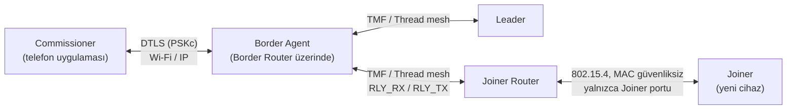

| Rol | Görev |
|---|---|
| **Commissioner** | Katılım isteklerini doğrular ve yetkilendirir; ağda aynı anda **bir** aktif commissioner olabilir. **Harici** (ağ dışında, ör. telefon) veya **native** (ağ içinde) olabilir. |
| **Border Agent** | Harici commissioner ile Thread ağı arasında güvenli köprü; DTLS sunucusu; MeshCoP mesajlarını Leader'a ve Joiner Router'lara aktarır. |
| **Leader** | Commissioner oturumunu kabul eder/sonlandırır; Commissioning Data'yı tutar. |
| **Joiner Router** | Joiner'ın komşusu olan router; Joiner'ın güvenliksiz DTLS paketlerini TMF içinde paketleyerek commissioner'a aktarır. |
| **Joiner** | Ağa katılmak isteyen cihaz; PSKd'ye sahiptir. |

### 16.3 Aşama 1 — Commissioner'ın Aktif Olması (Petition)

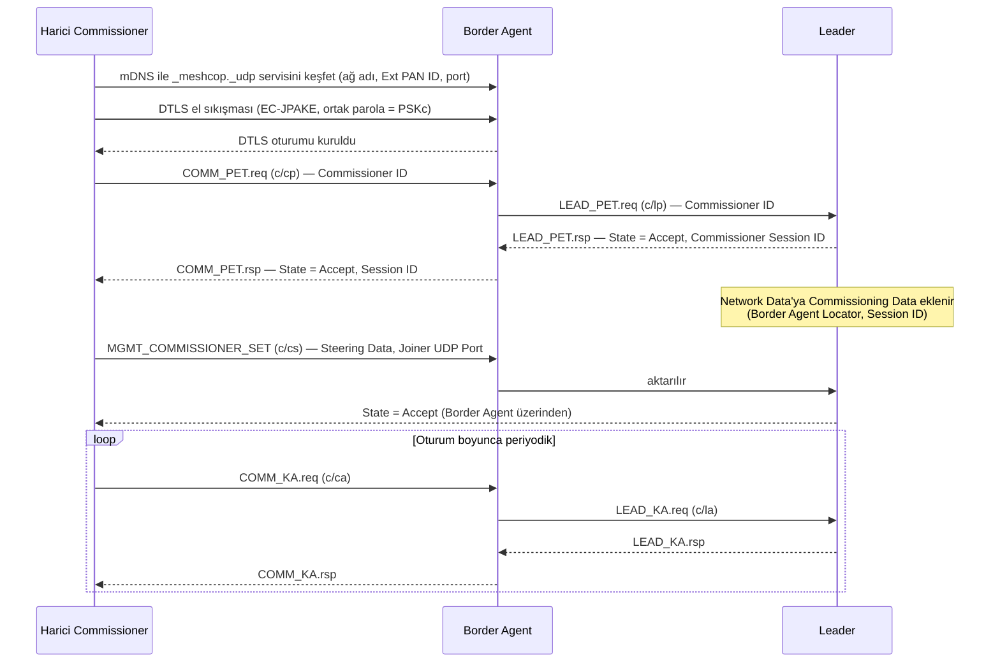

- Zaten aktif bir commissioner varsa Leader yeni petition'ı **reddeder**.
- Commissioner keep-alive göndermeyi bırakırsa (yaklaşık 50 saniyelik zaman aşımı) Leader oturumu kapatır ve Commissioning Data'yı Network Data'dan kaldırır.
- Commissioner kapanırken `State = Reject` içeren bir keep-alive ile oturumu kendisi de sonlandırabilir.

### 16.4 Joiner ID ve Steering Data

**Joiner ID**, Joiner'ın fabrika EUI-64'ünden türetilen 64 bitlik kimliktir:

```text
Joiner ID = SHA-256(EUI-64)'ün ilk 8 baytı, ilk baytta 0x02 biti (U/L) 1 yapılarak

Örnek: EUI-64 = 00 11 22 33 44 55 66 77
       SHA-256 = d1a5f998fa6ed82d…  →  Joiner ID = d3a5f998fa6ed82d
```

Joiner, katılım süresince MAC **Extended Address** olarak bu Joiner ID'yi kullanır. Böylece commissioner ve Joiner Router, Joiner'ı EUI-64'ünü açığa çıkarmadan tanır.

**Steering Data**, commissioner'ın "şu cihazların katılmasına izin veriyorum" bilgisini ağın tamamına küçük bir alanla yaymasını sağlayan bir **Bloom filtresi**dir:

| Özellik | Değer |
|---|---|
| Uzunluk | 1–16 bayt |
| Hash fonksiyonları | Joiner ID üzerinde **CRC16-CCITT** ve **CRC16-ANSI** |
| Bit indeksleri | Her CRC değeri mod (uzunluk × 8) → ilgili bit 1 yapılır |
| Tüm bitler 1 | **Her** joiner kabul edilir (joker, `*`) |
| Tüm bitler 0 | Hiçbir joiner kabul edilmez |

Joiner, Discovery Response'taki Steering Data'da kendi Joiner ID'sinin iki bitinin de 1 olup olmadığına bakar. İkisi de 1 ise "bu ağ beni kabul ediyor olabilir" der (Bloom filtresi olduğundan yanlış pozitif mümkündür; asıl doğrulama DTLS'te PSKd ile yapılır).

Thread 1.2 ile Joiner ID'ye alternatif olarak, uzunluğu ayarlanabilir bir **Joiner Discerner** değeri de kullanılabilir (ör. üretim hattında seri numarası tabanlı tanımlama için).

### 16.5 Aşama 2 — Joiner'ın Ağı Bulması

1. Joiner tüm kanallarda (veya yapılandırılmış kanal maskesinde) **MLE Discovery Request** gönderir (Joiner bayrağı = 1).
2. Devreye almaya açık ağların router'ları **Discovery Response** ile cevap verir: Extended PAN ID, Network Name, Steering Data, Joiner UDP Port, Commissioner UDP Port, sürüm, Native Commissioner bayrağı.
3. Joiner, Steering Data'sı kendisini kapsayan ağları sıralar (sinyal kalitesine göre) ve bir **Joiner Router** seçer.

### 16.6 Aşama 3 — DTLS, Finalize ve Entrust

```mermaid
sequenceDiagram
    participant J as Joiner
    participant JR as Joiner Router
    participant BA as Border Agent
    participant C as Commissioner
    J->>JR: DTLS ClientHello (UDP → Joiner UDP Port, MAC güvenliksiz)
    JR->>BA: RLY_RX.ntf (c/rx): Joiner UDP Port, Joiner IID, Joiner Router Locator, Joiner DTLS Encapsulation
    BA->>C: RLY_RX.ntf (commissioner DTLS oturumu içinde)
    C->>BA: RLY_TX.ntf (c/tx): DTLS kayıtları (ServerHello, EC-JPAKE)
    BA->>JR: RLY_TX.ntf
    JR->>J: DTLS kayıtları
    Note over J,C: EC-JPAKE el sıkışması, ortak parola = PSKd<br/>Tüm DTLS kayıtları bu röle yolundan gider
    J->>C: JOIN_FIN.req (c/jf, DTLS içinde): Vendor Name, Model, SW Version, Stack Version, Provisioning URL
    C-->>J: JOIN_FIN.rsp: State = Accept
    Note over J,C: Her iki taraf DTLS anahtar malzemesinden KEK türetir
    C->>BA: RLY_TX.ntf + Joiner Router KEK TLV
    BA->>JR: RLY_TX.ntf + KEK
    JR->>J: JOIN_ENT.ntf (c/je), MAC'te KEK ile şifreli (Key ID Mode 0)
    Note over J: Network Key, Key Sequence, Ext PAN ID, Network Name,<br/>Mesh-Local Prefix, Channel Mask, PSKc, Security Policy, Active Timestamp
    J-->>JR: JOIN_ENT.rsp
    Note over J: DTLS kapatılır. Joiner artık ağın kimlik bilgilerine sahip
    J->>JR: MLE Parent Request (normal attach, Bölüm 9.7)
```

**Önemli ayrıntılar:**

- Joiner henüz ağ anahtarına sahip olmadığı için Joiner ile Joiner Router arasındaki çerçeveler **MAC'te güvenliksizdir**. Joiner Router, güvenliksiz çerçeveleri yalnızca **Joiner UDP portuna** giden/gelen trafik için kabul eder; diğer her şeyi reddeder.
- DTLS kayıtları Joiner Router ile commissioner arasında TMF mesajlarının içinde (**Joiner DTLS Encapsulation TLV**) taşınır; Joiner Router DTLS'i çözemez.
- **JOIN_FIN** mesajında commissioner, Joiner'ın üretici/model/yazılım bilgisine bakarak kabul veya red kararı verebilir. Provisioning URL, uygulama düzeyinde ek kurulum adresini taşıyabilir.
- **JOIN_ENT** (Joiner Entrust) mesajı, ağın kimlik bilgilerini içerir ve **KEK** ile MAC seviyesinde şifrelenir. Böylece kimlik bilgileri havada düz metin olarak hiç görünmez.

### 16.7 Native Commissioning ve On-Mesh Commissioner

- **On-mesh commissioner**: Commissioner'ın kendisi Thread ağındaki bir cihazdır (ör. OpenThread CLI ile `commissioner start`). Border Agent gerekmez; Leader'a doğrudan petition yapar.
- **Native commissioning**: Security Policy'deki N bayrağı ile kontrol edilir; ağ içi bir commissioner'ın PSKc ile kimlik doğrulamasına izin verir.

### 16.8 Matter ile Devreye Alma (Bant Dışı)

Matter ekosistemlerinde Thread cihazları genellikle MeshCoP joiner akışını **kullanmaz**. Bunun yerine:

```mermaid
sequenceDiagram
    participant U as Kullanıcı / Telefon (Matter Commissioner)
    participant BR as Border Router
    participant D as Yeni Matter Cihazı
    U->>D: QR kodu okut (discriminator, setup passcode)
    U->>D: BLE ile bağlan, PASE (SPAKE2+, setup passcode)
    U->>D: Cihaz doğrulama (DAC/PAI sertifikaları), NOC yükleme
    U->>BR: Thread kimlik bilgilerini al (platform API / yerel depo)
    U->>D: Network Commissioning: AddOrUpdateThreadNetwork(Operational Dataset TLV'leri)
    U->>D: ConnectNetwork(Extended PAN ID)
    D->>BR: MLE Parent Request … Child ID Response (doğrudan attach)
    D->>BR: SRP ile servis kaydı (_matter._tcp)
    U->>D: CASE oturumu (IPv6 üzerinden), CommissioningComplete
```

- Güvenli kanal **BLE üzerindeki PASE** oturumudur; Thread Operational Dataset'i bu şifreli oturumla cihaza verilir.
- Cihaz, dataset'i aldıktan sonra doğrudan MLE attach yapar; Joiner/Commissioner/Joiner Router rolleri devreye girmez.
- Bu yöntemin ön koşulu, Matter commissioner'ın (telefon/hub) Thread ağının dataset'ine sahip olmasıdır. Ekosistemler bunu kendi Border Router'larından ve işletim sistemi API'lerinden (kimlik bilgisi paylaşımı) sağlar. Ayrıntılar Bölüm 23.

### 16.9 Thread 1.4: TCAT

**TCAT (Thread Commissioning over Authenticated TLS)**, Thread 1.4 ile tanımlanan, cihazı radyo dışı bir taşıyıcı (tipik olarak **BLE**) üzerinden **sertifika tabanlı TLS** ile devreye alma yöntemidir:

- Cihazda bir **TCAT Agent**, yönetici tarafında bir **TCAT Commander** bulunur.
- Kimlik doğrulama X.509 sertifikalarıyla yapılır; yetkilendirme sertifikadaki izinlere göre belirlenir.
- Commander, cihaza dataset yükleme, ağa katılma/ayrılma, teşhis bilgisi okuma gibi komutlar gönderebilir.
- Matter kullanmayan profesyonel/ticari Thread ürünleri için standart bir bant dışı devreye alma yolu sağlar.

### 16.10 Ekosistemler Arası Kimlik Paylaşımı ve ePSKc

Bir evde farklı üreticilerin Border Router'ları varsa, hepsinin **aynı Thread ağını** kullanması idealdir. Bunun için:

- **İşletim sistemi API'leri**: Mobil platformlar, uygulamaların "tercih edilen" Thread ağının kimlik bilgilerini güvenli şekilde saklayıp paylaşmasına izin veren API'ler sunar (ör. Apple'ın ThreadNetwork çerçevesi, Google Play services Thread Network API'si). Bir ekosistemin uygulaması, kullanıcı izniyle diğer ekosistemin ağına katılmak için bu bilgileri kullanabilir.
- **ePSKc (Ephemeral PSKc, Thread 1.4)**: Border Agent, kullanıcı istediğinde **kısa ömürlü** bir PSKc (ekranda gösterilen sayısal bir kod) üretir. Başka bir ekosistemin commissioner'ı bu geçici kodla Border Agent'a bağlanıp (ayrı bir mDNS servisi üzerinden, `_meshcop-e._udp`) ağın kimlik bilgilerini alabilir. Kod belirli bir süre sonra veya kullanımdan sonra geçersiz olur; kalıcı PSKc açığa çıkmaz.

### 16.11 OpenThread CLI ile Örnek Devreye Alma

**Commissioner tarafı (ağdaki bir cihaz):**

```text
> commissioner start
Commissioner: petitioning
Commissioner: active
Done
> commissioner joiner add d3a5f998fa6ed82d J01NME 120
Done
```

(`joiner add` için Joiner ID yerine EUI-64 veya tüm cihazlar için `*` de verilebilir; son parametre saniye cinsinden izin süresidir.)

**Joiner tarafı (yeni cihaz):**

```text
> ifconfig up
Done
> joiner start J01NME
Done
Join success
> thread start
Done
> state
child
```

### 16.12 Bölüm Özeti

- MeshCoP; Commissioner, Border Agent, Leader, Joiner Router ve Joiner rollerinden oluşur.
- Harici commissioner PSKc ile Border Agent'a DTLS/EC-JPAKE bağlanır ve Leader'dan oturum alır.
- Joiner, Discovery ile ağı bulur; Steering Data (Bloom filtresi) izin verilen joiner'ları gösterir.
- Joiner ↔ Commissioner DTLS'i (PSKd) Joiner Router ve Border Agent üzerinden rölelenir; kimlik bilgileri KEK ile şifreli JOIN_ENT ile teslim edilir.
- Matter, BLE + PASE ile bant dışı devreye alma yapar; Thread 1.4 TCAT ve ePSKc yeni standart yollar ekler.

## 17. Operational Dataset

### 17.1 Kavram

**Operational Dataset**, bir Thread ağının tüm kimlik ve çalışma parametrelerini içeren TLV kümesidir. Bir cihazın ağa bağlanabilmesi için bu dataset'e sahip olması gerekir; bu yüzden pratikte "Thread ağının kimlik bilgileri" (credentials) dendiğinde kastedilen budur.

İki tür dataset vardır:

| Dataset | Anlamı |
|---|---|
| **Active Operational Dataset** | Ağın **şu anda** kullandığı parametreler |
| **Pending Operational Dataset** | **Gelecekte** (bir gecikme süresi sonunda) geçerli olacak parametreler; ağ genelinde koordineli değişiklik için |

### 17.2 Active Dataset Bileşenleri

| MeshCoP TLV türü | Bileşen | Boyut | Açıklama |
|---|---|---|---|
| 14 | **Active Timestamp** | 8 | Dataset sürümü: 48 bit saniye + 15 bit "tick" (1/32768 s) + 1 bit U (authoritative) |
| 0 | **Channel** | 3 | Kanal sayfası (1) + kanal (2) |
| 53 | **Channel Mask** | değişken | Ağın kullanabileceği kanallar (sayfa + maske) |
| 2 | **Extended PAN ID** | 8 | Ağın benzersiz kimliği |
| 7 | **Mesh-Local Prefix** | 8 | /64 mesh-local önek |
| 5 | **Network Key** | 16 | Ağ anahtarı |
| 3 | **Network Name** | 1–16 | Ağ adı |
| 1 | **PAN ID** | 2 | MAC PAN ID |
| 4 | **PSKc** | 16 | Commissioner anahtarı |
| 12 | **Security Policy** | 3–4 | Rotasyon süresi + bayraklar (Bölüm 15.9) |

### 17.3 Pending Dataset

Pending Dataset, Active Dataset bileşenlerine ek olarak şunları içerir:

| TLV türü | Bileşen | Boyut | Açıklama |
|---|---|---|---|
| 51 | **Pending Timestamp** | 8 | Pending dataset'in sürümü |
| 52 | **Delay Timer** | 4 | Pending dataset'in Active olmasına kalan süre (milisaniye) |

Pending Dataset içindeki **Active Timestamp**, geçiş sonrası Active Dataset'in alacağı sürümdür ve mevcut olandan büyük olmalıdır.

**Delay Timer** ağ genelinde geri sayar. Süre dolduğunda **tüm cihazlar aynı anda** Pending Dataset'i Active yapar. Varsayılan gecikme tipik olarak **300 saniyedir**; bu süre, uyuyan cihazların da yeni dataset'i (poll/Data Request ile) almasına zaman tanır. Çok kısa gecikmeler bazı cihazların geride kalmasına neden olabilir.

### 17.4 Zaman Damgaları ve Sürüm Karşılaştırma

- Cihazlar MLE mesajlarında **Active/Pending Timestamp** TLV'lerini taşır.
- Bir cihaz, komşusunda kendisininkinden **daha büyük** zaman damgası görürse **Data Request** ile yeni dataset'i ister.
- Daha küçük zaman damgalı bir dataset asla daha büyüğünün yerine geçmez. Bu sayede eski bir dataset'le açılan cihaz ağı geri götüremez.
- İki partition farklı dataset'lerle birleşirse, kazanan partition'ın (ve daha yeni zaman damgasının) dataset'i yayılır.

### 17.5 Dataset Değiştirme

**Yıkıcı olmayan değişiklikler** (Network Name, PSKc, Security Policy, Channel Mask gibi) **MGMT_ACTIVE_SET** (`c/as`) ile, daha büyük bir Active Timestamp kullanılarak doğrudan yapılabilir.

**Yıkıcı değişiklikler** — **Channel, PAN ID, Mesh-Local Prefix, Network Key** — ağın tamamının aynı anda geçiş yapmasını gerektirir. Bunlar Active Set ile yapılamaz; **MGMT_PENDING_SET** (`c/ps`) ile Pending Dataset üzerinden yapılır:

```mermaid
sequenceDiagram
    participant C as Commissioner / BR (kanal yöneticisi)
    participant L as Leader
    participant R as Router'lar
    participant S as SED'ler
    C->>L: MGMT_PENDING_SET (c/ps): yeni Channel, Pending Timestamp, Delay Timer = 300 s, Active Timestamp (yeni)
    L-->>C: State = Accept
    L->>R: MLE Data Response (Pending Timestamp)
    R->>L: Data Request (Pending Dataset)
    R->>S: Child Update / Data Response (Pending Timestamp)
    S->>R: Data Request (Pending Dataset)
    Note over L,S: Herkes Delay Timer'ı geri sayar
    Note over L,S: Süre doldu: Pending → Active (yeni kanal)
    Note over L,S: Ağ yeni kanalda çalışmaya devam eder
    L->>R: Announce (eski kanallarda, geride kalanlar için)
```

**Geride kalan cihazlar:** Değişiklik sırasında kapalı olan veya uzun süre uyuyan cihazlar eski kanalda kalabilir. Bu cihazlar:

- Ebeveynlerini bulamayınca diğer kanalları tarayıp **Announce** mesajlarını yakalar ve yeni kanala geçer,
- veya commissioner/BR'nin **Announce Begin** (`c/ab`) ile tetiklediği duyuruları dinler.

### 17.6 Dataset TLV Kodlaması: Tam Örnek

Aşağıdaki onaltılık dize, OpenThread belgelerinde sıkça kullanılan örnek bir Active Dataset'tir (gerçek bir ağda **asla** bu değerleri kullanmayın):

```text
0e080000000000010000000300000f35060004001fffe0020811111111222222220708fdad70bfe5aa15dd
051000112233445566778899aabbccddeeff030e4f70656e54687265616444656d6f010212340410445f2b
5ca6f2a93a55ce570a70efeecb0c0402a0f7f8
```

| Ham TLV | Tür | Bileşen | Çözümlenmiş değer |
|---|---|---|---|
| `0e 08 0000000000010000` | 14 | Active Timestamp | saniye = 1, tick = 0, U = 0 |
| `00 03 00000f` | 0 | Channel | sayfa 0, kanal **15** |
| `35 06 00 04 001fffe0` | 53 | Channel Mask | sayfa 0, 4 baytlık maske; MSB-ilk bit sırasıyla kanal 11–26 |
| `02 08 1111111122222222` | 2 | Extended PAN ID | `1111111122222222` |
| `07 08 fdad70bfe5aa15dd` | 7 | Mesh-Local Prefix | `fdad:70bf:e5aa:15dd::/64` |
| `05 10 00112233…ddeeff` | 5 | Network Key | `00112233445566778899aabbccddeeff` |
| `03 0e 4f70656e…6d6f` | 3 | Network Name | "OpenThreadDemo" (14 bayt) |
| `01 02 1234` | 1 | PAN ID | `0x1234` |
| `04 10 445f2b5c…efeecb` | 4 | PSKc | `445f2b5ca6f2a93a55ce570a70efeecb` |
| `0c 04 02a0 f7f8` | 12 | Security Policy | 672 saat, `onrc`, sürüm eşiği 0 |

> [!NOTE]
> Channel Mask TLV'sinde bitler **MSB-ilk** sıralanır (ilk baytın en yüksek biti = kanal 0). Bu yüzden 11–26 kanalları TLV'de `0x001FFFE0` olarak görünür; OpenThread CLI ise aynı maskeyi alışılmış bit sırasıyla `0x07fff800` (bit n = kanal n) olarak gösterir.

Aynı dataset OpenThread CLI'de şöyle görünür:

```text
> dataset active
Active Timestamp: 1
Channel: 15
Channel Mask: 0x07fff800
Ext PAN ID: 1111111122222222
Mesh Local Prefix: fdad:70bf:e5aa:15dd::/64
Network Key: 00112233445566778899aabbccddeeff
Network Name: OpenThreadDemo
PAN ID: 0x1234
PSKc: 445f2b5ca6f2a93a55ce570a70efeecb
Security Policy: 672 onrc 0
Done
```

### 17.7 Diğer MeshCoP TLV'leri (Referans)

| Tür | TLV | Kullanım |
|---|---|---|
| 6 | Network Key Sequence | Joiner Entrust'ta güncel Key Sequence |
| 8 | Steering Data | Commissioning Data, Discovery Response |
| 9 | Border Agent Locator | Commissioning Data |
| 10 | Commissioner ID | Petition |
| 11 | Commissioner Session ID | Oturum doğrulama |
| 13 | Get | MGMT_*_GET: istenen TLV türleri |
| 15 | Commissioner UDP Port | Discovery Response |
| 16 | State | Accept (1) / Pending (0) / Reject (−1) |
| 17 | Joiner DTLS Encapsulation | RLY_RX/TX içinde DTLS kaydı |
| 18 | Joiner UDP Port | Discovery Response, RLY_RX/TX |
| 19 | Joiner IID | RLY_RX/TX: Joiner'ın link-local IID'si |
| 20 | Joiner Router Locator | RLY_RX/TX: Joiner Router'ın RLOC16'sı |
| 21 | Joiner Router KEK | RLY_TX: Joiner Entrust için KEK |
| 32 | Provisioning URL | JOIN_FIN |
| 33–37 | Vendor Name / Model / SW Version / Data / Stack Version | JOIN_FIN |
| 48 | UDP Encapsulation | Proxy (c/ur, c/ut) |
| 49 | IPv6 Address | Proxy |
| 54–57 | Count / Period / Scan Duration / Energy List | Energy Scan, PAN ID Query |
| 128 | Discovery Request | Thread Discovery TLV içinde |
| 129 | Discovery Response | Thread Discovery TLV içinde |

### 17.8 Dataset'in Yönetimi (OpenThread CLI)

| Komut | Açıklama |
|---|---|
| `dataset init new` | Rastgele değerlerle yeni bir dataset hazırlar (geçici tampon) |
| `dataset channel 20`, `dataset networkname Ev` … | Tampondaki alanları düzenler |
| `dataset commit active` | Tamponu Active Dataset olarak kaydeder |
| `dataset active -x` | Active Dataset'i onaltılık TLV dizisi olarak yazar (paylaşmak için) |
| `dataset set active <hex>` | Onaltılık TLV dizisinden Active Dataset yükler |
| `dataset mgmtsetcommand pending …` | Ağdaki Leader'a MGMT_PENDING_SET gönderir |
| `dataset updater start` | (OpenThread) Pending Dataset ile güvenli değişiklik başlatır |

### 17.9 Bölüm Özeti

- Operational Dataset, ağın kimlik bilgileridir: kanal, PAN ID, Extended PAN ID, ağ adı, mesh-local önek, Network Key, PSKc, Security Policy, zaman damgası.
- Zaman damgası büyük olan dataset kazanır; eskiler asla yenilerin yerine geçmez.
- Kanal, PAN ID, mesh-local önek ve Network Key değişiklikleri Pending Dataset + Delay Timer ile tüm ağda eşzamanlı yapılır.
- Geride kalan cihazlar Announce mesajlarıyla yeni kanala çağrılır.
- Dataset, onaltılık TLV dizisi olarak kolayca dışa/içe aktarılır; bu dizi gizli bilgi içerir ve korunmalıdır.

## 18. Uyuyan Cihazlar, Enerji Yönetimi ve CSL

### 18.1 Enerji Tüketiminin Kaynakları

Pille çalışan bir Thread cihazında enerjinin büyük kısmı radyoya gider. Tipik akım değerleri (çipe ve gerilime göre değişir):

| Durum | Tipik akım | Not |
|---|---|---|
| Derin uyku (RAM korumalı, RTC çalışıyor) | ≈ 1–3 µA | Cihaz zamanının > %99'unu burada geçirir |
| MCU aktif | ≈ 2–6 mA | Çip ve saat frekansına bağlı |
| Radyo alma (RX) | ≈ 4–10 mA | DC/DC dönüştürücü ile daha düşük |
| Radyo gönderme (TX, 0 dBm) | ≈ 5–10 mA | +8…+10 dBm'de 10–20 mA; FEM ile çok daha fazla |
| Kristal/radyo başlatma | kısa süreli tepe | Her uyanmada ek maliyet |

Enerji = akım × süre olduğu için tasarımın amacı, radyonun **açık kalma süresini** en aza indirmektir.

### 18.2 SED Çalışma Modeli

**Sleepy End Device (SED)** radyosunu kapalı tutar ve iki durumda uyanır:

1. **Uygulama olayı**: Sensör değeri değişti, düğmeye basıldı → veri gönderir.
2. **Poll zamanlayıcısı**: Belirli aralıklarla (**poll period**) ebeveynine **MAC Data Request** gönderip bekleyen veri olup olmadığını sorar (Bölüm 4.7).

| Parametre | Açıklama | Etkisi |
|---|---|---|
| **Poll period** | İki sorgu arasındaki süre | Kısa → düşük gecikme, yüksek tüketim; uzun → yüksek gecikme, düşük tüketim |
| **Child timeout** | Ebeveynin, sessiz kalan çocuğu silmeden önce beklediği süre (Timeout TLV) | Poll period'dan belirgin şekilde uzun olmalı |
| **Fast poll** | Bir istek gönderdikten sonra cevabı hızlı almak için geçici olarak sık poll | Cevap gecikmesini düşürür |

**Gecikme ilişkisi:** Bir SED'e giden mesaj, en kötü durumda bir poll period kadar ebeveynde bekler. 30 saniyelik poll period'lu bir kapı kilidine gönderilen "kilitle" komutu 30 saniye gecikebilir — bu yüzden etkileşimli cihazlarda kısa poll period, CSL veya Matter ICD'nin "aktif mod" mekanizmaları kullanılır.

### 18.3 Enerji Bütçesi Örneği

Kaba bir hesap (değerler örnek amaçlıdır):

```text
Uyku akımı              : 2 µA
Bir poll'un yükü        : ≈ 3 ms boyunca ortalama ≈ 10 mA   →  ≈ 30 µC
                          (kristal başlatma + CSMA + TX Data Request + ACK bekleme)

Poll period = 30 s      : 30 µC / 30 s = 1.0 µA
Ortalama                : 2 + 1.0 = 3.0 µA

Pil: CR2032 ≈ 220 mAh   : 220 mAh / 3.0 µA ≈ 73 000 saat ≈ 8 yıl (yalnızca poll + uyku)
```

Gerçek ömür; sensör ölçümleri, raporlar (ör. her 5 dakikada bir Matter raporu), yeniden iletimler, pilin kendi kendine boşalması ve sıcaklık etkileriyle bunun altında kalır. Yine de hesap, **poll period'un ve uyanma maliyetinin** ömrü belirleyen ana etkenler olduğunu gösterir:

| Poll period | Ortalama poll akımı (30 µC/poll) | Toplam (2 µA uyku ile) |
|---|---|---|
| 0.25 s | 120 µA | 122 µA (≈ 2.5 ay) |
| 1 s | 30 µA | 32 µA (≈ 9 ay) |
| 5 s | 6 µA | 8 µA (≈ 3 yıl) |
| 30 s | 1 µA | 3 µA (≈ 8 yıl) |
| 300 s | 0.1 µA | 2.1 µA (≈ 12 yıl) |

### 18.4 Child Timeout ve Canlı Tutma

- Çocuk, **Timeout TLV** ile ebeveynine bir zaman aşımı değeri bildirir (OpenThread varsayılanı 240 s).
- Ebeveyn bu süre boyunca çocuktan **hiçbir şey** duymazsa onu çocuk tablosundan siler ve onun için kuyruktaki paketleri atar.
- SED'in **poll'ları** etkinlik sayılır; ayrıca bir şey göndermesi gerekmez.
- Çocuk, kendi tarafında da zaman aşımından önce mutlaka bir mesaj (poll veya Child Update Request) gönderecek şekilde zamanlama yapar.
- Thread 1.2+ **Enhanced Keep-Alive**: Ebeveyne giden herhangi bir MAC veri çerçevesi canlılık göstergesi sayılır; MLE Child Update'e duyulan ihtiyaç azalır.

### 18.5 Child Supervision (Çocuk Denetimi)

Sorun: Ebeveyn kapanırsa, seyrek poll eden (veya hiç poll etmeyip yalnızca olay olduğunda veri gönderen) bir SED bunu uzun süre fark etmeyebilir; bu sürede ona gönderilen her şey kaybolur.

Çözüm — **Child Supervision**:

- Ebeveyn, bir çocuğa **supervision interval** süresince hiç çerçeve göndermediyse ona boş bir "denetim" çerçevesi kuyruğa koyar (çocuk poll edince alır).
- Çocuk, **supervision check timeout** süresince ebeveyninden hiçbir çerçeve almazsa ebeveynin kaybolduğunu varsayar ve yeniden bağlanma sürecini başlatır.
- Thread 1.3 ile denetim aralığı **Supervision Interval TLV** (MLE) ile çocuk tarafından ebeveyne bildirilir.

| Parametre | OpenThread varsayılanı |
|---|---|
| Supervision interval (ebeveyn) | 129 s |
| Supervision check timeout (çocuk) | 190 s |

### 18.6 Enhanced Frame Pending (Thread 1.2+)

Klasik 802.15.4'te Frame Pending biti yalnızca **Data Request**'e verilen ACK'de anlamlıdır. Thread 1.2 ile ebeveyn, SED'in gönderdiği **herhangi bir veri çerçevesinin** (Enhanced) ACK'inde Frame Pending = 1 ayarlayarak "senin için veri var" diyebilir. SED böylece ayrı bir Data Request göndermeden alıcısını açık tutar → bir uyanma ve bir TX tasarruf edilir. Özellikle istek-cevap trafiğinde (SED soru sorar, cevap hemen gelir) etkilidir.

### 18.7 CSL — Coordinated Sampled Listening (Thread 1.2+)

**CSL**, uyuyan cihazlara **düşük gecikmeyle ve düşük enerjiyle** veri ulaştırmak için tasarlanmış bir mekanizmadır. CSL kullanan uç cihaza **SSED (Synchronized Sleepy End Device)** denir.

#### Fikir

- SSED, **düzenli aralıklarla** (CSL period) çok kısa bir süre (birkaç milisaniye) kanalı **dinler** (sample). Gönderme yapmaz.
- Ebeveyn, SSED'in bir sonraki dinleme anını **bilir** ve göndereceği çerçeveyi tam o ana **zamanlar** (timed transmission).
- Poll'daki "TX Data Request + CSMA + ACK bekleme" maliyeti ortadan kalkar; her döngüde yalnızca kısa bir RX penceresi açılır.

```text
SSED radyosu:   ▁▁▁█▁▁▁▁▁▁▁▁▁█▁▁▁▁▁▁▁▁▁█▁▁▁▁▁▁▁▁▁█▁▁▁▁▁▁   (█ = kısa dinleme penceresi)
                   |<-- CSL period -->|
Ebeveyn TX:                           ▓                       (çerçeve, pencereye denk gelecek şekilde)
```

#### Senkronizasyon

| Bilgi | Taşıyıcı | Açıklama |
|---|---|---|
| **CSL Period** | MAC **CSL IE** (SSED'den ebeveyne giden çerçevelerde) | Dinleme periyodu, 10 sembol (160 µs) biriminde |
| **CSL Phase** | MAC **CSL IE** | Çerçevenin gönderildiği andan bir sonraki dinleme anına kalan süre (160 µs biriminde) |
| **CSL Channel** | MLE **CSL Channel TLV** | Dinlemenin yapılacağı kanal (genellikle ağ kanalı) |
| **CSL Synchronized Timeout** | MLE TLV | SSED'in en geç ne kadar sürede yeniden senkronizasyon sağlayacağı |
| **CSL Clock Accuracy** | MLE TLV | Saat doğruluğu (ppm) ve belirsizlik |

- SSED'in ebeveynine gönderdiği her çerçeve (veri veya ACK'li çerçeveler) CSL IE taşıdığı için ebeveyn zamanlamayı sürekli tazeler.
- SSED, **CSL Synchronized Timeout** süresi içinde hiçbir şey göndermezse ebeveyn senkronu kaybolmuş sayar; SSED bu süreden önce en az bir çerçeve (ör. boş veri veya poll) gönderir.

#### Saat kayması (drift) ve pencere genişliği

İki cihazın saatleri farklı hızlarda çalışır. Son senkrondan bu yana geçen süre arttıkça belirsizlik büyür:

```text
Belirsizlik ≈ geçen_süre × (ppm_ebeveyn + ppm_SSED) × 10⁻⁶ + sabit belirsizlik

Örnek: son senkrondan 60 s sonra, ±20 ppm + ±20 ppm saatler
       60 s × 40 × 10⁻⁶ = 2.4 ms  →  pencere her iki yönde ≈ 2.4 ms genişletilmeli
```

Bu yüzden CSL; doğru düşük frekans kristalleri (32.768 kHz, ±20–50 ppm) ve sık senkronizasyon ister. Ebeveyn, gönderimi pencerenin ortasına denk getirmek için kendi hesabını yapar.

#### SED (poll) ile SSED (CSL) karşılaştırması

| Özellik | SED (poll) | SSED (CSL) |
|---|---|---|
| Aşağı yön veri alma | Cihaz sorar (TX + RX) | Ebeveyn zamanlar, cihaz sadece dinler (RX) |
| Her döngünün maliyeti | ≈ birkaç ms TX/RX + CSMA | ≈ 1–2 ms RX penceresi |
| Tipik gecikme | Poll period (saniyeler–dakikalar) | CSL period (yüz milisaniyeler) |
| Ebeveyn gereksinimi | Her Thread router | Thread 1.2+ ebeveyn, zamanlı gönderim destekli radyo |
| Saat gereksinimi | Gevşek | Hassas (ppm), senkronizasyon |

**Örnek karşılaştırma (500 ms gecikme hedefi):**

```text
SED, poll = 500 ms   : 30 µC × 2 Hz            ≈ 60 µA
SSED, CSL = 500 ms   : ≈ 1.5 ms × 6 mA × 2 Hz  ≈ 18 µA   (+ periyodik senkron çerçeveleri)
```

### 18.8 Matter ICD (Intermittently Connected Device)

Matter, Thread uyuyan cihazlarının davranışını uygulama seviyesinde **ICD** (Intermittently Connected Device) kavramıyla standartlaştırır:

| Kavram | Açıklama | Thread karşılığı |
|---|---|---|
| **Idle Mode** | Cihaz çoğu zaman bu moddadır; seyrek uyanır | Uzun poll period (yavaş poll) |
| **Active Mode** | Etkileşim sırasında; hızlı cevap verir | Kısa poll period (hızlı poll) |
| **Idle Mode Duration** | Idle moddaki uyanma aralığı | Slow poll interval |
| **Active Mode Duration / Threshold** | Etkileşimden sonra aktif kalma süresi | Fast poll süresi |
| **SIT ICD** (Short Idle Time) | Yavaş poll aralığı kısa (≤ 15 s mertebesinde); denetleyici her an ulaşabilir | Klasik SED |
| **LIT ICD** (Long Idle Time) | Çok uzun uyku; denetleyiciye **Check-In** mesajlarıyla haber verir | Çok uzun poll period |

Matter'ın **MRP** (Message Reliability Protocol) yeniden iletim zamanlamaları da cihazın uyku/aktif aralıklarına göre ayarlanır; bu aralıklar DNS-SD kayıtlarında (`SII`, `SAI` anahtarları) ilan edilir. Ayrıntılar Bölüm 23.

### 18.9 Enerji Tasarımı İpuçları

1. **Mümkün olan en uzun poll period**'u seçin; etkileşim gerektiğinde fast poll / ICD aktif modunu kullanın.
2. **Ağ verisinden yalnızca stable kısmı** isteyin (Mode N = 0); gereksiz uyanmaları azaltır.
3. **Çoklu yayından kaçının**; SED'e ulaşan her çoklu yayın ayrı bir dolaylı iletimdir.
4. **İyi bir ebeveyn** seçimini sağlayın: Zayıf bağlantı = yeniden iletimler = boşa enerji. Kurulumda en az bir iyi router'ın yakında olduğundan emin olun.
5. **TX gücünü** ihtiyaca göre ayarlayın; gereğinden yüksek güç pil tüketir, gereğinden düşük güç yeniden iletim artırır.
6. **Raporları toplu gönderin**: Birden çok ölçümü tek mesajda birleştirin; her mesajın sabit bir uyanma maliyeti vardır.
7. **Uygulama yükünü küçük tutun**: Parçalanan paketler birden çok TX demektir.
8. **CSL** gerektiren cihazlarda düşük frekans kristalinin doğruluğuna dikkat edin.
9. **Matter abonelik (subscription) aralıklarını** (min/max interval) cihazın uyku profiline uygun seçin.

### 18.10 Bölüm Özeti

- Pilli cihazlarda enerjinin çoğu radyoya gider; hedef, radyonun açık kalma süresini en aza indirmektir.
- SED, poll period ile gecikme/enerji dengesi kurar; child timeout ve child supervision bağlantının sağlığını korur.
- Thread 1.2 Enhanced Frame Pending ve Enhanced Keep-Alive gereksiz uyanmaları azaltır.
- CSL, ebeveynin zamanlanmış gönderimiyle SSED'lere düşük gecikmeli ve verimli veri ulaştırır; hassas saat gerektirir.
- Matter ICD; aktif/boşta modları ve Check-In ile uyuyan cihaz davranışını uygulama seviyesinde standartlaştırır.

## 19. Border Router

### 19.1 Görevi

**Thread Border Router (BR)**, Thread mesh ağını Wi-Fi veya Ethernet gibi başka IP ağlarına (**altyapı ağı / infrastructure link**) bağlayan cihazdır. Önemli nokta: BR bir **protokol çeviricisi (gateway)** değil, bir **IP yönlendiricisidir**. Thread cihazları zaten IPv6 konuştuğu için BR paketleri çevirmeden yönlendirir (IPv4 erişimi için NAT64 istisnadır).

Thread 1.3 ile standartlaşan ve 1.4 ile zorunlu hâle gelen BR işlevleri:

| İşlev | Amaç |
|---|---|
| **IPv6 yönlendirme** | Thread ↔ altyapı ağı arasında paket iletimi |
| **OMR önek yönetimi** | Thread cihazlarına dışarıdan erişilebilir (Off-Mesh Routable) adres öneki sağlamak |
| **RA / RIO ilanları** | Altyapı ağındaki cihazlara Thread öneklerine giden yolu öğretmek |
| **On-link önek** | Altyapı ağında IPv6 yoksa ona IPv6 öneki sağlamak |
| **NAT64** | Thread cihazlarının IPv4 hedeflere erişmesi |
| **SRP sunucusu** | Thread cihazlarının servis (DNS-SD) kaydı |
| **Advertising Proxy** | Kayıtlı servisleri altyapı ağında mDNS ile duyurmak |
| **Discovery Proxy** | Thread cihazlarının altyapı ağındaki servisleri keşfetmesi |
| **Border Agent** | Harici commissioner erişimi (MeshCoP) |
| **Backbone Router** (1.2+) | Çoklu yayın (MLR) ve DUA desteği |
| **TREL** (1.3+) | Thread'i Wi-Fi/Ethernet üzerinden taşımak |
| **DHCPv6-PD** (1.4) | ISS'den global önek alarak Thread cihazlarına global IPv6 sağlamak |

```mermaid
flowchart LR
    subgraph INFRA["Altyapı ağı (Wi-Fi / Ethernet)"]
        PH["Telefon / Denetleyici"]
        WR["Ev router'ı"]
    end
    subgraph BRBOX["Border Router"]
        RM["Yönlendirme yöneticisi<br/>(OMR, RA/RIO, rotalar)"]
        SRP["SRP sunucusu +<br/>Advertising Proxy"]
        DP["Discovery Proxy /<br/>DNS"]
        N64["NAT64"]
        BA["Border Agent<br/>(MeshCoP)"]
        BBR["Backbone Router<br/>(MLR, DUA)"]
        OT["Thread yığını<br/>(wpan arayüzü)"]
    end
    subgraph TH["Thread mesh"]
        D1["Thread cihazları"]
    end
    PH <--> WR
    WR <--> RM
    RM <--> OT
    SRP <--> OT
    DP <--> OT
    N64 <--> OT
    BA <--> OT
    BBR <--> OT
    OT <-->|"802.15.4"| D1
```

### 19.2 OMR Öneki (Off-Mesh Routable Prefix)

Mesh-local adresler (ML-EID, RLOC) ağ dışına yönlendirilmez. Thread cihazlarının dış dünyayla konuşabilmesi için **OMR öneki** gerekir:

1. **Kaynak seçimi**:
    - Altyapı ağı **DHCPv6-PD** (prefix delegation) sunuyorsa (Thread 1.4), BR bir **global** /64 alır → Thread cihazları global IPv6 adreslerine sahip olur.
    - Aksi hâlde BR, kendi rastgele **ULA /48** öneğinden bir /64 türetir (ör. `fd4f:2d3c:ee9b:1::/64`).
2. **İlan**: BR öneki Network Data'ya `paros` bayraklarıyla (Preferred, SLAAC, default Route, On-mesh, Stable) ekler.
3. **Adres oluşturma**: Thread cihazları SLAAC ile bu önekten **OMR adresi** üretir.
4. **Birden çok BR**: Her BR kendi önekini yayınlarsa cihazlar çok sayıda adres üretirdi. Bunun yerine BR'ler Network Data'daki önekleri karşılaştırıp **tek bir "tercih edilen" (favored) OMR öneki** üzerinde uzlaşır (önce tercih değeri, sonra sayısal karşılaştırma); diğerleri kendi öneklerini geri çeker.

### 19.3 Altyapı Ağına Yönelik Yönlendirme: RA, RIO ve PIO

Wi-Fi'daki bir telefonun, `fd4f:2d3c:ee9b:1::/64` önekindeki bir Thread cihazına nasıl ulaşacağını bilmesi gerekir. BR bunu **ICMPv6 Router Advertisement (RA)** ile sağlar:

| RA seçeneği | İçerik | Etkisi |
|---|---|---|
| **RIO** (Route Information Option, RFC 4191) | OMR öneki (/64) + ömür + tercih | Altyapıdaki cihazlar "bu öneğe BR'nin link-local adresi üzerinden git" rotası ekler |
| **PIO** (Prefix Information Option) | On-link önek (yalnızca altyapıda IPv6 öneki yoksa) | Altyapıdaki cihazlar bu önekten adres alır; böylece IPv6 ile Thread'e konuşabilir |
| RA bayrakları | Thread BR'ler kendilerini "stub router" olarak tanıtır | Varsayılan yönlendirici gibi davranmaz; yalnızca belirli öneklere rota sunar |

**Ters yön (Thread → altyapı):** BR, Network Data'ya **Has Route** girdileri ekler:

- Altyapı ağının on-link öneki veya `fc00::/7` (ULA hedefleri),
- Altyapı ağında global IPv6 internet bağlantısı varsa `::/0`,
- NAT64 öneki (`/96`, N bayrağı ile).

> [!WARNING]
> Altyapı ağındaki cihazların **RIO'yu kabul etmesi** gerekir. Bazı işletim sistemleri veya yapılandırmalar RIO'yu varsayılan olarak yok sayar. Örneğin Linux'ta (ör. Home Assistant sunucusu) `net.ipv6.conf.<arayüz>.accept_ra_rt_info_max_plen` değeri en az 64 olmalı, IPv6 yönlendirme (forwarding) açıksa `accept_ra = 2` gerekir. Aksi hâlde denetleyici Thread cihazlarına ulaşamaz ve Matter cihazları "yanıt vermiyor" görünür.

### 19.4 NAT64 ve IPv4 Erişimi

Thread yalnızca IPv6 konuşur; ama birçok bulut servisi hâlâ yalnızca IPv4 ile erişilebilir. Çözüm **NAT64**:

1. BR bir **NAT64 öneki** (/96) belirler:
    - Altyapı ağı NAT64 sunuyorsa (RA'daki PREF64 seçeneği, RFC 8781, veya `ipv4only.arpa` sorgusu ile keşfedilen) onu kullanır,
    - yoksa kendi yerel NAT64 önekini (ör. `fd4f:2d3c:ee9b:2::/96`) oluşturur ve kendi NAT64 çeviricisini çalıştırır.
2. Önek Network Data'ya **Has Route + N bayrağı** ile eklenir.
3. Thread cihazı `93.184.216.34` IPv4 adresine ulaşmak istediğinde **IPv4-gömülü IPv6** adresi (RFC 6052) oluşturur: `fd4f:2d3c:ee9b:2::5db8:d822` veya iyi bilinen önekle `64:ff9b::5db8:d822`.
4. Paket BR'ye gider; BR IPv6 başlığını IPv4'e çevirip (durumlu NAT64, RFC 6146) gönderir; cevabı geri çevirir.
5. DNS tarafında IPv4-yalnız alan adları için AAAA kaydı sentezi (DNS64) ya cihazda (NAT64 önekini kullanarak) ya da BR'nin DNS hizmetinde yapılır.

### 19.5 Servis Keşfi: SRP, Advertising Proxy, Discovery Proxy

Klasik yerel ağlarda servis keşfi **mDNS** (çoklu yayın DNS) ile yapılır. Thread'de mDNS kullanmak kötü bir fikirdir: çoklu yayın pahalıdır ve uyuyan cihazlar sorgulara cevap veremez. Thread 1.3 bu sorunu **unicast DNS-SD** ile çözer:

#### SRP (Service Registration Protocol, RFC 9665)

- Thread cihazı, servislerini (ör. `_matter._tcp`) BR üzerindeki **SRP sunucusuna** DNS Update mesajlarıyla **kaydeder**.
- Kayıtlar cihazın açık anahtarıyla imzalanır (SIG(0), ECDSA P-256); aynı ismi başka bir cihaz ele geçiremez.
- Kayıtların bir **ömrü (lease)** vardır (ör. 2 saat) ve cihaz bunları periyodik yeniler; anahtar kaydı daha uzun ömürlüdür (ör. 14 gün).
- Cihazlar SRP sunucusunu Network Data'daki **DNS/SRP servis** girdilerinden (anycast `0x5C` veya unicast `0x5D`) bulur.
- Varsayılan alan adı: `default.service.arpa.`

#### Advertising Proxy

BR, SRP ile kaydedilen servisleri **altyapı ağında mDNS** ile yeniden yayınlar. Böylece Wi-Fi'daki bir telefon, Thread'deki bir Matter cihazını sıradan mDNS ile bulur — Thread'deki cihaz bu süreçte uyanmak zorunda kalmaz.

#### Discovery Proxy (RFC 8766)

Ters yönde, Thread cihazı altyapı ağındaki servisleri (ör. bir Matter denetleyicisi, yazıcı) bulmak isterse BR'ye **unicast DNS sorgusu** gönderir; BR bunu altyapıda mDNS sorgusuna çevirir ve sonuçları döner.

```mermaid
sequenceDiagram
    participant D as Thread Cihazı
    participant BR as Border Router (SRP + Adv. Proxy)
    participant P as Telefon (Wi-Fi)
    Note over D: Network Data'dan SRP sunucusunu bul
    D->>BR: SRP Update: host "abcd1234", AAAA = OMR adresi,<br/>servis _matter._tcp, SRV port 5540, TXT, lease 2 saat
    BR-->>D: Update başarılı
    BR->>P: mDNS ilanı (altyapı ağında): _matter._tcp, AAAA kaydı
    P->>BR: (gerekirse) mDNS sorgusu _matter._tcp
    BR-->>P: mDNS cevabı (Thread cihazının OMR adresi)
    P->>BR: Matter mesajı → OMR adresi (RIO rotası ile BR'ye)
    BR->>D: Thread mesh üzerinden ilet
```

### 19.6 Border Agent ve mDNS İlanı

Border Agent, harici commissioner'ların ağı bulabilmesi için kendini altyapı ağında **`_meshcop._udp`** servisi olarak mDNS ile duyurur. TXT kaydındaki tipik anahtarlar:

| Anahtar | Anlamı |
|---|---|
| `rv` | Kayıt sürümü |
| `tv` | Thread sürümü (ör. `1.4.0`) |
| `nn` | Network Name |
| `xp` | Extended PAN ID |
| `xa` | Border Agent cihazının Extended Address'i |
| `sb` | Durum bit eşlemi (bağlantı modu, Thread arayüz durumu, BBR durumu, ePSKc desteği vb.) |
| `at` | Active Timestamp |
| `pt` | Partition ID |
| `vn` / `mn` | Üretici adı / model adı |
| `id` | Border Agent kimliği (yeniden başlatmalarda sabit) |
| `sq` / `bb` / `dn` | BBR sıra numarası / BBR portu / Thread Domain adı (BBR etkinse) |

SRV kaydı Border Agent'ın UDP portunu (OTBR varsayılanı 49191) verir. Thread 1.4 ePSKc için ayrı bir servis (`_meshcop-e._udp`) yalnızca geçici kod etkinken ilan edilir.

### 19.7 Birden Fazla Border Router

Bir Thread ağında birden çok BR bulunması **önerilir** (yedeklilik):

- Her BR kendi rota/önek/servis girdilerini Network Data'ya ekler; BR'ler OMR öneki, NAT64 öneki ve SRP sunucusu gibi konularda **uzlaşma kuralları** (tercih + sayısal karşılaştırma + sıra numarası) ile tek bir seçim üzerinde anlaşır.
- Thread cihazları dışarı giden trafik için **en yakın** (yol maliyeti en düşük) uygun BR'yi seçer.
- Bir BR kapanırsa Leader onun girdilerini Network Data'dan kaldırır; trafik otomatik olarak diğer BR'ye kayar. OMR öneki BR'ler arasında ortak olduğu için cihazların adresleri değişmez.
- SRP kayıtlarının tek bir BR'de kalmaması için cihazlar, SRP sunucusu değiştiğinde kayıtlarını yeni sunucuya yeniden yapar.

> [!TIP]
> Farklı ekosistemlerin BR'lerinin **aynı Thread ağında** olması, yedekliliğin gerçekten işe yaraması için şarttır. Ayrı ağlar kuran BR'ler birbirinin yedeği olamaz. Kurulumdan sonra BR'lerin aynı Extended PAN ID'yi gösterdiğini (ör. ekosistem uygulamalarından veya `_meshcop._udp` ilanlarından) kontrol edin.

### 19.8 OpenThread Border Router (OTBR) Mimarisi

Linux tabanlı BR'lerin referans uygulaması **ot-br-posix**'tir:

```mermaid
flowchart TB
    subgraph HOST["Linux Host (ör. Raspberry Pi, Wi-Fi router)"]
        AG["otbr-agent<br/>(OpenThread çekirdeği POSIX'te çalışır)"]
        WPAN["wpan0<br/>(TUN arayüzü)"]
        MDNS["mDNS<br/>(Avahi / mDNSResponder / dahili)"]
        WEB["Web arayüzü / REST API"]
        DBUS["D-Bus API"]
        CTL["ot-ctl (CLI)"]
        FW["Güvenlik duvarı / NAT64"]
        ETH["eth0 / wlan0"]
    end
    RCP["RCP<br/>(802.15.4 radyo + sub-MAC)<br/>ör. nRF52840, EFR32, ESP32-H2"]
    AG <-->|"Spinel / HDLC<br/>UART · SPI · USB"| RCP
    AG <--> WPAN
    AG <--> MDNS
    AG <--> WEB
    AG <--> DBUS
    CTL <--> AG
    WPAN <--> FW <--> ETH
```

| Bileşen | Görev |
|---|---|
| **otbr-agent** | OpenThread yığınını (FTD) Linux üzerinde çalıştırır; RCP ile Spinel protokolüyle konuşur; BR mantığı (Routing Manager, SRP, Border Agent, BBR, NAT64) buradadır |
| **RCP** | Radyo eş işlemcisi: yalnızca 802.15.4 PHY/MAC alt katmanını (CSMA, ACK, zamanlama, şifreleme hızlandırma) çalıştırır |
| **wpan0** | Thread ağını Linux'a sıradan bir ağ arayüzü olarak gösteren TUN arayüzü |
| **mDNS** | Advertising/Discovery Proxy ve Border Agent ilanları |
| **REST API / Web** | Yönetim ve izleme (ör. dataset okuma/yazma, teşhis) |
| **Güvenlik duvarı** | Altyapıdan Thread'e yalnızca izin verilen trafiğin (ör. OMR hedefli) geçmesini sağlar; mesh-local öneki korur |

Örnek radyo URL'si: `spinel+hdlc+uart:///dev/ttyACM0?uart-baudrate=460800`

### 19.9 Güvenlik Duvarı ve Giriş Filtreleme

BR, altyapı ağından Thread'e giden trafiği filtreler:

- **Mesh-local önekli** hedeflere dışarıdan gelen paketler engellenir.
- Yalnızca Thread'deki **OMR/on-mesh** önekli hedeflere giden paketler iletilir.
- TMF (61631) ve MLE (19788) gibi Thread kontrol portlarına dışarıdan erişim kapalıdır.
- Kaynak adresi Thread öneklerinden biri gibi görünen sahte (spoofed) paketler reddedilir.

### 19.10 Bölüm Özeti

- Border Router, Thread ile Wi-Fi/Ethernet arasında çeviri değil IPv6 yönlendirme yapar.
- OMR öneki (ULA veya DHCPv6-PD ile global) Thread cihazlarına dışarıdan erişilebilir adres verir; RIO ile altyapıya duyurulur.
- NAT64 ile IPv4 erişimi, SRP + Advertising/Discovery Proxy ile multicast'siz servis keşfi sağlanır.
- Border Agent `_meshcop._udp` ile ilan edilir; Thread 1.4 ePSKc geçici erişim sunar.
- Birden fazla BR uzlaşma kurallarıyla tek OMR öneki ve SRP sunucusu üzerinde birleşir; yedeklilik ancak aynı ağdaysalar işe yarar.
- OTBR: otbr-agent (Linux) + RCP (radyo) + Spinel; Home Assistant gibi sistemler bunu kullanır.

## 20. Thread 1.2, 1.3 ve 1.4 Gelişmiş Özellikleri

### 20.1 Sürümlere Göre Özellik Matrisi

| Özellik | 1.1 | 1.2 | 1.3 | 1.4 |
|---|---|---|---|---|
| Temel mesh, MLE, 6LoWPAN, MeshCoP | ✔ | ✔ | ✔ | ✔ |
| 802.15.4-2015 çerçeveleri, Enhanced ACK, Header IE | | ✔ | ✔ | ✔ |
| CSL (SSED), Enhanced Frame Pending, Enhanced Keep-Alive | | ✔ | ✔ | ✔ |
| Link Metrics | | ✔ | ✔ | ✔ |
| Thread Domain, Backbone Router, DUA, MLR | | ✔ | ✔ | ✔ |
| Commercial Commissioning (CCM) | | ✔ | ✔ | ✔ |
| Thread Border Router şartnamesi (OMR, RA/RIO, SRP, proxy'ler, NAT64) | | | ✔ | ✔ |
| TREL (Wi-Fi/Ethernet üzerinden Thread) | | | ✔ | ✔ |
| SRP istemcisi / DNS istemcisi (cihaz tarafı) | | | ✔ | ✔ |
| TCP desteği | | | ✔ | ✔ |
| Supervision Interval TLV | | | ✔ | ✔ |
| Zorunlu ve birlikte çalışabilir BR yetenekleri | | | | ✔ |
| ePSKc (geçici commissioner anahtarı), kimlik paylaşımı | | | | ✔ |
| DHCPv6-PD ile global OMR öneki | | | | ✔ |
| Gelişmiş ağ teşhisi (yeni TLV'ler, sorgu/cevap) | | | | ✔ |
| TCAT (TLS tabanlı devreye alma) | | | | ✔ |

### 20.2 Thread 1.2

Thread 1.2'nin iki ana teması vardı: **daha verimli uyuyan cihazlar** ve **daha büyük/kurumsal ağlar**.

#### 20.2.1 802.15.4-2015 Özellikleri

- **Enhanced ACK**: IE taşıyabilen, güvenli olabilen ACK çerçevesi. CSL fazı ve Link Metrics verisini taşır.
- **Header IE'ler**: CSL IE, vendor-specific IE (Link Metrics) vb. (Bölüm 4.10).
- **Çerçeve sürümü 2015**: Yalnızca bu özellikleri destekleyen eşler arasında kullanılır; 1.1 cihazlarla 2006 sürümü kullanılmaya devam eder.

#### 20.2.2 Enerji Özellikleri

- **CSL** ve **SSED** (Bölüm 18.7),
- **Enhanced Frame Pending** (Bölüm 18.6),
- **Enhanced Keep-Alive**: Veri çerçeveleri canlılık sinyali sayılır.

#### 20.2.3 Link Metrics (Bağlantı Ölçümleri)

Bir cihazın (Initiator) bir komşusundan (Subject) bağlantı kalitesi ölçümleri istemesini sağlar.

| Ölçüm türü | Nasıl çalışır? |
|---|---|
| **Single Probe** | Initiator, MLE Data Request içinde **Link Metrics Query** gönderir; Subject o mesaja ait ölçümleri **Link Metrics Report** ile döner |
| **Forward Tracking Series** | Initiator, **Link Metrics Management Request** ile bir ölçüm serisi tanımlar (hangi çerçeve türleri sayılacak); ardından **Link Probe** mesajları/veri çerçeveleri gönderir; sonra seriyi sorgular ve birikmiş (ortalama) sonuçları alır |
| **Enhanced-ACK Based Probing** | Initiator, Subject'ten her Enhanced ACK'in içine ölçüm koymasını ister (vendor-specific Header IE); sürekli ve ek mesajsız izleme sağlar |

**Ölçülebilen değerler:** Layer 2 PDU sayısı, **LQI**, **Link Margin**, **RSSI**.

**Kullanım alanları:** SSED'lerin ebeveyn bağlantısını izlemesi ve gerekirse CSL/TX gücü ayarlaması, ağ teşhisi, daha iyi ebeveyn seçimi.

```mermaid
sequenceDiagram
    participant I as Initiator (ör. SSED)
    participant S as Subject (ebeveyn)
    I->>S: Link Metrics Management Request (Forward Series ID 1, ölçümler: LQI + Link Margin)
    S-->>I: Link Metrics Management Response (Status = Success)
    loop Ölçüm süresince
        I->>S: Link Probe / veri çerçeveleri
    end
    I->>S: Data Request + Link Metrics Query (Series ID 1)
    S-->>I: Data Response + Link Metrics Report (ortalama LQI, Link Margin)
```

#### 20.2.4 Thread Domain, Backbone Router ve DUA

**Problem:** Büyük bir binada tek Thread ağı yetmez (32 router sınırı, atlama sayısı, kanal kapasitesi). Birden fazla Thread ağı kurulur; ama bu ağlardaki cihazların birbirine ve bina ağına **tek bir IPv6 alanı** gibi ulaşabilmesi istenir.

**Çözüm:** Birden çok Thread ağı, ortak bir **omurga bağlantısı (backbone link)** (tipik olarak Ethernet) üzerinden birleşerek bir **Thread Domain** oluşturur.

```mermaid
flowchart TB
    BB["Omurga bağlantısı (Ethernet / IPv6)<br/>Domain öneki: fd00:7d03:7d03:7d03::/64"]
    subgraph T1["Thread Ağı 1 (kat 1)"]
        P1["Primary BBR 1"]
        S1["Secondary BBR"]
        D1["Cihaz A<br/>DUA: fd00:7d03:7d03:7d03::a"]
    end
    subgraph T2["Thread Ağı 2 (kat 2)"]
        P2["Primary BBR 2"]
        D2["Cihaz B<br/>DUA: fd00:7d03:7d03:7d03::b"]
    end
    P1 --- BB
    S1 --- BB
    P2 --- BB
    D1 -.- P1
    D2 -.- P2
```

| Kavram | Açıklama |
|---|---|
| **Backbone Router (BBR)** | Thread ağını omurgaya bağlayan BR işlevi. Network Data'ya BBR servisi olarak kaydolur (sıra numarası, yeniden kayıt gecikmesi, MLR zaman aşımı). |
| **Primary BBR (PBBR)** | Her Thread ağında aktif olan tek BBR; ALOC'u `0xFC38`. Diğer BBR'ler **Secondary** olarak bekler ve Primary kaybolursa devralır. |
| **Domain Prefix** | Domain genelinde ortak /64 önek; Network Data'da **D** bayrağıyla ilan edilir. |
| **DUA (Domain Unicast Address)** | Cihazın Domain Prefix'ten oluşturduğu adres. Cihaz Domain içinde başka bir Thread ağına geçse bile aynı kalabilir. |

**DUA kaydı akışı:**

1. Cihaz Domain Prefix'i görünce bir **DUA** oluşturur.
2. **DUA.req** (`n/dr`) ile Primary BBR'ye kaydeder (ML-EID'si ile birlikte).
3. PBBR, omurga üzerinde diğer BBR'lere **Backbone Query** (`b/bq`) göndererek adresin başka yerde kullanılıp kullanılmadığını denetler (Duplicate Address Detection).
4. Çakışma yoksa kaydı kabul eder ve omurgada bu adres için **ND Proxy** olarak davranır: omurgadaki cihazlar DUA'ya NS gönderdiğinde PBBR kendi adına cevap verir ve paketleri Thread ağına yönlendirir.
5. Cihaz kaydını periyodik olarak yeniler.

**MLR (Multicast Listener Registration):** Cihazlar admin-local ve daha geniş kapsamlı çoklu yayın aboneliklerini **MLR.req** (`n/mr`) ile PBBR'ye kaydeder; PBBR omurgada MLD dinleyicisi olur ve eşleşen çoklu yayınları Thread'e aktarır (Bölüm 14.5).

#### 20.2.5 Commercial Commissioning Mode (CCM)

Ticari binalarda yüzlerce cihazı tek tek PSKd ile devreye almak pratik değildir. CCM, **sertifika tabanlı otonom kayıt** sağlar:

- Cihazlar üretimde bir **IDevID** (üreticinin imzaladığı cihaz kimlik sertifikası) ile gelir.
- Domain'deki bir **Registrar** (genellikle BBR/BR üzerinde), cihazın kimliğini üreticinin doğrulama servisi (voucher mantığı, BRSKI benzeri) ile doğrular.
- Cihaza Domain'e özgü bir **LDevID** sertifikası (EST benzeri bir süreçle, CoAP üzerinden) verilir ve ağ anahtarı güvenli şekilde sağlanır.
- Security Policy'deki CCM ile ilgili bayraklar (Bölüm 15.9) bu davranışları kontrol eder.

CCM özellikle kurumsal/bina otomasyonu senaryoları içindir; tüketici akıllı evlerinde Matter devreye alması yaygındır.

### 20.3 Thread 1.3

Thread 1.3'ün ana teması **Border Router standardizasyonu ve Matter ile uyum**dur.

#### 20.3.1 Thread Border Router Özellikleri

OMR önek yönetimi, RA/RIO, on-link önek, NAT64, SRP sunucusu, Advertising Proxy, Discovery Proxy, çoklu yayın yönlendirme — ayrıntılar Bölüm 19.

#### 20.3.2 Cihaz Tarafı Servisler

- **SRP istemcisi**: Cihazlar servislerini BR'ye kaydeder (Matter için zorunlu).
- **DNS istemcisi**: Cihazlar BR üzerinden unicast DNS / DNS-SD sorguları yapabilir.
- **TCP**: Düşük güçlü cihazlar için optimize edilmiş bir TCP uygulaması (OpenThread'de TCPlp) tanımlanmıştır.

#### 20.3.3 TREL — Thread Radio Encapsulation Link

**TREL**, Thread'in MAC çerçevelerini **UDP/IPv6 içinde** altyapı ağları (Wi-Fi/Ethernet) üzerinden taşıyan ikinci bir "radyo" bağlantısıdır.

```mermaid
flowchart LR
    subgraph ODA1["Salon"]
        BR1["Border Router 1<br/>802.15.4 + TREL"]
        A["Thread cihazları"]
    end
    subgraph ODA2["Bodrum"]
        BR2["Border Router 2<br/>802.15.4 + TREL"]
        B["Thread cihazları"]
    end
    A -.-|"802.15.4"| BR1
    B -.-|"802.15.4"| BR2
    BR1 <-->|"TREL: UDP/IPv6 üzerinden Wi-Fi/Ethernet"| BR2
```

| Özellik | Açıklama |
|---|---|
| Keşif | Altyapı ağında DNS-SD **`_trel._udp`** servisi; TXT kaydında Extended Address (`xa`) ve Extended PAN ID (`xp`) |
| Taşıma | Tekil UDP/IPv6 (çoklu yayın gerektiğinde altyapı çoklu yayını) |
| Güvenlik | Thread güvenliği korunur; TREL için Network Key'den ayrı bir anahtar türetilir |
| Çoklu radyo | Bir router'ın aynı komşuya hem 802.15.4 hem TREL ile bağlantısı olabilir; yönlendirme her bağlantının kalitesine göre en iyisini seçer |
| Fayda | Farklı odalardaki/katlardaki BR'leri tek mesh'te birleştirir; çok atlamalı radyo yollarını kısaltır; Ethernet/Wi-Fi'ın yüksek bant genişliğini kullanır |

TREL ile birleşen BR'ler, aralarında radyo bağlantısı olmasa bile **tek partition** oluşturur; böylece "aynı evde iki ayrı Thread adası" sorunu azalır.

### 20.4 Thread 1.4

Thread 1.4 (Eylül 2024'te duyuruldu), Thread'in tüketici ekosistemlerinde yaşanan pratik sorunlara odaklanır:

| Alan | İçerik |
|---|---|
| **Border Router birlikte çalışabilirliği** | Daha önce isteğe bağlı olan birçok BR davranışı zorunlu hâle getirildi ve sertifikasyonla doğrulanıyor; farklı üreticilerin BR'leri aynı ağda daha öngörülebilir davranır |
| **Kimlik bilgisi paylaşımı** | **ePSKc**: Border Agent'ın ürettiği kısa ömürlü kodla başka ekosistemlerin mevcut ağa güvenle katılması; ekosistemlerin tek ağ kullanması teşvik edilir |
| **Gelişmiş internet bağlantısı** | **DHCPv6-PD** ile ISS'den alınan global öneklerin OMR olarak kullanılması → Thread cihazlarına global IPv6; NAT64 ve DNS iyileştirmeleri |
| **Gelişmiş ağ teşhisi** | Çocuk tabloları, router komşuları, MLE sayaçları gibi yeni teşhis TLV'leri; sorgu kimlikli (Query ID) çoklu cevap mekanizması; ağ topolojisinin uzaktan çıkarılması |
| **TCAT** | TLS ve sertifikalarla, BLE gibi bir taşıyıcı üzerinden Thread devreye alma (Bölüm 16.9) |

### 20.5 Sürüm Uyumluluğu Nasıl Yönetilir?

- **Version TLV** (MLE): Her cihaz kendi Thread sürümünü bildirir (1.1 = 2, 1.2 = 3, 1.3 = 4, 1.4 = 5). Özellikler yalnızca destekleyen eşler arasında kullanılır.
- **Security Policy VR (Version Threshold for Routing)**: Ağ yöneticisi, router olabilecek cihazlar için asgari sürüm belirleyebilir.
- **Çerçeve sürümü**: 2015 çerçeveleri yalnızca 1.2+ eşlere gönderilir.
- **Network Data**: Yeni bayraklar/servisler eski cihazlar tarafından yok sayılır.

### 20.6 Gelecek Yönelimleri

Thread Group'un yol haritası kamuya tam açık olmamakla birlikte; daha düşük güçlü yeni bağlantı modları (ör. uyandırma çerçeveleri ve eşler arası doğrudan bağlantılar), daha büyük ve ticari dağıtımlar, Border Router ve teşhis özelliklerinin olgunlaşması gibi başlıklar topluluk ve OpenThread geliştirmelerinde öne çıkmaktadır. Bu alanlardaki özellikler resmî sürümlere girene kadar deneysel kabul edilmelidir.

### 20.7 Bölüm Özeti

- 1.2: 802.15.4-2015, CSL/SSED, Link Metrics, Thread Domain + BBR + DUA + MLR, CCM.
- 1.3: Border Router şartnamesi (OMR, RIO, SRP, proxy'ler, NAT64), TREL, cihaz tarafı SRP/DNS, TCP.
- 1.4: Zorunlu BR yetenekleri, ePSKc ile kimlik paylaşımı, DHCPv6-PD, gelişmiş teşhis, TCAT.
- Sürümler Version TLV ve geriye uyumlu kodlamalarla bir arada çalışır.

## 21. Ağ Teşhisi, İzleme ve Paket Analizi

### 21.1 Network Diagnostics (Ağ Teşhis) Protokolü

Thread, bir cihazın başka bir cihazın iç durumunu uzaktan sorgulayabilmesi için TMF tabanlı bir teşhis mekanizması tanımlar:

| URI | Kullanım |
|---|---|
| `d/dg` | **Diagnostic Get**: Belirli bir cihazdan (RLOC/ML-EID) istenen TLV'leri ister; cevap aynı CoAP alışverişinde döner |
| `d/dq` + `d/da` | **Diagnostic Get Query / Answer**: Çoklu yayın (ör. `ff03::1`) ile birçok cihaza sorgu; her cihaz ayrı bir Answer mesajıyla cevap verir |
| `d/dr` | **Diagnostic Reset**: Belirli sayaçları sıfırlar |

#### Teşhis TLV'leri

| Tür | TLV | İçerik |
|---|---|---|
| 0 | Extended MAC Address | Cihazın Extended Address'i |
| 1 | Address16 | RLOC16 |
| 2 | Mode | R/D/N bitleri |
| 3 | Timeout | Child timeout (çocuklar için) |
| 4 | Connectivity | Connectivity TLV (Bölüm 9.6) |
| 5 | Route64 | Yönlendirme bilgisi |
| 6 | Leader Data | Partition, Leader, sürümler |
| 7 | Network Data | Cihazın gördüğü Network Data |
| 8 | IPv6 Address List | Cihazın IPv6 adresleri |
| 9 | MAC Counters | MAC katmanı sayaçları |
| 14 | Battery Level | Pil seviyesi (%) |
| 15 | Supply Voltage | Besleme gerilimi (mV) |
| 16 | Child Table | Çocuk tablosu (router'lar için) |
| 17 | Channel Pages | Desteklenen kanal sayfaları |
| 18 | Type List | (İstekte) istenen TLV türlerinin listesi |
| 19 | Max Child Timeout | Çocuklardan en büyük timeout |
| 23 | EUI-64 | Fabrika EUI-64'ü |
| 24 | Version | Thread sürümü |
| 25 / 26 / 27 | Vendor Name / Model / SW Version | Üretici bilgileri |
| 28 | Thread Stack Version | Yığın sürüm dizesi |
| 29 | Child | (1.4) Ayrıntılı çocuk bilgisi |
| 30 | Child IPv6 Address List | (1.4) Çocuğun adresleri |
| 31 | Router Neighbor | (1.4) Router komşu bilgisi |
| 32 / 33 | Answer / Query ID | (1.4) Çok parçalı cevap yönetimi |
| 34 | MLE Counters | (1.4) MLE rol/attach sayaçları |
| 35 | Vendor App URL | Üretici uygulama adresi |

#### Örnek

```text
> networkdiagnostic get fdde:ad00:beef:0:0:ff:fe00:9400 0 1 5 6 9 16
DIAG_GET.rsp/ans from fdde:ad00:beef:0:0:ff:fe00:9400:
Ext Address: 8e1f00ab23cd45ef
Rloc16: 0x9400
Route: …
Leader Data: PartitionId:0x3f8a12c4 Weighting:64 DataVersion:118 StableDataVersion:74 LeaderRouterId:23
MAC Counters: …
Child Table: …
```

OpenThread'in `meshdiag topology` gibi komutları, bu mekanizmayı kullanarak tüm ağın router/çocuk topolojisini tek komutla çıkarabilir.

### 21.2 Teşhis İçin OpenThread CLI Komutları

| Komut | Ne gösterir? | Neye bakılır? |
|---|---|---|
| `state` | Rol (disabled/detached/child/router/leader) | Cihaz beklenen rolde mi? |
| `rloc16`, `extaddr` | Adresler | Kimlik |
| `leaderdata` | Partition ID, weighting, sürümler, Leader Router ID | Ağda birden çok partition var mı? (farklı cihazlarda farklı Partition ID) |
| `router table` | Router'lar, LQ In/Out, yol maliyeti, sonraki atlama | Zayıf (LQ 1) bağlantılar, uzak router'lar |
| `child table` | Çocuklar, timeout, yaş, mod, sürüm, CSL | Çocuk sayısı, kopan çocuklar |
| `neighbor table` | Tüm komşular (router + çocuk) ve RSSI | Sinyal seviyeleri |
| `parent` | Ebeveyn ve link kalitesi (çocuklar için) | Ebeveyn bağlantısı iyi mi? |
| `counters mac` / `counters mle` | MAC ve MLE sayaçları | Yeniden iletim, CCA hatası, attach/rol değişim sayıları |
| `netdata show` | Network Data | Önekler, rotalar, SRP/BBR servisleri |
| `ipaddr`, `ipmaddr` | Adresler ve abonelikler | OMR adresi var mı? |
| `channel`, `panid`, `extpanid`, `networkname` | Ağ parametreleri | Doğru ağda mı? |
| `dataset active` | Active Dataset | Zaman damgası, kanal |
| `ping <adres>` | Erişilebilirlik ve gecikme | Uçtan uca bağlantı |
| `scan`, `discover`, `scan energy` | Çevredeki ağlar ve kanal gürültüsü | Kanal seçimi, yabancı ağlar |
| `channel monitor` | Kanal doluluk örneklemesi | Wi-Fi girişimi |
| `pollperiod`, `childtimeout`, `csl` | Uyuyan cihaz ayarları | Enerji/gecikme dengesi |
| `br state`, `br omrprefix`, `br nat64prefix` | Border Router durumu | BR çalışıyor mu, önek ne? |
| `srp server host`, `srp server service` | SRP kayıtları | Cihazlar servis kaydı yapmış mı? |
| `linkmetrics …` | Link Metrics sorguları | 1.2+ bağlantı ölçümleri |

#### Örnek çıktılar

```text
> router table
| ID | RLOC16 | Next Hop | Path Cost | LQ In | LQ Out | Age | Extended MAC     | Link |
+----+--------+----------+-----------+-------+--------+-----+------------------+------+
|  5 | 0x1400 |       12 |         4 |     0 |      0 |   0 | 1e2c7a0f5a3f2a11 |    0 |
| 12 | 0x3000 |       63 |         0 |     3 |      3 |   4 | 6a77d1c2b0e94f20 |    1 |
| 23 | 0x5c00 |       63 |         0 |     0 |      0 |   0 | 1a2b3c4d5e6f7081 |    0 |
| 37 | 0x9400 |       12 |         3 |     0 |      0 |   0 | 8e1f00ab23cd45ef |    0 |
```

- `Link = 1`: Doğrudan komşu (LQ In/Out değerleri anlamlı). Burada Router 12 ile LQ 3/3 mükemmel bağlantı var.
- `Next Hop`: Komşu olmayan router'lara giden yolun ilk atlaması (63 = doğrudan/yok).
- `Path Cost`: Hedef router'a toplam maliyet.
- `Age`: Komşudan son duyulan mesajdan beri geçen süre (s).

```text
> child table
| ID  | RLOC16 | Timeout    | Age        | LQ In | C_VN |R|D|N|Ver|CSL|QMsgCnt| Extended MAC     |
+-----+--------+------------+------------+-------+------+-+-+-+---+---+-------+------------------+
|   1 | 0x5c01 |        240 |         17 |     3 |  118 |0|0|0|  4| 0 |     0 | 4ecede68435358ac |
|   2 | 0x5c02 |        240 |          3 |     2 |  118 |1|0|1|  4| 0 |     0 | b2f0c1d2e3a4b5c6 |
```

- Çocuk 1: SED (R=0, D=0, N=0), 17 s önce duyuldu, kuyrukta mesajı yok.
- Çocuk 2: MED (R=1, N=1), LQ 2.

```text
> counters mac
TxTotal: 10560
    TxAckRequested: 6380
    TxAcked: 6201
    TxNoAckRequested: 4180
    TxDataPoll: 0
    TxRetry: 912
    TxErrCca: 37
    TxErrAbort: 0
RxTotal: 24311
    RxDuplicated: 214
    RxErrNoFrame: 0
    RxErrSec: 3
    RxErrFcs: 418
```

Yorum: ACK başarı oranı 6201 / 6380 ≈ %97.2; yeniden iletim oranı 912 / 6380 ≈ %14 (biraz yüksek — bazı bağlantılar zayıf olabilir); CCA hatası düşük (kanal çok meşgul değil); FCS hataları ortamdaki girişimin veya zayıf sinyallerin göstergesi olabilir.

### 21.3 İzlenmesi Gereken Göstergeler

| Gösterge | Sağlıklı | Dikkat | Olası anlam |
|---|---|---|---|
| Partition sayısı | 1 | > 1 | Ağ bölünmüş; bölgeler arası bağlantı zayıf |
| Router sayısı | 16–32 arasında, cihaz sayısına uygun | Çok az router ve çok sayıda çocuk | Kapsama zayıf, tek hata noktaları oluşabilir |
| Router komşu LQ'ları | Çoğunlukla 3 | Çok sayıda LQ 1 | Zayıf bağlantılar, yüksek yeniden iletim |
| MAC yeniden iletim oranı | < %5–10 | > %20 | Girişim, zayıf link, gizli düğüm |
| CCA hata oranı | Çok düşük | Yükselen | Kanal meşgul (Wi-Fi), kanal değiştirmeyi düşünün |
| Attach / parent change sayaçları | Nadiren artar | Sürekli artar | Kararsız ebeveyn bağlantıları, ebeveyn kopmaları |
| Leader / router rol değişimleri | Nadiren | Sık | Ağ kararsızlığı, partition birleşmeleri |
| SED poll başarısı | Yüksek | Poll'lara cevap gelmiyor | Ebeveyn kaybı, aşırı yüklü ebeveyn |
| Address Query başarısızlıkları | Nadir | Sık | Cihazlar ağdan düşüyor veya önbellek sorunları |

### 21.4 Paket Yakalama (Sniffing)

Radyo trafiğini görmek, Thread sorunlarını çözmenin en güçlü yoludur.

**Donanım seçenekleri:**

- **nRF52840 Dongle** + Nordic'in 802.15.4 sniffer yazılımı (Wireshark eklentisi ile canlı yakalama),
- **Silicon Labs** geliştirme kitleri + Network Analyzer (Simplicity Studio),
- **TI** CC26xx/CC13xx LaunchPad + paket sniffer yazılımı,
- **Espressif** ESP32-H2/C6 tabanlı sniffer uygulamaları,
- OpenThread RCP + **pyspinel** sniffer aracı (`sniffer.py`) ile Wireshark'a akış.

Sniffer, ağın **kanalına** ayarlanmalıdır (yakalama tek kanalda yapılır).

**Wireshark yapılandırması:**

1. **IEEE 802.15.4 → Decryption Keys**: Anahtar olarak **Network Key**'i girin, anahtar indeksini (Key Sequence 0 için 1) belirtin ve **Key Hash** olarak **"Thread hash"** seçin. Wireshark MAC ve MLE anahtarlarını Network Key'den kendisi türetir.
2. **IEEE 802.15.4 FCS formatı**: Sniffer'ın çıktı biçimine göre (TI meta verili veya ITU-T CRC-16) ayarlayın; yanlışsa tüm çerçeveler "bad FCS" görünür.
3. **6LoWPAN → Context 0**: Mesh-local öneki girin (`fdde:ad00:beef:0::/64`); adreslerin doğru açılması için gereklidir. Diğer bağlamlar için OMR önekini de ekleyebilirsiniz.
4. **CoAP**: UDP 61631'in CoAP olarak çözümlendiğinden emin olun (TMF mesajları için).
5. Key Sequence ilerlediyse (anahtar rotasyonu) Thread protokol ayarlarındaki sıra numarasını güncelleyin veya ilgili indeksleri ekleyin.

**Kullanışlı Wireshark filtreleri:**

| Filtre | Gösterir |
|---|---|
| `wpan` | Tüm 802.15.4 çerçeveleri |
| `wpan.frame_type == 0x3` | MAC komutları (ör. Data Request poll'ları) |
| `mle` | MLE mesajları |
| `mle.cmd == 9` | Parent Request |
| `coap` | TMF ve uygulama CoAP mesajları |
| `udp.port == 61631` | TMF |
| `udp.port == 5540` | Matter |
| `thread_address` | Thread adres TLV'li TMF mesajları (Address Query/Notification/Solicit) |
| `thread_nwd` | Network Data içeren mesajlar |
| `thread_meshcop` | Devreye alma (MeshCoP) mesajları |
| `wpan.src64 == 1a:2b:3c:4d:5e:6f:70:81` | Belirli bir cihazın çerçeveleri |

### 21.5 Matter Üzerinden Thread Teşhisi

Matter, Thread cihazlarının ağ durumunu **Thread Network Diagnostics** kümesi (cluster ID `0x0035`) ile sunar. Önemli öznitelikler:

| Grup | Öznitelikler |
|---|---|
| Ağ | Channel, RoutingRole, NetworkName, PanId, ExtendedPanId, MeshLocalPrefix |
| Partition | PartitionId, Weighting, DataVersion, StableDataVersion, LeaderRouterId |
| Tablolar | NeighborTable (RSSI, LQI, yaş, frame error rate…), RouteTable |
| Rol sayaçları | DetachedRoleCount, ChildRoleCount, RouterRoleCount, LeaderRoleCount, AttachAttemptCount, PartitionIdChangeCount, ParentChangeCount |
| Trafik sayaçları | TxTotalCount, TxRetryCount, TxErrCcaCount, RxTotalCount, RxErrFcsCount … |
| Dataset | ActiveTimestamp, PendingTimestamp, Delay, SecurityPolicy, ChannelPage0Mask |
| Hatalar | ActiveNetworkFaults (ör. bağlantı kaybı) |

Ekosistem uygulamaları ve Home Assistant gibi platformlar bu verileri kullanarak ağ topolojisini ve cihaz bağlantı kalitesini görselleştirir.

### 21.6 Diğer Araçlar

| Araç | Amaç |
|---|---|
| **OTNS** (OpenThread Network Simulator) | Sanal Thread ağlarını görsel olarak simüle etme, senaryo testi |
| **OpenThread POSIX simülasyonu** | Bilgisayarda çok sayıda sanal düğüm (`ot-cli-ftd` simülasyon) |
| **Thread Topology Monitor** (Nordic) | Ağ topolojisinin canlı görselleştirilmesi |
| **Network Analyzer** (Silicon Labs) | Çok kanallı yakalama, enerji profili ile birlikte analiz |
| **OTBR Web arayüzü / REST API** | BR üzerinden ağ durumu, topoloji, dataset |
| **Ekosistem uygulamaları** | Bazı üçüncü taraf uygulamalar Thread topolojisini ve rolleri gösterebilir |

### 21.7 Bölüm Özeti

- Thread'in TMF tabanlı teşhis protokolü (`d/dg`, `d/dq`) ile cihazların iç durumu uzaktan okunabilir; 1.4 ile kapsam genişledi.
- `router table`, `child table`, `leaderdata`, `counters mac` gibi komutlar ağ sağlığının temel göstergeleridir.
- Yeniden iletim oranı, CCA hataları, partition ve parent değişim sayaçları en kritik metriklerdir.
- Wireshark'ta Network Key + "Thread hash", 6LoWPAN bağlam 0 ve doğru FCS formatı ile tüm trafik çözülebilir.
- Matter'ın Thread Network Diagnostics kümesi bu bilgileri uygulama seviyesine taşır.

## 22. Uçtan Uca Haberleşme Senaryoları

Bu bölüm, önceki bölümlerde parça parça anlatılan mekanizmaları gerçek senaryolar üzerinde birleştirir. Zamanlamalar tipik değerlerdir; gerçek ağlarda değişir.

### 22.1 Senaryo A — Ağın Sıfırdan Kurulması

Bir evde ilk Border Router (BR1) kuruluyor:

| Adım | Ne olur? | İlgili mekanizma |
|---|---|---|
| 1 | BR1 enerji taraması yapar, en sessiz kanalı (ör. 20) seçer | Energy Scan (Bölüm 4.11) |
| 2 | Rastgele Network Key, Extended PAN ID, PAN ID, mesh-local önek, PSKc üretir; Active Timestamp = 1 | Operational Dataset (Bölüm 17) |
| 3 | Thread'i başlatır, Parent Request gönderir; cevap gelmez | MLE attach (Bölüm 9.7) |
| 4 | Partition kurar, **Leader** olur; Router ID seçer (ör. 23 → RLOC16 `0x5C00`) | Leader (Bölüm 11) |
| 5 | Kendi ULA /48'inden OMR öneki üretir, Network Data'ya `paros` ile ekler; NAT64 öneği, SRP servisi ve rotaları ekler | Network Data, BR (Bölüm 12, 19) |
| 6 | Wi-Fi tarafında RA ile OMR önekini RIO olarak ilan eder | RA/RIO (Bölüm 19.3) |
| 7 | `_meshcop._udp` servisini mDNS ile duyurur | Border Agent (Bölüm 19.6) |
| 8 | Ekosistem uygulaması dataset'i "tercih edilen Thread ağı" olarak saklar | Kimlik paylaşımı (Bölüm 16.10) |

İkinci Border Router (BR2) aynı ekosistemden veya kimlik paylaşımı ile eklenirse, aynı dataset'i alır, Parent Request ile BR1'e bağlanır, kısa süre içinde router'a terfi eder (router sayısı 16'dan az olduğu için) ve kendi BR girdilerini Network Data'ya ekler; BR'ler OMR öneki ve SRP sunucusu konusunda uzlaşır.

### 22.2 Senaryo B — Yeni Bir Matter Sensörünün Eklenmesi

Kullanıcı pilli bir kapı sensörünü (SED) telefonla ekliyor:

```mermaid
sequenceDiagram
    participant U as Telefon (Matter Commissioner)
    participant S as Kapı Sensörü (SED)
    participant P as Ebeveyn Router (ör. akıllı priz)
    participant L as Leader / BR
    U->>S: QR kod okutuldu, BLE ile bağlan
    U->>S: PASE (SPAKE2+), cihaz doğrulama, NOC yükleme
    U->>S: AddOrUpdateThreadNetwork (Operational Dataset) + ConnectNetwork
    S->>P: MLE Parent Request (ff02::2)
    P-->>S: Parent Response
    S->>P: Child ID Request (Mode = SED, Timeout, Address Registration)
    P-->>S: Child ID Response (RLOC16 0x5C01, stable Network Data)
    Note over S: Network Data'dan OMR öneki → SLAAC adresi,<br/>SRP sunucusu → servis kaydı
    S->>L: SRP Update (_matter._tcp, OMR adresi) — ebeveyn üzerinden
    L-->>S: SRP Update OK
    Note over L: Advertising Proxy, servisi Wi-Fi'da mDNS ile duyurur
    U->>S: CASE oturumu (UDP 5540, OMR adresine, BR üzerinden)
    U->>S: CommissioningComplete, abonelikler (subscriptions)
    Note over S: Idle moda geç: yavaş poll (ör. 15–60 s)
```

Bu süreçte Thread katmanında olanların özeti:

1. **Kimlik bilgisi** BLE/PASE ile güvenli şekilde verilir (MeshCoP joiner akışı kullanılmaz).
2. **Attach**: Sensör en iyi ebeveyni seçer (bağlantı kalitesine göre), RLOC16 alır.
3. **Adresleme**: ML-EID (rastgele) ve OMR adresi (SLAAC) oluşur; adresler ebeveyne kaydedilir.
4. **Servis kaydı**: SRP ile BR'ye; BR Wi-Fi tarafında mDNS ile duyurur.
5. **Uygulama oturumu**: Telefon, mDNS ile bulduğu OMR adresine CASE ile bağlanır; trafik RIO rotası sayesinde BR'ye, oradan mesh'e gider.

### 22.3 Senaryo C — Telefondan Bir Lambayı Açmak

Telefon Wi-Fi'da, lamba (router rolünde, RLOC16 `0x9400`) Thread'de, BR1 (`0x5C00`) ile lamba arasında bir ara router (`0x3000`) var.

```mermaid
sequenceDiagram
    participant PH as Telefon (Wi-Fi)
    participant BR as Border Router (0x5C00)
    participant R as Ara Router (0x3000)
    participant LA as Lamba (0x9400)
    Note over PH: mDNS önbelleği: lamba OMR adresi<br/>fd4f:2d3c:ee9b:1:8a43:51c0:76e:219d
    PH->>BR: IPv6/UDP 5540 (Matter Invoke: OnOff.On) — Wi-Fi, RIO rotası ile
    Note over BR: OMR hedef, on-mesh. EID→RLOC önbelleği: 0x9400<br/>(yoksa Address Query)
    BR->>R: 802.15.4 çerçeve: Mesh Header (Orig 0x5C00, Final 0x9400) + IPHC + UDP + Matter
    R->>LA: Mesh Header'a göre ilet (Hops Left azalır)
    Note over LA: Matter oturumu çöz, OnOff kümesini çalıştır, lambayı yak
    LA->>R: Matter yanıtı (Invoke Response + MRP ACK)
    R->>BR: ilet
    BR->>PH: IPv6 → Wi-Fi
```

**Paketin katman katman dönüşümü (BR → ara router çerçevesi):**

| Katman | Wi-Fi tarafında (telefon → BR) | Thread tarafında (BR → ara router) |
|---|---|---|
| Fiziksel | 802.11 (Wi-Fi) | 802.15.4, kanal 20, O-QPSK |
| Bağlantı | Wi-Fi MAC, WPA2/3 şifreleme | 802.15.4 MAC: kaynak `0x5C00`, hedef `0x3000`, AES-CCM*, frame counter |
| Uyarlama | — | 6LoWPAN: Mesh Header (5 B) + IPHC (≈ 19 B) + NHC UDP (7 B) |
| Ağ | IPv6, 40 B başlık; kaynak telefonun adresi, hedef lamba OMR adresi | Aynı IPv6 paketi, sıkıştırılmış |
| Taşıma | UDP 8 B | Sıkıştırılmış UDP |
| Uygulama | Matter mesajı (CASE oturum anahtarıyla şifreli) | Aynı Matter mesajı (BR içeriği **göremez**) |

Önemli gözlemler:

- BR, paketi **çevirmez**: IPv6 paketi aynıdır; yalnızca bağlantı katmanı ve sıkıştırma değişir.
- Telefonun kaynak adresi (Wi-Fi'daki adresi) mesh içinde sıkıştırılamaz; inline taşınır. Bu yüzden ağ dışından gelen paketlerin Thread'deki ek yükü mesh içi trafikten fazladır.
- Matter yükü uçtan uca şifrelidir; BR ve ara router yalnızca IP/UDP başlıklarını görür.
- Lamba bir **router** (rx-on) olduğu için komut anında ulaşır; bir SED olsaydı bir sonraki poll'a kadar beklerdi.

### 22.4 Senaryo D — Uyuyan Sensörün Rapor Göndermesi

Kapı açıldı; sensör (SED `0x5C01`, ebeveyn `0x5C00`) Matter abonelik raporu gönderecek:

| Zaman | Olay |
|---|---|
| t = 0 | Reed anahtarı tetikler; MCU uyanır |
| +2 ms | Radyo açılır, CSMA-CA, veri çerçevesi ebeveyne (MAC unicast, ACK istekli) |
| +7 ms | Ebeveynden Enhanced ACK; Frame Pending = 0 |
| +8 ms | Sensör, Matter MRP ACK'ini beklemek için **fast poll** moduna geçer (ör. 200–300 ms aralık) |
| +10 ms | Ebeveyn paketi Mesh Header ile hedefe (ör. hub/telefon tarafına BR üzerinden) iletir |
| ≈ +60 ms | Alıcının MRP ACK'i ebeveyne ulaşır ve kuyrukta bekler |
| ≈ +250 ms | Sensörün fast poll'u: Data Request → ACK (Frame Pending = 1) → MRP ACK teslim |
| ≈ +260 ms | Uygulama tamam; birkaç ek hızlı poll'dan sonra yavaş poll'a dönülür |
| sonra | Radyo kapalı; bir sonraki yavaş poll veya olaya kadar uyku |

Uyuyan cihazın tüm trafiği ebeveyni üzerinden geçer; cevaplar ebeveynde bekler ve poll ile alınır. Enhanced Frame Pending desteği varsa ebeveyn, cevabın geleceğini bildiğinde ACK'te Frame Pending = 1 ayarlayarak bir poll'u gereksiz kılabilir.

### 22.5 Senaryo E — Bir Router'ın Fişinin Çekilmesi

Router `0x3000` (ara router) aniden kapanıyor; iki SED çocuğu (`0x3001`, `0x3002`) ve bir MED çocuğu (`0x3003`) var.

| Zaman | Olay |
|---|---|
| t = 0 | Router kapanır |
| ≈ t + 0–1 s | Ona paket göndermeye çalışan komşular ACK alamaz; MAC yeniden iletimleri başarısız olur |
| ≈ t + birkaç s | **MED** (`0x3003`) gönderdiği çerçevelere ACK alamaz → ebeveyn kaybını hızla fark eder → Parent Request → yeni ebeveyn (yeni RLOC16) |
| ≈ t + poll period | **SED**'ler bir sonraki poll'da ACK alamaz; birkaç başarısız denemeden sonra yeniden bağlanır |
| ≤ t + supervision timeout | Poll etmeyen SED'ler bile child supervision sayesinde en geç denetim zaman aşımı (OpenThread varsayılanı 190 s) sonunda durumu fark eder |
| ≈ t + 100 s | Komşu router'lar `MAX_NEIGHBOR_AGE` sonunda `0x3000`'ü komşu tablosundan siler; ondan geçen rotalar alternatif yollardan yeniden hesaplanır (aslında link kalitesi düşüşüyle daha önce başlar) |
| ≈ t + 90–120 s | Leader, Router ID 12'ye rota kalmadığını görür ve ID'yi serbest bırakır; ID Sequence artar |
| + 100 s | Router ID 12, `ID_REUSE_DELAY` süresince başka cihaza verilmez |
| sonrasında | Yeni RLOC16'ları öğrenmemiş cihazlar, eski RLOC16'ya gönderdikleri paketler başarısız olunca Address Query ile güncel konumu bulur |

Uygulamalar (Matter) cihazlara **EID/OMR adresleriyle** konuştuğu için adresler değişmez; yalnızca birkaç saniyelik/dakikalık bir kesinti ve MRP yeniden iletimleri görülür.

### 22.6 Senaryo F — Leader'ın Kaybolması

| Zaman | Olay |
|---|---|
| t = 0 | Leader (aynı zamanda BR1) kapanır |
| t + birkaç s | Diğer router'lar Leader'dan Advertisement alamaz; rota maliyeti artar |
| t + ≈ 120 s | `NETWORK_ID_TIMEOUT` doluyor; router'lar partition'ın Leader'ını kaybettiğini kabul eder |
| t + 120–125 s | Bir router (rastgele gecikmeyle ilk davranan) diğer partition'ları arar, bulamaz → yeni partition kurar, **Leader** olur |
| hemen sonra | Diğer router'lar daha iyi/yeni partition'ı görür, ona bağlanır, eski Router ID'lerini Address Solicit ile geri ister |
| birkaç saniye | BR2 kendi BR girdilerini (OMR öneki, rotalar, SRP) yeni Leader'a kaydeder; OMR öneki aynı kalırsa cihazların adresleri değişmez |
| sonra | SRP kayıtları BR2'ye taşınır (cihazlar sunucu değişikliğini görünce yeniden kaydolur) |

Bu yüzden ağda **birden fazla Border Router** bulunması önemlidir: Leader ile birlikte tek BR da kaybolursa ağ dış dünyayla bağlantısını, BR geri gelene kadar kaybeder (mesh içi trafik devam eder).

### 22.7 Senaryo G — Ağın Kanal Değiştirmesi

Wi-Fi yeni kurulan bir erişim noktası yüzünden kanal 20'yi doldurmaya başladı; BR'nin kanal yöneticisi kanal 25'e geçmeye karar veriyor.

| Zaman | Olay |
|---|---|
| T | Kanal yöneticisi, kanal örneklemelerine (channel monitor) dayanarak daha iyi bir kanal seçer |
| T | Leader'a **MGMT_PENDING_SET**: Channel = 25, Pending Timestamp, yeni Active Timestamp, Delay Timer = 300 s |
| T + saniyeler | Pending Dataset tüm router'lara ve rx-on çocuklara yayılır |
| T + dakikalar | SED'ler ebeveynlerinden gelen Leader Data / Child Update ile yeni Pending Timestamp'i görüp Data Request ile Pending Dataset'i alır |
| T + 300 s | Tüm cihazlar **aynı anda** kanal 25'e geçer |
| sonrası | Geçişi kaçıran cihazlar (kapalı/uzun uykuda olanlar) eski kanalda ebeveynlerini bulamaz; kanal taraması ve **Announce** mesajlarıyla kanal 25'e geçer |

### 22.8 Senaryo H — İki Adanın Birleşmesi

Bir evin iki katı arasındaki tek router kapanınca ağ ikiye bölünür (Partition A ve B). Router geri geldiğinde:

1. Router, her iki partition'ın Advertisement'larını duyar.
2. Partition karşılaştırması (singleton → weighting → Partition ID) yapılır; ör. B kazanır.
3. A'daki router'lar B'ye bağlanır (önce çocuk olarak, sonra eski Router ID'lerini isteyerek router olarak); A'nın çocukları da onlarla birlikte gelir.
4. A'nın Network Data'sındaki BR girdileri B'nin Leader'ına yeniden kaydedilir.
5. Kısa sürede tek partition kalır; uygulama adresleri değişmediği için Matter oturumları devam eder.

### 22.9 Bölüm Özeti

- Ağ kurulumu: dataset üretimi → Leader → OMR öneki → RA/RIO → Border Agent ilanı.
- Matter cihaz ekleme: BLE/PASE ile dataset → MLE attach → SLAAC → SRP kaydı → CASE.
- Telefon → lamba: RIO rotası ile BR → EID→RLOC → Mesh Header ile çok atlamalı iletim; BR çeviri yapmaz.
- Router/Leader/BR arızaları dakikalar içinde kendiliğinden toparlanır; birden çok BR kritik önemdedir.
- Kanal değişimi Pending Dataset ile eşzamanlı yapılır; geride kalanlar Announce ile yakalanır.

## 23. Matter ve Thread

### 23.1 Matter'a Kısa Bakış

**Matter**, Connectivity Standards Alliance (CSA) tarafından geliştirilen, akıllı ev cihazlarının üreticiden bağımsız birlikte çalışmasını sağlayan **uygulama katmanı** standardıdır.

| Sürüm | Tarih | Öne çıkanlar |
|---|---|---|
| 1.0 | Ekim 2022 | Temel cihaz türleri (aydınlatma, priz, kilit, termostat, sensörler…), Thread/Wi-Fi/Ethernet taşıma |
| 1.1 | 2023 | Uyuyan cihaz (ICD) iyileştirmeleri |
| 1.2 | 2023 | Yeni cihaz türleri (beyaz eşya, robot süpürge vb.) |
| 1.3 | 2024 | Enerji yönetimi, yeni cihaz türleri |
| 1.4 | Kasım 2024 | Thread BR içeren **Home Router and Access Point (HRAP)** cihaz türü; Thread ağ yönetimi kümeleri; çoklu yönetici iyileştirmeleri |

Matter'ın katmanları:

- **Veri modeli**: Node → Endpoint → Cluster → Attribute / Command / Event.
- **Etkileşim modeli**: Read, Write, Invoke, Subscribe/Report.
- **Güvenlik**: PASE (kurulum), CASE (operasyonel), sertifika tabanlı cihaz kimliği (DAC), Fabric ve NOC (operasyonel sertifika).
- **Mesaj katmanı**: AES-CCM ile uçtan uca şifreleme, **MRP** (UDP üzerinde güvenilirlik).
- **Taşıma**: IPv6 üzerinden UDP (port 5540) / TCP; devreye almada BLE (BTP).

### 23.2 Matter over Thread Yığını

```text
+-------------------------------------------------------------+
| Matter Veri Modeli (Cluster'lar: OnOff, LevelControl, ...)  |
| Matter Etkileşim Modeli (Read / Write / Invoke / Subscribe) |
| Matter Güvenli Oturum (CASE / PASE), Mesaj Katmanı, MRP     |
+-------------------------------------------------------------+
| UDP (5540)                                                   |
+-------------------------------------------------------------+
| IPv6 (OMR adresleri, SRP ile DNS-SD kaydı)                  |
+-------------------------------------------------------------+
| Thread: 6LoWPAN, MLE, yönlendirme, TMF, MAC güvenliği       |
+-------------------------------------------------------------+
| IEEE 802.15.4 (2.4 GHz)                                      |
+-------------------------------------------------------------+
```

Thread açısından Matter sıradan bir UDP uygulamasıdır. Matter açısından Thread, "düşük güçlü bir IPv6 bağlantısı"dır. İki katman arasındaki temas noktaları şunlardır:

1. **Devreye almada** Thread kimlik bilgilerinin (Operational Dataset) cihaza verilmesi,
2. **Servis keşfi** için SRP/DNS-SD,
3. **Uyuyan cihaz** davranışının (ICD) Thread poll/CSL parametreleriyle eşlenmesi,
4. **Grup iletişimi** için IPv6 çoklu yayın (MPL, MLR),
5. **Teşhis** için Thread Network Diagnostics kümesi.

### 23.3 Keşif (Discovery)

| Aşama | Mekanizma | Servis / içerik |
|---|---|---|
| Devreye alınabilir cihazı bulma | **BLE reklamı** (Thread cihazlarında tipik) | Discriminator, Vendor ID, Product ID |
| Devreye alınabilir cihaz (IP üzerinden) | DNS-SD | `_matterc._udp` — TXT: `D` (discriminator), `VP`, `CM`, `DT`, `DN`… |
| Operasyonel cihazı bulma | DNS-SD (Thread'de SRP ile kayıt, altyapıda mDNS ile ilan) | `_matter._tcp` — örnek adı `<CompressedFabricID>-<NodeID>` (16'şar onaltılık hane) |
| Denetleyici bulma (commissioner) | DNS-SD | `_matterd._udp` |

Operasyonel kayıttaki TXT anahtarları Thread cihazları için kritiktir:

| Anahtar | Anlamı |
|---|---|
| `SII` | Session Idle Interval — cihaz boşta iken MRP'nin kullanacağı yeniden iletim temel aralığı (ms) |
| `SAI` | Session Active Interval — cihaz aktifken kullanılacak aralık (ms) |
| `SAT` | Session Active Threshold — son etkileşimden sonra "aktif" sayılma süresi |
| `ICD` | ICD çalışma modu (SIT / LIT) |
| `T` | TCP desteği |

Denetleyici, uyuyan bir Thread cihazına mesaj gönderirken MRP yeniden iletimlerini bu değerlere göre zamanlar; böylece cihaz uyurken boşuna yeniden iletim yapılmaz.

### 23.4 Devreye Alma (Commissioning) Akışı

```mermaid
sequenceDiagram
    participant C as Commissioner (telefon/hub)
    participant D as Thread Cihazı
    participant BR as Thread Border Router
    Note over C,D: 1. Onboarding: QR kodu (MT:...) veya manuel kod
    C->>D: 2. BLE ile bul (discriminator) ve bağlan (BTP)
    C->>D: 3. PASE (SPAKE2+, setup passcode) → şifreli oturum
    C->>D: 4. ArmFailSafe, cihaz doğrulama (DAC → PAI → PAA, Certification Declaration)
    C->>D: 5. CSR iste, NOC + kök sertifika yükle (Fabric'e katıl), ACL yaz
    C->>BR: 6a. Thread ağının dataset'ini al (yerel/BR/platform API)
    C->>D: 6b. AddOrUpdateThreadNetwork(Operational Dataset)
    C->>D: 6c. ConnectNetwork(Extended PAN ID)
    D->>BR: 7. MLE attach, SLAAC (OMR), SRP kaydı (_matter._tcp)
    C->>BR: 8. DNS-SD/mDNS ile cihazın operasyonel adresini çöz
    C->>D: 9. CASE (Sigma1/2/3) — IPv6/UDP üzerinden
    C->>D: 10. CommissioningComplete
```

**Thread'e özgü noktalar:**

- Adım 6'da gönderilen veri, Bölüm 17'deki **Operational Dataset TLV dizisinin** ta kendisidir.
- `ConnectNetwork` sonrası cihaz BLE bağlantısını kapatıp Thread'e geçer. Bağlantı başarısız olursa **fail-safe** zamanlayıcısı dolunca cihaz önceki durumuna döner.
- Commissioner'ın dataset'e sahip olması gerekir. Bu yüzden ekosistemler, kendi BR'lerinin dataset'ini ve kullanıcının "tercih edilen" ağını işletim sistemi düzeyinde saklar.
- CASE el sıkışmasındaki sertifika içeren mesajlar büyüktür (yüzlerce bayt–1 KB üzeri) ve 6LoWPAN'da **çok sayıda parçaya** bölünür; zayıf bağlantılarda devreye almanın en kırılgan adımı genellikle budur.

### 23.5 Thread Kimlik Bilgileri ve Çoklu Yönetici (Multi-Admin)

Matter'ın **çoklu yönetici** özelliği, aynı cihazın birden fazla ekosisteme (Fabric) eklenmesine izin verir. Ancak:

- Bir Thread cihazı aynı anda **yalnızca bir Thread ağına** bağlı olabilir.
- Cihaz ikinci ekosisteme eklendiğinde Thread ağı değişmez; ikinci ekosistemin denetleyicisi cihaza, cihazın bulunduğu Thread ağının **Border Router'ları üzerinden** ulaşır.
- İkinci ekosistemin kendi BR'leri **ayrı bir Thread ağı** kurmuşsa, bu BR'ler cihaza yönlendirme yapamaz; erişim birinci ekosistemin BR'lerine bağımlı kalır.

Bu nedenle ekosistemlerin **tek bir Thread ağı** üzerinde birleşmesi kritik önemdedir. Thread 1.4'ün ePSKc mekanizması, işletim sistemlerinin kimlik paylaşım API'leri ve Matter 1.4'ün Thread ağ yönetimi kümeleri bu hedefe hizmet eder.

### 23.6 Uyuyan Matter Cihazları: ICD

| Kavram | Değer / açıklama |
|---|---|
| **ICD Management** kümesi | `0x0046`; IdleModeDuration, ActiveModeDuration, ActiveModeThreshold öznitelikleri |
| **SIT ICD** (Short Idle Time) | Yavaş poll aralığı kısa (≈ 15 s ve altı); denetleyici her an (kısa gecikmeyle) ulaşabilir |
| **LIT ICD** (Long Idle Time) | Çok uzun uyku aralıkları; denetleyiciyle **Check-In** protokolü (cihaz uyandığında kayıtlı denetleyicilere haber verir) |
| **Active Mode** | Bir etkileşimden sonra cihaz belirli süre hızlı poll eder (ör. birkaç yüz ms) |
| **Abonelikler** | Rapor aralıkları (min/max interval) cihazın uyku profiline uygun seçilmeli; çok kısa max interval pili tüketir |

Thread karşılıkları: Idle Mode ↔ yavaş poll period (veya CSL period), Active Mode ↔ fast poll, Check-In ↔ cihazın uyandığında gönderdiği tek yönlü bildirim.

### 23.7 Thread ile İlgili Matter Kümeleri

| Küme | ID | Amaç |
|---|---|---|
| Network Commissioning | `0x0031` | Thread ağı ekleme/bağlanma (AddOrUpdateThreadNetwork, ConnectNetwork), tarama |
| Thread Network Diagnostics | `0x0035` | Thread durumu, sayaçlar, komşu/rota tabloları (Bölüm 21.5) |
| ICD Management | `0x0046` | Uyuyan cihaz parametreleri, Check-In kayıtları |
| Wi-Fi Network Management | `0x0451` | (1.4) HRAP cihazlarında Wi-Fi kimlik bilgisi paylaşımı |
| Thread Border Router Management | `0x0452` | (1.4) BR'nin Thread ağını yönetme (dataset okuma/ayarlama) |
| Thread Network Directory | `0x0453` | (1.4) Bilinen Thread ağlarının dizini ve tercih edilen ağ |

### 23.8 Grup İletişimi

Matter grup komutları (ör. "tüm salon ışıkları kapansın") IPv6 çoklu yayın kullanır:

- Grup adresleri **site-local** kapsamlı (scope 5), Fabric ve Grup kimliğinden türetilmiş önek tabanlı çoklu yayın adresleridir.
- Thread cihazları bu gruplara abone olur ve (BBR varsa) **MLR** ile kaydeder; Thread ağı içinde paket **MPL** ile yayılır (Bölüm 14).
- Grup mesajları grup anahtarlarıyla şifrelenir; MRP onayı yoktur (en iyi çaba).
- SED'lere grup mesajı ulaştırmak, ebeveyn başına ayrı dolaylı iletim gerektirdiğinden maliyetlidir.

### 23.9 Matter over Thread İçin Performans İpuçları

1. **Abonelikleri** cihazın enerji profiline göre ayarlayın; uyuyan cihazlarda sık rapor istemeyin.
2. **Büyük mesajları** (CASE, OTA) en iyi bağlantı koşullarında yapın; zayıf linklerde parça kaybı tüm mesajı kaybettirir.
3. **Birden fazla BR** kullanın ve hepsinin aynı Thread ağında olduğundan emin olun.
4. **IPv6'nın ev ağında** düzgün çalıştığından (RA/RIO kabulü, mDNS'in VLAN'lar arasında taşınması) emin olun.
5. **OTA güncellemeleri** (BDX — Bulk Data Exchange) Thread üzerinde yavaştır; uyuyan cihazlarda aktif mod sırasında yapılmalıdır.

### 23.10 Bölüm Özeti

- Matter, Thread'in üzerinde çalışan uygulama katmanıdır; Thread için sıradan bir UDP/IPv6 uygulamasıdır.
- Devreye almada Thread dataset'i BLE/PASE ile verilir; cihaz doğrudan MLE ile bağlanır, SRP ile kendini kaydeder.
- Operasyonel keşif `_matter._tcp` ile, BR'nin Advertising Proxy'si sayesinde Wi-Fi tarafında mDNS'ten yapılır.
- ICD (SIT/LIT) kavramları Thread poll/CSL davranışına karşılık gelir; MRP zamanlamaları DNS-SD ile ilan edilir.
- Çoklu yönetici, cihazın tek Thread ağına bağlı olması nedeniyle ekosistemlerin aynı Thread ağını paylaşmasını gerektirir.

## 24. OpenThread ve Yazılım Mimarisi

### 24.1 Genel Bakış

**OpenThread**, Thread şartnamesinin açık kaynak (BSD-3-Clause) uygulamasıdır. Özellikleri:

- **Taşınabilir**: Çekirdek C++ ile yazılmıştır, dışarıya C API'si sunar; donanıma özgü kısımlar ince bir **platform soyutlama katmanında** (`otPlat*` fonksiyonları) toplanmıştır.
- **Yapılandırılabilir**: Yüzlerce derleme zamanı seçeneği (`OPENTHREAD_CONFIG_*`) ile yalnızca gereken özellikler derlenir.
- **Kapsamlı**: FTD/MTD/RCP derlemeleri, CLI, Border Router, commissioner/joiner, SRP, DNS, NAT64, TREL, CSL, Link Metrics, teşhis…
- **Yaygın**: Çok sayıda çip üreticisinin SDK'sı (Nordic nRF Connect SDK, Silicon Labs, NXP, TI, Espressif ESP-IDF vb.) ve Zephyr RTOS ile entegredir.

### 24.2 Katmanlı Yapı

```mermaid
flowchart TB
    APP["Uygulama<br/>(Matter SDK, özel uygulama, CLI)"]
    API["OpenThread C API<br/>openthread/*.h"]
    subgraph CORE["OpenThread Çekirdeği (C++)"]
        direction TB
        NET["Ağ: IPv6, UDP, TCP, ICMPv6,<br/>CoAP/CoAPS, DNS, SRP, SNTP"]
        THR["Thread: MLE, MleRouter, MeshForwarder,<br/>AddressResolver, NetworkData, Leader,<br/>MeshCoP, BR RoutingManager, BBR, Diag"]
        LOWP["6LoWPAN"]
        MAC["MAC (Mac, SubMac, Link Raw)<br/>güvenlik, dolaylı iletim, CSL"]
    end
    PLAT["Platform Soyutlama Katmanı<br/>otPlatRadio · otPlatAlarm · otPlatSettings ·<br/>otPlatEntropy · otPlatCrypto · otPlatLog"]
    HW["Donanım: 802.15.4 radyo, zamanlayıcı, flash, TRNG"]
    APP --> API --> CORE
    NET --> THR --> LOWP --> MAC
    CORE --> PLAT --> HW
```

**Platform katmanının temel arayüzleri:**

| Arayüz | Sorumluluk |
|---|---|
| `otPlatRadio*` | Kanal ayarlama, gönderme/alma, enerji tarama, CCA, (isteğe bağlı) donanım ACK/şifreleme, zamanlı gönderim (CSL) |
| `otPlatAlarmMilli*` / `otPlatAlarmMicro*` | Milisaniye/mikrosaniye zamanlayıcılar |
| `otPlatSettings*` | Kalıcı ayar depolama (dataset, frame counter, ağ bilgisi) |
| `otPlatEntropy*` | Gerçek rastgele sayı üretimi |
| `otPlatCrypto*` | AES, SHA-256, HMAC, ECDSA, anahtar referansları (PSA) |
| `otPlatLog` | Günlükleme |

### 24.3 Derleme Türleri

| Kütüphane / uygulama | İçerik | Tipik kullanım |
|---|---|---|
| **FTD** (`libopenthread-ftd`) | Tam yığın, router/leader olabilir | Prizler, ampuller, BR |
| **MTD** (`libopenthread-mtd`) | Router yetenekleri olmayan küçük yığın | Pilli sensörler (SED/MED) |
| **RCP** (`libopenthread-radio`) | Yalnızca radyo + alt MAC | BR'lerin radyo eş işlemcisi |
| **CLI** (`ot-cli-ftd/mtd`) | Komut satırı uygulaması | Geliştirme, test |
| **NCP** (`ot-ncp-ftd/mtd`) | Spinel ile tam yığına erişim sunan eş işlemci | Eski mimari (wpantund) |

### 24.4 Cihaz Mimarileri: SoC, NCP, RCP

```text
SoC (tek çip)                NCP (ağ eş işlemcisi)          RCP (radyo eş işlemcisi)
+----------------------+     +--------------+              +--------------------------+
| Uygulama             |     | Host         |              | Host (Linux)             |
| OpenThread (tam)     |     | Uygulama     |              | Uygulama, otbr-agent     |
| Radyo sürücüsü       |     | (wpantund)   |              | OpenThread çekirdeği     |
| 802.15.4 radyo       |     +------+-------+              +------------+-------------+
+----------------------+            | Spinel                            | Spinel
                             +------+-------+              +------------+-------------+
                             | NCP çipi     |              | RCP çipi                 |
                             | OpenThread   |              | Sub-MAC: CSMA, ACK,      |
                             | (tam yığın)  |              | zamanlama, şifreleme     |
                             | Radyo        |              | 802.15.4 radyo           |
                             +--------------+              +--------------------------+
```

| Mimari | Avantaj | Dezavantaj | Örnek |
|---|---|---|---|
| **SoC** | En düşük maliyet ve güç, tek çip | Uygulama ve yığın aynı MCU kaynaklarını paylaşır | Sensörler, ampuller, prizler |
| **NCP** | Host yalnızca API çağırır | İki tarafta ayrı güncelleme; esneklik az; artık yaygın değil | Eski gateway'ler |
| **RCP** | Yığın host'ta: kolay güncelleme, büyük bellek, Linux araçları | Host her zaman açık olmalı; seri bağlantı gecikmesi | **Border Router'lar** (OTBR, Home Assistant) |

**Çoklu protokol (multi-PAN) RCP:** Bazı üreticiler tek radyoyu aynı anda Thread ve Zigbee için paylaştıran RCP firmware'leri sunar. Tek radyonun tek kanalda olması gibi kısıtlar nedeniyle güvenilirlik ve kanal esnekliği açısından genellikle iki ayrı radyo tercih edilir.

### 24.5 Spinel Protokolü

Host ile NCP/RCP arasındaki iletişim **Spinel** protokolüyle yapılır.

```text
+---------+-----------------------+-------------------------------+
| Header  | Command (packed uint) | Payload                       |
| 1 bayt  | ör. PROP_VALUE_SET    | Property ID (packed) + Değer  |
+---------+-----------------------+-------------------------------+

Header:  bit 7–6 = FLG (her zaman 0b10)
         bit 5–4 = IID (arayüz kimliği)
         bit 3–0 = TID (işlem kimliği; 0 = istenmemiş bildirim)
```

| Komut | Değer | Anlamı |
|---|---|---|
| `NOOP` | 0 | Boş |
| `RESET` | 1 | Eş işlemciyi sıfırla |
| `PROP_VALUE_GET` | 2 | Özellik oku |
| `PROP_VALUE_SET` | 3 | Özellik yaz |
| `PROP_VALUE_INSERT` / `REMOVE` | 4 / 5 | Listeye ekle / çıkar |
| `PROP_VALUE_IS` | 6 | Özellik değeri (cevap veya bildirim) |
| `PROP_VALUE_INSERTED` / `REMOVED` | 7 / 8 | Listeye eklendi / çıkarıldı bildirimi |

RCP modunda en önemli özellik **`STREAM_RAW`**'dır: Ham 802.15.4 çerçeveleri host ile RCP arasında bu özellik üzerinden taşınır. Kanal (`PHY_CHAN`), PAN ID, adresler, TX gücü, MAC anahtarları ve frame counter gibi ayarlar da özellikler aracılığıyla yapılır.

**Çerçeveleme (UART):** HDLC-lite — çerçeve sınırı `0x7E`, kaçış baytı `0x7D` (sonraki bayt `0x20` ile XOR'lanır), sonda CRC-16 (FCS). SPI ve USB-CDC taşıyıcıları da desteklenir.

### 24.6 OpenThread CLI: Hızlı Başlangıç

**İlk cihazda ağ kurmak:**

```text
> dataset init new
Done
> dataset networkname EvAgi
Done
> dataset channel 20
Done
> dataset commit active
Done
> ifconfig up
Done
> thread start
Done
> state
leader
> dataset active -x
0e080000000000010000000300001435060004001fffe00208…
Done
```

**İkinci cihazı aynı ağa eklemek (dataset ile, bant dışı):**

```text
> dataset set active 0e080000000000010000000300001435060004001fffe00208…
Done
> ifconfig up
Done
> thread start
Done
> state
child
> state          (birkaç saniye/dakika sonra, REED terfisi)
router
```

**Sık kullanılan komutlar:**

| Komut | Açıklama |
|---|---|
| `state`, `state router`, `state child` | Rolü göster / zorla |
| `mode rdn` / `mode -` | Cihaz modunu ayarla (FTD / SED) |
| `pollperiod 30000` | SED poll aralığı (ms) |
| `childtimeout 240` | Çocuk zaman aşımı (s) |
| `routerupgradethreshold`, `routerdowngradethreshold` | Router eşikleri |
| `routereligible disable` | Cihazın router olmasını engelle (FED) |
| `leaderweight 72` | Leader ağırlığı |
| `txpower 8` | TX gücü (dBm) |
| `ping ff03::1` | Mesh genelinde ping |
| `udp open`, `udp bind 0 1234`, `udp send ff03::1 1234 merhaba` | UDP denemeleri |
| `coap start`, `coap resource test`, `coap get <adres> test` | CoAP denemeleri |
| `srp client autostart enable`, `srp client service add …` | SRP kaydı |
| `dns browse _matter._tcp.default.service.arpa.` | DNS-SD sorgusu |
| `br enable`, `br omrprefix`, `nat64 enable` | Border Router işlevleri |
| `factoryreset` | Tüm ayarları sil |

### 24.7 Uygulama Geliştirme: C API Örneği

Aşağıdaki örnek, Thread durum değişikliklerini dinleyen ve realm-local tüm düğümlere UDP mesajı gönderen basit bir uygulamadır:

```c
#include <string.h>
#include <openthread/instance.h>
#include <openthread/thread.h>
#include <openthread/udp.h>
#include <openthread/ip6.h>

#define APP_PORT 1234

static otUdpSocket sSocket;

static void HandleUdpReceive(void *aContext, otMessage *aMessage,
                             const otMessageInfo *aMessageInfo)
{
    char     buf[64];
    uint16_t len = otMessageRead(aMessage, otMessageGetOffset(aMessage), buf, sizeof(buf) - 1);
    buf[len] = '\0';
    /* buf: gelen veri; aMessageInfo->mPeerAddr: gönderenin IPv6 adresi */
    (void)aContext;
    (void)aMessageInfo;
}

static void SendHello(otInstance *aInstance)
{
    otMessageInfo    info;
    otMessage       *msg;
    const char      *text = "merhaba thread";

    memset(&info, 0, sizeof(info));
    otIp6AddressFromString("ff03::1", &info.mPeerAddr);   /* realm-local tüm düğümler */
    info.mPeerPort = APP_PORT;

    msg = otUdpNewMessage(aInstance, NULL);
    if (msg == NULL) return;
    if (otMessageAppend(msg, text, (uint16_t)strlen(text)) != OT_ERROR_NONE ||
        otUdpSend(aInstance, &sSocket, msg, &info) != OT_ERROR_NONE)
    {
        otMessageFree(msg);
    }
}

static void HandleStateChanged(otChangedFlags aFlags, void *aContext)
{
    otInstance *instance = (otInstance *)aContext;

    if (aFlags & OT_CHANGED_THREAD_ROLE)
    {
        otDeviceRole role = otThreadGetDeviceRole(instance);
        if (role == OT_DEVICE_ROLE_CHILD || role == OT_DEVICE_ROLE_ROUTER ||
            role == OT_DEVICE_ROLE_LEADER)
        {
            SendHello(instance);   /* ağa bağlandık */
        }
    }
}

void AppInit(otInstance *aInstance)
{
    otSockAddr addr;

    memset(&addr, 0, sizeof(addr));
    addr.mPort = APP_PORT;

    otUdpOpen(aInstance, &sSocket, HandleUdpReceive, aInstance);
    otUdpBind(aInstance, &sSocket, &addr, OT_NETIF_THREAD);
    otSetStateChangedCallback(aInstance, HandleStateChanged, aInstance);

    otIp6SetEnabled(aInstance, true);     /* ifconfig up */
    otThreadSetEnabled(aInstance, true);  /* thread start (dataset önceden yüklenmiş olmalı) */
}
```

> [!NOTE]
> API imzaları OpenThread sürümleri arasında küçük değişiklikler gösterebilir (ör. `otUdpBind`'in ağ arayüzü parametresi). Kullandığınız sürümün `include/openthread/` başlık dosyalarını esas alın.

### 24.8 Diğer Önemli API Grupları

| Başlık dosyası | İçerik |
|---|---|
| `dataset.h`, `dataset_ftd.h` | Operational Dataset okuma/yazma |
| `thread.h`, `thread_ftd.h` | Rol, Leader verisi, router/çocuk tabloları, eşikler |
| `coap.h`, `coap_secure.h` | CoAP istemci/sunucu, DTLS |
| `srp_client.h`, `srp_server.h` | SRP kaydı ve sunucusu |
| `dns_client.h` | DNS/DNS-SD sorguları |
| `border_router.h`, `border_routing.h` | Network Data'ya önek/rota ekleme, BR yönlendirme yöneticisi |
| `commissioner.h`, `joiner.h` | MeshCoP rolleri |
| `link.h`, `link_metrics.h` | MAC ayarları, poll period, CSL, Link Metrics |
| `netdiag.h`, `mesh_diag.h` | Ağ teşhisi |
| `nat64.h`, `trel.h` | NAT64, TREL |

### 24.9 Simülasyon ve Test

- **POSIX simülasyonu**: OpenThread bilgisayarda sanal radyo ile çok sayıda düğüm çalıştırabilir; protokol davranışlarını donanımsız denemek için idealdir.
- **OTNS (OpenThread Network Simulator)**: Düğümlerin konumunu, bağlantılarını ve rollerini görsel olarak gösteren, senaryo betikleriyle çalışan simülatör.
- **Docker OTBR imajları**: Border Router'ı konteyner içinde çalıştırma.
- **Sertifikasyon testleri**: Thread Test Harness ve referans cihazlarla otomatik testler; OpenThread deposunda da şartname senaryolarını izleyen kapsamlı test betikleri bulunur.

### 24.10 Bölüm Özeti

- OpenThread; C++ çekirdek, C API ve ince platform katmanı ile birçok çipte çalışan açık kaynak Thread yığınıdır.
- SoC (sensör/ampul), RCP (Border Router) ve eski NCP mimarileri vardır; host ile eş işlemci Spinel + HDLC-lite ile konuşur.
- CLI, ağ kurma/katılma, teşhis ve deneme için en hızlı araçtır.
- C API ile UDP/CoAP/SRP/DNS uygulamaları yazılabilir; durum değişiklikleri geri çağırmalarla izlenir.
- POSIX simülasyonu ve OTNS donanımsız geliştirme ve test imkânı sağlar.

## 25. Donanım, Çipler ve RF Tasarımı

### 25.1 Thread Destekli Popüler Çipler

> [!NOTE]
> Aşağıdaki değerler yaklaşık ve özet niteliğindedir; ürün varyantına, paketine, besleme gerilimine ve yazılım sürümüne göre değişir. Tasarım kararları için ilgili veri sayfasını (datasheet) esas alın.

| Üretici | Çip / aile | Çekirdek | Bellek (flash / RAM) | Radyolar | Azami TX | Not |
|---|---|---|---|---|---|---|
| Nordic | **nRF52840** | Cortex-M4F 64 MHz | 1 MB / 256 KB | 802.15.4, BLE | +8 dBm | Çok yaygın; USB; dongle'ı sniffer/RCP olarak popüler |
| Nordic | nRF5340 | 2 × Cortex-M33 | 1 MB+256 KB / 512 KB+64 KB | 802.15.4, BLE | +3 dBm | Uygulama ve ağ çekirdeği ayrı |
| Nordic | nRF54L serisi | Cortex-M33 128 MHz | ≈ 1.5 MB / 256 KB (L15) | 802.15.4, BLE | +8 dBm | Yeni nesil, düşük güç |
| Silicon Labs | **EFR32MG21** | Cortex-M33 80 MHz | ≤ 1 MB / ≤ 96 KB | 802.15.4, BLE | +20 dBm | Yüksek çıkış gücü; BR radyosu olarak yaygın |
| Silicon Labs | **EFR32MG24** | Cortex-M33 78 MHz | ≤ 1.5 MB / ≤ 256 KB | 802.15.4, BLE | +20 dBm | Matter için popüler; AI/ML hızlandırıcı |
| Texas Instruments | CC2652R7 / CC2674 ailesi | Cortex-M4F / M33 48 MHz | ≈ 704 KB–1 MB / 144–256 KB | 802.15.4, BLE | +5 dBm (P varyantları +20 dBm) | Çok protokollü |
| NXP | K32W0x1, MCX W7x | Cortex-M4 / M33 | ≈ 0.5–1 MB / 128–152 KB | 802.15.4, BLE | ≈ +10 dBm | Düşük güç |
| NXP | **RW612** | Cortex-M33 | harici flash | **Wi-Fi 6 + BLE + 802.15.4** | — | Tek çipte Border Router için üçlü radyo |
| Espressif | **ESP32-H2** | RISC-V 96 MHz | 2–4 MB (pakette) / 320 KB | 802.15.4, BLE | +20 dBm | Uygun maliyetli Thread/Zigbee |
| Espressif | **ESP32-C6** | RISC-V 160 MHz | harici / 512 KB | **Wi-Fi 6 + BLE + 802.15.4** | +20 dBm | Wi-Fi ve Thread tek çipte (zaman paylaşımlı radyo) |
| Qorvo, Telink, Realtek, Infineon vb. | çeşitli | — | — | 802.15.4 (+BLE) | — | Belirli ürün segmentleri |

### 25.2 Çip Seçerken Dikkat Edilecekler

| Kriter | Neden önemli? |
|---|---|
| **Flash/RAM** | Matter + Thread FTD + OTA için genellikle ≥ 1 MB flash (OTA'da çift imaj için daha fazla) ve ≥ 128–256 KB RAM gerekir |
| **Uyku akımı** | SED ömrünü belirler (RAM korumalı uyku ≈ 1–3 µA) |
| **RX/TX akımı** | Poll ve rapor başına enerji |
| **Hassasiyet ve TX gücü** | Bağlantı bütçesi → menzil ve güvenilirlik |
| **Kripto hızlandırıcı / güvenli depolama** | AES-CCM, ECC (CASE/EC-JPAKE) hızları; anahtar koruması |
| **Zamanlı gönderim ve hassas zamanlayıcı** | CSL (SSED ve CSL ebeveyni) için gerekli |
| **Çoklu protokol** | Thread + BLE (Matter devreye alma için BLE şart) |
| **SDK ve sertifika** | Sertifikalı Thread/Matter yığını, uzun süreli destek |

### 25.3 RF Ön Uç (Front-End)

- **FEM (Front-End Module)**: PA (güç yükselteci) + LNA (düşük gürültülü alıcı yükselteci) + anahtarlar. Border Router ve router'larda menzili belirgin şekilde artırır.
- **Yasal sınırlar**: Avrupa'da (ETSI EN 300 328) 2.4 GHz geniş bant sistemleri için azami EIRP 20 dBm (100 mW); ABD'de (FCC Part 15.247) daha yüksek iletim gücü mümkündür ama **kanal 26** gibi bant kenarına yakın kanallarda bant dışı emisyon sınırları nedeniyle güç düşürülmesi gerekebilir.
- **Simetri**: Yalnızca TX gücünü artırmak asimetrik bağlantılar yaratır (A, B'yi duyar ama B, A'yı duyamaz). LNA ile alım hassasiyetini de iyileştirmek ve çift yönlü link kalitesini dengelemek gerekir — Thread'in yönlendirmesi zaten çift yönlü kaliteye bakar.

### 25.4 Anten Tasarımı

| Anten tipi | Avantaj | Dezavantaj |
|---|---|---|
| PCB anten (ters-F, menderes) | Maliyetsiz | Kart alanı ister; ayara (tuning) duyarlı |
| Çip anten | Küçük | Toprak düzlemine ve yerleşime çok duyarlı; verim daha düşük |
| Harici (dipol, U.FL) | En iyi performans | Maliyet, mekanik tasarım |

**Yerleşim ipuçları:**

- Antenin altında ve çevresinde **bakır içermeyen (keep-out) bölge** bırakın; üretici referans tasarımına birebir uyun.
- Anteni pil, metal kasa, ekran ve yüksek akımlı hatlardan uzak tutun.
- **Empedans uyumlama (matching) ağı** için yer bırakın; nihai kasa içinde ölçüm yaparak ayarlayın (kasa ve el yakınlığı rezonansı kaydırır).
- Wi-Fi ve Thread antenleri aynı cihazdaysa (BR) aralarında mümkün olduğunca fazla **izolasyon** (mesafe, polarizasyon farkı) sağlayın.

### 25.5 Saat Kaynakları

| Saat | Gereksinim | Neden? |
|---|---|---|
| Yüksek frekans kristali (ör. 32 MHz) | ±40 ppm (802.15.4 şartı) | Taşıyıcı frekans doğruluğu, sembol zamanlaması |
| Düşük frekans kristali (32.768 kHz) | ±20–50 ppm (CSL için önemli) | Uyku zamanlayıcısı; CSL senkronizasyon penceresi |
| RC osilatör (kristal yerine) | Periyodik kalibrasyon | Maliyet tasarrufu, ama CSL ve uzun uyku aralıklarında ek pencere payı gerekir |

### 25.6 Border Router Donanım Seçenekleri

| Seçenek | Açıklama |
|---|---|
| **Tümleşik ürünler** | Akıllı hoparlörler, TV kutuları, hub'lar, Thread destekli Wi-Fi router'lar (Matter 1.4 HRAP) |
| **Linux + USB RCP** | Raspberry Pi / mini PC + nRF52840, EFR32MG21/MG24, ESP32-H2 gibi bir RCP dongle; OTBR veya Home Assistant OTBR eklentisi |
| **Tek çipli BR** | Wi-Fi + 802.15.4 içeren SoC'ler (ESP32-C6, RW612) ile gömülü BR'ler (aynı radyoyu zaman paylaşımlı kullanan çözümlerde performans kısıtlarına dikkat) |

### 25.7 Geliştirme Kitleri

- nRF52840 DK / Dongle, nRF5340 DK, nRF54L15 DK (Nordic)
- EFR32xG24 / xG21 geliştirme kitleri (Silicon Labs)
- CC2652R7 / CC2674 LaunchPad (TI)
- ESP32-H2-DevKitM, ESP32-C6-DevKitC (Espressif)
- NXP FRDM / K32W kitleri

### 25.8 Bölüm Özeti

- Thread çipleri çoğunlukla Cortex-M veya RISC-V tabanlı, 802.15.4 + BLE içeren SoC'lerdir; Matter için ≥ 1 MB flash yaygındır.
- FEM'ler menzili artırır ama yasal sınırlar ve çift yönlü link dengesi gözetilmelidir.
- Anten yerleşimi ve kasa etkisi pratik menzilin en büyük belirleyicilerindendir.
- CSL ve uzun uyku için düşük frekans saatinin doğruluğu önemlidir.
- Border Router'lar tümleşik ürünler, Linux + RCP veya tek çipli çözümlerle kurulabilir.

## 26. Ağ Tasarımı ve En İyi Uygulamalar

### 26.1 Planlama Adımları

1. **Envanter**: Kaç cihaz var? Hangileri şebekeden beslenecek (router adayı), hangileri pilli (SED/SSED)?
2. **Kapsama haritası**: Ev/bina planı üzerinde Border Router ve router adaylarının yerleri; duvar/kat malzemeleri.
3. **Router yoğunluğu**: Her pilli cihazın çevresinde en az **iki** iyi (LQ 3) ebeveyn adayı olmasını hedefleyin.
4. **Border Router sayısı ve konumu**: En az **iki** BR, merkezi ve farklı bölgelerde; aynı Thread ağında.
5. **Kanal seçimi**: Wi-Fi kanallarını ölçün; Thread'i en az örtüşen kanala koyun.
6. **IPv6 ve mDNS altyapısı**: Ev ağının IPv6 RA/RIO ve mDNS'i düzgün taşıdığından emin olun.
7. **Test**: Kurulum sonrası topolojiyi, link kalitelerini ve yeniden iletim oranlarını kontrol edin.

### 26.2 Router ve Border Router Yerleşimi

| Kural | Gerekçe |
|---|---|
| Şebekeden beslenen cihazları router/REED olarak bırakın | Mesh omurgasını güçlendirir |
| Router'lar arası tipik mesafe iç mekânda ≈ 5–15 m, en fazla 1–2 duvar | LQ 3 bağlantılar için pay |
| Katlar arası en az birkaç router bağlantısı | Tek noktadan bölünmeyi (partition) önler |
| Border Router'ları metal dolapların, TV arkalarının içine koymayın | Ciddi sinyal kaybı |
| BR'yi Wi-Fi router'ının hemen yanına koymayın (ayrı cihazlarsa) | Girişim; ancak ağ bağlantısı için Ethernet kullanılabiliyorsa daha iyi |
| Pilli cihazları router yapmayın | Pil günler içinde biter |

### 26.3 Kanal Planlama

- Tercih sırası (Wi-Fi 1/6/11 kullanan ortamlarda): **15, 20, 25** (ve bölgeye göre **26**).
- Wi-Fi 40 MHz kanal genişliği 2.4 GHz'te geniş bir bölgeyi kaplar; mümkünse 2.4 GHz Wi-Fi'ı 20 MHz'te çalıştırın.
- Kanal değişikliği tüm ağ için bir Pending Dataset işlemidir; sık sık yapılmamalı, gerekirse otomatik kanal yöneticisine bırakılmalıdır.
- Çevredeki diğer Thread/Zigbee ağlarını `scan` / `discover` ile görüp aynı kanalı paylaşmaktan kaçının.

### 26.4 Tek Ağ İlkesi

- Bir evde/binada **tek Thread ağı** hedefleyin; farklı ekosistemlerin BR'lerini kimlik paylaşımıyla (işletim sistemi API'leri, ePSKc) aynı ağa katın.
- İlk BR'yi kurduktan sonra eklenen BR'lerin **aynı Extended PAN ID**'yi kullandığını doğrulayın.
- Büyük binalarda birden fazla ağ gerekiyorsa bunları Thread Domain/BBR veya TREL ile planlı şekilde birleştirin.

### 26.5 Ev Ağı (Altyapı) Gereksinimleri

| Gereksinim | Açıklama |
|---|---|
| IPv6 bağlantı yerel (link-local) ve ULA iletişimine izin verilmeli | Thread erişimi IPv6 ile yapılır; ISS IPv6 vermese bile yerel IPv6 çalışır |
| RA'lar ve ICMPv6 engellenmemeli | RIO ile Thread rotaları öğrenilir |
| Denetleyiciler RIO'yu kabul etmeli | Linux'ta `accept_ra_rt_info_max_plen` vb. ayarlar |
| mDNS (5353) çalışmalı, VLAN'lar arasında gerekiyorsa yansıtılmalı | Matter keşfi ve Border Agent ilanı |
| Wi-Fi'da çoklu yayın filtreleme/IGMP-MLD snooping doğru yapılandırılmalı | Yanlış snooping mDNS ve RA'ları düşürebilir |
| Denetleyiciler ve BR'ler aynı L2 segmentte olmalı (veya doğru yönlendirme) | RIO yalnızca aynı bağlantıda geçerlidir |

### 26.6 Cihaz Davranışı Ayarları

| Parametre | Öneri |
|---|---|
| SED poll period | Etkileşimsiz sensörlerde uzun (15–60 s+); etkileşimli cihazlarda ICD aktif mod veya CSL |
| Child timeout | Poll period'un birkaç katı; çok kısa olursa gereksiz yeniden bağlanmalar olur |
| Rapor/abonelik aralıkları | İhtiyaca göre; çok sık rapor enerji ve kanal kapasitesi tüketir |
| Uygulama yükü | Tek çerçeveye sığacak boyutlar; büyük veriyi parçalamaktan kaçının |
| Çoklu yayın | Yalnızca gerektiğinde; periyodik yayın yerine abonelik |
| TX gücü | Router/BR'de yüksek (yasal sınırda), SED'de ihtiyaca göre |

### 26.7 Güvenlik Uygulamaları

- Rastgele ağ parametreleri (`dataset init new`), cihaz başına benzersiz PSKd, güçlü passphrase.
- Dataset'i (özellikle Network Key) günlüklere, destek çıktılarına, ekran görüntülerine sızdırmayın.
- Güvenli önyükleme, imzalı OTA, kapalı debug portları, güvenli anahtar depolama.
- Network Key sızıntısı şüphesinde Pending Dataset ile anahtar değişimi.
- Uygulama katmanında uçtan uca güvenlik (Matter CASE).

### 26.8 Yazılım Güncellemeleri (OTA) Üzerine

Thread'in verimi düşük olduğundan büyük imajların aktarımı zaman alır:

```text
Örnek: 600 KB imaj, etkin verim ≈ 20 kbit/s
       600 × 1024 × 8 / 20 000 ≈ 246 s ≈ 4 dakika (ideal, kesintisiz)
       Uyuyan cihazlarda, çok atlamada ve paylaşılan kanalda: onlarca dakika olabilir
```

- Matter OTA (BDX) blok boyutunu ve uyuyan cihazlarda aktif modu doğru ayarlayın.
- Aynı anda çok sayıda cihazı güncellemek kanalı doyurur; güncellemeleri kademelendirin.
- İmajı sıkıştırmak ve delta (fark) güncellemeleri kullanmak süreyi azaltır.

### 26.9 Kurulum Sonrası Kontrol Listesi

| Kontrol | Nasıl? | Hedef |
|---|---|---|
| Tek partition | Farklı cihazlarda `leaderdata` (Partition ID) | Hepsi aynı |
| Tek Thread ağı | BR'lerin Extended PAN ID'si, `_meshcop._udp` ilanları | Hepsi aynı |
| Router sayısı | `router table` | Cihaz sayısına uygun, 32'nin altında |
| Link kaliteleri | `router table` LQ In/Out, `neighbor table` RSSI | Çoğunlukla LQ 3 |
| Yeniden iletim oranı | `counters mac` | < %10 |
| OMR adresleri | Cihazlarda `ipaddr` | OMR önekli adres var |
| SRP kayıtları | BR'de `srp server service` | Tüm Matter cihazları kayıtlı |
| Dış erişim | Denetleyiciden cihaz OMR adresine ping | Başarılı |
| BR yedekliliği | Bir BR'yi kapatıp erişimi test edin | Erişim devam ediyor |

### 26.10 Bölüm Özeti

- Şebekeden beslenen cihazlarla güçlü bir router omurgası, en az iki BR ve tek Thread ağı temel ilkelerdir.
- Kanal seçimi Wi-Fi'a göre yapılmalı; ev ağının IPv6/RA/mDNS desteği doğrulanmalıdır.
- SED parametreleri, rapor aralıkları ve yük boyutları enerji ve güvenilirliği belirler.
- OTA güncellemeleri yavaştır; kademelendirme ve doğru blok boyutları gerekir.
- Kurulum sonrası topoloji, link kalitesi ve dış erişim mutlaka doğrulanmalıdır.

## 27. Sorun Giderme Rehberi

### 27.1 Teşhis Akışı: "Cihaz Yanıt Vermiyor"

```mermaid
flowchart TD
    A(["Matter/Thread cihazı yanıt vermiyor"]) --> B{"Cihaz Thread ağında mı?<br/>(BR'de child/router tablosu,<br/>Thread Network Diagnostics)"}
    B -- Hayır --> C{"Cihaz doğru dataset'e sahip mi?<br/>(aynı Ext PAN ID, kanal)"}
    C -- Hayır --> C1["Cihazı yeniden devreye alın<br/>veya doğru ağı paylaşın"]
    C -- Evet --> C2["Menzil / ebeveyn sorunu:<br/>yakına router ekleyin,<br/>kanal gürültüsünü ölçün"]
    B -- Evet --> D{"Cihazın OMR adresi var mı<br/>ve SRP kaydı güncel mi?"}
    D -- Hayır --> D1["BR'lerin OMR önekini ve SRP<br/>sunucusunu kontrol edin;<br/>Network Data'yı inceleyin"]
    D -- Evet --> E{"Denetleyici OMR önekine<br/>rota biliyor mu? (RIO)"}
    E -- Hayır --> E1["Ev ağı/işletim sistemi RIO'yu kabul<br/>etmiyor: Linux accept_ra ayarları,<br/>VLAN ayrımı, Wi-Fi filtreleri"]
    E -- Evet --> F{"mDNS ile cihaz bulunuyor mu?"}
    F -- Hayır --> F1["mDNS VLAN'lar arasında taşınmıyor<br/>veya Advertising Proxy çalışmıyor"]
    F -- Evet --> G{"Ping / gecikme normal mi?"}
    G -- Hayır --> G1["Link kalitesi, yeniden iletimler,<br/>SED poll period, çok atlama"]
    G -- Evet --> H["Uygulama katmanı:<br/>Matter oturumu, ACL, abonelikler,<br/>cihaz yazılımı"]
```

### 27.2 Yaygın Sorunlar ve Çözümleri

| Belirti | Olası nedenler | Teşhis | Çözüm |
|---|---|---|---|
| **Devreye alma "Thread ağına katılamadı" hatası** | BR çevrimdışı; commissioner'ın dataset'i yanlış/eski; cihaz menzil dışında; BLE kopması | BR durumu (`br state`, `state`); cihaz yakınındaki router'lar; commissioner logları | Cihazı BR/router yakınında devreye alın; doğru ağın BR'sini kullanın; BR'yi yeniden başlatın |
| **Cihaz eklendi ama sonra "yanıt vermiyor"** | Denetleyici RIO'yu kabul etmiyor; mDNS VLAN sorunu; SRP kaydı süresi doldu; ayrı Thread ağları | Denetleyiciden OMR adresine ping; `srp server service`; Ext PAN ID karşılaştırma | Ev ağı IPv6 ayarları; mDNS yansıtıcı; ekosistemleri tek ağda birleştirme |
| **Sık kopmalar / çevrimdışı-çevrimiçi döngüsü** | Zayıf ebeveyn bağlantısı (LQ 1); Wi-Fi girişimi; ebeveyn router sık yeniden başlıyor; child timeout çok kısa | `parent`, `child table`, MAC retry/CCA sayaçları, ParentChangeCount | Router ekleyin; kanal değiştirin; child timeout/poll ayarlarını uyumlu yapın |
| **Ağ ikiye bölündü (iki partition)** | Bölgeler arasında yalnızca tek/zayıf bağlantı | Farklı cihazlarda `leaderdata` Partition ID'leri farklı | Bölgeler arasına router ekleyin; TREL destekli BR'ler kullanın |
| **SED pili beklenenden hızlı bitiyor** | Kısa poll period; sık rapor/abonelik; zayıf link → yeniden iletim; sürekli ebeveyn değişimi; çoklu yayın; fast poll'da takılı kalma | Cihazın poll period ve ICD ayarları; ebeveyn LQ; sniffer ile uyanma sıklığı | Poll/abonelik aralıklarını uzatın; daha yakın router; çoklu yayını azaltın |
| **Yüksek gecikme** | SED'e giden komutlar poll period kadar bekliyor; çok atlama; Address Query gecikmesi; parçalanmış paketlerin yeniden iletimi | Cihaz türü (SED/SSED/router); `router table` yol maliyeti | Etkileşimli cihazlarda CSL/ICD aktif mod; topolojiyi iyileştirin |
| **"Thread ağı bulunamadı" (ekosistem uygulaması)** | Border Agent `_meshcop._udp` ilanı görünmüyor; telefon farklı Wi-Fi/VLAN'da | mDNS tarayıcıyla `_meshcop._udp` | Telefonu BR ile aynı ağa alın; mDNS'i düzeltin |
| **BR yedekten geri yüklendikten sonra cihazlarla haberleşemiyor** | Frame counter geri gitti (replay koruması), Key Sequence uyumsuzluğu | Komşularda RxErrSec artışı; sniffer'da MIC hataları | Frame counter'ı ileri alın/anahtar dizisini artırın; ağı yeniden kurmaktan önce yedekleme aracının belgelerine bakın |
| **Çok fazla/az router** | Eşik ayarları; çoğu cihaz FED/MED olarak yapılandırılmış | `router table` sayısı, cihaz modları | Şebekeden beslenen cihazların REED olmasına izin verin; eşikleri varsayılanda bırakın |
| **Adres çakışması / Address Error** | Aynı ML-EID/OMR adresine sahip iki cihaz (ör. klonlanmış ayarlar) | Sniffer'da `a/ae`; aynı EUI-64/ayar dosyası | Klonlanmış cihazlarda `factoryreset` ve yeniden devreye alma |
| **Kanal değişikliği sonrası bazı cihazlar kayıp** | Cihazlar geçiş sırasında kapalıydı; Announce'ları kaçırdılar | Cihaz eski kanalda (sniffer) | Cihazı yeniden başlatın (kanal taraması); commissioner ile Announce Begin |
| **Linux denetleyici Thread cihazlarına ulaşamıyor** | `accept_ra=1` iken IP yönlendirme açık; `accept_ra_rt_info_max_plen` = 0 | `ip -6 route` çıktısında OMR öneki yok | `sysctl net.ipv6.conf.<if>.accept_ra=2` ve `accept_ra_rt_info_max_plen=64` |
| **Wi-Fi kullanımı yoğunken Thread bozuluyor** | Aynı kanal bölgesi; BR içinde Wi-Fi/Thread girişimi (PTA yok) | CCA hataları; `channel monitor` | Thread kanalını değiştirin; Wi-Fi'ı 20 MHz'e alın; BR'yi Wi-Fi AP'den uzaklaştırın |

### 27.3 Belirtiye Göre Bakılacak Sayaçlar

| Sayaç / değer | Yükseliyorsa |
|---|---|
| `TxErrCca` | Kanal meşgul (girişim) |
| `TxRetry` / (`TxAckRequested` − `TxAcked`) | Zayıf bağlantılar, gizli düğüm, aşırı yük |
| `RxErrFcs` | Zayıf sinyal, girişim |
| `RxErrSec` | Anahtar/frame counter uyumsuzluğu, eski dataset'li cihaz |
| `RxDuplicated` | ACK'ler kayboluyor (karşı taraf yeniden gönderiyor) |
| MLE `AttachAttempts`, `ParentChanges` | Kararsız ebeveyn ilişkileri |
| MLE `PartitionIdChanges`, `LeaderRole` | Ağ bölünmeleri, Leader değişimleri |
| Address Query başarısızlıkları | Hedef cihazlar ağdan düşmüş veya önbellek sorunları |

### 27.4 Sorun Giderme İçin Altın Kurallar

1. **Önce fiziksel katman**: Sinyal kalitesi ve kanal temiz değilse üst katman ayarları sonuç vermez.
2. **Tek ağ, tek partition**: Birden fazla Thread ağı veya partition, "bazen çalışıyor" türü sorunların en yaygın kaynağıdır.
3. **IPv6'yı doğrulayın**: Matter cihazlarına ulaşılamıyorsa genellikle sorun Thread'de değil, ev ağının IPv6/mDNS yapılandırmasındadır.
4. **Sniffer kullanın**: Tahmin yerine gerçek paketlere bakın; Network Key ile şifreyi çözün.
5. **Değişiklikleri tek tek yapın**: Kanal, BR konumu, cihaz ayarlarını aynı anda değiştirmek nedeni gizler.

### 27.5 Bölüm Özeti

- "Yanıt vermiyor" sorunlarında sıra: Thread üyeliği → OMR/SRP → RIO rotası → mDNS → link kalitesi → uygulama.
- En yaygın kök nedenler: ayrı Thread ağları, ev ağının IPv6/mDNS sorunları, zayıf bağlantılar ve Wi-Fi girişimi.
- MAC/MLE sayaçları ve sniffer kayıtları kesin teşhisin anahtarıdır.

## 28. Diğer IoT Protokolleriyle Karşılaştırma

### 28.1 Genel Karşılaştırma Tablosu

| Özellik | **Thread** | Zigbee | Z-Wave | BLE Mesh | Wi-Fi (2.4 GHz) | Wi-SUN FAN | LoRaWAN |
|---|---|---|---|---|---|---|---|
| Standart kuruluşu | Thread Group (+IEEE, IETF) | CSA | Z-Wave Alliance (ITU G.9959 tabanlı) | Bluetooth SIG | IEEE / Wi-Fi Alliance | Wi-SUN Alliance (+IEEE, IETF) | LoRa Alliance |
| Fiziksel katman | 802.15.4, 2.4 GHz | 802.15.4, 2.4 GHz (+ sub-GHz) | Sub-GHz (868/908 MHz vb.) | BLE 2.4 GHz | 802.11 | 802.15.4g sub-GHz | LoRa (sub-GHz) |
| Ham veri hızı | 250 kbit/s | 250 kbit/s | 9.6–100 kbit/s | 1 Mbit/s (PHY) | 10'larca–100'lerce Mbit/s | 50–300 kbit/s | 0.3–50 kbit/s |
| Topoloji | Mesh (router omurgası + uç cihazlar) | Mesh (coordinator + router'lar) | Mesh (kaynak yönlendirmeli) | Yönetilen taşma (flooding) | Yıldız | Mesh (RPL) | Yıldızların yıldızı |
| IP tabanlı mı? | **Evet (IPv6)** | Hayır | Hayır | Hayır | Evet | Evet (IPv6) | Hayır |
| Uygulama katmanı | Tanımlamaz (Matter vb.) | ZCL (Zigbee Cluster Library) | Z-Wave komut sınıfları | Mesh modelleri | Tanımlamaz | Tanımlamaz | Tanımlamaz |
| Tek hata noktası | Yok (Leader ve BR yedekli) | Coordinator (Trust Center) | Birincil denetleyici | Yok (sağlayıcı bağımlı) | Erişim noktası | Border router | Ağ sunucusu/gateway |
| Güvenlik | AES-128-CCM, EC-JPAKE / bant dışı | AES-128, install code | S2 (ECDH + AES) | AES-CCM, iki katmanlı anahtar | WPA2/WPA3 | IEEE 802.1X/EAP-TLS | AES-128 (oturum anahtarları) |
| Güç | Çok düşük (SED/SSED) | Çok düşük | Çok düşük | Düşük–orta | Yüksek | Düşük (sub-GHz) | Çok düşük |
| Tipik menzil (tek atlama) | 10–30 m iç mekân | 10–30 m | 30–100 m (sub-GHz) | 10–30 m | 30–50 m | 100'lerce m | km'ler |
| Matter desteği | **Yerel taşıma** | Köprü (bridge) ile | Köprü ile | Yalnızca devreye alma için BLE | **Yerel taşıma** | — | — |
| Tipik kullanım | Akıllı ev, bina | Akıllı ev, aydınlatma | Akıllı ev güvenlik | Aydınlatma, beacon | Kameralar, yüksek veri | Akıllı şehir, sayaçlar | Geniş alan sensörleri |

### 28.2 Thread ve Zigbee: Aynı Radyo, Farklı Mimari

Thread ve Zigbee aynı 802.15.4 radyosunu kullandığı için en sık karşılaştırılan ikilidir:

| Konu | Thread | Zigbee |
|---|---|---|
| Ağ katmanı | IPv6 + 6LoWPAN + Thread yönlendirmesi | Zigbee NWK (16 bit adresler, AODV benzeri / ağaç yönlendirme) |
| İnternet/telefon erişimi | Border Router ile doğrudan IP yönlendirme | Gateway ile protokol çevirisi |
| Merkezi düğüm | Yok; Leader herhangi bir router olabilir | Coordinator (genellikle Trust Center) |
| Çoklu sağlayıcı ağ geçidi | Birden çok BR aynı ağda | Genellikle tek coordinator |
| Uygulama katmanı | Matter (ayrı standart) | ZCL (yığına gömülü) |
| Olgunluk ve cihaz yelpazesi | Hızla büyüyor | Çok olgun, çok geniş cihaz yelpazesi |
| Birlikte çalışma | Aynı çipte farklı zamanlarda/eşzamanlı (çoklu protokol) çalışabilir | — |

**Pratik sonuç:** Zigbee'nin geniş cihaz tabanı köprülerle Matter'a bağlanabilirken, yeni ürünlerde Thread + Matter, "gateway'siz IP" ve çok üreticili Border Router avantajları nedeniyle öne çıkmaktadır.

### 28.3 Thread ve Wi-Fi (Matter Açısından)

| Konu | Thread | Wi-Fi |
|---|---|---|
| Güç tüketimi | Pille yıllar | Genellikle şebeke; pilli cihazlarda sınırlı |
| Veri hızı | Düşük (sensör/kontrol için yeterli) | Yüksek (kamera, ses, video) |
| Erişim noktası yükü | Wi-Fi AP'yi yormaz | Her cihaz AP'ye bağlanır; çok cihazda AP sınırları |
| Kapsama | Mesh ile kendiliğinden genişler | AP/mesh Wi-Fi sistemine bağlı |
| Altyapı gereksinimi | Border Router | Wi-Fi AP |
| Uygun cihazlar | Sensörler, kilitler, prizler, ampuller, düğmeler | Kameralar, hoparlörler, büyük beyaz eşyalar |

### 28.4 Thread ve BLE Mesh

- BLE Mesh, IP tabanlı değildir; mesajlar "yönetilen taşma" ile birçok düğüm tarafından yeniden yayınlanır. Basit ve kurulumu kolaydır ama büyük ağlarda kanal verimi düşebilir.
- Thread, yönlendirme tablolarıyla hedefe yönelik iletim yapar; IPv6 sayesinde internet ve diğer IP ağlarıyla doğal entegrasyon sunar.
- Matter, BLE'yi yalnızca **devreye alma** için kullanır; operasyonel iletişim Thread veya Wi-Fi üzerindendir.

### 28.5 Thread ve Wi-SUN

Her ikisi de 802.15.4 + 6LoWPAN + IPv6 kullanır; ancak:

- **Wi-SUN FAN** sub-GHz (802.15.4g), frekans atlamalı, **RPL** yönlendirmeli ve kilometrelerce alana yayılan şehir/altyapı ağları içindir.
- **Thread** 2.4 GHz, tek kanallı, mesafe-vektör yönlendirmeli ve ev/bina ölçeği içindir.

### 28.6 Bölüm Özeti

- Thread'in ayırt edici özellikleri: IPv6'nın uç cihaza kadar gitmesi, tek hata noktasının olmaması, düşük güç ve Matter'ın yerel taşıması olması.
- Zigbee aynı radyoyu kullanır ama IP tabanlı değildir ve coordinator'a bağımlıdır.
- Wi-Fi yüksek veri gerektiren cihazlar, Thread düşük güçlü kontrol/sensör cihazları için uygundur; Matter ikisini birlikte kullanır.

## 29. Ekler

### Ek A — Sabitler ve Zamanlayıcılar

| Sabit / parametre | Değer | Açıklama | Bölüm |
|---|---|---|---|
| `aMaxPHYPacketSize` | 127 bayt | En büyük 802.15.4 çerçevesi | 3 |
| Sembol süresi / bayt süresi | 16 µs / 32 µs | 250 kbit/s O-QPSK | 3 |
| `aTurnaroundTime` | 192 µs | RX↔TX geçişi, ACK gecikmesi | 3, 4 |
| `aUnitBackoffPeriod` | 320 µs | CSMA geri çekilme birimi | 4 |
| `macAckWaitDuration` | 864 µs | ACK bekleme süresi | 4 |
| `macMinBE` / `macMaxBE` | 3 / 5 | CSMA geri çekilme üsleri | 4 |
| `macMaxCSMABackoffs` | 4 | CCA deneme sınırı | 4 |
| `macMaxFrameRetries` | 3 | ACK'siz yeniden iletim (OpenThread doğrudan iletim) | 4 |
| IPv6 asgari MTU | 1280 bayt | 6LoWPAN parçalamayı zorunlu kılar | 5 |
| Bağlam ID yeniden kullanım gecikmesi | 48 saat | Kaldırılan 6LoWPAN bağlamı | 5, 12 |
| `MAX_ROUTERS` | 32 | Partition başına aktif router | 7, 8 |
| Router ID aralığı | 0–62 | 63 geçersiz (ALOC alanı) | 6 |
| Child ID aralığı | 1–511 | 9 bit | 6 |
| `ROUTER_UPGRADE_THRESHOLD` | 16 | Altındaysa REED'ler terfi eder | 7 |
| `ROUTER_DOWNGRADE_THRESHOLD` | 23 | Üstündeyse gereksiz router'lar düşer | 7 |
| `ROUTER_SELECTION_JITTER` | 120 s | Terfi öncesi rastgele bekleme üst sınırı | 7 |
| `ADVERTISEMENT_I_MIN` / `I_MAX` | 1 s / 32 s | Trickle aralıkları | 9 |
| `MAX_NEIGHBOR_AGE` | 100 s | Router komşu yaşlanması | 9, 10 |
| `PARENT_REQUEST_ROUTER_TIMEOUT` | 750 ms | Router'lara Parent Request bekleme | 9 |
| `PARENT_REQUEST_REED_TIMEOUT` | 1250 ms | Router + REED Parent Request bekleme | 9 |
| REED Advertisement aralığı | ≈ 570–630 s | REED varlık ilanı | 9 |
| `MAX_ROUTE_COST` | 16 | Ulaşılamaz (sonsuz) maliyet | 10 |
| Link cost (LQ 3/2/1/0) | 1 / 2 / 4 / ∞ | Bağlantı maliyeti | 10 |
| `NETWORK_ID_TIMEOUT` | 120 s | Leader'dan haber alınamazsa partition kaybı | 11 |
| `MAX_LEADER_TO_ROUTER_TIMEOUT` | 90 s | Leader'ın ulaşılamayan router ID'sini bırakması | 11 |
| `ID_REUSE_DELAY` | 100 s | Serbest bırakılan Router ID'nin bekletilmesi | 11 |
| Varsayılan partition weighting | 64 | Leader Data | 11 |
| Network Data azami boyutu | 254 bayt | | 12 |
| Thread Enterprise Number | 44970 | Service TLV | 12 |
| CoAP `ACK_TIMEOUT` / `MAX_RETRANSMIT` | 2 s / 4 | TMF güvenilirliği | 13 |
| Key Rotation Time (varsayılan) | 672 saat (28 gün) | Security Policy | 15 |
| PSKc PBKDF2 tur sayısı | 16384 | AES-CMAC-PRF-128 | 15 |
| PSKd uzunluğu | 6–32 karakter | `I`, `O`, `Q`, `Z` hariç büyük harf/rakam | 15 |
| Commissioner oturum zaman aşımı | ≈ 50 s | Keep-alive gelmezse | 16 |
| Pending Dataset varsayılan gecikmesi | 300 s | Delay Timer | 17 |
| Varsayılan child timeout | 240 s | OpenThread | 18 |
| Supervision interval / check timeout | 129 s / 190 s | OpenThread varsayılanları | 18 |
| Address Query zaman aşımı | 3 s | OpenThread | 6 |
| Address Query ilk yeniden deneme gecikmesi | 15 s | OpenThread | 6 |

### Ek B — Portlar, Adresler ve Kimlikler

| Öğe | Değer |
|---|---|
| MLE | UDP 19788 |
| TMF (CoAP) | UDP 61631 (`0xF0BF`) |
| MeshCoP Joiner (varsayılan) | UDP 1000 |
| Border Agent (OTBR varsayılanı) | UDP 49191 (mDNS SRV ile ilan) |
| Matter | UDP/TCP 5540 |
| mDNS | UDP 5353 |
| SRP sunucusu (OpenThread) | UDP 53535–53554 aralığı (Network Data ile ilan) |
| Leader ALOC16 | `0xFC00` |
| DHCPv6 Agent ALOC16 | `0xFC01`–`0xFC0F` |
| Service ALOC16 | `0xFC10`–`0xFC2F` |
| Commissioner ALOC16 | `0xFC30`–`0xFC37` |
| Primary BBR ALOC16 | `0xFC38` |
| ND Agent ALOC16 | `0xFC40`–`0xFC4E` |
| Link-Local All Thread Nodes | `ff32:40:<mesh-local önek>::1` |
| Realm-Local All Thread Nodes | `ff33:40:<mesh-local önek>::1` |
| Realm-Local All MPL Forwarders | `ff03::fc` |
| mDNS servisleri | `_meshcop._udp` (Border Agent), `_meshcop-e._udp` (ePSKc), `_trel._udp` (TREL), `_matter._tcp`, `_matterc._udp`, `_matterd._udp` |
| Thread sürüm numaraları (Version TLV) | 1.1 = 2, 1.2 = 3, 1.3 = 4, 1.4 = 5 |

### Ek C — Mesaj ve TLV Referans Dizini

| Konu | Bulunduğu yer |
|---|---|
| 802.15.4 Frame Control bitleri | Bölüm 4.3 |
| Auxiliary Security Header, nonce | Bölüm 4.9 |
| Header IE'ler (CSL IE vb.) | Bölüm 4.10 |
| 6LoWPAN dispatch, IPHC, NHC | Bölüm 5.2–5.5 |
| Mesh Header, FRAG1/FRAGN | Bölüm 5.7–5.8 |
| RLOC16 ve ALOC tablosu | Bölüm 6.4–6.5 |
| MLE komutları ve TLV'leri | Bölüm 9.4–9.6 |
| Route64 TLV | Bölüm 10.3 |
| Leader Data TLV | Bölüm 9.6, 11.3 |
| Network Data TLV'leri | Bölüm 12.4–12.10 |
| TMF URI'leri ve TLV'leri | Bölüm 13.3–13.4 |
| MeshCoP / Dataset TLV'leri | Bölüm 17.2–17.7 |
| Security Policy bayrakları | Bölüm 15.9 |
| Teşhis TLV'leri | Bölüm 21.1 |
| Spinel komutları | Bölüm 24.5 |

### Ek D — İlgili Standartlar ve RFC'ler

| Standart | Konu |
|---|---|
| IEEE 802.15.4-2006 / -2015 / -2020 | Düşük hızlı kablosuz kişisel alan ağları (PHY/MAC) |
| RFC 4944 | IPv6 over IEEE 802.15.4 (6LoWPAN çerçeveleme, Mesh Header, parçalama) |
| RFC 6282 | 6LoWPAN başlık sıkıştırma (IPHC, NHC) |
| RFC 6775 | 6LoWPAN Neighbor Discovery optimizasyonu (arka plan) |
| RFC 8200 / RFC 4291 | IPv6 ve IPv6 adresleme mimarisi |
| RFC 4193 | Unique Local Addresses (ULA) |
| RFC 4862 / RFC 7217 | SLAAC / kararlı-gizli arayüz kimlikleri |
| RFC 6724 | IPv6 varsayılan adres seçimi |
| RFC 3306 | Önek tabanlı çoklu yayın adresleri |
| RFC 4443 | ICMPv6 |
| RFC 4191 | Router Advertisement Route Information Option (RIO) |
| RFC 7252 | CoAP |
| RFC 6347 | DTLS 1.2 |
| RFC 8236 | J-PAKE (EC-JPAKE'nin temeli) |
| RFC 2104 / RFC 4493 / RFC 4615 | HMAC / AES-CMAC / AES-CMAC-PRF-128 |
| RFC 8018 | PBKDF2 (PKCS #5 v2.1) |
| RFC 6206 | Trickle algoritması |
| RFC 7731 | MPL (Multicast Protocol for Low-Power and Lossy Networks) |
| RFC 6762 / RFC 6763 | mDNS / DNS-SD |
| RFC 9665 | SRP (Service Registration Protocol) |
| RFC 8766 | DNS-SD Discovery Proxy |
| RFC 6146 / RFC 6147 / RFC 6052 | NAT64 / DNS64 / IPv4-gömülü IPv6 adresleri |
| RFC 7050 / RFC 8781 | NAT64 önek keşfi / RA PREF64 seçeneği |
| RFC 8415 | DHCPv6 (önek delegasyonu dahil) |
| Thread Specification (Thread Group) | Thread 1.1 / 1.2 / 1.3 / 1.4 çekirdek ve Border Router şartnameleri |
| Matter Specification (CSA) | Matter çekirdek, cihaz kütüphanesi ve küme şartnameleri |

### Ek E — Sözlük

| Terim | Açıklama |
|---|---|
| **6LoWPAN** | IPv6'yı 802.15.4 gibi kısıtlı bağlantılara uyarlayan sıkıştırma/parçalama katmanı |
| **ACK** | Onay çerçevesi; Imm-Ack (5 bayt) veya Enhanced ACK (IE taşıyabilir) |
| **Active Dataset** | Ağın şu an kullandığı Operational Dataset |
| **Active Timestamp** | Dataset sürüm damgası; büyük olan kazanır |
| **Address Query / Notification** | EID'nin RLOC16'sını bulma sorgusu ve cevabı (`a/aq`, `a/an`) |
| **Advertisement** | Router'ların Trickle ile gönderdiği, Route64 içeren MLE mesajı |
| **AES-CCM\*** | 802.15.4'te kullanılan, şifreleme + doğrulama sağlayan blok şifre modu |
| **ALOC** | Anycast Locator; Leader, commissioner, servis gibi rollere ulaşma adresi (`0xFCxx`) |
| **Announce** | Ağın kanal/PAN bilgisini diğer kanallarda duyuran MLE mesajı |
| **BBR (Backbone Router)** | Thread ağını omurgaya bağlayan, DUA ve MLR'yi yöneten işlev (1.2+) |
| **BDX** | Matter Bulk Data Exchange; OTA gibi büyük aktarımlar |
| **Bloom filtresi** | Steering Data'nın kullandığı olasılıksal küme yapısı |
| **Border Agent** | Harici commissioner'ın ağa güvenli erişim noktası (`_meshcop._udp`) |
| **Border Router (BR)** | Thread ile diğer IP ağları arasında yönlendirme yapan cihaz |
| **CASE / PASE** | Matter'ın sertifika tabanlı / parola tabanlı güvenli oturum kurma protokolleri |
| **CCA** | Clear Channel Assessment; göndermeden önce kanal boşluk kontrolü |
| **CCM** | Commercial Commissioning Mode; sertifika tabanlı ticari devreye alma (1.2) |
| **Child** | Bir ebeveyne bağlı uç cihaz (REED, FED, MED, SED, SSED) |
| **Child Supervision** | Ebeveynin uyuyan çocuğa periyodik denetim çerçevesi göndermesi |
| **CoAP** | Kısıtlı cihazlar için UDP tabanlı REST protokolü (RFC 7252) |
| **Commissioner** | Yeni cihazların ağa katılmasını yetkilendiren rol |
| **Connectivity TLV** | Ebeveyn adayının bağlantı durumu bilgisi |
| **Context** | 6LoWPAN sıkıştırmasında paylaşılan önek (bağlam 0 = mesh-local önek) |
| **CSL** | Coordinated Sampled Listening; ebeveynin zamanlanmış gönderimiyle SSED'e veri ulaştırma |
| **CSMA-CA** | Taşıyıcı dinlemeli çoklu erişim / çakışmadan kaçınma |
| **Data Poll** | SED'in MAC Data Request ile ebeveynini sorgulaması |
| **Delay Timer** | Pending Dataset'in Active olmasına kalan süre |
| **Discovery Request/Response** | Güvenliksiz MLE ağ keşif mesajları |
| **DNS-SD** | DNS tabanlı servis keşfi |
| **DTLS** | UDP üzerinde TLS; MeshCoP oturumlarında kullanılır |
| **DUA** | Domain Unicast Address; Thread Domain genelinde sabit adres (1.2+) |
| **EC-JPAKE** | Eliptik eğri tabanlı parola doğrulamalı anahtar değişimi |
| **ED (Energy Detection)** | Kanal enerjisi ölçümü |
| **EID** | Endpoint Identifier; topolojiden bağımsız cihaz adresi (ML-EID, OMR, DUA) |
| **ePSKc** | Ephemeral PSKc; Border Agent'ın ürettiği kısa ömürlü commissioner anahtarı (1.4) |
| **EUI-64** | Fabrika tarafından atanmış 64 bitlik benzersiz donanım kimliği |
| **Extended Address** | Cihazın ağdaki rastgele 64 bitlik MAC adresi |
| **Extended PAN ID** | Thread ağının 8 baytlık benzersiz kimliği |
| **FED** | Full End Device; router olmayan FTD |
| **FEM** | Front-End Module; PA + LNA radyo ön ucu |
| **Frame Counter** | Tekrar korumasında kullanılan, her mesajda artan 32 bitlik sayaç |
| **Frame Pending** | Ebeveynde bekleyen veri olduğunu bildiren MAC biti |
| **FTD / MTD** | Full / Minimal Thread Device |
| **HDLC-lite** | Spinel'in UART üzerindeki çerçeveleme biçimi |
| **ICD** | Intermittently Connected Device; Matter'ın uyuyan cihaz modeli (SIT/LIT) |
| **IE** | Information Element; 802.15.4-2015 başlık/yük uzantıları |
| **IPHC / NHC** | 6LoWPAN IPv6 başlık ve sonraki başlık (UDP) sıkıştırması |
| **Joiner / Joiner Router** | Ağa katılan yeni cihaz / onun DTLS trafiğini aktaran komşu router |
| **Joiner ID** | SHA-256(EUI-64)'ten türetilen 64 bitlik katılım kimliği |
| **KEK** | Key Encryption Key; Joiner Entrust'ı şifreleyen anahtar |
| **Key Sequence** | Anahtar rotasyon sayacı; MAC/MLE anahtarları bundan türetilir |
| **Leader** | Router ID'leri ve Network Data'yı yöneten router |
| **Leader Data** | Partition ID, weighting, veri sürümleri ve Leader Router ID |
| **Link Margin** | RSSI − gürültü tabanı (dB) |
| **Link Metrics** | Komşudan bağlantı ölçümleri isteme mekanizması (1.2+) |
| **Link Quality (LQ)** | Link margin'den türetilen 0–3 arası kalite seviyesi |
| **LQI** | Link Quality Indicator; alınan sinyal kalitesi göstergesi (0–255) |
| **MED / SED / SSED** | Minimal / Sleepy / Synchronized Sleepy End Device |
| **Mesh Header** | 6LoWPAN'da uçtan uca kaynak/hedef RLOC16'ları taşıyan başlık |
| **Mesh-Local Prefix** | Mesh-local adreslerin ULA /64 öneki |
| **MeshCoP** | Mesh Commissioning Protocol; Thread devreye alma protokolü |
| **MIC** | Message Integrity Code; bütünlük doğrulama kodu |
| **ML-EID** | Mesh-Local EID; rastgele IID'li sabit mesh-local adres |
| **MLE** | Mesh Link Establishment; Thread'in link seviyesi kontrol protokolü |
| **MLR** | Multicast Listener Registration; çoklu yayın aboneliğini BBR'ye kaydetme |
| **MPL** | Multicast Protocol for LLNs; mesh içi çoklu yayın yayma protokolü |
| **MRP** | Matter Message Reliability Protocol |
| **NAT64** | IPv6 ↔ IPv4 adres/protokol çevirisi |
| **NCP / RCP** | Network / Radio Co-Processor mimarileri |
| **Network Data** | Ağ geneli önek, rota, servis ve devreye alma bilgisi |
| **Network Key** | Ağın 128 bitlik kök anahtarı |
| **OMR Prefix** | Off-Mesh Routable önek; Thread cihazlarına dışarıdan erişilebilir adres sağlar |
| **OpenThread / OTBR** | Açık kaynak Thread yığını / Border Router uygulaması |
| **Operational Dataset** | Ağın kimlik bilgileri ve parametreleri |
| **PAN ID** | 802.15.4 ağ kimliği (16 bit) |
| **Parent** | Bir uç cihazın bağlı olduğu router |
| **Partition** | Aynı Leader'ı paylaşan, birbirine ulaşabilen cihaz kümesi |
| **Pending Dataset** | Gelecekte devreye girecek dataset |
| **PSKc / PSKd** | Commissioner anahtarı / Joiner parolası |
| **REED** | Router Eligible End Device; router olabilecek uç cihaz |
| **RIO** | Route Information Option; RA içinde rota ilanı |
| **RLOC / RLOC16** | Routing Locator adresi / 16 bitlik konum değeri (Router ID + Child ID) |
| **Route64 TLV** | Router'ların yönlendirme bilgisini taşıyan MLE TLV'si |
| **Router ID** | Leader'ın atadığı 0–62 arası router kimliği |
| **RSSI** | Alınan sinyal gücü |
| **Security Policy** | Anahtar rotasyon süresi ve güvenlik bayrakları |
| **SLAAC** | Durumsuz IPv6 adres otomatik yapılandırması |
| **Spinel** | Host ile NCP/RCP arasındaki protokol |
| **SRP** | Service Registration Protocol; unicast DNS-SD kaydı |
| **Steering Data** | Katılmasına izin verilen joiner'ları gösteren Bloom filtresi |
| **TCAT** | Thread Commissioning over Authenticated TLS (1.4) |
| **TMF** | Thread Management Framework; CoAP tabanlı yönetim mesajları |
| **TREL** | Thread Radio Encapsulation Link; Thread'i Wi-Fi/Ethernet üzerinden taşıma (1.3+) |
| **Trickle** | Ağ kararlıyken mesaj sıklığını azaltan zamanlama algoritması |
| **ULA** | Unique Local Address (`fd00::/8`) |

### Ek F — Kaynaklar ve İleri Okuma

| Kaynak | Adres |
|---|---|
| Thread Group (şartnameler, sertifikasyon, teknik belgeler) | https://www.threadgroup.org |
| OpenThread belgeleri (kılavuzlar, CLI ve API referansı) | https://openthread.io |
| OpenThread kaynak kodu | https://github.com/openthread/openthread |
| OpenThread Border Router | https://github.com/openthread/ot-br-posix |
| Connectivity Standards Alliance (Matter) | https://csa-iot.org |
| Matter açık kaynak SDK | https://github.com/project-chip/connectedhomeip |
| IETF RFC'leri | https://www.rfc-editor.org |

### Ek G — Doküman Sürüm Geçmişi

| Sürüm | Tarih | Değişiklik |
|---|---|---|
| 1.0 | Kasım 2026 | İlk tam sürüm: 29 bölüm + ekler; Markdown ve HTML çıktıları |
