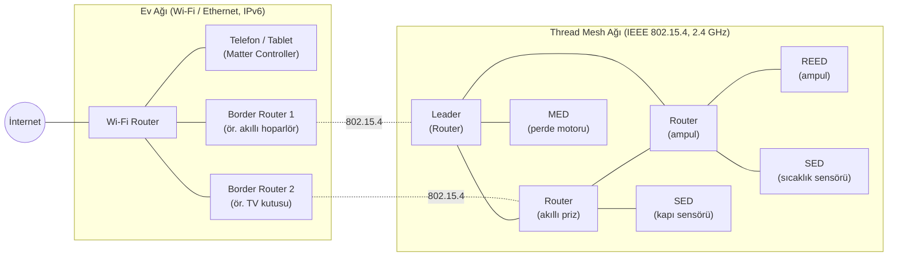

## 1. Thread'e Giriş

### 1.1 Thread Nedir?

**Thread**, nesnelerin interneti (IoT) için tasarlanmış; **IPv6 tabanlı**, **düşük güçlü**, **kablosuz mesh (ağ örgüsü)** ağ protokolüdür. Özellikle akıllı ev ve bina otomasyonu cihazlarının (lambalar, prizler, sensörler, kilitler, termostatlar, perdeler vb.) birbirleriyle ve internetle güvenli, güvenilir ve pil dostu şekilde haberleşmesi için geliştirilmiştir.

Tek cümleyle: **Thread = IEEE 802.15.4 radyosu + 6LoWPAN + IPv6 + Thread'e özgü ağ yönetimi (MLE, yönlendirme, güvenlik, devreye alma).**

Thread'in temel karakteristikleri:

| Özellik | Açıklama |
|---|---|
| **IP tabanlı** | Ağdaki her cihazın kendi IPv6 adresi vardır. Cihaza ulaşmak için protokol çeviren bir "gateway" gerekmez; sadece bir yönlendirici (**Border Router**) yeterlidir. |
| **Mesh topoloji** | Cihazlar birbirlerinin mesajlarını taşır. Kapsama alanı cihaz eklendikçe büyür. |
| **Kendi kendini onarma** | Bir yönlendirici bozulursa trafik otomatik olarak başka yollardan akar; yeni bir **Leader** seçilir. |
| **Tek hata noktası yok** | Zigbee'deki "coordinator" gibi vazgeçilmez merkezi bir düğüm yoktur. Leader rolünü herhangi bir router devralabilir; birden fazla Border Router bulunabilir. |
| **Düşük güç** | Pille çalışan "uyuyan" cihazlar (Sleepy End Device) radyolarını çoğu zaman kapalı tutarak yıllarca çalışabilir. |
| **Güvenlik** | Tüm bağlantı katmanı trafiği AES-128-CCM ile şifrelenir ve doğrulanır. Ağa katılım, parola doğrulamalı anahtar değişimi (EC-JPAKE) veya bant dışı (Matter) devreye alma ile yapılır. |
| **Ölçeklenebilirlik** | Tek ağda 32 aktif router ve her router'a bağlı çok sayıda çocuk cihaz: pratikte 250+ cihaz. |
| **Açık standartlar** | IEEE 802.15.4, IETF RFC'leri (6LoWPAN, IPv6, CoAP, DTLS, MPL, Trickle) üzerine kuruludur. |

> [!IMPORTANT]
> Thread bir **ağ katmanı** protokolüdür; **uygulama katmanını tanımlamaz**. Bir lambanın "aç/kapat" komutunun nasıl kodlanacağı Thread'in değil, üzerinde çalışan uygulama protokolünün (bugün çoğunlukla **Matter**) işidir. Thread'i "Wi-Fi'ın düşük güçlü, mesh'li kuzeni", Matter'ı ise "bu ağların üzerinde konuşulan ortak dil" olarak düşünebilirsiniz.

### 1.2 Neden Thread? Çözdüğü Problemler

Thread öncesinde akıllı ev dünyası birkaç temel sorunla boğuşuyordu:

1. **Dikey, kapalı yığınlar.** Zigbee ve Z-Wave gibi teknolojiler radyodan uygulamaya kadar kendi protokol yığınlarını tanımlıyordu. İnternete veya telefona bağlanmak için mesajları IP dünyasına **çeviren** üreticiye özel hub/gateway'ler gerekiyordu.
2. **Wi-Fi'ın güç tüketimi.** Wi-Fi yüksek veri hızı sunar ama sürekli dinleme ve ilişkilendirme (association) maliyeti, düğme pilli bir kapı sensörü için uygun değildir. Ayrıca Wi-Fi erişim noktalarının bağlı istemci sayısı sınırlıdır.
3. **Bluetooth'un menzil ve topoloji kısıtları.** Klasik BLE noktadan noktaya çalışır; BLE Mesh ise IP tabanlı değildir ve "managed flooding" yaklaşımı büyük ağlarda verimsizleşebilir.
4. **Tek hata noktası.** Coordinator/hub'a bağımlı ağlarda o cihaz bozulduğunda bütün ağ etkilenir.

Thread bu sorunlara şu yaklaşımla cevap verir:

- Radyo olarak düşük güçlü ve olgun **IEEE 802.15.4**'ü kullanır (Zigbee ile aynı radyo).
- Üzerine **IPv6**'yı taşır (6LoWPAN ile sıkıştırarak). Böylece "çeviri" değil, sadece "yönlendirme" gerekir.
- Uygulama katmanını serbest bırakır; bugün bu boşluğu **Matter** doldurur.
- Yönetimi dağıtık yapar: Leader, router'lar ve Border Router'lar yedeklidir.

### 1.3 Tarihçe

| Yıl | Olay |
|---|---|
| **2014 (Temmuz)** | **Thread Group** kuruldu. Kurucular arasında Nest Labs (Google), Samsung, ARM, Freescale (bugün NXP), Silicon Labs, Big Ass Fans ve Yale Security vardı. |
| **2015** | Thread 1.0 şartnamesi yayımlandı; ilk sertifikalı ürünler (Nest ürünleri) pazara çıktı. |
| **2016 (Mayıs)** | Google/Nest, Thread'in açık kaynak uygulaması **OpenThread**'i BSD-3 lisansıyla yayımladı. |
| **2017** | **Thread 1.1**: devreye alma (commissioning) ve ağ yönetimi iyileştirmeleri, MLE tabanlı keşif, anahtar yönetimi düzenlemeleri. |
| **2019** | **Thread 1.2**: büyük/kurumsal ağlar için **Thread Domain**, **Backbone Router**, **DUA**, çoklu yayın kaydı (MLR), **CSL** (senkronize uyuyan cihazlar), **Link Metrics**, Enhanced ACK, ticari devreye alma (CCM). |
| **2019 (Aralık)** | Apple, Google, Amazon ve Zigbee Alliance **Project CHIP**'i duyurdu; Thread düşük güçlü taşıma katmanı olarak seçildi. |
| **2020** | Apple HomePod mini gibi tüketici ürünleriyle Thread Border Router'lar evlere yayılmaya başladı. |
| **2021** | Zigbee Alliance adını **Connectivity Standards Alliance (CSA)** olarak değiştirdi; Project CHIP'in adı **Matter** oldu. |
| **2022–2023** | **Matter 1.0** (Ekim 2022) yayımlandı. **Thread 1.3** ile Border Router işlevleri (SRP, DNS-SD proxy, NAT64, OMR yönlendirme) ve TREL standartlaştırıldı. |
| **2024 (Eylül)** | **Thread 1.4** duyuruldu: zorunlu ve birlikte çalışabilir Border Router özellikleri, ekosistemler arası kimlik bilgisi paylaşımı (ePSKc), gelişmiş internet bağlantısı (DHCPv6-PD), gelişmiş ağ teşhisi, TCAT. |

### 1.4 Sürümlerin Özeti

| Sürüm | Öne çıkan özellikler | Uyumluluk |
|---|---|---|
| **1.0** | Temel mesh, MLE, 6LoWPAN, güvenlik, MAC beacon tabanlı keşif | Tarihsel |
| **1.1** | MLE Discovery, iyileştirilmiş MeshCoP, harici commissioner, network key rotasyonu | 1.2+ ile birlikte çalışır |
| **1.2** | CSL / SSED, Enhanced Frame Pending, Enhanced Keep-Alive, Link Metrics, 802.15.4-2015 çerçeveleri, Thread Domain, Backbone Router, DUA, MLR, CCM | 1.1 ile geriye uyumlu |
| **1.3** | Thread Border Router (TBR) şartnamesi: OMR prefix, RA/RIO, SRP sunucusu, Advertising/Discovery Proxy, NAT64; TREL (Thread over Wi-Fi/Ethernet) | Matter için temel gereksinim |
| **1.4** | Zorunlu BR yetenekleri, ePSKc ile kimlik paylaşımı, DHCPv6-PD ile global IPv6, gelişmiş teşhis TLV'leri, TCAT (TLS tabanlı devreye alma) | 1.3 ile geriye uyumlu |

> [!TIP]
> Bir Thread ağında farklı sürümlerden cihazlar bir arada çalışabilir. Yeni özellikler (ör. CSL) yalnızca bu özelliği destekleyen eşler arasında kullanılır; eski cihazlar bunları görmezden gelir. Sürüm bilgisi MLE mesajlarındaki **Version TLV** ile taşınır (1.1 = 2, 1.2 = 3, 1.3 = 4, 1.4 = 5).

### 1.5 Thread Group ve Sertifikasyon

**Thread Group**, şartnameyi geliştiren, sertifikasyon programını yürüten ve birlikte çalışabilirlik etkinlikleri düzenleyen kar amacı gütmeyen endüstri birliğidir.

- **Şartname**: Thread Specification (çekirdek ağ katmanı), Thread Border Router özellikleri, test şartnameleri.
- **Sertifikasyon**: Ürünler yetkili test laboratuvarlarında sertifika test senaryolarından geçer. Sertifikalı yığınlar ("Thread Certified Component") üzerine ürün geliştiren üreticiler süreci kısaltabilir.
- **Logo**: "Built on Thread" logosu sertifikalı ürünlerde kullanılır.
- **Test araçları**: Thread Test Harness ve referans cihaz setleri ile otomatik birlikte çalışabilirlik testleri yapılır.

### 1.6 OpenThread

**OpenThread**, Google tarafından başlatılan, Thread şartnamesini uygulayan açık kaynak (BSD-3-Clause) bir yığındır.

- C++ ile yazılmıştır, C API sunar; mikrodenetleyiciden Linux'a kadar taşınabilir.
- **Platform soyutlama katmanı** (radyo, zamanlayıcı, kalıcı bellek, rastgele sayı, kripto) sayesinde birçok çip üreticisi tarafından desteklenir: Nordic, Silicon Labs, NXP, Texas Instruments, Espressif, Qorvo, Telink ve diğerleri.
- **OpenThread Border Router (OTBR)** projesi Linux tabanlı Border Router'lar için referans uygulamadır (Home Assistant OTBR eklentisi de buna dayanır).
- Thread sürümleriyle paralel güncellenir; Thread sertifikası almış sürümleri vardır.

Ayrıntılar için Bölüm 24'e bakın.

### 1.7 Thread ve Matter İlişkisi

| Konu | Thread | Matter |
|---|---|---|
| **Katman** | Ağ (bağlantı + IPv6 ağ yönetimi) | Uygulama (veri modeli, etkileşim modeli, güvenlik oturumları) |
| **Sorumlu kuruluş** | Thread Group | Connectivity Standards Alliance (CSA) |
| **Neyi tanımlar?** | Paketlerin cihazdan cihaza nasıl taşınacağını | "Lambayı aç" komutunun anlamını ve formatını |
| **Taşıma** | IEEE 802.15.4 | Thread, Wi-Fi, Ethernet (IPv6 üzerinden) |

Matter cihazı, Thread ağında sıradan bir IPv6/UDP uygulaması gibi çalışır (UDP port 5540). Matter, Thread ağının kimlik bilgilerini (Operational Dataset) cihaza devreye alma sırasında BLE üzerinden aktarır. Ayrıntılar Bölüm 23'te.

### 1.8 Büyük Resim

Tipik bir akıllı evde Thread ağı şöyle görünür:

- **Border Router**'lar Thread mesh'i ile Wi-Fi/Ethernet ev ağını IP seviyesinde birbirine bağlar.
- **Router**'lar (genelde şebekeden beslenen cihazlar) mesh omurgasını oluşturur ve paketleri yönlendirir.
- **Leader**, router'lardan biridir; router kimliklerini dağıtır ve ağ verisini yönetir.
- **REED** (Router Eligible End Device), gerektiğinde router'a terfi edebilen cihazdır.
- **SED/MED** gibi uç cihazlar yalnızca **ebeveyn (parent)** router'larıyla konuşur.

### 1.9 Thread'in Tanımlamadıkları

Thread'in kapsamını doğru anlamak için neleri **tanımlamadığını** bilmek önemlidir:

- **Uygulama protokolü / veri modeli** → Matter, LwM2M, özel CoAP uygulamaları vb.
- **Bulut bağlantısı ve uzaktan erişim** → Ekosistem hub'ları/bulut servisleri.
- **Kullanıcı arayüzü ve cihaz eşleştirme deneyimi** → Ekosistem uygulamaları (Apple Home, Google Home, Home Assistant vb.).
- **Uçtan uca (end-to-end) uygulama güvenliği** → Thread bağlantı katmanında hop-by-hop güvenlik sağlar; uçtan uca güvenlik Matter (CASE/PASE oturumları) veya DTLS gibi üst katmanların işidir.
- **Wi-Fi ağının yapılandırılması** → Border Router'ın altyapı ağıyla etkileşimi Thread BR şartnamesinde tanımlanır ama ev ağı Thread'in kontrolünde değildir.

### 1.10 Bölüm Özeti

- Thread, 802.15.4 radyo üzerinde IPv6 taşıyan, düşük güçlü ve kendi kendini onaran bir mesh ağıdır.
- Uygulama katmanından bağımsızdır; bugün en yaygın üst katman Matter'dır.
- Merkezi tek hata noktası yoktur: Leader ve Border Router işlevleri yedeklidir.
- Sürümler geriye uyumludur; 1.2 enerji ve ölçek, 1.3 Border Router, 1.4 birlikte çalışabilirlik ve kimlik paylaşımı odaklıdır.
