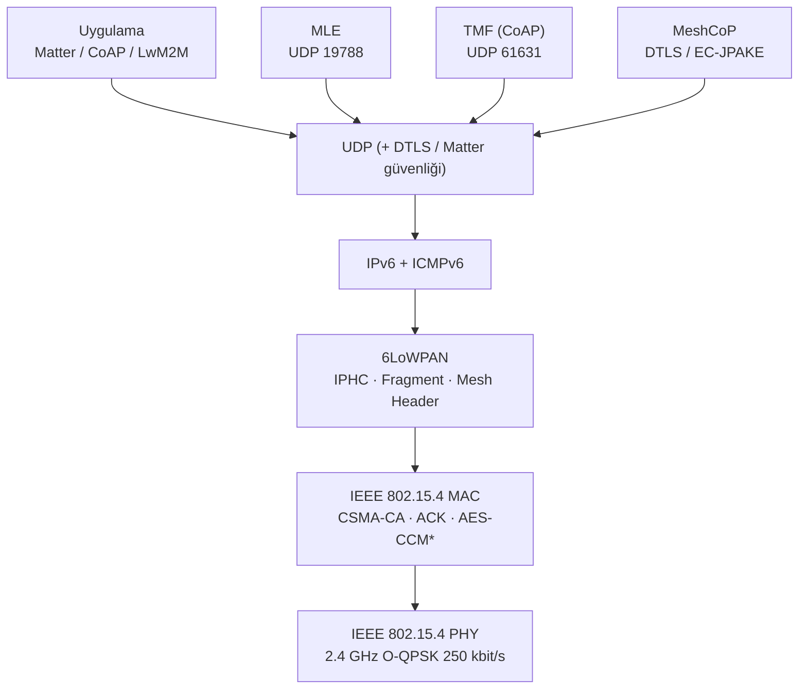
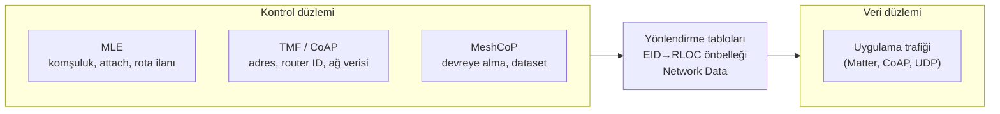
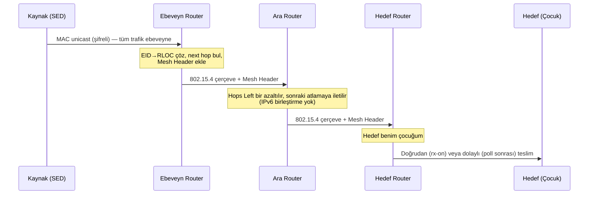

## 2. Protokol Yığını ve Genel Mimari

### 2.1 Katmanlar

Thread, mevcut standartları bir araya getirip eksik parçaları kendisi tanımlayan bir "sistem şartnamesi"dir. Yığın aşağıdan yukarıya şöyledir:

```text
+-----------------------------------------------------------------------+
|  UYGULAMA        Matter  |  CoAP uygulamaları  |  LwM2M  |  özel UDP  |
+-----------------------------------------------------------------------+
|  OTURUM/GÜVENLİK         (Matter CASE/PASE, DTLS — uygulamaya bağlı)  |
+-----------------------------------------------------------------------+
|  TAŞIMA          UDP   (TCP isteğe bağlı; Thread 1.3+ TCP desteği)    |
+--------------------------+--------------------------------------------+
|                          |  Thread Kontrol Düzlemi:                   |
|  AĞ  IPv6 + ICMPv6       |   MLE   (UDP 19788)  komşuluk / bağlanma   |
|      Thread yönlendirme  |   TMF   (CoAP, UDP 61631) ağ yönetimi      |
|                          |   MeshCoP (DTLS)  devreye alma             |
+--------------------------+--------------------------------------------+
|  UYARLAMA        6LoWPAN: başlık sıkıştırma, parçalama, mesh başlığı  |
+-----------------------------------------------------------------------+
|  BAĞLANTI (MAC)  IEEE 802.15.4-2006 (+2015 özellikleri): CSMA-CA,     |
|                  ACK, AES-CCM* güvenlik, dolaylı iletim, IE'ler       |
+-----------------------------------------------------------------------+
|  FİZİKSEL (PHY)  IEEE 802.15.4  2.4 GHz  O-QPSK  250 kbit/s  k11-26   |
+-----------------------------------------------------------------------+
```



### 2.2 OSI Modeliyle Eşleme

| OSI katmanı | Thread'deki karşılığı | Standart / kaynak |
|---|---|---|
| 7 Uygulama | Matter, CoAP uygulamaları | CSA Matter, RFC 7252 |
| 6 Sunum | (Uygulamaya ait — TLV, CBOR vb.) | — |
| 5 Oturum | Matter CASE/PASE, DTLS 1.2 | RFC 6347 |
| 4 Taşıma | UDP (ağırlıklı), TCP | RFC 768, RFC 9293 |
| 3 Ağ | IPv6, ICMPv6, Thread yönlendirme, MLE, TMF, MPL | RFC 8200, RFC 4443, RFC 7731, Thread Spec |
| 2.5 Uyarlama | 6LoWPAN | RFC 4944, RFC 6282 |
| 2 Veri bağlantısı | IEEE 802.15.4 MAC | IEEE 802.15.4-2006 / -2015 |
| 1 Fiziksel | IEEE 802.15.4 O-QPSK PHY (2.4 GHz) | IEEE 802.15.4 |

### 2.3 Thread'in Kullandığı ve Tanımladığı Bileşenler

**Kullandığı (başkalarının tanımladığı) standartlar:**

| Bileşen | Kaynak | Thread'deki rolü |
|---|---|---|
| IEEE 802.15.4 PHY/MAC | IEEE | Radyo ve çerçeve erişimi |
| 6LoWPAN çerçeveleme ve parçalama | RFC 4944 | IPv6'yı 127 baytlık çerçevelere sığdırma |
| IPHC / NHC sıkıştırma | RFC 6282 | IPv6/UDP başlıklarını sıkıştırma |
| IPv6 adresleme | RFC 4291, RFC 4193 (ULA), RFC 4862 (SLAAC) | Adres yapısı |
| ICMPv6 | RFC 4443 | Ping, hata mesajları |
| CoAP | RFC 7252 | TMF yönetim mesajları |
| DTLS 1.2 | RFC 6347 | Devreye alma oturumları |
| EC-JPAKE | RFC 8236 (J-PAKE) temelli TLS uzantısı | Parola doğrulamalı anahtar değişimi |
| Trickle | RFC 6206 | Advertisement zamanlaması |
| MPL | RFC 7731 | Mesh içi çoklu yayın (multicast) iletimi |
| mDNS / DNS-SD / SRP | RFC 6762, RFC 6763, RFC 9665 | Servis keşfi (Border Router) |
| NAT64 / DNS64 | RFC 6146, RFC 6147, RFC 6052 | IPv4 erişimi (Border Router) |

**Thread'in kendi tanımladıkları:**

| Bileşen | Görevi |
|---|---|
| **MLE** (Mesh Link Establishment) | Komşu keşfi, bağlanma (attach), ebeveyn seçimi, bağlantı kalitesi ölçümü, yönlendirme bilgisinin yayılması, ağ parametrelerinin dağıtımı |
| **Thread yönlendirme protokolü** | Router'lar arası mesafe-vektör (distance-vector) yönlendirme (Route64 TLV) |
| **TMF** (Thread Management Framework) | CoAP tabanlı yönetim: adres sorgulama, router ID atama, ağ verisi kaydı, teşhis |
| **Network Data** | Ağ genelinde önekler, rotalar, servisler, sıkıştırma bağlamları |
| **MeshCoP** (Mesh Commissioning Protocol) | Commissioner, Border Agent, Joiner süreçleri; Operational Dataset yönetimi |
| **Adres mimarisi** | RLOC, ALOC, ML-EID, RLOC16 yapısı, adres sorgulama |
| **Güvenlik mimarisi** | Network Key'den MAC/MLE anahtarı türetme, anahtar rotasyonu, PSKc/PSKd |
| **Border Router davranışları** | OMR prefix, RA/RIO, SRP, NAT64, TREL (1.3+) |

### 2.4 Kontrol Düzlemi ve Veri Düzlemi

Thread'deki trafiği iki gruba ayırmak mimariyi anlamayı kolaylaştırır:

**Veri düzlemi (data plane)** — Uygulamanın asıl yükü: Matter komutları, sensör verileri, CoAP istekleri. IPv6/UDP paketleri olarak taşınır, 6LoWPAN ile sıkıştırılır, MAC katmanında şifrelenir.

**Kontrol düzlemi (control plane)** — Ağın kendisini ayakta tutan trafik:

| Protokol | Kapsam | Örnek işler |
|---|---|---|
| **MLE** | Tek atlama (link-local) | Parent Request/Response, Child ID Request/Response, Link Request/Accept, Advertisement, Data Response |
| **TMF** | Mesh geneli (RLOC/ALOC adresleri) | Address Query/Notification, Address Solicit/Release, Server Data, Diagnostic Get |
| **MeshCoP** | Mesh + Border Agent + harici commissioner | Commissioner Petition, Joiner DTLS, Joiner Entrust, Active/Pending Set |



### 2.5 Bir Paketin Yolculuğu (Genel Bakış)

Bir uygulamanın Thread ağındaki başka bir cihaza UDP mesajı gönderdiğini düşünelim. Ayrıntılar ilgili bölümlerde verilecek; burada akışı kuşbakışı görüyoruz:

1. **Uygulama** veriyi UDP soketine yazar (ör. hedef: `fd4f:…:1234` port 5540).
2. **IPv6 katmanı** kaynak adresini seçer ve hedefin mesh içinde mi (on-mesh) yoksa dışarıda mı olduğuna bakar.
3. **Thread yönlendirme**: Hedef bir EID ise (ML-EID veya OMR adresi) **EID→RLOC** önbelleğine bakılır. Kayıt yoksa ağa **Address Query** gönderilir ve paket bekletilir. Hedef ağ dışındaysa Network Data'dan uygun **Border Router**'ın RLOC16'sı seçilir.
4. **Sonraki atlama (next hop)** yönlendirme tablosundan bulunur.
5. **6LoWPAN**: IPv6 ve UDP başlıkları sıkıştırılır; paket birden fazla atlama gidecekse **Mesh Header** (kaynak ve nihai hedef RLOC16) eklenir; paket 127 bayta sığmıyorsa **parçalanır** (FRAG1/FRAGN).
6. **MAC**: Her parça, hedef MAC adresi = sonraki atlama olacak şekilde çerçevelenir, **AES-CCM*** ile şifrelenip doğrulanır, **CSMA-CA** ile kanala erişilip gönderilir, **ACK** beklenir; gelmezse yeniden denenir.
7. **Ara router'lar** her çerçeveyi alır, MAC güvenliğini doğrular, Mesh Header'daki nihai hedefe bakar, *Hops Left* değerini azaltır ve sonraki atlamaya — paketi IPv6 seviyesinde birleştirmeden — iletir.
8. **Hedef router** paketi doğrudan veya (uyuyan çocuk cihaz ise) **dolaylı iletim** ile teslim eder.
9. **Hedef cihaz** parçaları birleştirir, başlıkları açar ve UDP yükünü uygulamaya verir.



### 2.6 Önemli UDP Portları

| Port | Protokol | Açıklama |
|---|---|---|
| **19788** | MLE | Mesh Link Establishment (link-local) |
| **61631** | TMF (CoAP) | Thread yönetim mesajları (`0xF0BF`; 6LoWPAN ile 4 bite sıkıştırılabilir) |
| **1000** | MeshCoP Joiner | Joiner UDP portu (varsayılan; Discovery Response içinde ilan edilir) |
| **49191** | MeshCoP Border Agent | OTBR varsayılanı; gerçek port mDNS `_meshcop._udp` SRV kaydıyla ilan edilir |
| **5540** | Matter | Matter operasyonel mesajları (UDP/TCP) |
| **5353** | mDNS | Altyapı ağında (Wi-Fi/Ethernet) servis keşfi |
| **53** | DNS | Discovery Proxy / DNS sorguları (Border Router) |
| **53535–53554** | SRP | OpenThread SRP sunucusunun kullandığı aralık (Network Data'da ilan edilir) |

### 2.7 Bölüm Özeti

- Thread yığını: 802.15.4 PHY/MAC → 6LoWPAN → IPv6 → UDP → uygulama.
- Thread'e özgü kontrol protokolleri: MLE (link yönetimi), TMF (CoAP tabanlı ağ yönetimi), MeshCoP (devreye alma).
- Mesh içinde paketler IPv6 seviyesinde değil, 6LoWPAN **Mesh Header** ile RLOC16'lara göre iletilir; ara düğümler parçaları birleştirmez.
- Her atlamada MAC katmanı şifreleme/doğrulama yapar (hop-by-hop güvenlik).
