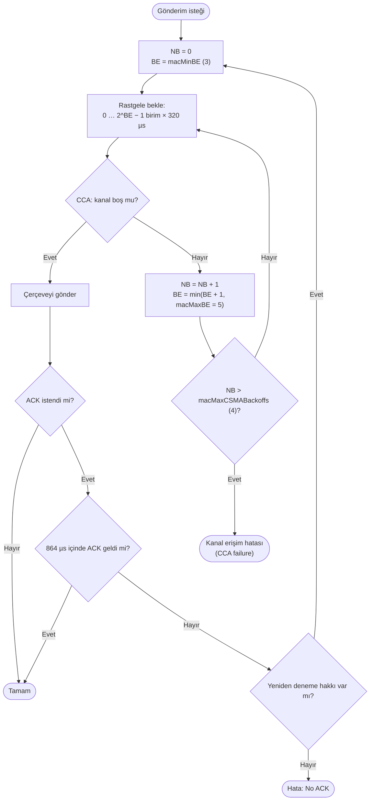
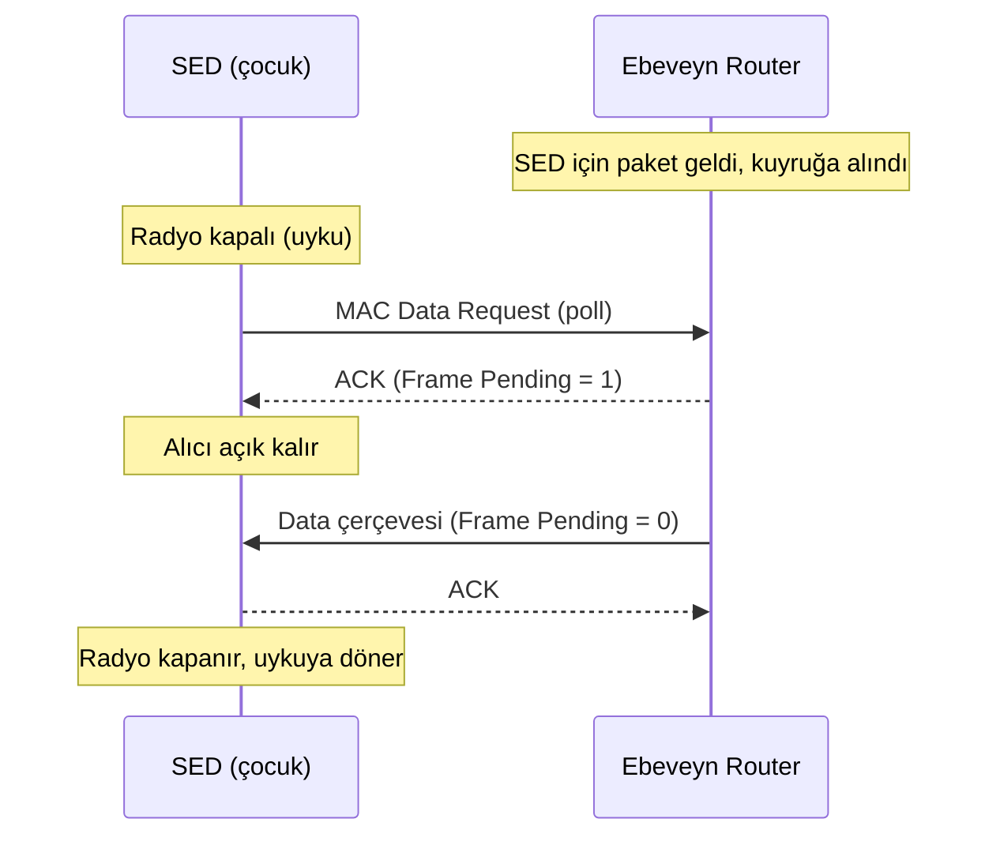

## 4. MAC Katmanı (IEEE 802.15.4 MAC)

### 4.1 Görevler

802.15.4 MAC katmanının Thread'deki sorumlulukları:

| Görev | Açıklama |
|---|---|
| **Kanal erişimi** | Slotsuz (unslotted) CSMA-CA ile çakışmaları azaltmak |
| **Çerçeveleme** | Başlık (MHR), yük ve FCS (CRC-16) oluşturmak |
| **Adresleme** | PAN ID, 16 bit kısa adres, 64 bit genişletilmiş adres |
| **Güvenilirlik** | Onay (ACK) ve yeniden iletim (retry) |
| **Güvenlik** | AES-128-CCM* ile şifreleme + bütünlük (MIC), tekrar (replay) koruması |
| **Dolaylı iletim** | Uyuyan cihazlar için ebeveynde kuyruklama ve "poll" ile teslim |
| **Tarama** | Active scan, energy scan |
| **Bilgi elemanları (IE)** | Thread 1.2+: CSL, Link Metrics gibi bilgilerin başlıkta taşınması |

### 4.2 Thread'in 802.15.4 MAC'i Kullanma Biçimi

802.15.4 çok geniş bir standarttır; Thread bunun yalnızca belirli bir alt kümesini kullanır:

- **Beacon'sız (non-beacon) mod**: Süper çerçeve (superframe), GTS (garantili zaman dilimi) yoktur. Kanal erişimi tamamen **slotsuz CSMA-CA** ile yapılır.
- **802.15.4 "association" kullanılmaz**: Bir cihazın ağa bağlanması MAC Association komutlarıyla değil, **MLE** (Bölüm 9) ile yapılır. Bu sayede bağlanma süreci güvenli ve IP tabanlıdır.
- **PAN Coordinator kavramı yoktur**: Thread'de "coordinator" rolü bulunmaz; Leader bir MAC kavramı değil, Thread ağ katmanı rolüdür.
- **Çerçeve sürümleri**: Thread 1.1 güvenli çerçeveler için 802.15.4-**2006** sürümünü kullanır. Thread 1.2 ve sonrası, IE (Information Element) ve Enhanced ACK gerektiren durumlarda 802.15.4-**2015** çerçeve sürümünü kullanır (ör. CSL, Link Metrics).
- **Genişletilmiş adres rastgeledir**: Thread cihazları ağda fabrika EUI-64'ünü değil, rastgele üretilmiş bir 64 bit **Extended Address** kullanır (gizlilik). Fabrika EUI-64'ü yalnızca devreye almada Joiner ID türetmek için kullanılır.

### 4.3 MAC Çerçeve Formatı

```text
           MHR (MAC Header)                                          MAC Payload      MFR
+-------+-----+-------+-------+-------+-------+-----------+-------+--------------+--------+
| Frame | Seq | Dest  | Dest  |  Src  |  Src  | Auxiliary | Header|   Payload    |  FCS   |
|Control| Num | PAN ID| Addr  | PAN ID| Addr  | Security  |  IEs  | (+Payload IE)| CRC-16 |
|   2   | 0/1 | 0/2   |0/2/8  | 0/2   | 0/2/8 | 0/5/6/10/14| değ. |   değişken   |   2    |
+-------+-----+-------+-------+-------+-------+-----------+-------+--------------+--------+
```

Tüm çok baytlı alanlar havada **little-endian** sırayla gönderilir.

#### Frame Control (2 bayt)

```text
 bit: 15 14 | 13 12 | 11 10 |  9  |  8  |  7  |  6  |  5  |  4  |  3  | 2 1 0
      SrcAM | Sürüm | DstAM | IEP | SNS | ayr.| PIC | AR  | FP  | Sec | Tür
```

| Bit(ler) | Alan | Değerler |
|---|---|---|
| 0–2 | **Frame Type** | `000` Beacon, `001` Data, `010` Ack, `011` MAC Command (diğerleri Thread'de kullanılmaz) |
| 3 | **Security Enabled** | 1 = Aux Security Header var, yük şifreli/doğrulanmış |
| 4 | **Frame Pending** | 1 = gönderende bu alıcı için bekleyen veri var (uyuyan cihazlar için kritik) |
| 5 | **AR** (Ack Request) | 1 = alıcı ACK göndermeli (unicast çerçeveler); yayın (broadcast) çerçevelerde 0 |
| 6 | **PAN ID Compression** | 1 = kaynak PAN ID atlanır (hedef PAN ID ile aynı kabul edilir) |
| 8 | **Sequence Number Suppression** | (2015) 1 = sıra numarası alanı yok |
| 9 | **IE Present** | (2015) 1 = başlıkta Information Element var |
| 10–11 | **Dest Addr Mode** | `00` yok, `10` kısa (16 bit), `11` genişletilmiş (64 bit) |
| 12–13 | **Frame Version** | `00` 2003, `01` 2006, `10` 2015 |
| 14–15 | **Src Addr Mode** | `00` yok, `10` kısa, `11` genişletilmiş |

#### Çözümlenmiş örnekler

| Havadaki baytlar | FCF değeri | Anlamı |
|---|---|---|
| `41 D8` | `0xD841` | Data, güvenliksiz, ACK yok, PAN sıkıştırma; hedef kısa (yayın `0xFFFF`), kaynak genişletilmiş, sürüm 2006 → tipik **MLE yayın** çerçevesi (ör. Parent Request) |
| `61 DC` | `0xDC61` | Data, güvenliksiz, ACK istekli, PAN sıkıştırma; hedef ve kaynak genişletilmiş, sürüm 2006 → tipik **MLE unicast** çerçevesi |
| `69 98` | `0x9869` | Data, **güvenli**, ACK istekli, PAN sıkıştırma; hedef ve kaynak kısa, sürüm 2006 → tipik **komşular arası veri** çerçevesi |
| `69 D8` | `0xD869` | Aynısı, kaynak genişletilmiş |
| `02 00` | `0x0002` | Imm-Ack (Frame Pending = 0) |
| `12 00` | `0x0012` | Imm-Ack (Frame Pending = 1) — "sende bekleyen veri var" |

#### Tam bir veri çerçevesi örneği

```text
69 98                 Frame Control: Data, Sec=1, AR=1, PIC=1, kısa→kısa, 2006
5A                    Sıra numarası = 90
34 12                 Hedef PAN ID = 0x1234
00 5C                 Hedef kısa adres = 0x5C00  (Router ID 23)
01 5C                 Kaynak kısa adres = 0x5C01 (Router 23'ün 1 numaralı çocuğu)
0D                    Security Control: seviye 5 (ENC-MIC-32), Key ID Mode 1
3A 00 00 00           Frame Counter = 58
01                    Key Index = 1  (Key Sequence 0)
.. .. .. ..           Şifreli yük (6LoWPAN: Mesh/Frag/IPHC + UDP + uygulama)
xx xx xx xx           MIC (32 bit)
yy yy                 FCS (CRC-16/ITU-T)
```

MAC ek yükü: başlık 9 bayt + güvenlik başlığı 6 bayt + MIC 4 bayt + FCS 2 bayt = **21 bayt**. Yani kısa adreslerle MAC yükü için en fazla **106 bayt** kalır (kaynak genişletilmiş adres ise ≈ 100 bayt).

### 4.4 Adresler

| Adres | Boyut | Thread'deki anlamı |
|---|---|---|
| **PAN ID** | 16 bit | Ağın MAC seviyesindeki kimliği; Operational Dataset'te bulunur. `0xFFFF` yayın PAN ID'sidir. |
| **Kısa adres (Short Address)** | 16 bit | Thread'de doğrudan **RLOC16** değeridir (Router ID + Child ID). `0xFFFF` yayın, `0xFFFE` "kısa adres yok" anlamına gelir. |
| **Genişletilmiş adres (Extended Address)** | 64 bit | Cihazın ağdaki rastgele 64 bitlik kimliği. Link-local IPv6 adresinin arayüz kimliği (IID) bundan türetilir. Ayrıca MAC güvenlik **nonce**'unda kullanılır. |

**Hangi adres ne zaman kullanılır?**

- Cihaz henüz RLOC16 almamışken (bağlanma sırasında) **genişletilmiş** adres kullanılır.
- MLE mesajları link-local IPv6 adresleriyle gönderildiği için MAC kaynağı genellikle **genişletilmiş** adrestir.
- Bağlanmış komşular arasındaki veri trafiğinde çerçeveyi küçültmek için **kısa** adresler tercih edilir.
- IPv6 çoklu yayın (multicast) paketleri MAC seviyesinde **`0xFFFF`** yayın adresine gönderilir ve ACK istenmez.

### 4.5 CSMA-CA (Slotsuz)

Thread cihazları göndermeden önce rastgele süre bekleyip kanalı dinler:



| Parametre | Varsayılan | Açıklama |
|---|---|---|
| `macMinBE` | 3 | İlk geri çekilme üssü (0–7 birim) |
| `macMaxBE` | 5 | En büyük geri çekilme üssü (0–31 birim) |
| `macMaxCSMABackoffs` | 4 | Vazgeçmeden önce en fazla CCA denemesi (toplam 5 CCA) |
| `macMaxFrameRetries` | 3 | ACK gelmezse yeniden iletim sayısı (OpenThread doğrudan iletim varsayılanı 3) |

> [!TIP]
> MAC sayaçlarında **TxErrCca** (kanal erişim hatası) oranı yüksekse kanal çok meşguldür (genellikle Wi-Fi); **TxRetry** oranı yüksekse bağlantı kalitesi zayıftır veya gizli düğüm (hidden node) problemi vardır. Bkz. Bölüm 21.

### 4.6 Onay (ACK) ve Yeniden İletim

- Unicast çerçevelerde AR = 1 olur. Alıcı çerçeveyi doğru aldıysa (FCS geçerli ve adres kendisine) **`aTurnaroundTime` = 192 µs** sonra ACK gönderir; CSMA uygulanmaz.
- **Imm-Ack** (2006): 5 baytlık MPDU (FCF 2 + Seq 1 + FCS 2). Güvenlik içermez; yalnızca sıra numarası eşleşmesi kontrol edilir.
- **Enhanced ACK** (2015, Thread 1.2+): IE taşıyabilen, güvenli olabilen ACK. CSL bilgisi (CSL IE) veya Link Metrics verisi taşımak için kullanılır.
- Yayın (broadcast) çerçeveler ACK'lenmez. Bu yüzden MLE/MPL gibi üst katmanlar kendi tekrar mekanizmalarını kullanır.
- Gönderen ACK gelmezse çerçeveyi **aynı sıra numarasıyla** yeniden gönderir; alıcı, yinelenen çerçeveleri sıra numarası + kaynak adres ile ayıklar (RxDuplicated sayacı).

### 4.7 Dolaylı İletim (Indirect Transmission) ve Veri Sorgulama (Data Poll)

Uyuyan cihazlar (SED) radyolarını çoğu zaman kapalı tutar; ebeveyn onlara istediği an veri gönderemez. Çözüm **dolaylı iletim**dir:

1. Ebeveyn, SED'e giden paketi **kuyrukta** tutar.
2. SED periyodik olarak uyanıp ebeveynine **MAC Data Request** komutu (komut kimliği `0x04`) gönderir — buna **poll** (sorgulama) denir.
3. Ebeveyn ACK'deki **Frame Pending** bitini 1 yaparak "senin için veri var" der.
4. SED alıcısını açık tutar; ebeveyn veriyi gönderir.
5. Kuyrukta başka çerçeve varsa veri çerçevesindeki Frame Pending biti 1 olur; SED dinlemeye devam eder veya tekrar poll eder.



**Ebeveynin tampon yükümlülüğü:** Thread, ebeveynin her uyuyan çocuğu için en az bir tam IPv6 datagramını (1280 bayt) tutabilmesini ister. Thread 1.2+ ebeveynler bu kapasiteyi **Connectivity TLV** içindeki *SED Buffer Size* ve *SED Datagram Count* alanlarıyla ilan eder.

**Poll yanıtı gecikmesi:** Data Request ile veri çerçevesi arasındaki süre kısa olmalıdır; SED bu süre boyunca alıcısını açık tutar. Bu yüzden ebeveyn yazılımları poll'a hızlı cevap verecek şekilde optimize edilir.

### 4.8 MAC Komutları

Thread yalnızca birkaç MAC komutu kullanır:

| Kimlik | Komut | Thread'de kullanımı |
|---|---|---|
| `0x04` | **Data Request** | SED'in ebeveynini sorgulaması (poll) |
| `0x07` | **Beacon Request** | Active scan (çevredeki 802.15.4 ağlarını bulma) |
| `0x01`–`0x03`, `0x05`, `0x06`, `0x08`, `0x09` | Association, Disassociation, Orphan, Coordinator Realignment, GTS vb. | **Kullanılmaz** (MLE ile değiştirilmiştir) |

**Thread Beacon (tarihsel):** Thread 1.0'da ağlar, Beacon Request'e MAC beacon ile cevap verip beacon yükünde *Protocol ID (3)*, sürüm, "Joining Permitted" ve "Native Commissioning" bayrakları, *Network Name*, *Extended PAN ID* ve *Steering Data* taşırdı. Thread 1.1 ve sonrası ağ keşfi için **MLE Discovery Request/Response** kullanır (Bölüm 9.13); beacon yükü geriye uyumluluk için isteğe bağlıdır.

### 4.9 MAC Güvenliği

Thread'de ağ trafiği **her atlamada** MAC katmanında şifrelenir ve doğrulanır.

#### Güvenlik seviyeleri

| Seviye | Ad | Şifreleme | MIC |
|---|---|---|---|
| 0 | None | Hayır | — |
| 1 / 2 / 3 | MIC-32 / 64 / 128 | Hayır | 4 / 8 / 16 bayt |
| 4 | ENC | Evet | — |
| **5** | **ENC-MIC-32** | **Evet** | **4 bayt** ← Thread bunu kullanır |
| 6 / 7 | ENC-MIC-64 / 128 | Evet | 8 / 16 bayt |

#### Auxiliary Security Header

```text
+------------------+----------------+--------------------------------------+
| Security Control | Frame Counter  | Key Identifier                       |
|     1 bayt       |  4 bayt (LE)   | Mode 0: yok                          |
|                  |                | Mode 1: Key Index (1)                |
|                  |                | Mode 2: Key Source (4) + Index (1)   |
|                  |                | Mode 3: Key Source (8) + Index (1)   |
+------------------+----------------+--------------------------------------+

Security Control:
 bit:   7      6           5              4  3          2 1 0
      ayr.  ASN-in-Nonce  FC Suppression  Key ID Mode   Security Level
```

| Kullanım | Key ID Mode | Anahtar | Security Control | Başlık boyutu |
|---|---|---|---|---|
| Normal veri çerçeveleri | **1** | MAC Key (Network Key'den türetilmiş) | `0x0D` | 6 bayt |
| Joiner Entrust (devreye almada) | **0** | **KEK** (DTLS oturumundan türetilmiş) | `0x05` | 5 bayt |
| MLE mesajları | MAC'te güvenliksiz; güvenlik **MLE katmanında** (Bölüm 9.4) | MLE Key | — | — |

**Key Index** değeri, mevcut **Key Sequence**'ten türetilir:

```text
Key Index = (Key Sequence mod 128) + 1        → 1 … 128
```

Alıcı, Key Index'e bakarak çerçevenin mevcut, önceki veya sonraki anahtar dizisiyle şifrelendiğini anlar ve ilgili anahtarı kullanır (anahtar rotasyonu, Bölüm 15).

#### AES-CCM* nonce'u (13 bayt)

```text
+-----------------------------------+--------------------+----------------+
| Kaynak Extended Address (8 bayt)  | Frame Counter (4)  | Sec. Level (1) |
+-----------------------------------+--------------------+----------------+
```

> [!IMPORTANT]
> Nonce her zaman gönderenin **64 bitlik Extended Address**'ini içerir — çerçeve kısa adresle gönderilse bile. Bu yüzden bir cihaz, bir komşudan gelen kısa adresli güvenli çerçeveyi çözebilmek için o komşunun Extended Address'ini önceden (MLE ile) öğrenmiş olmalıdır. Bu, MLE bağlantı kurulumunun neden zorunlu olduğunun bir sebebidir.

**Şifrelenen ve doğrulanan kısımlar:**

- **Doğrulanır (AAD)**: MHR (Frame Control, adresler, Aux Security Header, IE'ler).
- **Şifrelenir + doğrulanır**: MAC yükü (6LoWPAN ile sıkıştırılmış IPv6 paketi).
- **MIC** (4 bayt) yükün sonuna, FCS'den önce eklenir.

#### Frame Counter ve tekrar (replay) koruması

- Her cihaz, gönderdiği her güvenli çerçeve için 32 bitlik **Frame Counter**'ı bir artırır.
- Alıcı, her komşu için en son kabul ettiği frame counter'ı saklar ve **daha küçük veya eşit** değerli çerçeveleri reddeder.
- Komşuların başlangıç sayaçları MLE ile değiş tokuş edilir (*Link-layer Frame Counter TLV*).
- Key Sequence değiştiğinde (yeni anahtar) sayaçlar sıfırlanır; çünkü (anahtar, nonce) çifti benzersiz kalmaya devam eder.
- Cihazlar yeniden başlatmada sayacın geri gitmemesi için değeri kalıcı belleğe **ileriye dönük bir payla** yazar (OpenThread birkaç yüz/bin değer ileriyi saklar); aksi hâlde yeniden başlatma sonrası gönderilen çerçeveler komşular tarafından reddedilirdi.

### 4.10 Bilgi Elemanları (Information Elements — IE)

802.15.4-2015 çerçevelerinde, başlığa esnek alanlar eklemek için IE'ler kullanılır. Thread 1.2+ bunları şu amaçlarla kullanır:

| IE | Element ID | İçerik | Kullanım |
|---|---|---|---|
| **CSL IE** | `0x1A` | CSL Phase (2 bayt), CSL Period (2 bayt) — 10 sembol (160 µs) biriminde | SSED'in örnekleme zamanlamasını ebeveynine bildirmesi (Bölüm 18) |
| **Vendor Specific Header IE** | `0x00` | Thread Group OUI'si + içerik | Enhanced-ACK tabanlı Link Metrics raporları |
| **Header Termination 1** | `0x7E` | — | Header IE'lerin bittiğini ve Payload IE'lerin başladığını gösterir |
| **Header Termination 2** | `0x7F` | — | Header IE'lerin bittiğini ve doğrudan yükün başladığını gösterir |

Header IE tanımlayıcısı 2 bayttır: 7 bit uzunluk, 8 bit Element ID, 1 bit tür (0 = header IE).

### 4.11 Taramalar

| Tarama | Nasıl? | Thread'de amacı |
|---|---|---|
| **Energy Scan** | Her kanalda belirli süre ED ölçümü | En sessiz kanalı seçmek; commissioner'ın uzaktan Energy Scan istemesi (`c/es`) |
| **Active Scan** | Her kanalda Beacon Request yayını, beacon dinleme | Çevredeki 802.15.4 ağlarını listelemek (`scan` komutu) |
| **MLE Discovery Scan** | Her kanalda MLE Discovery Request yayını | Thread ağlarını ve devreye almaya açık ağları bulmak (`discover` komutu, Joiner) |

### 4.12 MAC Seviyesinde Alım Filtreleri

Bir çerçeve kabul edilmeden önce sırasıyla şu kontrollerden geçer:

1. **FCS** doğru mu? (Değilse: RxErrFcs)
2. **Hedef PAN ID** kendi PAN ID'm veya `0xFFFF` mi?
3. **Hedef adres** kendi kısa/genişletilmiş adresim veya `0xFFFF` mi? (Değilse: RxDestAddrFiltered)
4. **Kaynak adres** geçerli mi, (filtre etkinse) izin listesinde mi?
5. Güvenli çerçeveyse: **anahtar** bulunuyor mu, **frame counter** yeni mi, **MIC** doğru mu? (Değilse: RxErrSec)
6. **Yinelenen çerçeve** mi? (sıra numarası + kaynak; RxDuplicated)
7. Gönderen bilinen bir **komşu** mu? Değilse ve çerçeve güvenliyse genellikle reddedilir (RxErrUnknownNeighbor) — istisna: MLE ve devreye alma mesajları.

### 4.13 Bölüm Özeti

- Thread, 802.15.4 MAC'in beacon'sız, slotsuz CSMA-CA modunu kullanır; association yerine MLE vardır.
- Kısa MAC adresi = RLOC16; genişletilmiş adres rastgeledir ve güvenlik nonce'unun parçasıdır.
- Veri çerçeveleri seviye 5 (AES-CCM*, 4 baytlık MIC), Key ID Mode 1 ile korunur; MAC ek yükü ≈ 21 bayttır.
- Uyuyan cihazlara veri dolaylı iletimle (poll + Frame Pending) ulaştırılır.
- Thread 1.2+ Enhanced ACK ve Header IE'leri ile CSL ve Link Metrics gibi gelişmiş özellikleri taşır.
