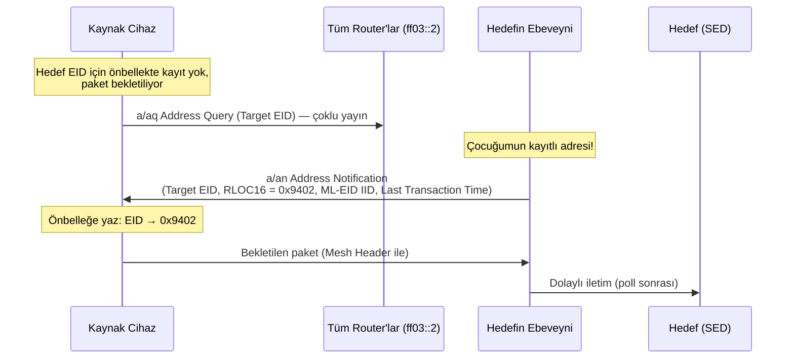

## 6. Thread'de IPv6 Adresleme

### 6.1 Temel Fikir: Kimlik ve Konum Ayrımı

Thread adres mimarisinin kalbinde **kimlik (identifier)** ile **konum (locator)** ayrımı yatar:

- **EID (Endpoint Identifier)**: Cihazın "kim" olduğunu söyleyen, topoloji değişse de **sabit kalan** adres. Uygulamalar bunu kullanır. (ML-EID, OMR/GUA adresi, DUA)
- **RLOC (Routing Locator)**: Cihazın ağda "nerede" olduğunu söyleyen, **topolojiye bağlı** adres. Ebeveyn veya router kimliği değişince değişir. Yalnızca Thread'in iç kontrol trafiği tarafından kullanılır.

Thread, bir EID'ye paket gönderirken önce o EID'nin güncel RLOC'unu bulur (**EID→RLOC eşlemesi**), sonra paketi RLOC16'ya göre yönlendirir. Bu sayede cihazlar ebeveyn değiştirdiğinde uygulamalar hiçbir şey fark etmez.

### 6.2 Kapsamlar (Scopes)

| Kapsam | Değer | Thread'deki anlamı |
|---|---|---|
| **Link-local** | 2 | **Tek radyo atlaması** (doğrudan komşular) |
| **Realm-local** | 3 | **Tüm Thread ağı** (partition) — mesh geneli |
| Admin-local | 4 | Thread ağının ötesi; Backbone Router ile (Thread 1.2+) |
| Site-local | 5 | Bina/site; Border/Backbone Router üzerinden |
| Global | 14 (`e`) | İnternet |

### 6.3 Tekil (Unicast) Adres Türleri

Örneklerde mesh-local önek `fdde:ad00:beef:0::/64` kabul edilmiştir.

| Tür | Biçim | Örnek | Kullanım |
|---|---|---|---|
| **Link-Local** | `fe80::/64` + IID (Extended Address'ten, U/L biti ters) | `fe80::182b:3c4d:5e6f:7081` | MLE, tek atlama komşu iletişimi |
| **ML-EID** (Mesh-Local EID) | Mesh-local önek + **rastgele** IID | `fdde:ad00:beef:0:6c1f:c63a:9a2e:3b07` | Mesh içi uygulama iletişimi; topolojiden bağımsız |
| **RLOC** | Mesh-local önek + `0:ff:fe00:` + RLOC16 | `fdde:ad00:beef:0:0:ff:fe00:5c01` | Thread kontrol trafiği (TMF); topolojiye bağlı |
| **ALOC** | Mesh-local önek + `0:ff:fe00:` + ALOC16 (`0xFCxx`) | `fdde:ad00:beef:0:0:ff:fe00:fc00` | Servis/rol adresi (anycast): Leader, commissioner vb. |
| **OMR / GUA** | Network Data'daki on-mesh önek + SLAAC IID | `fd4f:2d3c:ee9b:1:8a43:...` veya `2001:db8:...` | Ağ dışıyla iletişim (Matter bunu kullanır) |
| **DUA** (1.2+) | Domain öneki + IID | `fd00:7d03:7d03:7d03:...` | Thread Domain genelinde sabit adres |

> [!NOTE]
> Mesh-local önek **ULA** (`fd00::/8`) aralığındandır ve Operational Dataset'in parçasıdır. Mesh-local adresler (ML-EID, RLOC, ALOC) **asla Thread ağı dışına yönlendirilmez**; Border Router bunları dışarı sızdırmaz.

### 6.4 RLOC16 Yapısı

**RLOC16**, 16 bitlik yönlendirme konum değeridir ve aynı zamanda cihazın **MAC kısa adresidir**.

```text
 bit: 15 14 13 12 11 10 |  9  |  8  7  6  5  4  3  2  1  0
      Router ID (6 bit) | 0   |        Child ID (9 bit)
```

| Değer | Anlamı |
|---|---|
| Router ID | 0–62 (63 geçersiz) |
| Child ID = 0 | Router'ın kendisi |
| Child ID = 1–511 | O router'ın çocuklarından biri |

Örnekler:

| Cihaz | Router ID | Child ID | RLOC16 |
|---|---|---|---|
| Router 0 | 0 | 0 | `0x0000` |
| Router 1 | 1 | 0 | `0x0400` |
| Router 23 | 23 | 0 | `0x5C00` |
| Router 23'ün 1. çocuğu | 23 | 1 | `0x5C01` |
| Router 37'nin 2. çocuğu | 37 | 2 | `0x9402` |
| Router 62 | 62 | 0 | `0xF800` |

**Pratik çıkarım:** Bir RLOC16'nın ebeveyn router'ını bulmak için alt 10 biti sıfırlamak yeterlidir: `0x9402 & 0xFC00 = 0x9400` → Router 37. Yönlendirme bu sayede çocukların ayrı ayrı tabloda tutulmasını gerektirmez.

Router ID 63 hiçbir zaman atanmadığı için `0xFC00–0xFFFF` aralığı serbest kalır; bu aralık **ALOC16** değerleri için kullanılır.

### 6.5 ALOC (Anycast Locator) Tablosu

| ALOC16 | Servis / rol |
|---|---|
| `0xFC00` | **Leader** |
| `0xFC01`–`0xFC0F` | DHCPv6 Agent (bağlam ID 1–15'e göre) |
| `0xFC10`–`0xFC2F` | **Service ALOC** (Network Data'daki Service ID'ye göre; ör. SRP anycast) |
| `0xFC30`–`0xFC37` | **Commissioner** (Commissioner Session ID'ye göre) |
| `0xFC38` | **Primary Backbone Router** (Thread 1.2+) |
| `0xFC40`–`0xFC4E` | Neighbor Discovery Agent (bağlam ID'ye göre) |

Bir cihaz Leader'a mesaj göndermek istediğinde Leader'ın kim olduğunu bilmek zorunda değildir: `<mesh-local önek>::ff:fe00:fc00` adresine gönderir. Yönlendirme katmanı, Leader Data TLV'sindeki **Leader Router ID**'yi kullanarak bunu doğru router'a ulaştırır.

### 6.6 Çoklu Yayın (Multicast) Adresleri

| Adres | Ad | Kimler alır? |
|---|---|---|
| `ff02::1` | Link-Local All Nodes | Tek atlamadaki tüm FTD'ler ve MED'ler (rx-on cihazlar) |
| `ff02::2` | Link-Local All Routers | Tek atlamadaki tüm FTD'ler (router, REED, FED) |
| `ff03::1` | Realm-Local All Nodes | Tüm ağdaki FTD'ler ve MED'ler |
| `ff03::2` | Realm-Local All Routers | Tüm ağdaki FTD'ler |
| `ff03::fc` | Realm-Local All MPL Forwarders | Çoklu yayını ileten cihazlar (MPL) |
| `ff32:40:<ML önek>::1` | **Link-Local All Thread Nodes** | Tek atlamadaki **tüm** Thread cihazları (SED'ler dahil) |
| `ff33:40:<ML önek>::1` | **Realm-Local All Thread Nodes** | Ağdaki **tüm** Thread cihazları (SED'ler dahil) |

Neden iki ayrı "tümü" adresi var? Çünkü uyuyan cihazlara çoklu yayın ulaştırmak pahalıdır (ebeveyn her SED'e ayrı ayrı dolaylı iletim yapmak zorundadır). `ff02::1` / `ff03::1` gibi standart adresler SED'leri kapsamaz; gerçekten herkese ulaşılması gerekiyorsa "All Thread Nodes" adresleri kullanılır.

`ff33:40:<önek>::1` biçimi, RFC 3306 **önek tabanlı çoklu yayın** adresidir: `ff3` (önek tabanlı, geçici), kapsam `3`, `40` = önek uzunluğu 64 bit, ardından mesh-local önek ve grup kimliği 1.

### 6.7 Adreslerin Yapılandırılması

| Adres | Nasıl oluşur? |
|---|---|
| Link-local | Extended Address'ten otomatik |
| ML-EID | Ağa ilk katılımda rastgele üretilir, kalıcı saklanır |
| RLOC / ALOC | RLOC16 atanınca / rol üstlenilince otomatik |
| OMR / GUA (SLAAC) | Network Data'da **`a` (SLAAC)** bayraklı bir on-mesh önek görünce cihaz kendi IID'siyle adres oluşturur (RFC 4862; IID için genellikle RFC 7217 kararlı-gizli yöntem) |
| DHCPv6 | Önekte **`d` (DHCP)** bayrağı varsa DHCPv6 Agent ALOC'una istek |
| DUA | Domain önekinden türetilir ve Primary BBR'ye kaydedilir (Bölüm 20) |

Thread, standart IPv6 **Neighbor Discovery**'yi (Router Advertisement, Neighbor Solicitation/Advertisement, DAD) mesh içinde kullanmaz. Onların yerine:

- Önekler ve rotalar **Network Data** ile yayılır (RA yerine).
- Adres çözümleme **Address Query / Address Notification** ile yapılır (NS/NA yerine).
- Çakışan adresler **Address Error** ile bildirilir (DAD yerine).

### 6.8 Uç Cihazların Adres Kaydı

MTD çocuklar (MED, SED) ağ genelindeki adres sorgularını kendileri cevaplamaz; çünkü `ff03::2`'ye abone değildirler ve SED'ler çoğu zaman uykudadır. Bunun yerine adreslerini **ebeveynlerine kaydederler**:

- Kayıt, MLE **Child ID Request** veya **Child Update Request** içindeki **Address Registration TLV** ile yapılır.
- Adres bir bağlam öneki ile sıkıştırılabiliyorsa yalnızca 8 baytlık IID + bağlam kimliği gönderilir; değilse 16 baytın tamamı.
- Ebeveyn, çocukları adına Address Query'leri cevaplar (vekil — proxy).
- Ebeveyn, çocuklarının çoklu yayın aboneliklerini de bu yolla öğrenir.

FTD çocuklar (FED, REED) ise sorguları kendileri cevaplar ve kendi EID→RLOC önbelleklerini tutar.

### 6.9 EID → RLOC Çözümleme: Address Query

Bir cihaz bir EID'ye (ör. ML-EID veya OMR adresi) paket göndermek istediğinde:

1. **EID→RLOC önbelleğine** (Address Cache) bakar. Kayıt varsa RLOC16 bellidir.
2. Kayıt yoksa paketi bekletir ve **Address Query** (`a/aq`) mesajını `ff03::2` (Realm-Local All Routers) adresine çoklu yayınla gönderir. Mesaj **Target EID TLV** içerir.
3. Adresin sahibi (veya sahibi MTD ise ebeveyni) **Address Notification** (`a/an`) ile tekil olarak cevap verir. İçerik: Target EID, **RLOC16**, **ML-EID IID**, (çocuk adına cevap veriliyorsa) **Last Transaction Time**.
4. Sorgulayan önbelleğe yazar ve bekleyen paketi gönderir.



**Zamanlayıcılar (OpenThread varsayılanları):**

| Parametre | Değer | Anlamı |
|---|---|---|
| Address Query zaman aşımı | 3 s | Cevap beklenen süre |
| İlk yeniden deneme gecikmesi | 15 s | Cevapsız sorgudan sonra aynı EID için bekleme |
| En büyük yeniden deneme gecikmesi | 8 saat | Gecikme her başarısızlıkta katlanarak artar |

**Diğer önbellek doldurma yolları:**

- **Snoop (dinleme)**: Router'lar, ilettikleri paketlerin Mesh Header'ındaki kaynak RLOC16 ile IPv6 kaynak adresini eşleştirip önbelleğe ekleyebilir (cevap trafiği için sorgu gerekmez).
- **Mesh-local RLOC adresleri** sorgu gerektirmez; RLOC16 doğrudan adresin içindedir.

### 6.10 Çakışma Tespiti: Address Error

İki farklı cihaz aynı EID'yi kullanıyorsa Address Query'ye **farklı ML-EID IID**'leriyle iki Address Notification gelir. Bu durumda sorgulayan, ilgili cihazlara **Address Error** (`a/ae`) gönderir; Target EID ve ML-EID IID'si eşleşen cihaz o adresi bırakır. Ebeveynler de çocukları adına benzer kontroller yapar.

### 6.11 Hangi Adres Ne İçin Kullanılmalı?

| Senaryo | Önerilen adres | Neden |
|---|---|---|
| Thread ağı içindeki iki uygulama | ML-EID (veya OMR) | Topolojiden bağımsız, sabit |
| Ağ dışından (Wi-Fi'daki telefon) erişim | OMR / GUA | Border Router üzerinden yönlendirilebilir |
| Matter iletişimi | OMR (DNS-SD/SRP ile ilan edilen) | Hem mesh içi hem dışı erişilebilir |
| Thread yönetim mesajları (TMF) | RLOC / ALOC | Topolojiye göre doğrudan yönlendirilebilir |
| MLE | Link-local | Tek atlama, ağ adresleri olmadan da çalışır |
| Uygulama bildirimi tüm cihazlara | `ff33:40:<önek>::1` veya uygulamaya özgü grup | SED'ler dahil herkese |

### 6.12 Örnek: Bir Router'ın Adres Listesi

```text
> ipaddr -v
fdde:ad00:beef:0:0:ff:fe00:fc00 origin:thread    (ALOC — bu cihaz Leader)
fdde:ad00:beef:0:0:ff:fe00:5c00 origin:thread    (RLOC — Router 23)
fd4f:2d3c:ee9b:1:a7b9:56f2:e01:93c1 origin:slaac (OMR adresi)
fdde:ad00:beef:0:6c1f:c63a:9a2e:3b07 origin:thread (ML-EID)
fe80:0:0:0:182b:3c4d:5e6f:7081 origin:thread     (Link-local)
Done

> ipmaddr
ff33:40:fdde:ad00:beef:0:0:1     (Realm-Local All Thread Nodes)
ff32:40:fdde:ad00:beef:0:0:1     (Link-Local All Thread Nodes)
ff02::2
ff03::2
ff03::fc
ff02::1
ff03::1
Done
```

### 6.13 Bölüm Özeti

- Thread kimlik (EID) ile konumu (RLOC) ayırır; uygulamalar EID, ağ katmanı RLOC kullanır.
- RLOC16 = Router ID (6 bit) + Child ID (9 bit); aynı zamanda MAC kısa adresidir.
- ALOC'lar (`0xFCxx`) Leader, commissioner, servis gibi rollere anycast erişim sağlar.
- Standart IPv6 ND yerine Network Data, Address Query/Notification ve Address Error kullanılır.
- SED'leri de kapsayan çoklu yayın için "All Thread Nodes" (`ff32:40:…::1`, `ff33:40:…::1`) adresleri vardır.
