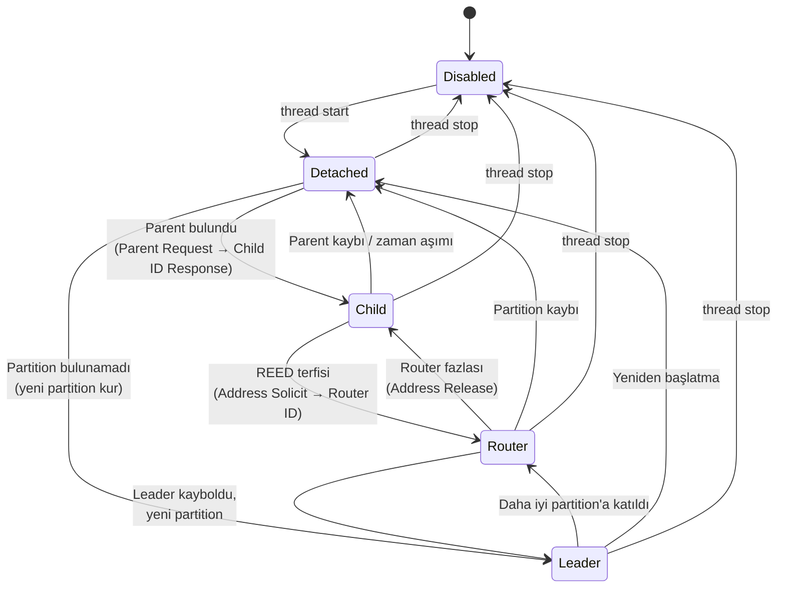

## 7. Cihaz Türleri ve Roller

### 7.1 İki Boyut: Cihaz Türü ve Rol

Thread'de bir cihazı tanımlarken iki ayrı boyut vardır:

- **Cihaz türü (device type)** — cihazın **yeteneği**; donanım/yazılım tasarımıyla belirlenir: FTD veya MTD.
- **Rol (role)** — cihazın **o anki işlevi**; ağın durumuna göre dinamik olarak değişir: Router, Leader, Child, Detached…

Örneğin bir akıllı priz (FTD) ağa ilk katıldığında **Child** (REED) rolündedir; ağa router gerekirse **Router** olur; Leader kaybolursa **Leader** olabilir.

### 7.2 Full Thread Device (FTD)

FTD'nin alıcısı **her zaman açıktır** (rx-on-when-idle), router tablosu tutabilir, `ff03::2`/`ff02::2` adreslerine abonedir ve EID→RLOC önbelleği tutar.

| FTD türü | Açıklama |
|---|---|
| **Router** | Paketleri yönlendirir, child cihazlara parent'lık yapar, MLE Advertisement gönderir, commissioning'de Joiner Router olabilir. |
| **REED** (Router Eligible End Device) | Router olabilecek ama şu anda **child** rolünde olan FTD. Ağa router gerektiğinde (router sayısı azsa ya da yakınındaki bir cihaz parent arıyorsa) router'a terfi eder. |
| **FED** (Full End Device) | Router olmayacak şekilde yapılandırılmış FTD. Tam ağ verisini tutar, multicast mesajları alır ama yönlendirme yapmaz. |

### 7.3 Minimal Thread Device (MTD)

MTD tüm trafiğini **parent'ı üzerinden** gönderir ve alır; yönlendirme yapmaz, router olamaz.

| MTD türü | Alıcı (RX) | Parent'tan veri alma | Tipik cihaz |
|---|---|---|---|
| **MED** (Minimal End Device) | Her zaman açık | Doğrudan (anında) | Şebekeden beslenen ama router olması istenmeyen cihazlar |
| **SED** (Sleepy End Device) | Çoğu zaman kapalı | Dolaylı: periyodik **poll** ile | Pilli sensörler, kapı/pencere sensörleri, uzaktan kumandalar |
| **SSED** (Synchronized SED, Thread 1.2+) | Çoğu zaman kapalı; belirli aralıklarla kısa süre dinler | **CSL**: parent, SED'in dinleme anına denk gelecek şekilde gönderir | Düşük gecikme gereken pilli cihazlar (kilit, perde, termostat) |

### 7.4 Mode TLV: Cihazın Kendini Tanıtması

Cihaz, parent'ına MLE mesajlarında **Mode TLV** ile kendini tanıtır:

```text
 bit:  7  6  5  4 |  3  |  2  |  1  |  0
       ayrılmış   |  R  | ayr.|  D  |  N
```

| Bit | Maske | Ad | Anlamı |
|---|---|---|---|
| R | `0x08` | Receiver On When Idle | Alıcı boştayken açık (MED/FTD). 0 ise uyuyan cihaz. |
| (S) | `0x04` | (eski: Secure Data Requests) | Thread 1.0'dan kalma; artık kullanılmaz |
| D | `0x02` | Full Thread Device | 1 = FTD |
| N | `0x01` | Full Network Data | 1 = tam ağ verisini ister; 0 = yalnızca "stable" (kalıcı) alt kümeyi |

| Cihaz | Mode | OpenThread gösterimi |
|---|---|---|
| Router / REED / FED | `0x0B` (R+D+N) | `rdn` |
| MED | `0x09` (R+N) veya `0x08` | `rn` / `r` |
| SED | `0x00` veya `0x01` | `-` / `n` |

### 7.5 Roller ve Durum Makinesi

| Rol | Anlamı |
|---|---|
| **Disabled** | Thread yığını durdurulmuş |
| **Detached** | Yığın çalışıyor ama hiçbir partition'a bağlı değil; parent veya partition arıyor |
| **Child** | Bir parent'a bağlı uç cihaz (REED, FED, MED, SED, SSED) |
| **Router** | Aktif router (Router ID'si var) |
| **Leader** | Partition'ın lideri olan router |



### 7.6 Rol Geçiş Kuralları

**REED → Router (terfi / upgrade):**

- Ağdaki aktif router sayısı **`ROUTER_UPGRADE_THRESHOLD` = 16**'nın altındaysa REED, 0 ile **`ROUTER_SELECTION_JITTER` = 120 s** arasında rastgele bir süre bekleyip Leader'a **Address Solicit** gönderir.
- Bir cihaz REED'i parent olarak seçip ona **Child ID Request** gönderirse, REED hemen terfi etmeye çalışır (child'ı kabul edebilmek için router olmalıdır).
- Rastgele bekleme, aynı anda çok sayıda REED'in router olmasını engeller.

**Router → REED (düşürme / downgrade):**

- Router sayısı **`ROUTER_DOWNGRADE_THRESHOLD` = 23**'ün üzerindeyse,
- router'ın **hiç child'ı yoksa**,
- ve yeterli sayıda (OpenThread'de 7+) iyi kaliteli router komşusu varsa (yani ağ bu router'a ihtiyaç duymuyorsa),
- router rastgele bir beklemenin ardından **Address Release** ile Router ID'sini bırakıp REED olur.

Bu iki eşik arasındaki boşluk (16–23) **histerezis** sağlar; router sayısı sürekli salınmaz.

**Mutlak sınır:** Bir partition'da en fazla **32 aktif router** olabilir (`MAX_ROUTERS`). Leader, 32 router varken yeni Address Solicit isteklerini reddeder.

### 7.7 Leader

Leader, partition'daki router'lardan biridir ve şu ek görevleri üstlenir:

- **Router ID yönetimi**: Router ID atama (Address Solicit) ve geri alma (Address Release); ID Sequence'ı artırma.
- **Network Data yönetimi**: Border Router'ların ve servislerin kayıtlarını toplama, birleştirme, sürüm numaralarını artırma ve dağıtma.
- **6LoWPAN bağlam (context) ID'lerini** atama.
- **Commissioner oturumu yetkilendirme**: Aynı anda yalnızca bir aktif commissioner'a izin verme.
- **Partition kimliği**: Partition ID ve ağırlık (weighting) değerlerinin sahibi olma.
- **Operational Dataset** değişikliklerini (Active/Pending Set) kabul etme ve dağıtma.

Leader tek hata noktası değildir: Leader kaybolursa diğer router'lar bunu fark eder ve içlerinden biri yeni Leader olur (Bölüm 11).

### 7.8 Diğer İşlevsel Roller

Aşağıdaki roller ağ rollerinin **üzerine eklenen** işlevlerdir; bir router aynı anda birkaçını üstlenebilir:

| İşlev | Açıklama | Genelde kimde? |
|---|---|---|
| **Border Router** | Thread ağını Wi-Fi/Ethernet gibi diğer IP ağlarına bağlar; önek ve rota ilan eder | Hub, akıllı hoparlör, TV kutusu, Wi-Fi router |
| **Border Agent** | Harici commissioner'ın (ör. telefon uygulaması) Thread ağına güvenli erişimini sağlar | Border Router |
| **Commissioner** | Yeni cihazların ağa katılmasını yetkilendirir; ağda aynı anda bir tane aktif olabilir | Telefon uygulaması, hub |
| **Joiner** | Ağa katılmaya çalışan yeni cihaz | Yeni cihaz |
| **Joiner Router** | Joiner'a komşu olan ve onun DTLS trafiğini commissioner'a aktaran router | Herhangi bir router |
| **Backbone Router (BBR)** | Thread 1.2+: Thread ağını omurga (backbone) bağlantısına multicast ve DUA açısından bağlar; Primary/Secondary | Border Router |
| **SRP Server** | Thread cihazlarının DNS-SD servis kaydı yaptığı sunucu | Border Router |
| **DHCPv6 Agent / ND Agent** | İlgili önekler için adres dağıtımı / komşu keşfi proxy'si | Border Router (nadir) |

### 7.9 Karşılaştırma Tablosu

| Özellik | Router | REED | FED | MED | SED | SSED |
|---|---|---|---|---|---|---|
| Cihaz türü | FTD | FTD | FTD | MTD | MTD | MTD |
| Alıcı boştayken | Açık | Açık | Açık | Açık | Kapalı | Kapalı (periyodik kısa dinleme) |
| Paket yönlendirme | Evet | Hayır | Hayır | Hayır | Hayır | Hayır |
| Child kabul etme | Evet | Hayır (önce terfi) | Hayır | Hayır | Hayır | Hayır |
| Router olabilir | — | Evet | Hayır | Hayır | Hayır | Hayır |
| Parent'ı var | Hayır | Evet | Evet | Evet | Evet | Evet |
| Ağ verisi | Tam | Tam | Tam | Tam / stable | Genelde stable | Genelde stable |
| Adres kaydı parent'a | — | Hayır | Hayır | Evet | Evet | Evet |
| Gecikme (aşağı yön) | Anında | Anında | Anında | Anında | Poll periyoduna bağlı | CSL periyoduna bağlı |
| Güç tüketimi | Yüksek (mA) | Yüksek | Yüksek | Yüksek | Çok düşük (µA) | Çok düşük (µA) |
| Tipik güç kaynağı | Şebeke | Şebeke | Şebeke | Şebeke | Pil | Pil |

### 7.10 Ürünlerde Tipik Rol Eşlemesi

| Ürün | Tipik Thread rolü |
|---|---|
| Akıllı priz, duvar anahtarı, ampul | Router / REED |
| Hoparlör, TV kutusu, hub, Wi-Fi router | Border Router + Router (sıklıkla Leader) |
| Kapı/pencere sensörü, hareket sensörü, su kaçağı sensörü | SED |
| Sıcaklık/nem sensörü | SED |
| Akıllı kilit | SED veya SSED (hızlı tepki için) |
| Pilli perde/jaluzi motoru | SED / SSED |
| Pilli termostat | SED / SSED (şebekeden besleniyorsa Router) |
| Duvara takılı uzaktan kumanda / düğme | SED |

> [!TIP]
> Pilli bir cihazı asla router/REED olarak yapılandırmayın: alıcısı sürekli açık kalır ve pil günler içinde biter. Tersine, şebekeden beslenen cihazların REED/router olması ağın kapsama ve dayanıklılığını artırır.

### 7.11 Bölüm Özeti

- Cihaz türü (FTD/MTD) yeteneği, rol (Router/Leader/Child…) anlık işlevi belirtir.
- FTD'ler: Router, REED, FED; MTD'ler: MED, SED, SSED.
- REED'ler router sayısı 16'nın altına düşünce terfi eder; 23'ün üstündeyken gereksiz router'lar REED'e döner; üst sınır 32 router.
- Leader, router ID'leri ve ağ verisini yöneten ama yerine başkası geçebilen bir router'dır.
- Border Router, Border Agent, Commissioner, BBR, SRP Server gibi işlevler ağ rollerinin üzerine eklenir.
