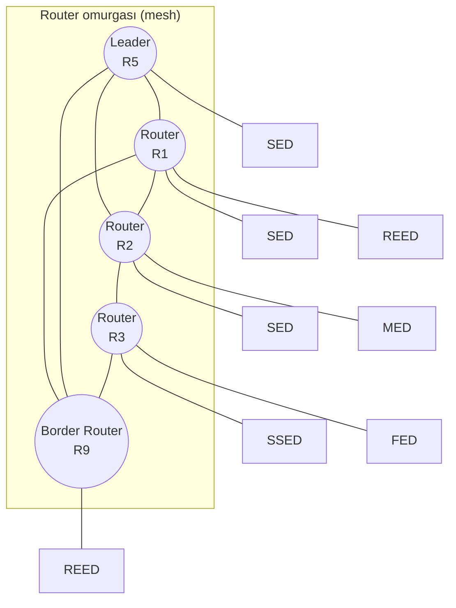

## 8. Ağ Topolojisi ve Ölçek

### 8.1 İki Katmanlı Yapı

Thread topolojisi iki katmandan oluşur:

1. **Router omurgası (mesh)**: Router'lar birbirleriyle tam bir mesh oluşturur. Her router, mesafe-vektör yönlendirmesi sayesinde diğer **her router'a** giden en iyi yolu bilir.
2. **Uç cihaz yıldızları (star)**: Her router çevresindeki child cihazların (REED, FED, MED, SED, SSED) parent'ıdır. Child'lar yalnızca parent'larıyla haberleşir.

Bu yapının avantajları:

- **Yönlendirme tabloları küçüktür**: Router'lar yalnızca en fazla 32 router için rota tutar; child'lar RLOC16'nın içinde parent'ın Router ID'siyle adreslenir.
- **Uç cihazlar basittir**: Yönlendirme yapmaz, yalnızca parent'larını bilirler; bu da düşük güç ve az bellek demektir.
- **Kendi kendini onarma**: Router kaybolursa diğer router'lar rotaları yeniden hesaplar; o router'ın child'ları başka bir parent'a bağlanır.

### 8.2 Ölçek Sınırları

| Sınır | Değer | Kaynağı |
|---|---|---|
| Atanabilir Router ID'leri | 0–62 (63 adet) | RLOC16'nın 6 bitlik Router ID alanı (63 geçersiz) |
| Aynı anda aktif router | **32** | `MAX_ROUTERS`; Route64 TLV ve yönlendirme yükü |
| Router başına child (adres alanı) | 511 | 9 bitlik Child ID |
| Router başına child (pratik) | Onlarca (uygulamaya ve RAM'e bağlı; OpenThread'de derleme zamanı ayarı) | Tampon ve tablo bellek ihtiyacı |
| Toplam cihaz (pratik) | **250–300+** | Thread Group'un sıkça verdiği hedef değer |

> [!NOTE]
> 32 router × (örneğin) 10–20 child ile yüzlerce cihaz mümkündür. Daha büyük kurulumlar (ör. bina otomasyonu) için birden fazla Thread ağı kullanılır ve bunlar Thread 1.2'nin **Thread Domain / Backbone Router** veya Thread 1.3'ün **TREL** özellikleriyle IP omurgası üzerinden birleştirilir.

### 8.3 Ağ Kimlik Parametreleri

Bir Thread ağı şu parametrelerle tanımlanır (hepsi **Operational Dataset**'in parçası, Bölüm 17):

| Parametre | Boyut | Açıklama |
|---|---|---|
| **Network Name** | ≤ 16 bayt (UTF-8) | İnsan tarafından okunabilir ad, ör. "MyHome" |
| **Extended PAN ID** | 8 bayt | Ağın küresel olarak benzersiz kimliği (ağı ayırt etmenin asıl yolu) |
| **PAN ID** | 2 bayt | MAC seviyesindeki kimlik |
| **Channel** | 11–26 | Çalışılan kanal |
| **Mesh-Local Prefix** | /64 | Mesh-local adreslerin öneki (ULA) |
| **Network Key** | 16 bayt | Ağ anahtarı (tüm güvenlik bundan türetilir) |
| **PSKc** | 16 bayt | Commissioner kimlik doğrulama anahtarı |
| **Security Policy** | 3–4 bayt | Anahtar rotasyon süresi ve izin bayrakları |
| **Active Timestamp** | 8 bayt | Dataset'in sürümü |

### 8.4 Ağın Kurulması

İlk cihaz (genellikle bir Border Router) ağı şöyle kurar:

1. Yeni bir Operational Dataset oluşturur (rastgele Network Key, Extended PAN ID, PAN ID, mesh-local önek; enerji taramasıyla seçilmiş kanal).
2. Thread'i başlatır; cihaz **Detached** durumundadır.
3. **Parent Request** gönderir; kimse cevap vermez (ağda başka cihaz yok).
4. Bağlanma denemeleri tükenince cihaz **yeni bir partition kurar** ve **Leader** olur:
    - Rastgele bir **Partition ID** seçer.
    - Kendine bir **Router ID** atar.
    - Network Data'yı başlatır (Border Router ise öneklerini ve servislerini ekler).
    - MLE **Advertisement** göndermeye başlar.
5. Sonra gelen cihazlar bu ağa child olarak bağlanır, gerektiğinde router'a terfi eder.

### 8.5 Partition (Bölüm/Ada) Kavramı

Bir **partition**, kablosuz bağlantıyla birbirine ulaşabilen ve aynı Leader'ı paylaşan Thread cihazları kümesidir. Normalde bir Thread ağı tek partition'dır. Ancak:

- Ağın iki bölgesi arasındaki bağlantı koparsa (ör. aradaki router'lar kapanırsa), kopan taraf kendi Leader'ını seçer ve **ikinci bir partition** oluşur. İki partition aynı Network Key, kanal ve PAN ID'yi kullanır ama birbirinden habersizdir.
- Bağlantı geri geldiğinde partition'lar Advertisement'lar aracılığıyla birbirini fark eder ve **birleşir** (merge): "daha iyi" partition kazanır, diğerinin cihazları ona katılır (Bölüm 11).

Partition'ı karakterize eden değerler **Leader Data TLV**'de taşınır: Partition ID, Weighting, Data Version, Stable Data Version, Leader Router ID.

### 8.6 Kendi Kendini Onarma

| Olay | Ağın tepkisi |
|---|---|
| Bir router kapanır | Komşuları ondan Advertisement alamaz; bağlantı kalitesi düşer ve en geç `MAX_NEIGHBOR_AGE` (100 s) sonra komşu silinir; rotalar alternatif yollardan yeniden hesaplanır. |
| O router'ın child'ları | MED'ler ACK alamayınca, SED'ler poll'larına cevap alamayınca veya *child supervision* zaman aşımıyla durumu fark eder ve yeni parent arar. |
| Router ID'si | Leader, router'dan uzun süre haber alamazsa ID'yi serbest bırakır; ID bir süre (`ID_REUSE_DELAY` = 100 s) yeniden kullanılmaz. |
| Leader kapanır | Router'lar Leader'a rotayı kaybeder; `NETWORK_ID_TIMEOUT` (120 s) sonra bir router yeni Leader olur, diğerleri ona bağlanır. |
| Border Router kapanır | Leader, BR'nin Network Data girdilerini kaldırır; diğer BR'ler (varsa) devralır. |
| Kanal çok gürültülü | Commissioner/BR kanal yöneticisi Pending Dataset ile ağı yeni kanala taşıyabilir. |

### 8.7 Birden Fazla Thread Ağı

Aynı ortamda birden fazla bağımsız Thread ağı bulunabilir: farklı Extended PAN ID ve Network Key ile, aynı veya farklı kanallarda. Örnek: bir evde Apple, Google ve Amazon Border Router'ları **kimlik bilgilerini paylaşmazsa** her biri kendi Thread ağını kurar.

Bu durumun sonuçları:

- Cihazlar ağlar arasında bölünür; her ağın mesh'i daha seyrek olur (daha az router, daha zayıf kapsama).
- Bir ağın cihazları diğer ağın router'larını kullanamaz.
- Aynı kanaldaysalar birbirlerinin yayınlarıyla kanalı paylaşırlar (ek girişim).

Çözüm: Ekosistemlerin aynı Thread ağını paylaşması. Bunun için işletim sistemlerinin kimlik bilgisi paylaşım API'leri ve Thread 1.4'ün **ePSKc** mekanizması geliştirilmiştir (Bölüm 16 ve 19).

### 8.8 Ölçekleme Değerlendirmeleri

- **Advertisement boyutu**: Route64 TLV, her aktif router için 1 bayt + 9 bayt sabit içerir. 32 router'da Advertisement yaklaşık 60–70 bayttır ve tek çerçeveye sığar.
- **Router sayısı ve kontrol trafiği**: Daha çok router daha çok Advertisement ve daha çok multicast tekrarı demektir. 16–23 eşikleri bu dengeyi kurar.
- **Child tabloları ve tamponlar**: Parent'ın her SED için paket tutması gerekir; çok sayıda SED'i olan router'ın RAM'i yeterli olmalıdır.
- **Atlama sayısı**: Her atlama gecikme ekler ve aynı kanal paylaşıldığı için verimi düşürür. İyi bir tasarımda cihazların büyük çoğunluğu Border Router'a 2–4 atlama uzaklıktadır.
- **Network Data boyutu**: En fazla 254 bayt; çok sayıda önek/servis ilanı bu sınıra takılabilir.

### 8.9 Bölüm Özeti

- Thread: router'lardan oluşan bir mesh + router'ların etrafında uç cihaz yıldızları.
- Partition başına en fazla 32 aktif router; pratikte 250+ cihaz.
- Ağ kimliği Extended PAN ID, Network Name, PAN ID, kanal ve Network Key ile tanımlanır.
- Kopan bölgeler ayrı partition'lar oluşturur; bağlantı gelince birleşirler.
- Bir evde birden çok bağımsız Thread ağı oluşması verimsizdir; kimlik paylaşımıyla tek ağ hedeflenmelidir.
