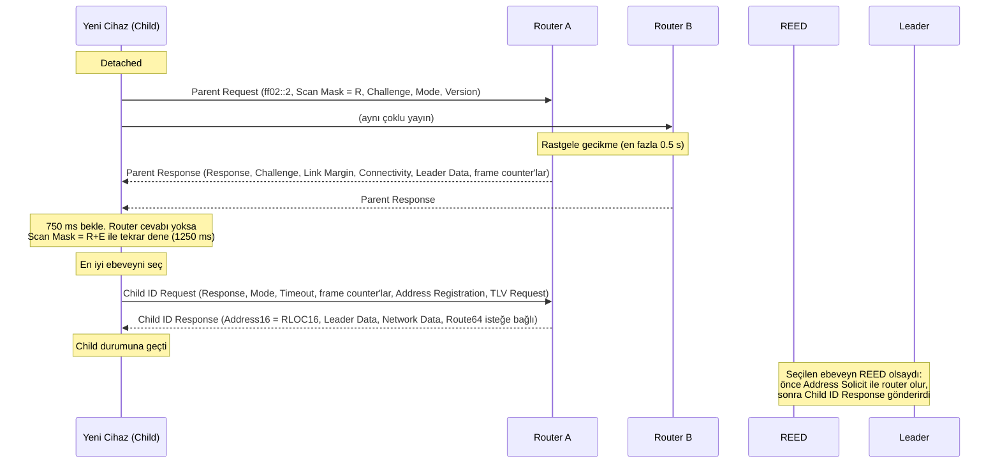
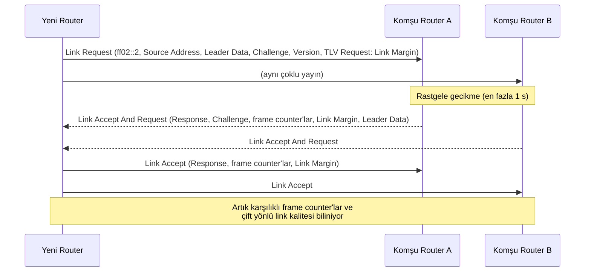

## 9. MLE — Mesh Link Establishment

### 9.1 MLE Nedir, Ne İşe Yarar?

**MLE (Mesh Link Establishment)**, Thread'in tek atlamalı (link seviyesindeki) kontrol protokolüdür. 802.15.4 MAC'in "association" mekanizmasının yerini alır ve çok daha fazlasını yapar:

| Görev | İlgili MLE mesajları |
|---|---|
| Ağa bağlanma (attach) ve ebeveyn seçimi | Parent Request, Parent Response, Child ID Request, Child ID Response |
| Router'lar arası bağlantı kurma | Link Request, Link Accept, Link Accept And Request, Link Reject |
| Yönlendirme bilgisinin yayılması | Advertisement (Route64 TLV) |
| Çocuk bakımı ve canlı tutma | Child Update Request / Response |
| Ağ verisi ve dataset dağıtımı | Data Request, Data Response |
| Ağ keşfi | Discovery Request, Discovery Response |
| Kanal/PAN değişikliği duyurusu | Announce |
| Bağlantı kalitesi ölçümü (1.2+) | Link Metrics Management Request/Response, Link Probe |
| Güvenlik senkronizasyonu | Frame counter TLV'leri, Challenge/Response |

**Neden MAC association veya standart IPv6 ND değil?**

- MLE kendi güvenliğine sahiptir; MAC frame counter'ı henüz bilinmeyen bir komşuyla bile güvenli konuşabilir.
- Her iki yöndeki bağlantı kalitesini (çift yönlü link quality) ölçüp paylaşabilir.
- Frame counter, ağ verisi, dataset, ağ sürümü gibi Thread'e özgü bilgileri TLV'lerle esnekçe taşır.
- IPv6/UDP üzerinde çalıştığı için IP tabanlı mimariyle tutarlıdır.

### 9.2 Taşıma

| Özellik | Değer |
|---|---|
| Protokol | UDP |
| Port | **19788** (kaynak ve hedef) |
| Adresler | **Link-local** tekil (`fe80::…`) veya çoklu yayın (`ff02::1`, `ff02::2`) |
| Hop Limit | 255 (yalnızca tek atlamalık mesajların kabul edilmesi için; gelen MLE paketinin hop limit'i 255 değilse reddedilir) |
| MAC güvenliği | **Yok** — güvenlik MLE katmanında uygulanır (MAC çerçevesi güvenliksiz gönderilir) |
| MLE güvenliği | AES-128-CCM, 4 baytlık MIC, MLE Key ile |

### 9.3 Mesaj Formatı

```text
+----------+------------------------------------+---------+-----------------+------+
| Security | Auxiliary Security Header          | Command | TLV'ler         | MIC  |
| Suite    | (802.15.4 biçiminde)               | Type    |                 |      |
| 1 bayt   | SecCtl(1) FC(4) KeySrc(4) KeyIdx(1)| 1 bayt  | değişken        | 4    |
+----------+------------------------------------+---------+-----------------+------+
           |<------ yalnızca suite = 0 ------->|<---- şifreli (suite = 0) ---->|
```

| Alan | Açıklama |
|---|---|
| **Security Suite** | `0` = 802.15.4 tarzı güvenlik kullanılıyor · `255` = güvenlik yok (yalnızca Discovery Request/Response) |
| **Security Control** | Tipik değer `0x15`: güvenlik seviyesi 5 (ENC-MIC-32) + **Key ID Mode 2** |
| **Frame Counter** | Gönderenin **MLE** frame counter'ı (MAC sayacından ayrıdır) |
| **Key Source** | Mevcut **Key Sequence** değeri (4 bayt) — alıcı hangi anahtarın kullanıldığını kesin bilir |
| **Key Index** | `(Key Sequence mod 128) + 1` |
| **Command Type** | Mesaj türü (aşağıdaki tablo) |
| **TLV'ler** | Type (1) + Length (1) + Value |
| **MIC** | 4 baytlık bütünlük kodu |

**Şifreleme ayrıntıları:**

- Anahtar: **MLE Key** (Network Key ve Key Sequence'ten türetilir; Bölüm 15).
- Nonce: Gönderenin Extended Address'i (link-local IPv6 kaynak adresinin IID'sinden U/L biti geri çevrilerek elde edilir) + Frame Counter + güvenlik seviyesi.
- Ek doğrulanan veri (AAD): IPv6 **kaynak ve hedef adresleri** + Auxiliary Security Header. Böylece mesaj başka bir adrese yönlendirilip yeniden oynatılamaz.
- Şifrelenen kısım: Command Type + TLV'ler.

Key ID Mode 2'nin (anahtar dizisinin tamamını taşıyan) kullanılması, bir cihazın uzun süre uyuduktan veya ağdan ayrı kaldıktan sonra bile ağın güncel anahtar dizisini öğrenebilmesini sağlar.

### 9.4 Komut Türleri

| Değer | Komut | Yön / adres | Amaç |
|---|---|---|---|
| 0 | **Link Request** | Router → router(lar) | Bağlantı kurma isteği |
| 1 | **Link Accept** | Tekil | İsteği kabul (ve frame counter bilgisi) |
| 2 | **Link Accept And Request** | Tekil | Kabul + karşı tarafa istek |
| 3 | **Link Reject** | Tekil | Reddetme |
| 4 | **Advertisement** | `ff02::1` | Router/Leader varlığı, Route64 |
| 5 | (Update — kullanılmıyor) | — | — |
| 6 | (Update Request — kullanılmıyor) | — | — |
| 7 | **Data Request** | Tekil | Ağ verisi / dataset isteği |
| 8 | **Data Response** | Tekil veya `ff02::1` | Ağ verisi / dataset yanıtı veya duyurusu |
| 9 | **Parent Request** | `ff02::2` | Ebeveyn arama |
| 10 | **Parent Response** | Tekil | Ebeveyn adayı olma teklifi |
| 11 | **Child ID Request** | Tekil | Seçilen ebeveyne bağlanma isteği |
| 12 | **Child ID Response** | Tekil | Bağlanma onayı, RLOC16 ataması |
| 13 | **Child Update Request** | Tekil | Çocuk bilgilerini güncelleme / canlı tutma |
| 14 | **Child Update Response** | Tekil | Yanıt |
| 15 | **Announce** | Yayın (başka kanal) | Ağın kanal/PAN bilgisini duyurma |
| 16 | **Discovery Request** | `ff02::2` (güvenliksiz) | Ağ keşfi |
| 17 | **Discovery Response** | Tekil (güvenliksiz) | Ağ bilgisi |
| 18 | **Link Metrics Management Request** | Tekil | (1.2) Ölçüm serisi yapılandırma |
| 19 | **Link Metrics Management Response** | Tekil | (1.2) Yanıt |
| 20 | **Link Probe** | Tekil | (1.2) Ölçüm için sonda mesajı |

### 9.5 MLE TLV'leri

| Tür | TLV | Uzunluk | İçerik / kullanım |
|---|---|---|---|
| 0 | **Source Address** | 2 | Gönderenin RLOC16'sı |
| 1 | **Mode** | 1 | R/D/N bitleri (Bölüm 7.4) |
| 2 | **Timeout** | 4 | Çocuğun zaman aşımı (s) |
| 3 | **Challenge** | 4–8 | Rastgele sayı (tazelik kanıtı istemi) |
| 4 | **Response** | 4–8 | Alınan Challenge'ın aynen geri gönderilmesi |
| 5 | **Link-layer Frame Counter** | 4 | Gönderenin MAC frame counter'ı |
| 6 | (Link Quality) | — | Kullanımdan kalktı |
| 7 | (Network Parameter) | — | Kullanımdan kalktı |
| 8 | **MLE Frame Counter** | 4 | Gönderenin MLE frame counter'ı |
| 9 | **Route64** | değişken | ID Sequence, Router Mask, router başına link kalitesi ve rota maliyeti |
| 10 | **Address16** | 2 | Ebeveynin çocuğa atadığı RLOC16 |
| 11 | **Leader Data** | 8 | Partition ID, Weighting, Data Version, Stable Data Version, Leader Router ID |
| 12 | **Network Data** | değişken | Thread Network Data (Bölüm 12) |
| 13 | **TLV Request** | değişken | Karşı taraftan istenen TLV türlerinin listesi |
| 14 | **Scan Mask** | 1 | Parent Request'e kimlerin cevap vereceği (R: router'lar, E: REED'ler) |
| 15 | **Connectivity** | 7–10 | Ebeveyn adayının bağlantı durumu (Parent Priority, LQ sayıları, Leader maliyeti…) |
| 16 | **Link Margin** | 1 | Alınan mesajın link margin değeri (dB) |
| 17 | **Status** | 1 | Hata/durum kodu |
| 18 | **Version** | 2 | Thread sürümü (2=1.1, 3=1.2, 4=1.3, 5=1.4) |
| 19 | **Address Registration** | değişken | Çocuğun IPv6 adres listesi |
| 20 | **Channel** | 3 | Kanal sayfası + kanal (Announce) |
| 21 | **PAN ID** | 2 | PAN ID (Announce) |
| 22 | **Active Timestamp** | 8 | Active Operational Dataset zaman damgası |
| 23 | **Pending Timestamp** | 8 | Pending Dataset zaman damgası |
| 24 | **Active Operational Dataset** | değişken | Dataset TLV'leri |
| 25 | **Pending Operational Dataset** | değişken | Dataset TLV'leri (+ Delay Timer) |
| 26 | **Thread Discovery** | değişken | MeshCoP Discovery Request/Response alt-TLV'leri |
| 27 | **Supervision Interval** | 2 | Çocuk denetim aralığı (s) |
| 80 | **CSL Channel** | 3 | (1.2) CSL dinleme kanalı |
| 85 | **CSL Synchronized Timeout** | 4 | (1.2) CSL senkron zaman aşımı |
| 86 | **CSL Clock Accuracy** | 2 | (1.2) Saat doğruluğu (ppm) ve belirsizlik |
| 87 | **Link Metrics Query** | değişken | (1.2) Tek seferlik ölçüm sorgusu |
| 88 | **Link Metrics Management** | değişken | (1.2) Ölçüm serisi yapılandırma |
| 89 | **Link Metrics Report** | değişken | (1.2) Ölçüm raporu |
| 90 | **Link Probe** | değişken | (1.2) Sonda verisi |

### 9.6 Önemli TLV'lerin Ayrıntısı

#### Leader Data TLV (8 bayt)

```text
+---------------------+-----------+--------------+--------------------+------------------+
| Partition ID (4)    | Weighting | Data Version | Stable Data Version| Leader Router ID |
|                     |    (1)    |     (1)      |        (1)         |       (1)        |
+---------------------+-----------+--------------+--------------------+------------------+
```

Her Advertisement, Parent Response, Child ID Response ve Data Response bu TLV'yi taşır. Cihazlar bu sayede partition'ı, Leader'ı ve ağ verisinin güncel olup olmadığını hemen anlar.

#### Connectivity TLV

```text
+-------+-----------+-----------+-----------+-------------+--------+---------+--------------+-------------+
| Flags | LQ3 count | LQ2 count | LQ1 count | Leader Cost | ID Seq | Active  | SED Buffer   | SED Datagram|
|  (1)  |    (1)    |    (1)    |    (1)    |     (1)     |  (1)   | Routers | Size (2, ops)| Count (1,ops)|
+-------+-----------+-----------+-----------+-------------+--------+---------+--------------+-------------+
 Flags: bit 7-6 = Parent Priority (+1 yüksek, 0 orta, −1 düşük, −2 = ayrılmış)
```

Ebeveyn adayının ne kadar "iyi bağlı" olduğunu gösterir: kaç router komşusuyla LQ3/LQ2/LQ1 bağlantısı var, Leader'a maliyeti ne, aktif router sayısı kaç ve SED'ler için ne kadar tampon ayırabilir.

#### Route64 TLV

```text
+--------+--------------------------+------------------------------------------+
| ID Seq | Router ID Mask (8 bayt)  | Route Data (atanmış her Router ID için 1)|
|  (1)   | bit i = Router ID i      |  bit 7-6: LQ Out  bit 5-4: LQ In         |
|        | atanmış mı?              |  bit 3-0: Route Cost (0 = ulaşılamaz)    |
+--------+--------------------------+------------------------------------------+
```

Yönlendirmenin temelidir; ayrıntıları Bölüm 10'da.

#### Address Registration TLV

Her girdi ya sıkıştırılmış ya da tam adres içerir:

```text
Sıkıştırılmış :  [C=1 | Context ID (4 bit)] [IID (8 bayt)]       → 9 bayt
Tam            :  [C=0 | ayrılmış        ] [IPv6 adresi (16 bayt)] → 17 bayt
```

#### Scan Mask TLV

| Bit | Maske | Anlamı |
|---|---|---|
| R | `0x80` | Router'lar cevap versin |
| E | `0x40` | REED'ler (end device olarak çalışan FTD'ler) cevap versin |

### 9.7 Bağlanma (Attach) Süreci

Ağa ilk kez katılan ya da ebeveynini kaybetmiş bir cihaz (Operational Dataset'i biliyor olmalıdır) şu adımları izler:



#### Adım 1 — Parent Request

- Hedef: `ff02::2` (link-local tüm router'lar).
- İlk denemede **Scan Mask = R**: yalnızca router'lar cevap verir. Cihaz `PARENT_REQUEST_ROUTER_TIMEOUT` (750 ms) bekler.
- Uygun router cevabı yoksa ikinci denemede **Scan Mask = R + E**: REED'ler de cevap verir; bekleme `PARENT_REQUEST_REED_TIMEOUT` (1250 ms).
- Mesaj içinde rastgele **Challenge** bulunur; cevaplar bu Challenge'ı **Response** TLV'sinde geri getirmek zorundadır (eski mesajların tekrar oynatılmasına karşı koruma).

#### Adım 2 — Parent Response

Ebeveyn adayları, çoklu yayın fırtınasını önlemek için rastgele bir gecikmeyle (router'lar için en fazla 500 ms, REED'ler dahil en fazla 1000 ms) cevap verir. Cevap şunları içerir:

- **Response** (gelen Challenge), yeni bir **Challenge** (çocuğun bir sonraki mesajında cevaplaması için),
- **Link-layer** ve **MLE Frame Counter**,
- Parent Request'in alındığı **Link Margin**,
- **Connectivity** ve **Leader Data**,
- **Version** (ve 1.2+'da CSL saat doğruluğu).

#### Adım 3 — Ebeveyn seçimi

Çocuk, gelen cevapları karşılaştırır. Tipik öncelik sırası (OpenThread'in uyguladığı mantığa yakın):

1. **İki yönlü bağlantı kalitesi** (çocuğun ölçtüğü RSS ile ebeveynin bildirdiği Link Margin'in kötüsü) — yüksek olan tercih edilir.
2. Router'lar REED'lere tercih edilir (REED'in terfi etmesi gerekmesin).
3. **Parent Priority** (Connectivity TLV) yüksek olan.
4. Ebeveynin **LQ3 komşu sayısı** fazla olan (iyi bağlı ebeveyn).
5. Thread sürümü, SED tampon kapasitesi, CSL doğruluğu gibi ikincil kriterler.

Partition seçimi de devrededir: Birden fazla partition'dan cevap gelirse genellikle "daha iyi" partition (Bölüm 11) tercih edilir.

#### Adım 4 — Child ID Request / Response

Child ID Request şunları taşır: **Response**, frame counter'lar, **Mode**, **Timeout**, **Version**, MTD ise **Address Registration**, istenen TLV'ler (**TLV Request**: Address16, Network Data, gerekirse Route64), bilinen **Active/Pending Timestamp**.

Ebeveyn kabul ederse **Child ID Response** ile:

- **Address16**: Çocuğa atanan RLOC16 (ebeveynin Router ID'si + yeni Child ID),
- **Leader Data**, **Network Data** (çocuk N=0 ise yalnızca stable kısım),
- İstenmişse **Route64**,
- Çocuğun dataset'i eskiyse **Active/Pending Operational Dataset**,
- (1.2+) **Supervision Interval**, CSL parametreleri.

Bu noktadan sonra çocuk RLOC16'sını kullanır, MAC güvenli çerçeveleriyle haberleşir ve **Child** rolündedir.

#### Yeniden bağlanma ve "daha iyi ebeveyn" araması

- **Ebeveyn kaybı**: Çocuk, ebeveyninden belirli sayıda ardışık ACK alamazsa veya child supervision zaman aşımı dolarsa yeniden bağlanma başlatır. İlk denemelerde aynı partition'a bağlanmaya çalışır.
- **Child Update ile geri dönüş**: Ebeveyn kısa süreli bir kesinti yaşadıysa çocuk önce Child Update Request ile mevcut ebeveynine geri dönmeyi dener; başarılı olursa tam attach gerekmez.
- **Parent Search**: FTD çocuklar periyodik olarak (OpenThread'de dakikalar mertebesinde) çevreyi dinleyip belirgin şekilde daha iyi bir ebeveyn varsa ona geçebilir.

### 9.8 Router'lar Arası Bağlantı Kurulumu

Bir cihaz router olduğunda (veya yeniden başladığında) komşu router'larla **çift yönlü, güvenli bağlantılar** kurmalıdır:



- **Challenge/Response** çifti, mesajın taze olduğunu ve karşı tarafın gerçekten ağ anahtarına sahip olduğunu kanıtlar.
- **Frame counter TLV'leri**, MAC katmanındaki tekrar korumasının başlangıç noktalarını belirler.
- **Link Margin TLV**, karşı tarafın bu cihazı ne kadar iyi duyduğunu bildirir (çift yönlü link kalitesi için).
- Bir router, Advertisement'ından haberdar olduğu ama bağlantısı olmayan bir router'a doğrudan tekil Link Request de gönderebilir.

### 9.9 Advertisement ve Trickle Zamanlayıcısı

Router'lar ve Leader, `ff02::1` adresine periyodik **Advertisement** gönderir. İçerik: **Source Address**, **Leader Data**, **Route64**.

Gönderim aralığı **Trickle** algoritmasıyla (RFC 6206) belirlenir:

| Parametre | Değer |
|---|---|
| `Imin` | 1 saniye |
| `Imax` | 32 saniye |

- Ağ kararlıyken aralık her seferinde ikiye katlanarak 32 saniyeye kadar uzar → kontrol trafiği azalır.
- Router kümesi değiştiğinde (yeni router, kaybolan router, ID Sequence değişimi) Trickle **sıfırlanır** ve aralık tekrar 1 saniyeye düşer → değişiklik hızla yayılır.

**REED'ler** de çok daha seyrek Advertisement gönderir (yaklaşık 570–630 saniyede bir; Route64 olmadan). Bu sayede router'lar çevredeki REED'lerden haberdar olur.

**Komşu yaşlanması**: Bir router, bir komşu router'dan `MAX_NEIGHBOR_AGE` (100 s) boyunca hiçbir şey duymazsa o komşuyu tablodan siler.

### 9.10 Child Update

**Child Update Request/Response** çifti çocuk-ebeveyn ilişkisini günceller:

| Kim gönderir? | Ne zaman? | İçerik |
|---|---|---|
| Çocuk | Mode değişince (ör. MED → SED), adres listesi değişince, Timeout değişince, canlı tutma (keep-alive) için, ebeveyn yeniden başladıysa | Mode, Address Registration, Timeout, Leader Data, (CSL TLV'leri) |
| Ebeveyn | Kendi yeniden başlatması sonrası çocuklarını doğrulamak, ağ verisi değişikliğini SED'e bildirmek | Source Address, Leader Data, Challenge |

**Zaman aşımı (child timeout)**: Çocuk, Timeout TLV ile bildirdiği süre içinde ebeveyniyle en az bir kez konuşmazsa ebeveyn onu çocuk tablosundan siler. SED'lerin MAC poll'ları da ebeveyn tarafından etkinlik olarak sayılır; bu yüzden düzenli poll eden bir SED'in ayrıca MLE keep-alive göndermesi gerekmez (Thread 1.2+'da "Enhanced Keep-Alive").

### 9.11 Data Request / Data Response ve Ağ Verisinin Yayılması

Network Data değiştiğinde yeni sürümün tüm ağa yayılması şöyle olur:

1. Leader ağ verisini günceller, **Data Version** (ve gerekiyorsa **Stable Data Version**) değerini artırır.
2. Leader, yeni ağ verisini içeren **Data Response**'u `ff02::1`'e çoklu yayınla gönderir.
3. Bunu duyan router'lar ağ verisini günceller ve kısa bir rastgele gecikmeden sonra **kendileri de** Data Response çoklu yayını yapar → veri dalga gibi tüm mesh'e yayılır.
4. Advertisement'lardaki Leader Data TLV'sinde daha yeni sürüm gören, ama Data Response'u kaçırmış bir router, **Data Request** ile komşusundan güncel veriyi ister.
5. Rx-on çocuklar (MED/FED) çoklu yayınları doğrudan alır; SED'ler ise ebeveynlerinden gelen Child Update mesajındaki Leader Data'da yeni sürümü görüp **Data Request** gönderir.

Aynı mekanizma **Active/Pending Operational Dataset** dağıtımında da kullanılır (Active/Pending Timestamp TLV'leri ile sürüm karşılaştırması).

### 9.12 Discovery Request / Discovery Response

Ağ keşfi için kullanılan, **güvenliksiz** (Security Suite = 255) mesajlardır; çünkü keşif yapan cihaz henüz ağ anahtarını bilmez.

- **Discovery Request**: Her kanalda `ff02::2`'ye (MAC'te `0xFFFF` yayın, PAN ID `0xFFFF`) gönderilir. Thread Discovery TLV içinde *Discovery Request* alt-TLV'si vardır: sürüm ve **Joiner (J)** bayrağı (yalnızca devreye almaya açık ağlar cevap versin).
- **Discovery Response**: Router'lar cevap verir. İçerik: *Discovery Response* alt-TLV'si (sürüm, **Native Commissioner (N)** bayrağı), **Extended PAN ID**, **Network Name**, varsa **Steering Data**, **Joiner UDP Port**, **Commissioner UDP Port**.
- Joiner, Steering Data içinde kendi Joiner ID'sinin olup olmadığını kontrol ederek hangi ağa katılmaya çalışacağına karar verir (Bölüm 16).

### 9.13 Announce

**Announce**, ağın şu anki kanalını ve PAN ID'sini **diğer kanallarda** duyurmak için kullanılır. İçerik: **Channel**, **Active Timestamp**, **PAN ID**.

Kullanım senaryoları:

- Ağ kanal değiştirdikten sonra değişikliği kaçıran (ör. uzun süre uyuyan veya kapalı olan) cihazlar eski kanalda kalır. Announce mesajları onları yeni kanala çağırır.
- Bir cihaz, daha yeni Active Timestamp'li bir Announce aldığında belirtilen kanala geçip bağlanmayı dener.
- Commissioner, **Announce Begin** (`c/ab`) yönetim komutuyla belirli cihazlara belirtilen kanal maskesinde Announce göndermelerini söyleyebilir.
- Announce, MLE anahtarıyla korunur; dolayısıyla yalnızca ağ anahtarını bilenler geçerli Announce üretebilir.

### 9.14 Örnek: Parent Request'in Çözümlenmesi

```text
--- IPv6/UDP (6LoWPAN ile sıkıştırılmış) ---
Kaynak  fe80::182b:3c4d:5e6f:7081  port 19788
Hedef   ff02::2                     port 19788,  Hop Limit 255

--- MLE ---
00                      Security Suite = 0 (güvenli)
15                      Security Control: seviye 5, Key ID Mode 2
2A 01 00 00             MLE Frame Counter = 298 (LE)
00 00 00 00             Key Source = Key Sequence 0
01                      Key Index = 1
=== buradan sonrası MLE Key ile şifreli ===
09                      Command = Parent Request
01 01 0B                Mode TLV: R + D + N (rdn)
03 08 9F 31 C4 7A 0E 55 D2 18   Challenge TLV (8 bayt rastgele)
0E 01 80                Scan Mask TLV: R (yalnızca router'lar)
12 02 00 04             Version TLV: 4 (Thread 1.3)
=== şifreli kısım sonu ===
xx xx xx xx             MIC (4 bayt)
```

### 9.15 MLE Zaman Sabitleri

| Sabit | Değer | Açıklama |
|---|---|---|
| `ADVERTISEMENT_I_MIN` | 1 s | Trickle en küçük aralık |
| `ADVERTISEMENT_I_MAX` | 32 s | Trickle en büyük aralık |
| `MAX_NEIGHBOR_AGE` | 100 s | Router komşusu yaşlanma süresi |
| `PARENT_REQUEST_ROUTER_TIMEOUT` | 750 ms | Yalnızca router'lara Parent Request sonrası bekleme |
| `PARENT_REQUEST_REED_TIMEOUT` | 1250 ms | Router + REED Parent Request sonrası bekleme |
| Parent Response gecikmesi | ≤ 500 ms (router) / ≤ 1000 ms (REED dahil) | Rastgele yanıt gecikmesi |
| Link Request yanıt gecikmesi | ≤ 1 s | Çoklu yayın Link Request'e rastgele yanıt |
| `ROUTER_SELECTION_JITTER` | 120 s | REED terfisi öncesi rastgele bekleme üst sınırı |
| REED Advertisement aralığı | ≈ 570–630 s | REED'lerin varlık ilanı |
| Varsayılan child timeout | 240 s (OpenThread) | Çocuğun ebeveyniyle konuşması gereken süre |

### 9.16 Bölüm Özeti

- MLE, UDP 19788 üzerinde link-local çalışan, kendi AES-CCM güvenliğine sahip Thread kontrol protokolüdür.
- Attach süreci: Parent Request → Parent Response → ebeveyn seçimi → Child ID Request → Child ID Response.
- Router'lar Link Request/Accept ile komşuluk kurar; Advertisement'lar Trickle ile 1–32 s aralıkla Route64 yayar.
- Challenge/Response ve frame counter TLV'leri tazelik ve tekrar koruması sağlar.
- Data Request/Response ağ verisini ve dataset'leri; Discovery ağ keşfini; Announce kanal değişikliklerini taşır.
