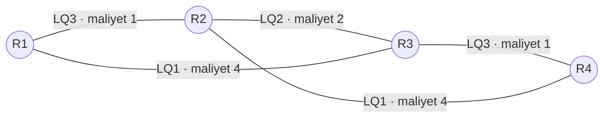

## 10. Yönlendirme (Routing)

### 10.1 Genel Bakış

Thread yönlendirmesi üç temel ilkeye dayanır:

1. **Router'lar arası proaktif mesafe-vektör (distance-vector)**: Her router, ağdaki **her router'a** giden en düşük maliyetli yolu ve bu yolun **sonraki atlamasını** bilir. Bilgi MLE Advertisement'lardaki **Route64 TLV** ile yayılır.
2. **Uç cihazlar yönlendirme yapmaz**: Her şeyi ebeveynlerine gönderirler. Bir çocuğa giden paket, onun ebeveyn router'ına yönlendirilir (RLOC16'nın üst 6 biti).
3. **Bağlantı kalitesine dayalı maliyet**: Rota maliyeti atlama sayısı değil, **çift yönlü bağlantı kalitesine** göre hesaplanan link maliyetlerinin toplamıdır.

En fazla 32 router olduğundan tablolar küçüktür ve tüm ağın rotaları birkaç Advertisement turunda yakınsar.

### 10.2 Link Margin → Link Quality → Link Cost

Her router, komşusundan aldığı çerçevelerin RSS değerlerinin ortalamasını tutar ve **link margin** (RSS − gürültü tabanı) hesaplar:

| Link Margin (histerezisli) | Link Quality (LQ) | Link Cost |
|---|---|---|
| > 20 dB | **3** | **1** |
| > 10 dB | **2** | **2** |
| > 2 dB | **1** | **4** |
| ≤ 2 dB | **0** | **∞** (kullanılmaz) |

**Çift yönlü kalite:** Radyo bağlantıları asimetrik olabilir (A, B'yi iyi duyar ama B, A'yı zayıf duyar). Bu yüzden Thread iki değeri birlikte kullanır:

- **LQ In**: Bu router'ın komşudan gelen çerçeveler için ölçtüğü kalite.
- **LQ Out**: Komşunun bu router'dan gelen çerçeveler için ölçtüğü ve Route64 TLV'sinde bildirdiği kalite.
- **Link cost** = `cost( min(LQ In, LQ Out) )`.

### 10.3 Route64 TLV Ayrıntısı

```text
+--------+-------------------------------+-------------------------------------------+
| ID Seq | Router ID Mask (64 bit)       | Route Data (Mask'te 1 olan her ID için)    |
| 1 bayt | bit 0 (ilk baytın MSB'si)=ID 0| 1 bayt: [LQ Out:2][LQ In:2][Route Cost:4] |
+--------+-------------------------------+-------------------------------------------+
```

- **ID Sequence**: Leader'ın router ID kümesindeki her değişiklikte artırdığı sıra numarası. Daha büyük ID Sequence içeren Route64, daha güncel router kümesini temsil eder.
- **Router ID Mask**: Hangi Router ID'lerin şu anda atanmış olduğu.
- **Route Data**: Mask'te atanmış görünen her router için, gönderenin o router'a ilişkin bilgisi:
    - Komşuysa **LQ Out** ve **LQ In** (komşu değilse 0),
    - Gönderenin o router'a olan **rota maliyeti** (4 bit; 0 = ulaşılamaz/sonsuz).

**Örnek** — Router 1, Router 2, 3 ve 4'ün atanmış olduğu bir ağda Router 1'in Advertisement'ı:

```text
09 0D                       Route64 TLV, uzunluk 13
07                          ID Sequence = 7
78 00 00 00 00 00 00 00     Router Mask: ID 1, 2, 3, 4 atanmış (0b0111_1000)
xx                          ID 1 (gönderenin kendisi)
F1                          ID 2: LQ Out=3, LQ In=3, maliyet 1   (doğrudan, mükemmel)
53                          ID 3: LQ Out=1, LQ In=1, maliyet 3   (komşu ama R2 üzerinden daha ucuz)
04                          ID 4: komşu değil,       maliyet 4   (R2 üzerinden)
```

### 10.4 Rota Hesaplama

Router X, hedef router D için şu değerleri karşılaştırır:

```text
Doğrudan yol (D komşuysa) : linkCost(X, D)
N üzerinden yol           : linkCost(X, N) + routeCost_N(D)     (N: her komşu router,
                                                                 routeCost_N(D): N'nin Route64'te ilan ettiği maliyet)
En iyi yol                : bunların en küçüğü; eşitlikte doğrudan bağlantı tercih edilir
Maliyet ≥ 16 (MAX_ROUTE_COST) ise hedef "ulaşılamaz" kabul edilir
```

**Örnek ağ:**



**R1'in yönlendirme tablosu:**

| Hedef | Doğrudan | R2 üzerinden | R3 üzerinden | Seçim | Sonraki atlama | Maliyet |
|---|---|---|---|---|---|---|
| R2 | 1 | — | 4 + 3 = 7 | Doğrudan | R2 | 1 |
| R3 | 4 | 1 + 2 = 3 | — | R2 üzerinden | R2 | 3 |
| R4 | — | 1 + 3 = 4 | 4 + 1 = 5 | R2 üzerinden | R2 | 4 |

(R2'nin R4'e maliyeti: doğrudan 4 veya R3 üzerinden 2 + 1 = 3 → **3**.)

Görüldüğü gibi, R1 ile R3 doğrudan komşu olsa da bağlantıları zayıf olduğu için trafik iki atlamalı ama daha kaliteli yoldan gider. Bu, Thread'in "atlama sayısı" yerine "bağlantı kalitesi" optimize ettiğinin somut örneğidir.

### 10.5 Rota Bilgisinin Yayılması ve Yakınsama

- Her router Advertisement'ında kendi en iyi maliyetlerini ilan eder; komşular bunları kendi link maliyetleriyle toplar.
- Bir değişiklik (yeni router, kopan bağlantı) Trickle zamanlayıcısını sıfırlayarak Advertisement sıklığını artırır; yeni bilgi hızla yayılır.
- Komşu bir router'dan `MAX_NEIGHBOR_AGE` (100 s) boyunca haber alınamazsa bağlantı silinir ve o router üzerinden geçen rotalar yeniden hesaplanır.
- **Sonsuza sayma (count-to-infinity)** problemi, 4 bitlik maliyet alanı ve 16'da kesilen maksimum maliyet ile sınırlandırılır; ulaşılamayan hedef birkaç Advertisement turunda "sonsuz" olarak işaretlenir.
- **ID Sequence**, silinmiş router ID'lerinin eski bilgilerle yeniden canlanmasını önler: Daha küçük ID Sequence içeren Route64 bilgisi router kümesi açısından dikkate alınmaz.

### 10.6 Paket İletme Algoritması

Bir router'ın IPv6 paketi için verdiği kararın sadeleştirilmiş hâli:

```text
1. Hedef link-local mi? (fe80::/ff02::)
      → Doğrudan komşuya / yerel yayın olarak gönder. (Yönlendirilmez.)

2. Hedef RLOC16'yı belirle:
   a) Hedef RLOC veya ALOC ise   → RLOC16 adresin son 16 bitidir
                                    (ALOC: Leader → Leader Router ID, Service → en yakın sunucu …)
   b) Hedef mesh-içi bir EID ise → EID→RLOC önbelleği
                                    (yoksa Address Query gönder, paketi beklet)
   c) Hedef ağ dışında ise       → Network Data'daki rotalardan uygun Border Router'ı seç
                                    (en uzun önek eşleşmesi, sonra tercih, sonra yol maliyeti)

3. Hedef RLOC16 benim çocuğum mu?
      → Rx-on ise doğrudan; uyuyan ise dolaylı iletim kuyruğuna koy.

4. Hedef RLOC16 kendim miyim?   → Yerel olarak teslim et.

5. Hedef router = RLOC16 & 0xFC00
   Sonraki atlama = yönlendirme tablosundan (hedef router veya ona giden yol)

6. Sonraki atlama nihai hedef değilse 6LoWPAN Mesh Header ekle
      (Originator = kendi RLOC16'm veya paketi bana veren çocuğun RLOC16'sı,
       Final Destination = hedef RLOC16)

7. Gerekirse parçala, MAC çerçevesi oluştur (hedef = sonraki atlamanın RLOC16'sı), şifrele, gönder.
```

**Ara router'daki işlem** çok daha basittir: Mesh Header'daki *Final Destination*'a bakıp sonraki atlamayı bulur, *Hops Left*'i bir azaltır ve çerçeveyi iletir. IPv6 başlığını açmaz, parçaları birleştirmez.

### 10.7 Uç Cihazların ve Çocukların Yönlendirilmesi

- **Çocuktan çıkan paket**: Çocuk (MED/SED/FED/REED), hedef ne olursa olsun paketi MAC seviyesinde **ebeveynine** gönderir. Ebeveyn, paketi kendi göndermiş gibi yönlendirir (Mesh Header'da Originator olarak çocuğun RLOC16'sı yazılır).
- **Çocuğa giden paket**: Paket, RLOC16'nın üst bitlerinden belirlenen **ebeveyn router'a** yönlendirilir; ebeveyn teslim eder.
- **FTD çocuklar (REED/FED)** kendi EID→RLOC önbelleklerini tutar ve Address Query yapabilir; ancak paketleri yine ebeveynlerine gönderir.
- Bir çocuk ebeveyn değiştirdiğinde RLOC16'sı değişir. Eski RLOC16'yı önbelleğinde tutan cihazlar paketi eski ebeveyne gönderir; eski ebeveyn o çocuğu artık tanımadığı için paketi teslim edemez. Kaynaktaki önbellek kaydı geçersiz hâle gelip yenilendiğinde (yeni Address Query veya dinlenen trafikten öğrenme ile) doğru RLOC16 elde edilir; yeni sorguya artık çocuğun **yeni** ebeveyni cevap verir.

### 10.8 Ağ Dışına Yönlendirme (Border Router Seçimi)

Network Data, ağ dışına çıkış noktalarını iki biçimde ilan eder (Bölüm 12):

- **Prefix TLV + Border Router alt-TLV'si**: Bir on-mesh önek ve o önekle ilgili BR'ler (`r` = varsayılan rota bayrağı).
- **Prefix TLV + Has Route alt-TLV'si**: Belirli bir dış önek için rota sunan BR'ler (ör. `::/0`, `fc00::/7`, NAT64 öneki).

Bir cihaz ağ dışına paket gönderirken:

1. Hedefle **en uzun eşleşen** Has Route öneki bulunur (yoksa `r` bayraklı varsayılan rota).
2. Birden fazla BR varsa **tercih** (preference: high > medium > low) karşılaştırılır.
3. Tercihler eşitse **yol maliyeti en düşük** (en yakın) BR seçilir.
4. Paket o BR'nin RLOC16'sına yönlendirilir; BR paketi altyapı ağına (Wi-Fi/Ethernet) iletir.

### 10.9 Uçtan Uca Örnek

SED `0x5C01` (Router 23'ün çocuğu), SED `0x9402`'ye (Router 37'nin çocuğu) bir UDP paketi göndersin. Router'lar: 23 → 12 → 37.

| Adım | Cihaz | İşlem | MAC kaynak → hedef | Mesh Header |
|---|---|---|---|---|
| 1 | SED 0x5C01 | Paketi ebeveynine gönderir | 0x5C01 → 0x5C00 | (yok) |
| 2 | Router 23 | EID→RLOC: 0x9402; hedef router 37; sonraki atlama 12 | 0x5C00 → 0x3000 | Orig 0x5C01, Final 0x9402, Hops Left = n |
| 3 | Router 12 | Mesh Header'a bakar; sonraki atlama 37 | 0x3000 → 0x9400 | Hops Left = n − 1 |
| 4 | Router 37 | Hedef kendi çocuğu; SED olduğu için kuyruğa alır | — | — |
| 5 | SED 0x9402 | Poll gönderir, ACK'de Frame Pending = 1 görür | 0x9402 → 0x9400 (Data Request) | — |
| 6 | Router 37 | Paketi teslim eder (Mesh Header kaldırılmış) | 0x9400 → 0x9402 | (yok) |

Her MAC atlamasında çerçeve, gönderenin Extended Address'i ve kendi frame counter'ı ile yeniden şifrelenir (hop-by-hop güvenlik).

### 10.10 Döngü ve Hata Durumları

| Durum | Koruma / tepki |
|---|---|
| Geçici yönlendirme döngüsü | Mesh Header **Hops Left** 0'a inince paket atılır |
| Hedef router ulaşılamaz | Paket atılır; kaynağa ICMPv6 Destination Unreachable dönebilir |
| EID→RLOC kaydı eski | Paket eski ebeveyne gider ve teslim edilemez; önbellek kaydı yenilenince (yeni Address Query) trafik düzelir |
| Address Query cevapsız | Paket atılır; aynı EID için yeniden sorgu artan gecikmelerle yapılır |
| Çok fazla yeniden iletim | Link kalitesi düşer → maliyet artar → alternatif yol seçilir |

### 10.11 Bölüm Özeti

- Router'lar arası yönlendirme, Route64 TLV ile yayılan mesafe-vektör algoritmasıdır.
- Maliyet, çift yönlü link kalitesine göre 1/2/4/∞ değerlerinden oluşur; atlama sayısı değil kalite optimize edilir.
- Çocuklara giden trafik ebeveyn router'a yönlendirilir; çocuklar her şeyi ebeveynlerine gönderir.
- Ara router'lar yalnızca Mesh Header'a bakar; IPv6 paketini açmaz.
- Ağ dışı trafik Network Data'daki rotalardan, en uzun önek → tercih → yol maliyeti sırasıyla seçilen Border Router'a gider.
