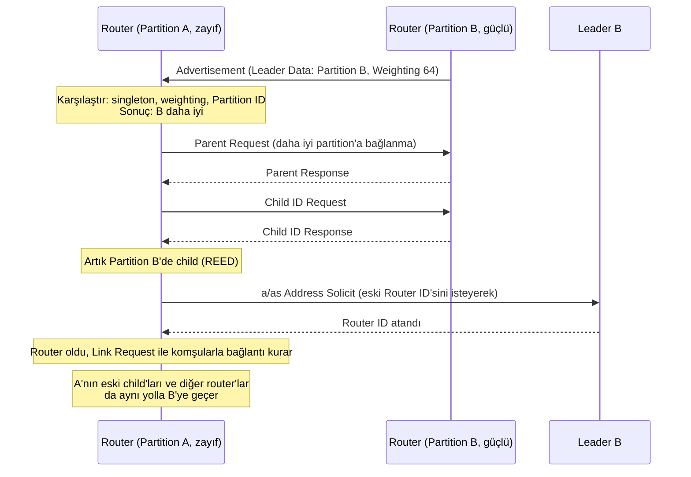
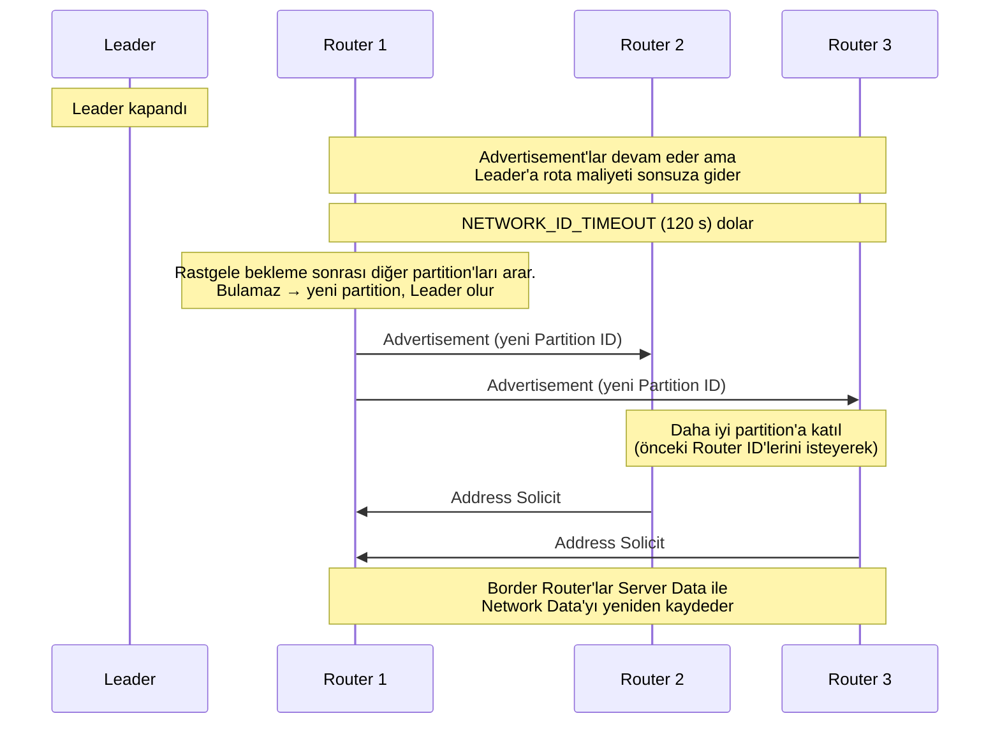

## 11. Leader, Partition ve Router ID Yönetimi

### 11.1 Leader'ın Görevleri

| Görev | Mekanizma |
|---|---|
| Router ID atama / geri alma | TMF `a/as` (Address Solicit), `a/ar` (Address Release) |
| Router ID kümesini ve ID Sequence'ı yönetme | Route64 TLV'deki ID Sequence + Router Mask |
| Network Data'yı toplama ve dağıtma | TMF `a/sd` (Server Data) ile kayıt, MLE Data Response ile dağıtım |
| 6LoWPAN bağlam ID'lerini atama | Network Data'daki Context alt-TLV'leri |
| Commissioner oturumunu yetkilendirme | MeshCoP `c/lp` (Leader Petition), `c/la` (Leader Keep Alive) |
| Operational Dataset değişikliklerini yönetme | MeshCoP `c/as`, `c/ps` (Active/Pending Set) |
| Partition kimliğini taşıma | Leader Data TLV: Partition ID, Weighting, Leader Router ID |
| Leader ALOC'unu (`0xFC00`) sahiplenme | Diğer cihazlar Leader'a bu adresle ulaşır |

> [!NOTE]
> Leader bir "yönetici" ama "darboğaz" değildir: Veri trafiği Leader üzerinden geçmek zorunda değildir. Leader yalnızca kontrol düzlemindeki merkezi kayıtları tutar ve bu kayıtlar tüm router'lara kopyalandığı için (Network Data, Route64) Leader kaybolsa bile ağ çalışmaya devam eder.

### 11.2 Leader Nasıl Belirlenir?

Thread'de açık bir "seçim" (election) protokolü yoktur. Leader, **partition'ı kuran router**dır:

1. Bir router veya REED, bağlı olduğu partition'ın Leader'ına ulaşamadığını fark eder.
2. Başka bir partition'a bağlanmayı dener (Parent Request).
3. Hiçbir partition bulamazsa **kendi partition'ını kurar ve Leader olur**: rastgele yeni bir Partition ID seçer, Router ID kümesini başlatır, Network Data'yı (bildiği kadarıyla) oluşturur.
4. Aynı anda birden fazla router bunu yaparsa geçici olarak birden fazla partition oluşur; bunlar Bölüm 11.4'teki kurallarla tek partition'da birleşir.

### 11.3 Leader Data TLV ve Partition Kimliği

| Alan | Boyut | Açıklama |
|---|---|---|
| **Partition ID** | 4 bayt | Leader'ın partition kurarken seçtiği rastgele sayı |
| **Weighting** | 1 bayt | Partition ağırlığı (varsayılan 64). Leader'ın ağırlığı (leader weight) ile belirlenir |
| **Data Version** | 1 bayt | Tam Network Data sürümü; her değişiklikte artar (mod 256) |
| **Stable Data Version** | 1 bayt | Yalnızca kalıcı (stable) Network Data sürümü |
| **Leader Router ID** | 1 bayt | Leader'ın Router ID'si (Leader ALOC'unun yönlendirileceği router) |

Thread 1.3.1/1.4 ile Leader ağırlığı, cihazın özelliklerine (güç kaynağı tipi — pil/şebeke/kesintisiz, Border Router olup olmadığı vb.) göre otomatik hesaplanabilir. Böylece şebekeye bağlı, kararlı ve BR işlevli cihazların Leader olması teşvik edilir.

### 11.4 Partition Karşılaştırma ve Birleşme

İki partition karşılaştırılırken (OpenThread'in uyguladığı sıra):

1. **Singleton kontrolü**: Yalnızca tek router'dan oluşan (singleton) partition, birden fazla router'ı olan partition'a karşı kaybeder.
2. **Weighting**: Yüksek ağırlıklı partition kazanır.
3. **Partition ID**: Ağırlıklar eşitse sayısal olarak büyük Partition ID kazanır.

Bir router, Advertisement'larda kendi partition'ından **daha iyi** bir partition'ın Leader Data'sını görürse o partition'a geçmeye çalışır:



Birleşme sırasında kısa süreli paket kayıpları olabilir; ancak cihazların EID'leri (ML-EID, OMR) değişmediği için uygulamalar birleşme sonrası kesintisiz devam eder.

### 11.5 Router ID Atama: Address Solicit

Bir REED router olmak istediğinde Leader'a **Address Solicit** gönderir:

```text
CoAP CON POST  coap://[<Leader ALOC>]:61631/a/as
Yük (TMF TLV'leri):
  Ext MAC Address TLV   — isteyenin Extended Address'i
  Status TLV            — terfi nedeni
  RLOC16 TLV (isteğe)   — tercih edilen (genellikle önceki) Router ID
```

**Terfi nedenleri (Status TLV değerleri):**

| Değer | Neden |
|---|---|
| 2 | **Too Few Routers** — router sayısı eşik altında |
| 3 | **Have Child ID Request** — bir cihaz beni parent seçti |
| 4 | **Parent Partition Change** — partition değişimi sonrası eski rolüme dönüyorum |

**Leader'ın yanıtı:**

```text
Status TLV       — 0 = Success, 1 = No Address Available
RLOC16 TLV       — atanan Router ID (RLOC16 = ID << 10)
Router Mask TLV  — güncel ID Sequence + atanmış Router ID maskesi
```

Leader'ın karar mantığı:

- Aktif router sayısı 32 ise → **No Address Available**.
- İstenen Router ID boştaysa ve yakın zamanda serbest bırakılmamışsa → o ID verilir (cihaz eski kimliğini korur).
- Aksi hâlde boştaki ID'lerden biri (rastgele) seçilir.
- Router kümesi değiştiği için **ID Sequence** artırılır ve yeni küme Advertisement'larla yayılır.

### 11.6 Router ID Geri Alma: Address Release

- Router, REED'e dönerken (downgrade) Leader'a **Address Release** (`a/ar`) gönderir: RLOC16 TLV + Ext MAC Address TLV.
- Leader bir router'dan uzun süre haber alamazsa (yönlendirme bilgisine göre o router'a rota yoksa; `MAX_LEADER_TO_ROUTER_TIMEOUT` = 90 s) ID'yi kendisi serbest bırakır.
- Serbest bırakılan ID, **`ID_REUSE_DELAY` = 100 s** boyunca başka bir cihaza verilmez. Böylece eski ID'ye ait bayat rota bilgileri ağdan silinmeye fırsat bulur.

### 11.7 Leader Kaybı ve Kurtarma



- Yeni Leader, eski Network Data'yı ilk etapta kendi kopyasından yeniden oluşturabilir; Border Router'lar ve servis sağlayıcılar kayıtlarını `a/sd` ile yeniler.
- Cihazların ML-EID ve OMR adresleri değişmez; çoğu router eski Router ID'sini geri alır.
- Kesinti tipik olarak birkaç dakika mertebesindedir (zaman aşımı + yakınsama).

**Leader'ın kendisi yeniden başlarsa:** Leader durumunu kalıcı bellekte saklar; açıldığında önceki partition'ı ve Router ID'sini geri yüklemeye çalışır (komşularına Link Request göndererek). Bu sayede kısa süreli bir yeniden başlatma ağı bölmeden atlatılır.

### 11.8 Network Data Yönetimi (Leader Tarafı)

- Border Router'lar ve servis sağlayıcılar kendi **yerel Network Data** parçalarını Leader'a **Server Data Notification** (`a/sd`) ile bildirir.
- Leader bunları birleştirir; her girdinin sahibini (RLOC16) bilir.
- Değişiklik olduğunda **Data Version** (kalıcı kısım değiştiyse **Stable Data Version** da) artırılır ve Data Response ile dağıtılır.
- Router ID'si serbest bırakılan bir cihazın girdileri Network Data'dan kaldırılır.
- Yeni bir on-mesh önek için **bağlam ID'si** (1–15) atanır; önek kaldırıldığında bağlam önce "sıkıştırmada kullanılmaz" (C = 0) yapılır ve ID belirli bir süre (48 saat) yeniden kullanılmaz.
- Network Data'nın 254 baytı aşmasına izin verilmez; yer yoksa kayıt reddedilir.

### 11.9 Commissioner Oturumunun Yönetimi

- Leader, Network Data içindeki **Commissioning Data TLV**'yi tutar: Border Agent Locator, Commissioner Session ID, Steering Data, Joiner UDP Port.
- Bir commissioner, Border Agent aracılığıyla **Leader Petition** (`c/lp`) gönderir; Leader aktif commissioner yoksa kabul eder ve yeni bir **Commissioner Session ID** verir.
- Commissioner belirli aralıklarla **Keep Alive** göndermezse Leader oturumu kapatır ve Commissioning Data'yı temizler. Ayrıntılar Bölüm 16'da.

### 11.10 Bölüm Özeti

- Leader, partition'ı kuran router'dır; açık bir seçim protokolü yoktur.
- Partition karşılaştırma: singleton < çok router'lı, sonra yüksek weighting, sonra büyük Partition ID.
- Router ID'ler Address Solicit/Release ile yönetilir; en fazla 32 aktif router, serbest ID'ler 100 s bekletilir.
- Leader kaybolursa 120 s sonra yeni Leader oluşur, router'lar eski ID'lerini geri isteyerek katılır.
- Network Data, bağlam ID'leri ve commissioner oturumu Leader'da merkezileşir ama tüm ağa kopyalanır.
