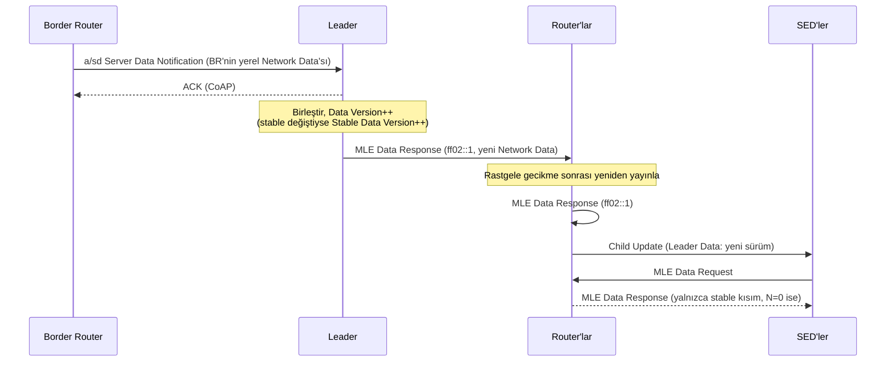

## 12. Network Data (Ağ Verisi)

### 12.1 Nedir?

**Thread Network Data**, ağ genelinde paylaşılan yapılandırma bilgisidir. Standart IPv6'daki Router Advertisement'ın Thread'deki karşılığı gibi düşünülebilir, ama çok daha fazlasını taşır:

| İçerik | Örnek |
|---|---|
| **On-mesh önekler** | OMR öneki `fd4f:2d3c:ee9b:1::/64` — cihazlar bundan SLAAC adresi üretir |
| **Dış rotalar** | `::/0` (internet), `fc00::/7`, NAT64 öneki `64:ff9b::/96` |
| **Border Router bilgileri** | Hangi BR hangi öneği sunuyor, tercih değeri, bayraklar |
| **6LoWPAN bağlamları** | Önek ↔ bağlam ID eşlemesi (sıkıştırma için) |
| **Servisler** | SRP sunucusu (anycast/unicast), Backbone Router, diğer servisler |
| **Commissioning Data** | Aktif commissioner, Border Agent konumu, Steering Data |

### 12.2 Yaşam Döngüsü



- **Kayıt**: Veri sağlayıcılar (BR'ler, servis sunucuları) yerel Network Data'larını **Server Data Notification** (`a/sd`) ile Leader'a gönderir. Bir şeyi kaldırmak için güncellenmiş (eksiltilmiş) yerel veriyi yeniden gönderirler.
- **Birleştirme**: Leader tüm parçaları birleştirir, sürüm numaralarını artırır.
- **Dağıtım**: MLE Data Response çoklu yayınları ve Data Request/Response çiftleriyle (Bölüm 9.11).
- **Temizlik**: Router ID'si geçersiz olan sağlayıcıların girdileri Leader tarafından silinir.

### 12.3 Stable ve Temporary Veri

Her Network Data TLV'sinde bir **Stable (S)** biti vardır:

- **Stable (kalıcı)**: Uzun süre geçerli kalması beklenen bilgi (ör. OMR öneki, SLAAC bayrakları, bağlamlar). SED'ler (N = 0) yalnızca bunu alır.
- **Temporary (geçici)**: Sık değişebilen bilgi (ör. Commissioning Data, bazı rota tercihleri).

Bu ayrım, uyuyan cihazların her küçük değişiklik için uyanıp veri çekmesini önler. SED'ler yalnızca **Stable Data Version** değiştiğinde güncelleme yapar.

### 12.4 TLV Biçimi

```text
+---------------------------+--------+------------------+
| Type (7 bit) | Stable (1) | Length | Value (alt TLV'ler)|
+---------------------------+--------+------------------+
```

| Tür | TLV | Nerede |
|---|---|---|
| 0 | **Has Route** | Prefix TLV içinde alt-TLV |
| 1 | **Prefix** | Üst seviye |
| 2 | **Border Router** | Prefix TLV içinde alt-TLV |
| 3 | **6LoWPAN ID** (Context) | Prefix TLV içinde alt-TLV |
| 4 | **Commissioning Data** | Üst seviye |
| 5 | **Service** | Üst seviye |
| 6 | **Server** | Service TLV içinde alt-TLV |

Network Data'nın toplam boyutu en fazla **254 bayttır**.

### 12.5 Prefix TLV

```text
+-----------+---------------+-------------------+----------------------------+
| Domain ID | Prefix Length | Prefix (bit uzun. | Alt-TLV'ler: Border Router,|
|   (1)     |     (1)       | yuvarlanmış bayt) | Has Route, 6LoWPAN ID      |
+-----------+---------------+-------------------+----------------------------+
```

Bir önek altında birden çok alt-TLV ve her alt-TLV'de birden çok sağlayıcı girdisi (farklı BR'ler) bulunabilir.

### 12.6 Border Router Alt-TLV'si

Her girdi 4 bayttır: **RLOC16 (2)** + **Bayraklar (2)**.

```text
 bit: 15 14 | 13 | 12 | 11 | 10 |  9 |  8 |  7 |  6 | 5 … 0
      Pref  |  p |  a |  d |  c |  r |  o |  n |  D | ayrılmış
```

| Bayrak | OpenThread harfi | Anlamı |
|---|---|---|
| **Pref** (2 bit) | high/med/low | Bu BR'nin tercih değeri (`01` high, `00` medium, `11` low) |
| **p** (Preferred) | `p` | SLAAC/DHCP ile üretilen adresler "preferred" olarak kullanılabilir |
| **a** (SLAAC) | `a` | Cihazlar bu önekten **SLAAC** ile adres üretmeli |
| **d** (DHCP) | `d` | Adresler DHCPv6 ile alınır |
| **c** (Configure) | `c` | Diğer yapılandırmalar DHCPv6 ile alınabilir |
| **r** (Default Route) | `r` | Bu BR, bu önekten kaynaklanan paketler için **varsayılan rota** sunar |
| **o** (On-Mesh) | `o` | Önek **mesh üzerindedir**: bu önekteki hedefler Thread ağı içindedir |
| **n** (ND DNS) | `n` | DNS bilgisi ND ile sağlanır |
| **D** (Domain Prefix) | `D` | (1.2) Bu önek bir **Thread Domain** önekidir (DUA için) |

Tipik OMR öneki girdisi: `paros` = Preferred + SLAAC + default Route + On-mesh + Stable.

### 12.7 Has Route Alt-TLV'si

Her girdi 3 bayttır: **RLOC16 (2)** + **Bayraklar (1)**.

| Bayrak | Anlamı |
|---|---|
| **Pref** (2 bit, bit 7–6) | Rota tercihi (high/medium/low) |
| **N** (NAT64, bit 5) | (1.3) Bu önek bir **NAT64** önekidir |
| **P** (Advertising PIO, bit 4) | (1.4) BR, altyapı ağında ilgili PIO ilanı yapıyor |

Has Route, "bu önekteki hedeflere benim üzerimden ulaşabilirsiniz" anlamına gelir. Örnekler:

| Önek | Anlamı |
|---|---|
| `::/0` | İnternet'e (varsayılan) rota — altyapı ağında global IPv6 bağlantısı varsa |
| `fc00::/7` | Tüm ULA hedeflerine rota — altyapı ağındaki ULA adreslerine erişim |
| `fd12:3456:789a:1::/64` | Altyapı ağının on-link öneki |
| `64:ff9b::/96` veya `fdxx:…::/96` + N | NAT64 öneki (IPv4 hedefleri) |

### 12.8 6LoWPAN ID (Context) Alt-TLV'si

```text
+--------------------------------+----------------+
| ayr.(3) | C (1) | Context ID(4) | Context Length |
+--------------------------------+----------------+
```

- **C (Compress)**: 1 = bu bağlam sıkıştırmada kullanılabilir.
- **Context ID**: 1–15 (0, mesh-local önek için ayrılmıştır).
- **Context Length**: Bağlam olarak kullanılacak önek uzunluğu (bit).

### 12.9 Service ve Server TLV'leri

```text
Service TLV:
+---+------------+------------------------+--------------+--------------+-----------------+
| T | Service ID | Enterprise Number (4)  | Service Data | Service Data | Server alt-TLV'leri |
|(1)|   (4 bit)  | (T=1 ise atlanır)      | Length (1)   |              |                 |
+---+------------+------------------------+--------------+--------------+-----------------+

Server alt-TLV'si:
+------------------+-------------+
| Server RLOC16 (2)| Server Data |
+------------------+-------------+
```

- **T = 1** ise kurum numarası atlanır ve **Thread Group'un IANA Enterprise Number'ı 44970** kabul edilir.
- **Service ID** (0–15), Leader tarafından atanır ve **Service ALOC** (`0xFC10` + Service ID) ile servise anycast erişim sağlar.

**Thread'in tanımladığı servisler (Enterprise 44970):**

| Service Data (ilk bayt) | Servis | İçerik |
|---|---|---|
| `0x01` | **Backbone Router** | Server Data: BBR sıra numarası, yeniden kayıt gecikmesi, MLR zaman aşımı |
| `0x5C` | **DNS/SRP Anycast** | Service Data: sıra numarası. Sunucuya Service ALOC ile ulaşılır |
| `0x5D` | **DNS/SRP Unicast** | Sunucunun IPv6 adresi ve portu (Service Data'da veya Server Data'da) |

Cihazlar SRP sunucusunu bu girdilerden keşfeder (Bölüm 19).

### 12.10 Commissioning Data TLV

Aktif commissioner varken Leader tarafından eklenir (geçici veri):

| Alt-TLV | Anlamı |
|---|---|
| **Border Agent Locator** | Commissioner'a giden trafiğin aktarılacağı Border Agent'ın RLOC16'sı |
| **Commissioner Session ID** | Aktif oturumun kimliği |
| **Steering Data** | Hangi joiner'ların kabul edileceğini gösteren Bloom filtresi |
| **Joiner UDP Port** | Joiner'ların DTLS için kullanacağı port |

Router'lar Discovery Response'larda Steering Data ve Joiner UDP Port'u bu TLV'den alır.

### 12.11 Örnek: `netdata show` Çıktısı

```text
> netdata show
Prefixes:
fd4f:2d3c:ee9b:1::/64 paros med 5c00
Routes:
fc00::/7 s med 5c00
fd8a:93c2:7f01:2:0:0::/96 sn low 5c00
Services:
44970 5d fddead00beef00006c1fc63a9a2e3b07d11f s 5c00
44970 01 36000500000e10 s 5c00
Contexts:
fd4f:2d3c:ee9b:1::/64 1 c
Commissioning:
37104 5c00 - -
Done
```

| Satır | Yorum |
|---|---|
| `fd4f:2d3c:ee9b:1::/64 paros med 5c00` | OMR öneki; Router 23 (`0x5C00`) sunuyor; SLAAC ile adres üret, varsayılan rota, on-mesh, stable, tercih orta |
| `fc00::/7 s med 5c00` | ULA hedefleri için dış rota (s = stable), tercih orta |
| `fd8a:…::/96 sn low 5c00` | NAT64 öneki (n = NAT64), düşük tercih |
| `44970 5d …d11f s 5c00` | DNS/SRP unicast servisi: Server Data = sunucunun ML-EID adresi (`fdde:ad00:beef:0:6c1f:c63a:9a2e:3b07`) + port `0xD11F` (53535) |
| `44970 01 36000500000e10` | Backbone Router servisi: sıra numarası `0x36`, yeniden kayıt gecikmesi 5 s, MLR zaman aşımı 3600 s |
| `fd4f:2d3c:ee9b:1::/64 1 c` | OMR öneki bağlam ID 1, sıkıştırmaya açık |
| `37104 5c00 - -` | Commissioner oturum ID 37104, Border Agent `0x5C00` |

> [!NOTE]
> `netdata show` çıktı biçimi OpenThread sürümleri arasında küçük farklılıklar gösterebilir; ham TLV görmek için `netdata show -x` kullanılabilir.

### 12.12 Cihazın Network Data'yı Kullanması

Bir cihaz yeni Network Data aldığında:

1. **On-mesh öneklerde `a` bayrağı varsa** SLAAC adresi üretir; önek kaybolursa adresi kaldırır.
2. **Bağlam tablosunu** günceller (sıkıştırma/açma için).
3. **Rota tablosunu** (dış rotalar, tercihler, BR RLOC16'ları) günceller.
4. **Servisleri** (SRP sunucusu, BBR) keşfeder; gerekirse SRP kaydını yeni sunucuya taşır.
5. **Commissioning Data** varsa (router'lar) Discovery Response'larda kullanır.

### 12.13 Bölüm Özeti

- Network Data; önekler, rotalar, bağlamlar, servisler ve devreye alma bilgisinden oluşan ağ geneli yapılandırmadır.
- Sağlayıcılar `a/sd` ile Leader'a kaydeder; Leader birleştirip MLE ile dağıtır.
- Stable/Temporary ayrımı uyuyan cihazları gereksiz güncellemelerden korur.
- Border Router alt-TLV'si (`paros` gibi bayraklar) on-mesh önekleri, Has Route alt-TLV'si dış rotaları tanımlar.
- Service TLV'leri (Enterprise 44970) SRP sunucusu ve Backbone Router gibi servislerin keşfini sağlar.
