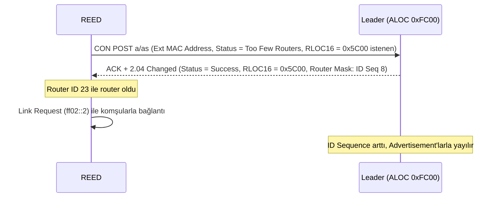

## 13. TMF — Thread Management Framework ve CoAP

### 13.1 TMF Nedir?

**TMF (Thread Management Framework)**, Thread ağının mesh genelindeki yönetim mesajlarını taşıyan çerçevedir. MLE tek atlamalık işleri yaparken TMF; adres çözümleme, router ID yönetimi, ağ verisi kaydı, devreye alma ve teşhis gibi **çok atlamalı** yönetim işlerini yapar.

| Özellik | Değer |
|---|---|
| Uygulama protokolü | **CoAP** (RFC 7252) |
| Taşıma | UDP, port **61631** (`0xF0BF`) |
| Adresler | RLOC, ALOC (ör. Leader ALOC), `ff03::2` gibi realm-local çoklu yayın |
| Yük | Thread TLV'leri (Network Layer TLV'leri, MeshCoP TLV'leri, Network Diagnostic TLV'leri) |
| Güvenlik | Ayrı bir şifreleme yok; **MAC katmanı güvenliğine** dayanır. TMF mesajları yalnızca bağlantı katmanı güvenliği ile mesh'ten gelmişse kabul edilir |

### 13.2 CoAP'a Kısa Bakış

CoAP, kısıtlı cihazlar için tasarlanmış, HTTP benzeri (GET/POST/PUT/DELETE) ama UDP üzerinde çalışan, ikili ve kompakt bir protokoldür.

```text
 0                   1                   2                   3
+---+---+-------+---------------+-------------------------------+
|Ver| T |  TKL  |     Code      |          Message ID           |
+---+---+-------+---------------+-------------------------------+
|   Token (0–8 bayt) ...
+---------------------------------------------------------------+
|   Options (delta kodlamalı) ...
+---------------+-----------------------------------------------+
| 0xFF (yük ayracı) |  Payload ...
+---------------+-----------------------------------------------+
```

| Alan | Açıklama |
|---|---|
| **Ver** | 1 |
| **T** (Type) | 0 = CON (onay ister), 1 = NON (onaysız), 2 = ACK, 3 = RST |
| **TKL** | Token uzunluğu |
| **Code** | `0.01` GET, `0.02` POST, `0.03` PUT, `0.04` DELETE; yanıtlar `2.04` Changed, `2.05` Content, `4.04` Not Found … |
| **Message ID** | Tekrar tespiti ve ACK eşleştirme |
| **Token** | İstek/yanıt eşleştirme |
| **Options** | Uri-Path (11), Content-Format (12) vb.; delta kodlamalı |

**Güvenilirlik (CON mesajlar):** Varsayılan `ACK_TIMEOUT` = 2 s, `ACK_RANDOM_FACTOR` = 1.5, `MAX_RETRANSMIT` = 4; ACK gelmezse bekleme süresi her denemede ikiye katlanarak yeniden gönderilir.

TMF'de tekil istekler genellikle **CON**, çoklu yayınlar (ör. Address Query) **NON** olarak gönderilir.

### 13.3 TMF URI'leri

#### Adres ve ağ yönetimi (`a/…`)

| URI | Ad | Yön | Amaç |
|---|---|---|---|
| `a/aq` | Address Query | `ff03::2` (NON) | Bir EID'nin RLOC16'sını sorma |
| `a/an` | Address Notification | Tekil (CON) | Address Query cevabı |
| `a/ae` | Address Error Notification | Tekil/çoklu | Çakışan adres bildirimi |
| `a/as` | Address Solicit | Leader ALOC (CON) | Router ID isteme |
| `a/ar` | Address Release | Leader ALOC (CON) | Router ID bırakma |
| `a/sd` | Server Data Notification | Leader ALOC (CON) | Yerel Network Data'yı kaydetme |

#### Devreye alma ve dataset (`c/…`, MeshCoP)

| URI | Ad | Amaç |
|---|---|---|
| `c/cp` | Commissioner Petition | Commissioner olma isteği (Border Agent'a) |
| `c/ca` | Commissioner Keep Alive | Commissioner oturumunu canlı tutma |
| `c/lp` | Leader Petition | Border Agent → Leader petition aktarımı |
| `c/la` | Leader Keep Alive | Border Agent → Leader keep alive aktarımı |
| `c/cs` / `c/cg` | Commissioner Set / Get | Commissioning Data'yı (Steering Data vb.) yazma/okuma |
| `c/as` / `c/ag` | Active Set / Get | Active Operational Dataset'i değiştirme/okuma |
| `c/ps` / `c/pg` | Pending Set / Get | Pending Operational Dataset'i değiştirme/okuma |
| `c/dc` | Dataset Changed | Dataset değiştiğini commissioner'a bildirme |
| `c/rx` | Relay Receive | Joiner Router → Commissioner: Joiner'dan gelen DTLS kaydını aktarma |
| `c/tx` | Relay Transmit | Commissioner → Joiner Router: Joiner'a gidecek DTLS kaydını aktarma |
| `c/jf` | Joiner Finalize | Joiner → Commissioner (DTLS içinde): katılım sonlandırma |
| `c/je` | Joiner Entrust | Joiner Router → Joiner: ağ kimlik bilgilerini (KEK ile) teslim |
| `c/ab` | Announce Begin | Cihazlara Announce gönderme emri |
| `c/es` / `c/er` | Energy Scan / Report | Uzaktan enerji taraması ve raporu |
| `c/pq` / `c/pc` | PAN ID Query / Conflict | PAN ID çakışması sorgusu ve bildirimi |
| `c/ur` / `c/ut` | Proxy Receive / Transmit | Harici commissioner'ın mesh içindeki cihazlarla UDP üzerinden konuşması (Border Agent vekilliği) |

#### Teşhis (`d/…`)

| URI | Ad | Amaç |
|---|---|---|
| `d/dg` | Diagnostic Get | Bir cihazdan teşhis TLV'leri isteme (tekil) |
| `d/dq` | Diagnostic Get Query | Çoklu yayınla teşhis sorgusu |
| `d/da` | Diagnostic Get Answer | Sorguya cevap |
| `d/dr` | Diagnostic Reset | Sayaçları sıfırlama |

#### Thread 1.2+ Backbone (`n/…`, `b/…`)

| URI | Ad | Amaç |
|---|---|---|
| `n/dr` | DUA Registration | Domain Unicast Address'i Primary BBR'ye kaydetme |
| `n/mr` | Multicast Listener Registration | Çoklu yayın aboneliğini Primary BBR'ye kaydetme |
| `b/bq` | Backbone Query | BBR'ler arası (omurga üzerinden) DUA çakışma/konum sorgusu |
| `b/ba` | Backbone Answer | Backbone Query cevabı |
| `b/bmr` | Backbone MLR | BBR'ler arası MLR bilgisi |

### 13.4 Ağ Katmanı TMF TLV'leri

| Tür | TLV | Uzunluk | Kullanım |
|---|---|---|---|
| 0 | **Target EID** | 16 | Sorgulanan/bildirilen IPv6 adresi |
| 1 | **Extended MAC Address** | 8 | Cihazın Extended Address'i |
| 2 | **RLOC16** | 2 | Routing locator |
| 3 | **ML-EID** | 8 | ML-EID'nin IID kısmı (çakışma tespiti için) |
| 4 | **Status** | 1 | Durum/neden kodu |
| 6 | **Last Transaction Time** | 4 | Çocukla son iletişimden beri geçen süre |
| 7 | **Router Mask** | 9 | ID Sequence + 64 bit router maskesi |
| 8 | **ND Option** | değişken | Neighbor Discovery seçenekleri |
| 9 | **ND Data** | değişken | ND verisi |
| 10 | **Thread Network Data** | değişken | Server Data Notification içinde yerel Network Data |
| 11 | **Timeout** | 4 | Zaman aşımı değerleri |
| 12 | **Network Name** | ≤ 16 | Ağ adı |
| 14 | **IPv6 Addresses** | değişken | Adres listesi (ör. MLR) |
| 15 | **Commissioner Session ID** | 2 | Oturum kimliği |

### 13.5 Örnek: Address Query Mesajının Baytları

```text
--- CoAP ---
52              Ver=1, Type=NON(1), TKL=2
02              Code = 0.02 (POST)
7B 1C           Message ID = 0x7B1C
A3 E9           Token
B1 61           Option: Uri-Path (delta 11, uzunluk 1) = "a"
02 61 71        Option: Uri-Path (delta 0, uzunluk 2)  = "aq"
FF              Yük ayracı
--- TMF TLV ---
00 10           Target EID TLV, uzunluk 16
FD 4F 2D 3C EE 9B 00 01 8A 43 51 C0 07 6E 21 9D    (hedef OMR adresi)
```

Bu mesaj UDP 61631 → 61631, IPv6 hedefi `ff03::2` ile gönderilir. 6LoWPAN tarafında iki port birlikte tek bayta, `ff03::2` hedefi ise `ffXX::00XX:XXXX` biçimiyle 4 bayta sıkıştırılır (tek baytlık mod yalnızca `ff02::00XX` adresleri içindir).

**Cevap (Address Notification, CON POST `a/an`):**

```text
42 02 4F 10 C5 07  B1 61 02 61 6E  FF
00 10 <16 bayt Target EID>           Target EID TLV
02 02 94 02                          RLOC16 TLV = 0x9402
03 08 <8 bayt ML-EID IID>            ML-EID TLV
06 04 00 00 01 2C                    Last Transaction Time = 300 s (vekil cevap)
```

### 13.6 Örnek Akış: Address Solicit



### 13.7 TMF'nin Güvenlik Sınırları

- TMF mesajları ağ içinde yalnızca **MAC güvenliği** ile korunur. Ağ anahtarına sahip her cihaz TMF mesajı üretebilir; bu yüzden Thread'in güven modeli "ağdaki her cihaz güvenilirdir" varsayımına dayanır (Bölüm 15).
- Ağ dışından (Border Router'ın altyapı tarafından) gelen paketlerin TMF portuna ulaşması engellenir. Harici commissioner'ın TMF/MeshCoP işlemleri yalnızca **Border Agent ile kurulan DTLS oturumu** üzerinden yapılabilir.
- MeshCoP yönetim komutları (Active/Pending Set gibi) ek olarak **Commissioner Session ID** doğrulaması gerektirir.

### 13.8 Bölüm Özeti

- TMF, UDP 61631 üzerinde CoAP ile taşınan, mesh geneli Thread yönetim mesajlarıdır.
- URI ön ekleri: `a/` adres ve ağ, `c/` devreye alma ve dataset, `d/` teşhis, `n/` ve `b/` Thread 1.2 omurga işlemleri.
- Tekil istekler CON, çoklu yayınlar NON olarak gönderilir.
- TMF mesajlarının yükü Thread TLV'leridir; güvenliği MAC katmanından gelir.
