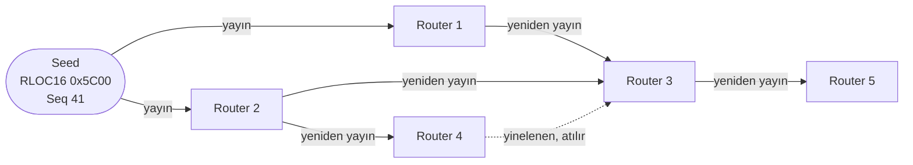

## 14. Çoklu Yayın (Multicast) ve MPL

### 14.1 Kapsama Göre Çoklu Yayın

| Kapsam | Örnek adres | Nasıl iletilir? |
|---|---|---|
| **Link-local (2)** | `ff02::1`, `ff02::2`, `ff32:40:<önek>::1` | Tek bir MAC yayın çerçevesi (`0xFFFF`); **iletilmez** |
| **Realm-local (3)** | `ff03::1`, `ff03::2`, `ff03::fc`, `ff33:40:<önek>::1` | Router'lar tarafından **MPL** ile tüm mesh'e yayılır |
| **Admin-local (4) ve üstü** | `ff04::…`, `ff05::…`, `ff35:…` | Mesh içinde MPL ile yayılır; Border/Backbone Router ile ağ dışına/dışından taşınır (abonelik kaydı gerekir) |

MAC seviyesinde çoklu yayın çerçeveleri **ACK'lenmez**. Bu yüzden güvenilirlik, tekrar gönderimle sağlanır.

### 14.2 MPL (Multicast Protocol for Low-Power and Lossy Networks)

Thread, realm-local ve daha geniş kapsamlı çoklu yayınları mesh'te yaymak için **MPL**'i (RFC 7731) kullanır. MPL, kontrollü bir "taşma" (flooding) protokolüdür:

1. **Seed (tohum)**: Çoklu yayını başlatan cihaz. Her pakete **MPL Option** (IPv6 Hop-by-Hop seçeneği) ekler:
    - **Seed ID**: Thread'de gönderenin **RLOC16**'sı (2 bayt),
    - **Sequence**: Seed başına artan 8 bitlik sıra numarası.
2. **Forwarder (iletici)**: Router'lar yeni (daha önce görmediği Seed ID + Sequence çiftine sahip) bir MPL paketini alınca:
    - Paketi yerel olarak işler (aboneyse uygulamaya verir),
    - **Seed set** tablosuna kaydeder (yinelenen paketleri tanımak için),
    - Paketi rastgele kısa gecikmelerle **birkaç kez** yeniden yayınlar.
3. Zaten görülmüş (Seed ID, Sequence) çiftine sahip paketler atılır.

**Kapsülleme kuralı:**

- Hedef **realm-local** ise MPL Option doğrudan paketin Hop-by-Hop başlığına eklenir.
- Hedef **realm-local'dan geniş** bir kapsamdaysa (ör. `ff05::…`), orijinal paket bir dış IPv6 başlığıyla **kapsüllenir** (IPv6-in-IPv6); dış başlığın hedefi `ff03::fc` (Realm-Local All MPL Forwarders) olur ve MPL Option dış başlığa eklenir. Paket mesh'ten çıkarken (BR'de) dış başlık atılır.

### 14.3 Çoklu Yayının Uç Cihazlara Ulaştırılması

| Cihaz | Nasıl alır? |
|---|---|
| Router, REED, FED | Yayın çerçevelerini doğrudan dinler |
| **MED** | Radyosu açık olduğu için yayın çerçevelerini doğrudan dinler |
| **SED / SSED** | Radyosu kapalıdır. Ebeveyn, SED'in **abone olduğu** adreslere (ve "All Thread Nodes" adreslerine) gelen çoklu yayınları **her SED için ayrı ayrı** kuyruğa koyar ve **dolaylı iletim** ile (MAC'te tekil çerçeve olarak) teslim eder |

SED'ler abone oldukları çoklu yayın adreslerini **Address Registration TLV** ile ebeveynlerine bildirir.

> [!WARNING]
> Çoklu yayın, Thread ağındaki **en pahalı** trafik türlerinden biridir: Her router paketi birkaç kez yayınlar ve her uyuyan alıcı için ebeveyn ayrı bir dolaylı iletim yapar. Sık periyodik çoklu yayınlar (ör. her saniye durum yayını) hem kanal kapasitesini hem SED pillerini tüketir. Mümkünse tekil (unicast) iletişim veya abonelik (subscription) modelleri tercih edilmelidir.

### 14.4 Hangi Adres Kime Ulaşır?

| Hedef | Router | REED/FED | MED | SED/SSED |
|---|---|---|---|---|
| `ff02::1` (link-local all nodes) | ✔ (komşu ise) | ✔ (komşu ise) | ✔ (komşu ise) | ✘ |
| `ff02::2` (link-local all routers) | ✔ (komşu ise) | ✔ (komşu ise) | ✘ | ✘ |
| `ff32:40:<önek>::1` (link-local all Thread nodes) | ✔ | ✔ | ✔ | ✔ (ebeveyn iletir) |
| `ff03::1` (realm-local all nodes) | ✔ | ✔ | ✔ | ✘ |
| `ff03::2` (realm-local all routers) | ✔ | ✔ | ✘ | ✘ |
| `ff33:40:<önek>::1` (realm-local all Thread nodes) | ✔ | ✔ | ✔ | ✔ (ebeveyn iletir) |
| Uygulama grubu (ör. `ff05::abcd`) | Aboneyse | Aboneyse | Aboneyse | Aboneyse (ebeveyne kayıtlıysa) |

### 14.5 Ağ Dışından Çoklu Yayın (Thread 1.2+)

Bir altyapı ağındaki (Wi-Fi/Ethernet) cihaz, Thread cihazlarının abone olduğu bir gruba çoklu yayın gönderirse:

1. Thread cihazı, admin-local veya daha geniş kapsamlı (scope ≥ 4) bir gruba abone olduğunda bunu **Primary Backbone Router**'a **MLR** (Multicast Listener Registration, `n/mr`) ile kaydeder.
2. Primary BBR, omurga (altyapı) arayüzünde bu grup için **MLD** ile dinleyici olur.
3. Altyapıdan gelen eşleşen çoklu yayınlar, BBR tarafından MPL kapsülleme ile mesh'e aktarılır.
4. Kayıtların bir ömrü vardır (MLR timeout; BBR servis verisinde ilan edilir); cihazlar kayıtlarını periyodik yeniler.

Thread'den dışarı giden çoklu yayınlar için Border Router, scope ≥ 4 olan paketleri (kapsülü açarak) altyapı arayüzüne iletir.

### 14.6 Matter Grupları ve Çoklu Yayın

Matter'ın **grup iletişimi** (ör. "tüm salon lambalarını kapat") IPv6 çoklu yayını kullanır:

- Matter grup adresleri **site-local kapsamlı** (scope 5), önek tabanlı çoklu yayın adresleridir (`ff35:40:fd…` biçiminde; fabric kimliği ve grup kimliğinden türetilir).
- Thread cihazları bu adreslere abone olur ve (Thread 1.2+ BBR mevcutsa) MLR ile kaydeder.
- Telefon/hub'dan gönderilen grup komutu Border Router'dan Thread ağına MPL ile yayılır.
- Grup mesajları Matter'ın grup anahtarlarıyla (operational group key) uygulama katmanında şifrelenir.

### 14.7 Bölüm Özeti

- Link-local çoklu yayın tek atlamadır; realm-local ve daha geniş kapsamlar MPL ile mesh'e yayılır.
- MPL; Seed ID (RLOC16) + sıra numarası ile yinelenenleri ayıklar, router'lar paketi birkaç kez yeniden yayınlar.
- SED'lere çoklu yayın, ebeveyn tarafından her cihaza ayrı dolaylı iletimle ulaştırılır; pahalıdır.
- "All Thread Nodes" adresleri SED'leri de kapsar; `ff02::1`/`ff03::1` kapsamaz.
- Thread 1.2+ BBR ve MLR ile ağ dışından gelen çoklu yayınlar abone cihazlara taşınır; Matter grupları bunu kullanır.
