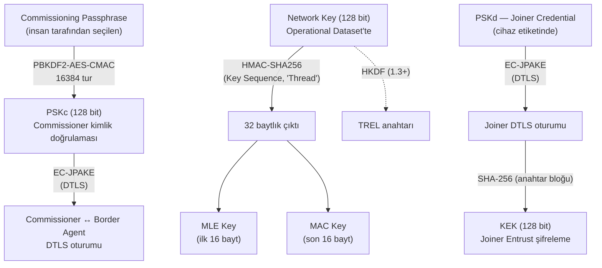

## 15. Güvenlik Mimarisi

### 15.1 Güvenlik Hedefleri ve Temel Model

Thread'in güvenlik tasarımı şu hedeflere dayanır:

| Hedef | Nasıl sağlanır? |
|---|---|
| **Gizlilik** | Tüm ağ trafiği MAC katmanında AES-128-CCM* ile şifrelenir |
| **Bütünlük ve kimlik doğrulama** | Her çerçevede MIC; yalnızca ağ anahtarını bilenler geçerli çerçeve üretebilir |
| **Tekrar (replay) koruması** | Frame counter'lar, MLE Challenge/Response |
| **Yetkisiz katılımın engellenmesi** | Ağa katılım ya PAKE tabanlı (EC-JPAKE + PSKd) devreye alma ya da güvenli bant dışı kanal (Matter/BLE) ile kimlik bilgisi aktarımı gerektirir |
| **Yetkili yönetim** | Commissioner olmak için PSKc ile kimlik doğrulama; aynı anda tek commissioner |
| **Anahtar tazeliği** | Periyodik anahtar rotasyonu (Key Sequence) |

**Temel model — "ağ üyeliği = güven":** Thread'de bütün cihazlar aynı **Network Key**'i paylaşır. Ağa kabul edilmiş her cihaz, ağ katmanında diğerleriyle eşit güven seviyesindedir. Bu basit ve verimli bir modeldir, fakat iki önemli sonucu vardır:

1. Thread güvenliği **hop-by-hop**'tur: Her atlamada çerçeve çözülüp yeniden şifrelenir; ara router'lar yükü düz metin olarak görebilir.
2. **Uçtan uca (end-to-end) uygulama güvenliği** Thread'in değil, üst katmanın işidir. Matter bunu CASE/PASE oturumlarıyla sağlar: Thread ağına sızmış bir cihaz bile Matter mesajlarını okuyamaz/değiştiremez.

### 15.2 Anahtar Hiyerarşisi



| Anahtar | Boyut | Nereden gelir? | Ne korur? |
|---|---|---|---|
| **Network Key** | 128 bit | Ağ kurulurken rastgele üretilir; Operational Dataset ile dağıtılır | Tüm türetilmiş anahtarların kökü |
| **MAC Key** | 128 bit | Network Key + Key Sequence | 802.15.4 veri çerçeveleri |
| **MLE Key** | 128 bit | Network Key + Key Sequence | MLE mesajları |
| **PSKc** | 128 bit | Passphrase + Extended PAN ID + Network Name | Commissioner ↔ Border Agent DTLS |
| **PSKd** | 6–32 karakter | Cihaz üreticisi (etiket/QR) | Joiner ↔ Commissioner DTLS |
| **KEK** | 128 bit | Joiner DTLS oturumu | Joiner Entrust mesajı (kimlik bilgisi teslimi) |
| **TREL Key** | 128 bit | Network Key'den HKDF ile | Thread 1.3 TREL (Wi-Fi/Ethernet üzerinden Thread) |

### 15.3 MAC ve MLE Anahtarlarının Türetilmesi

```text
HMAC-SHA256( anahtar = Network Key,
             veri    = Key Sequence (4 bayt, big-endian) ‖ "Thread" (ASCII: 54 68 72 65 61 64) )
    → 32 bayt
         bayt  0–15 : MLE Key
         bayt 16–31 : MAC Key
```

**Hesaplanmış örnek** (Network Key = `00112233445566778899aabbccddeeff`):

| Key Sequence | MLE Key | MAC Key |
|---|---|---|
| 0 | `5445f4158fd75912175809f8b57a66a4` | `de89c53af382b421e0fde5a9bae3bef0` |
| 1 | `8f4cd1a27d95c07d12db8974bd615c13` | `9be0d1af7bd87350deabcdd07febb9d5` |

Bu tasarımın avantajları:

- Network Key hiçbir zaman doğrudan çerçeve şifrelemede kullanılmaz.
- Key Sequence artırıldığında **yeni anahtarlar** hiçbir mesaj gönderilmeden her cihazda yerel olarak hesaplanır.
- MAC ve MLE için ayrı anahtarlar, iki katmanın kriptografik olarak birbirinden ayrılmasını sağlar.

### 15.4 Key Sequence ve Anahtar Rotasyonu

- **Key Sequence**: 32 bitlik sayaç. Her cihaz mevcut değeri bilir.
- **Key Index** (MAC ve MLE başlıklarında): `(Key Sequence mod 128) + 1`.
- **Key Rotation Time**: Security Policy'deki süre (saat cinsinden; varsayılan **672 saat = 28 gün**). Süre dolunca cihaz Key Sequence'ı **kendiliğinden** bir artırır.
- **Key Switch Guard Time**: Bir cihazın, kısa süre içinde birden çok kez anahtar değiştirmesini engelleyen koruma süresi (OpenThread'de rotasyon süresinin yaklaşık %93'ü).

**Geçiş sırasında uyum:** Ağdaki cihazların saatleri tam senkron değildir. Bu yüzden:

- Alıcılar **önceki** (Key Sequence − 1), **mevcut** ve **sonraki** (Key Sequence + 1) anahtarlarla gelen çerçeveleri doğrulayabilir.
- Bir cihaz, **daha yüksek** Key Sequence ile şifrelenmiş ve doğrulaması başarılı bir çerçeve aldığında (koruma süresi izin veriyorsa) kendi Key Sequence'ını o değere çeker.
- MLE mesajları (Key ID Mode 2) Key Sequence'ın **tamamını** taşıdığı için, uzun süre ağdan kopuk kalmış bir cihaz bile ağın anahtar dizisini yakalayabilir.

> [!IMPORTANT]
> Anahtar rotasyonu **ileri gizlilik (forward secrecy) sağlamaz**: Network Key'i ele geçiren bir saldırgan tüm geçmiş ve gelecek Key Sequence anahtarlarını hesaplayabilir. Rotasyonun amacı, frame counter'ların tükenmemesini ve aynı anahtarla şifrelenen veri miktarının sınırlanmasını sağlamaktır. Network Key'in sızdığından şüpheleniliyorsa **Network Key'in kendisi** Pending Dataset ile değiştirilmelidir.

### 15.5 MAC Katmanı Güvenliği (Özet)

| Özellik | Değer |
|---|---|
| Algoritma | AES-128-CCM* |
| Güvenlik seviyesi | 5 (ENC-MIC-32): şifreleme + 32 bit MIC |
| Key ID Mode | 1 (Key Index) — veri çerçeveleri; 0 — KEK ile Joiner Entrust |
| Nonce | Kaynak Extended Address (8) ‖ Frame Counter (4) ‖ Security Level (1) |
| Doğrulanan veri | MAC başlığı (+ Aux Security Header, IE'ler) |
| Şifrelenen veri | MAC yükü |

Ayrıntılar: Bölüm 4.9.

### 15.6 MLE Güvenliği (Özet)

| Özellik | Değer |
|---|---|
| Algoritma | AES-128-CCM, 32 bit MIC |
| Key ID Mode | 2 (Key Source = Key Sequence, Key Index) |
| Frame counter | MAC sayacından bağımsız **MLE frame counter** |
| Doğrulanan veri | IPv6 kaynak + hedef adresleri + Aux Security Header |
| Güvenliksiz istisnalar | Yalnızca Discovery Request/Response (Security Suite 255) |

Ayrıntılar: Bölüm 9.3.

### 15.7 Frame Counter'lar ve Tekrar Koruması

| Konu | Ayrıntı |
|---|---|
| Sayaçlar | Her cihazın bir **MAC** ve bir **MLE** frame counter'ı vardır (32 bit) |
| Gönderim | Her güvenli mesajda sayaç 1 artar; aynı (anahtar, nonce) çifti asla tekrar kullanılmaz |
| Alım | Her komşu için son kabul edilen sayaç tutulur; daha küçük/eşit sayaçlı mesajlar reddedilir |
| Senkronizasyon | Komşuluk kurulurken (Parent/Child ID, Link Request/Accept) **Link-layer Frame Counter** ve **MLE Frame Counter** TLV'leri değiş tokuş edilir |
| Anahtar değişimi | Yeni Key Sequence ile sayaçlar sıfırlanabilir (anahtar değiştiği için nonce benzersizliği korunur) |
| Kalıcılık | Sayaçlar kalıcı belleğe ileriye doğru bir payla yazılır; yeniden başlatmada geri gitmez |

> [!CAUTION]
> Bir Border Router'ı **eski bir yedekten** geri yüklemek (ör. ayar dosyası veya disk imajı ile) frame counter'ların geriye gitmesine neden olabilir. Komşular bu cihazın çerçevelerini "tekrar saldırısı" sanıp reddeder ve cihaz ağla haberleşemez. Bu durumda frame counter'ın ileri alınması veya Key Sequence'ın artırılması gerekir. Yedekleme/taşıma araçları bu yüzden genellikle frame counter'ı güvenli bir payla ileri alır.

### 15.8 Devreye Alma Kimlik Bilgileri

#### PSKc (Pre-Shared Key for the Commissioner)

Commissioner'ın Border Agent'a kendini doğrulamak için kullandığı 128 bitlik anahtar. İnsanların hatırlayabileceği bir **passphrase**'ten türetilir:

```text
PSKc = PBKDF2( PRF        = AES-CMAC-PRF-128,
               parola     = Commissioning Passphrase (6–255 karakter, UTF-8),
               tuz (salt) = "Thread" ‖ Extended PAN ID (8 bayt) ‖ Network Name,
               tur sayısı = 16384,
               uzunluk    = 128 bit )
```

**Doğrulanmış test vektörü:**

| Girdi | Değer |
|---|---|
| Passphrase | `12SECRETPASSWORD34` |
| Extended PAN ID | `0001020304050607` |
| Network Name | `Test Network` |
| **PSKc** | **`c3f59368445a1b6106be420a706d4cc9`** |

Tuz olarak ağa özgü değerlerin kullanılması, aynı passphrase'in farklı ağlarda farklı PSKc üretmesini ve önceden hesaplanmış sözlük saldırılarının işe yaramamasını sağlar. 16384 tur, kaba kuvvet denemelerini yavaşlatır.

#### PSKd (Joining Device Credential)

Yeni cihazın (Joiner) kimlik bilgisidir; genellikle ürün etiketinde veya QR kodda bulunur.

| Kural | Değer |
|---|---|
| Uzunluk | 6–32 karakter |
| Karakter kümesi | Büyük harf ve rakam (`0–9`, `A–Z`) |
| Hariç tutulan harfler | `I`, `O`, `Q`, `Z` (1, 0 ve 2 ile karışmaması için) |
| Örnek | `J01NME`, `THREAD8TEST` gibi |

#### EC-JPAKE ve DTLS

Hem commissioner ↔ Border Agent hem de joiner ↔ commissioner oturumları **DTLS 1.2** üzerinde **EC-JPAKE** anahtar değişimi kullanır:

| Özellik | Değer |
|---|---|
| Şifre takımı | `TLS_ECJPAKE_WITH_AES_128_CCM_8` (`0xC0FF`) |
| Eğri | NIST P-256 (secp256r1) |
| Kimlik doğrulama | Ortak parola (PSKc veya PSKd); sertifika gerekmez |

**Neden PAKE?** Parola doğrulamalı anahtar değişimi (Password-Authenticated Key Exchange), kısa ve düşük entropili bir parolayla (6 karakterlik PSKd gibi) bile güçlü bir oturum anahtarı kurar. Pasif dinleyici, el sıkışmayı kaydetse bile parolayı çevrimdışı kaba kuvvetle deneyemez; her tahmin için aktif bir el sıkışma yapması gerekir.

#### KEK (Key Encryption Key)

Joiner DTLS el sıkışması tamamlandığında her iki taraf da oturumun anahtar malzemesinden (key block) SHA-256 ile 128 bitlik **KEK**'i türetir. Commissioner bu KEK'i Joiner Router'a iletir; Joiner Router, ağ kimlik bilgilerini içeren **Joiner Entrust** mesajını MAC katmanında **KEK ile (Key ID Mode 0)** şifreleyerek Joiner'a gönderir (Bölüm 16).

### 15.9 Security Policy TLV

Operational Dataset'in parçasıdır; ağın güvenlik davranışını belirler.

```text
0C 04 02A0 F7 F8
│  │  │    │  └── Bayrak baytı 2
│  │  │    └───── Bayrak baytı 1
│  │  └────────── Key Rotation Time = 0x02A0 = 672 saat
│  └───────────── Uzunluk = 4
└──────────────── Tür = 12 (Security Policy)
```

**Bayrak baytı 1:**

| Bit | Ad | Anlamı (1 olduğunda) |
|---|---|---|
| 7 | **O** — Obtain Network Key | Harici commissioner Network Key'i okuyabilir |
| 6 | **N** — Native Commissioning | Ağ içi (native) commissioner'a izin verilir |
| 5 | **R** — Routers | Cihazlar router olabilir (0 ise ağ yalnızca mevcut router'larla çalışır) |
| 4 | **C** — External Commissioning | Harici commissioner'a (Border Agent üzerinden) izin verilir |
| 3 | (B) | Thread 1.1'de "beacons enabled"; 1.2'den itibaren ayrılmış |
| 2 | **CCM** | Ticari devreye alma (Commercial Commissioning) — **ters mantık**: 0 = etkin |
| 1 | **AE** | Autonomous Enrollment — ters mantık |
| 0 | **NP** | Network Key Provisioning — ters mantık |

**Bayrak baytı 2 (Thread 1.2+):** Non-CCM Routers (ters mantık), ayrılmış bitler ve **VR** (Version Threshold for Routing, 3 bit): Router olabilmek için gereken asgari Thread sürümü.

Thread 1.2 ile eklenen bitlerin "0 = etkin" şeklinde ters kodlanmasının sebebi geriye uyumluluktur: Thread 1.1 cihazları ayrılmış bitleri 1 olarak yazar; böylece 1.1 ağlarında yeni özellikler varsayılan olarak "kapalı" görünür.

Varsayılan `F7 F8` değeri: O, N, R, C açık; CCM ile ilgili özellikler kapalı; sürüm eşiği 0. OpenThread bunu `672 onrc 0` olarak gösterir.

### 15.10 Tehdit Modeli

| Tehdit | Thread'in koruması | Kalan risk / not |
|---|---|---|
| Pasif dinleme | AES-CCM* şifreleme | Şifreleme olmayan Discovery mesajları ağ adını ve Extended PAN ID'yi açığa çıkarır |
| Çerçeve sahteciliği / değiştirme | MIC | Ağ anahtarı olan bir cihaz geçerli çerçeve üretebilir |
| Tekrar saldırısı | Frame counter, Challenge/Response | Yedekten geri yükleme hataları (bkz. 15.7) |
| Yetkisiz cihazın katılması | PSKd + EC-JPAKE veya bant dışı devreye alma | Zayıf/varsayılan PSKd; uzun süre açık bırakılan joiner penceresi |
| Sahte commissioner | PSKc + EC-JPAKE; aynı anda tek commissioner | Zayıf passphrase |
| Network Key sızması | Anahtar rotasyonu sınırlı koruma sağlar | Tüm ağ trafiği çözülebilir; Network Key değiştirilmelidir |
| Ele geçirilmiş ağ cihazı | — (ağ içi herkes güvenilir) | Uygulama katmanı uçtan uca güvenlik (Matter CASE) şart |
| Sinyal karıştırma (jamming) | — | Kanal değiştirme sınırlı yardımcı olur; fiziksel tedbir gerekir |
| Kaynak tüketme (DoS) | Hız sınırlama, uygulama düzeyi korumalar | Güvenliksiz Discovery Request seli, sahte Parent Request'ler |
| Cihazdan fiziksel anahtar çıkarma | Platform güvenliği (güvenli depolama, debug kilidi) | Donanım tasarımına bağlıdır |

### 15.11 Platform ve Donanım Güvenliği

Protokol güvenliği, anahtarların cihazda nasıl saklandığı kadar güçlüdür:

- **Güvenli anahtar depolama**: Network Key ve PSKc gibi değerler, mümkünse düz metin flash yerine güvenli depolama (ör. PSA Internal Trusted Storage, güvenli eleman veya TrustZone) içinde tutulmalı ve **anahtar referanslarıyla** kullanılmalıdır. OpenThread, platform anahtar referanslarını destekler.
- **Güvenli önyükleme (secure boot)** ve imzalı yazılım güncellemeleri (OTA).
- **Hata ayıklama arayüzlerinin** (SWD/JTAG) üretimde kilitlenmesi.
- **Rastgele sayı üreteci**: Anahtar üretimi ve EC-JPAKE için gerçek donanım RNG'si (TRNG) şarttır.

### 15.12 En İyi Uygulamalar

1. Her ağ için **rastgele** Network Key, Extended PAN ID ve PSKc kullanın (`dataset init new`); asla örnek/varsayılan değerleri üretimde kullanmayın.
2. Commissioning passphrase'ini güçlü seçin; PSKc'yi gizli tutun.
3. Cihaz başına **benzersiz PSKd** kullanın; tüm cihazlarda aynı PSKd kullanmayın.
4. Joiner izin penceresini (commissioner `joiner add` süresi) **kısa** tutun ve mümkünse joiner'ı EUI-64/Joiner ID ile sınırlandırın (joker `*` yerine).
5. Operational Dataset'i (özellikle Network Key) yalnızca güvenli kanallarla paylaşın; log dosyalarına yazdırmayın.
6. Uygulama katmanında uçtan uca güvenlik kullanın (Matter zaten zorunlu kılar).
7. Network Key sızıntısı şüphesinde Pending Dataset ile yeni Network Key'e geçin.
8. Border Router yedeklerini geri yüklerken frame counter ve Key Sequence durumuna dikkat edin.

### 15.13 Bölüm Özeti

- Thread, tek bir Network Key'den HMAC-SHA256 ile türetilen MAC ve MLE anahtarlarıyla hop-by-hop güvenlik sağlar.
- Key Sequence periyodik olarak artar (varsayılan 28 gün); cihazlar önceki/sonraki anahtarları da kabul ederek uyumlu geçiş yapar.
- PSKc (PBKDF2-AES-CMAC, 16384 tur) commissioner'ı, PSKd joiner'ı EC-JPAKE/DTLS ile doğrular; KEK kimlik bilgilerinin teslimini korur.
- Ağdaki her cihaz güvenilir kabul edilir; uçtan uca güvenlik üst katmanın (Matter) sorumluluğudur.
- Güvenli anahtar depolama ve doğru yedekleme pratikleri protokol güvenliği kadar önemlidir.
