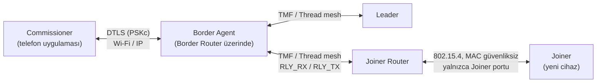
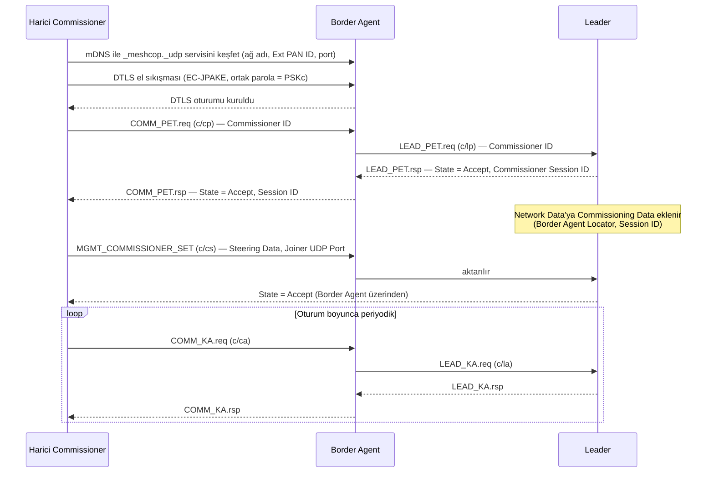
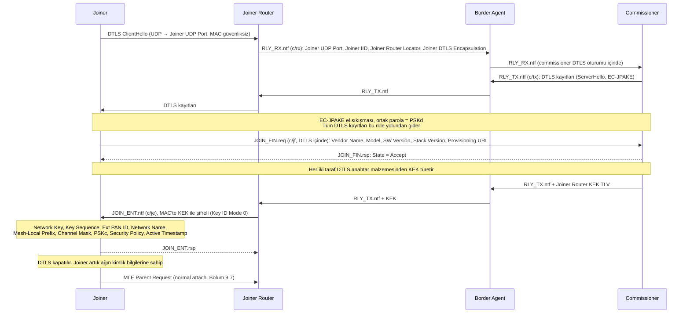
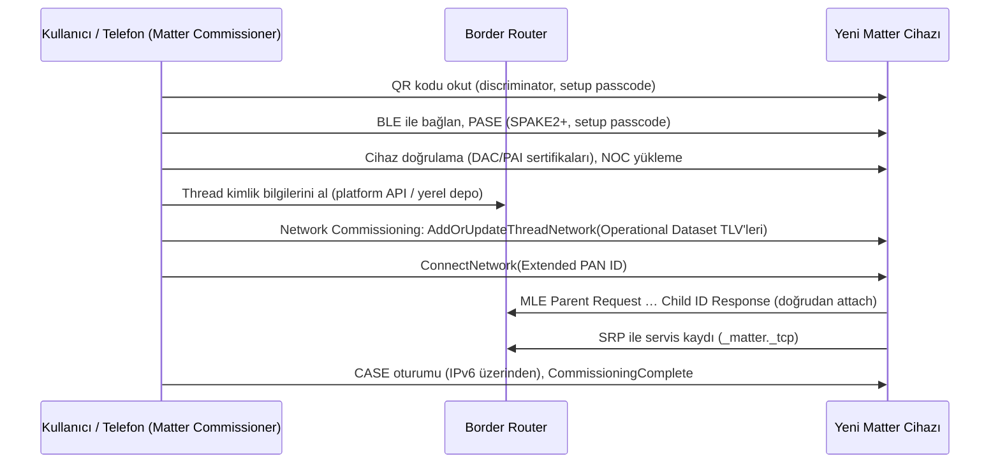

## 16. Devreye Alma (Commissioning) ve MeshCoP

### 16.1 Kavramlar

**Devreye alma (commissioning)**, yeni bir cihazın Thread ağına **güvenli şekilde** katılması, yani ağın kimlik bilgilerini (Network Key, Extended PAN ID, kanal vb. — Operational Dataset) yetkisiz kişilere sızdırmadan alması sürecidir.

Thread, bunun için **MeshCoP (Mesh Commissioning Protocol)** protokolünü tanımlar. Günümüzde iki ana yol vardır:

| Yöntem | Nasıl? | Nerede kullanılır? |
|---|---|---|
| **MeshCoP (Thread-native)** | Joiner, 802.15.4 üzerinden DTLS + EC-JPAKE (PSKd) ile commissioner'a kendini doğrular; kimlik bilgilerini Joiner Entrust ile alır | Saf Thread ürünleri, geliştirme, OpenThread CLI |
| **Bant dışı (out-of-band)** | Kimlik bilgileri (Operational Dataset) başka bir güvenli kanalla verilir; cihaz doğrudan MLE ile bağlanır | **Matter** (BLE + PASE), TCAT (Thread 1.4), üretimde önceden yükleme |

### 16.2 MeshCoP Rolleri



| Rol | Görev |
|---|---|
| **Commissioner** | Katılım isteklerini doğrular ve yetkilendirir; ağda aynı anda **bir** aktif commissioner olabilir. **Harici** (ağ dışında, ör. telefon) veya **native** (ağ içinde) olabilir. |
| **Border Agent** | Harici commissioner ile Thread ağı arasında güvenli köprü; DTLS sunucusu; MeshCoP mesajlarını Leader'a ve Joiner Router'lara aktarır. |
| **Leader** | Commissioner oturumunu kabul eder/sonlandırır; Commissioning Data'yı tutar. |
| **Joiner Router** | Joiner'ın komşusu olan router; Joiner'ın güvenliksiz DTLS paketlerini TMF içinde paketleyerek commissioner'a aktarır. |
| **Joiner** | Ağa katılmak isteyen cihaz; PSKd'ye sahiptir. |

### 16.3 Aşama 1 — Commissioner'ın Aktif Olması (Petition)



- Zaten aktif bir commissioner varsa Leader yeni petition'ı **reddeder**.
- Commissioner keep-alive göndermeyi bırakırsa (yaklaşık 50 saniyelik zaman aşımı) Leader oturumu kapatır ve Commissioning Data'yı Network Data'dan kaldırır.
- Commissioner kapanırken `State = Reject` içeren bir keep-alive ile oturumu kendisi de sonlandırabilir.

### 16.4 Joiner ID ve Steering Data

**Joiner ID**, Joiner'ın fabrika EUI-64'ünden türetilen 64 bitlik kimliktir:

```text
Joiner ID = SHA-256(EUI-64)'ün ilk 8 baytı, ilk baytta 0x02 biti (U/L) 1 yapılarak

Örnek: EUI-64 = 00 11 22 33 44 55 66 77
       SHA-256 = d1a5f998fa6ed82d…  →  Joiner ID = d3a5f998fa6ed82d
```

Joiner, katılım süresince MAC **Extended Address** olarak bu Joiner ID'yi kullanır. Böylece commissioner ve Joiner Router, Joiner'ı EUI-64'ünü açığa çıkarmadan tanır.

**Steering Data**, commissioner'ın "şu cihazların katılmasına izin veriyorum" bilgisini ağın tamamına küçük bir alanla yaymasını sağlayan bir **Bloom filtresi**dir:

| Özellik | Değer |
|---|---|
| Uzunluk | 1–16 bayt |
| Hash fonksiyonları | Joiner ID üzerinde **CRC16-CCITT** ve **CRC16-ANSI** |
| Bit indeksleri | Her CRC değeri mod (uzunluk × 8) → ilgili bit 1 yapılır |
| Tüm bitler 1 | **Her** joiner kabul edilir (joker, `*`) |
| Tüm bitler 0 | Hiçbir joiner kabul edilmez |

Joiner, Discovery Response'taki Steering Data'da kendi Joiner ID'sinin iki bitinin de 1 olup olmadığına bakar. İkisi de 1 ise "bu ağ beni kabul ediyor olabilir" der (Bloom filtresi olduğundan yanlış pozitif mümkündür; asıl doğrulama DTLS'te PSKd ile yapılır).

Thread 1.2 ile Joiner ID'ye alternatif olarak, uzunluğu ayarlanabilir bir **Joiner Discerner** değeri de kullanılabilir (ör. üretim hattında seri numarası tabanlı tanımlama için).

### 16.5 Aşama 2 — Joiner'ın Ağı Bulması

1. Joiner tüm kanallarda (veya yapılandırılmış kanal maskesinde) **MLE Discovery Request** gönderir (Joiner bayrağı = 1).
2. Devreye almaya açık ağların router'ları **Discovery Response** ile cevap verir: Extended PAN ID, Network Name, Steering Data, Joiner UDP Port, Commissioner UDP Port, sürüm, Native Commissioner bayrağı.
3. Joiner, Steering Data'sı kendisini kapsayan ağları sıralar (sinyal kalitesine göre) ve bir **Joiner Router** seçer.

### 16.6 Aşama 3 — DTLS, Finalize ve Entrust



**Önemli ayrıntılar:**

- Joiner henüz ağ anahtarına sahip olmadığı için Joiner ile Joiner Router arasındaki çerçeveler **MAC'te güvenliksizdir**. Joiner Router, güvenliksiz çerçeveleri yalnızca **Joiner UDP portuna** giden/gelen trafik için kabul eder; diğer her şeyi reddeder.
- DTLS kayıtları Joiner Router ile commissioner arasında TMF mesajlarının içinde (**Joiner DTLS Encapsulation TLV**) taşınır; Joiner Router DTLS'i çözemez.
- **JOIN_FIN** mesajında commissioner, Joiner'ın üretici/model/yazılım bilgisine bakarak kabul veya red kararı verebilir. Provisioning URL, uygulama düzeyinde ek kurulum adresini taşıyabilir.
- **JOIN_ENT** (Joiner Entrust) mesajı, ağın kimlik bilgilerini içerir ve **KEK** ile MAC seviyesinde şifrelenir. Böylece kimlik bilgileri havada düz metin olarak hiç görünmez.

### 16.7 Native Commissioning ve On-Mesh Commissioner

- **On-mesh commissioner**: Commissioner'ın kendisi Thread ağındaki bir cihazdır (ör. OpenThread CLI ile `commissioner start`). Border Agent gerekmez; Leader'a doğrudan petition yapar.
- **Native commissioning**: Security Policy'deki N bayrağı ile kontrol edilir; ağ içi bir commissioner'ın PSKc ile kimlik doğrulamasına izin verir.

### 16.8 Matter ile Devreye Alma (Bant Dışı)

Matter ekosistemlerinde Thread cihazları genellikle MeshCoP joiner akışını **kullanmaz**. Bunun yerine:



- Güvenli kanal **BLE üzerindeki PASE** oturumudur; Thread Operational Dataset'i bu şifreli oturumla cihaza verilir.
- Cihaz, dataset'i aldıktan sonra doğrudan MLE attach yapar; Joiner/Commissioner/Joiner Router rolleri devreye girmez.
- Bu yöntemin ön koşulu, Matter commissioner'ın (telefon/hub) Thread ağının dataset'ine sahip olmasıdır. Ekosistemler bunu kendi Border Router'larından ve işletim sistemi API'lerinden (kimlik bilgisi paylaşımı) sağlar. Ayrıntılar Bölüm 23.

### 16.9 Thread 1.4: TCAT

**TCAT (Thread Commissioning over Authenticated TLS)**, Thread 1.4 ile tanımlanan, cihazı 802.15.4 dışında bir taşıyıcı (tipik olarak **BLE**) üzerinden **sertifika tabanlı TLS** ile devreye alma yöntemidir:

- Cihazda bir **TCAT Agent**, yönetici tarafında bir **TCAT Commander** bulunur.
- Kimlik doğrulama X.509 sertifikalarıyla yapılır; yetkilendirme sertifikadaki izinlere göre belirlenir.
- Commander, cihaza dataset yükleme, ağa katılma/ayrılma, teşhis bilgisi okuma gibi komutlar gönderebilir.
- Matter kullanmayan profesyonel/ticari Thread ürünleri için standart bir bant dışı devreye alma yolu sağlar.

### 16.10 Ekosistemler Arası Kimlik Paylaşımı ve ePSKc

Bir evde farklı üreticilerin Border Router'ları varsa, hepsinin **aynı Thread ağını** kullanması idealdir. Bunun için:

- **İşletim sistemi API'leri**: Mobil platformlar, uygulamaların "tercih edilen" Thread ağının kimlik bilgilerini güvenli şekilde saklayıp paylaşmasına izin veren API'ler sunar (ör. Apple'ın ThreadNetwork çerçevesi, Google Play services Thread Network API'si). Bir ekosistemin uygulaması, kullanıcı izniyle diğer ekosistemin ağına katılmak için bu bilgileri kullanabilir.
- **ePSKc (Ephemeral PSKc, Thread 1.4)**: Border Agent, kullanıcı istediğinde **kısa ömürlü** bir PSKc (ekranda gösterilen sayısal bir kod) üretir. Başka bir ekosistemin commissioner'ı bu geçici kodla Border Agent'a bağlanıp (ayrı bir mDNS servisi üzerinden, `_meshcop-e._udp`) ağın kimlik bilgilerini alabilir. Kod belirli bir süre sonra veya kullanımdan sonra geçersiz olur; kalıcı PSKc açığa çıkmaz.

### 16.11 OpenThread CLI ile Örnek Devreye Alma

**Commissioner tarafı (ağdaki bir cihaz):**

```text
> commissioner start
Commissioner: petitioning
Commissioner: active
Done
> commissioner joiner add d3a5f998fa6ed82d J01NME 120
Done
```

(`joiner add` için Joiner ID yerine EUI-64 veya tüm cihazlar için `*` de verilebilir; son parametre saniye cinsinden izin süresidir.)

**Joiner tarafı (yeni cihaz):**

```text
> ifconfig up
Done
> joiner start J01NME
Done
Join success
> thread start
Done
> state
child
```

### 16.12 Bölüm Özeti

- MeshCoP; Commissioner, Border Agent, Leader, Joiner Router ve Joiner rollerinden oluşur.
- Harici commissioner PSKc ile Border Agent'a DTLS/EC-JPAKE bağlanır ve Leader'dan oturum alır.
- Joiner, Discovery ile ağı bulur; Steering Data (Bloom filtresi) izin verilen joiner'ları gösterir.
- Joiner ↔ Commissioner DTLS'i (PSKd) Joiner Router ve Border Agent üzerinden rölelenir; kimlik bilgileri KEK ile şifreli JOIN_ENT ile teslim edilir.
- Matter, BLE + PASE ile bant dışı devreye alma yapar; Thread 1.4 TCAT ve ePSKc yeni standart yollar ekler.
