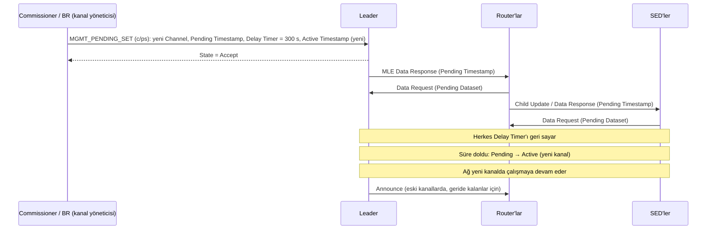

## 17. Operational Dataset

### 17.1 Kavram

**Operational Dataset**, bir Thread ağının tüm kimlik ve çalışma parametrelerini içeren TLV kümesidir. Bir cihazın ağa bağlanabilmesi için bu dataset'e sahip olması gerekir; bu yüzden pratikte "Thread ağının kimlik bilgileri" (credentials) dendiğinde kastedilen budur.

İki tür dataset vardır:

| Dataset | Anlamı |
|---|---|
| **Active Operational Dataset** | Ağın **şu anda** kullandığı parametreler |
| **Pending Operational Dataset** | **Gelecekte** (bir gecikme süresi sonunda) geçerli olacak parametreler; ağ genelinde koordineli değişiklik için |

### 17.2 Active Dataset Bileşenleri

| MeshCoP TLV türü | Bileşen | Boyut | Açıklama |
|---|---|---|---|
| 14 | **Active Timestamp** | 8 | Dataset sürümü: 48 bit saniye + 15 bit "tick" (1/32768 s) + 1 bit U (authoritative) |
| 0 | **Channel** | 3 | Kanal sayfası (1) + kanal (2) |
| 53 | **Channel Mask** | değişken | Ağın kullanabileceği kanallar (sayfa + maske) |
| 2 | **Extended PAN ID** | 8 | Ağın benzersiz kimliği |
| 7 | **Mesh-Local Prefix** | 8 | /64 mesh-local önek |
| 5 | **Network Key** | 16 | Ağ anahtarı |
| 3 | **Network Name** | 1–16 | Ağ adı |
| 1 | **PAN ID** | 2 | MAC PAN ID |
| 4 | **PSKc** | 16 | Commissioner anahtarı |
| 12 | **Security Policy** | 3–4 | Rotasyon süresi + bayraklar (Bölüm 15.9) |

### 17.3 Pending Dataset

Pending Dataset, Active Dataset bileşenlerine ek olarak şunları içerir:

| TLV türü | Bileşen | Boyut | Açıklama |
|---|---|---|---|
| 51 | **Pending Timestamp** | 8 | Pending dataset'in sürümü |
| 52 | **Delay Timer** | 4 | Pending dataset'in Active olmasına kalan süre (milisaniye) |

Pending Dataset içindeki **Active Timestamp**, geçiş sonrası Active Dataset'in alacağı sürümdür ve mevcut olandan büyük olmalıdır.

**Delay Timer** ağ genelinde geri sayar. Süre dolduğunda **tüm cihazlar aynı anda** Pending Dataset'i Active yapar. Varsayılan gecikme tipik olarak **300 saniyedir**; bu süre, uyuyan cihazların da yeni dataset'i (poll/Data Request ile) almasına zaman tanır. Çok kısa gecikmeler bazı cihazların geride kalmasına neden olabilir.

### 17.4 Zaman Damgaları ve Sürüm Karşılaştırma

- Cihazlar MLE mesajlarında **Active/Pending Timestamp** TLV'lerini taşır.
- Bir cihaz, komşusunda kendisininkinden **daha büyük** zaman damgası görürse **Data Request** ile yeni dataset'i ister.
- Daha küçük zaman damgalı bir dataset asla daha büyüğünün yerine geçmez. Bu sayede eski bir dataset'le açılan cihaz ağı geri götüremez.
- İki partition farklı dataset'lerle birleşirse, kazanan partition'ın (ve daha yeni zaman damgasının) dataset'i yayılır.

### 17.5 Dataset Değiştirme

**Yıkıcı olmayan değişiklikler** (Network Name, PSKc, Security Policy, Channel Mask gibi) **MGMT_ACTIVE_SET** (`c/as`) ile, daha büyük bir Active Timestamp kullanılarak doğrudan yapılabilir.

**Yıkıcı değişiklikler** — **Channel, PAN ID, Mesh-Local Prefix, Network Key** — ağın tamamının aynı anda geçiş yapmasını gerektirir. Bunlar Active Set ile yapılamaz; **MGMT_PENDING_SET** (`c/ps`) ile Pending Dataset üzerinden yapılır:



**Geride kalan cihazlar:** Değişiklik sırasında kapalı olan veya uzun süre uyuyan cihazlar eski kanalda kalabilir. Bu cihazlar:

- Parent'larını bulamayınca diğer kanalları tarayıp **Announce** mesajlarını yakalar ve yeni kanala geçer,
- veya commissioner/BR'nin **Announce Begin** (`c/ab`) ile tetiklediği duyuruları dinler.

### 17.6 Dataset TLV Kodlaması: Tam Örnek

Aşağıdaki onaltılık dize, OpenThread belgelerinde sıkça kullanılan örnek bir Active Dataset'tir (gerçek bir ağda **asla** bu değerleri kullanmayın):

```text
0e080000000000010000000300000f35060004001fffe0020811111111222222220708fdad70bfe5aa15dd
051000112233445566778899aabbccddeeff030e4f70656e54687265616444656d6f010212340410445f2b
5ca6f2a93a55ce570a70efeecb0c0402a0f7f8
```

| Ham TLV | Tür | Bileşen | Çözümlenmiş değer |
|---|---|---|---|
| `0e 08 0000000000010000` | 14 | Active Timestamp | saniye = 1, tick = 0, U = 0 |
| `00 03 00000f` | 0 | Channel | sayfa 0, kanal **15** |
| `35 06 00 04 001fffe0` | 53 | Channel Mask | sayfa 0, 4 baytlık maske; MSB-ilk bit sırasıyla kanal 11–26 |
| `02 08 1111111122222222` | 2 | Extended PAN ID | `1111111122222222` |
| `07 08 fdad70bfe5aa15dd` | 7 | Mesh-Local Prefix | `fdad:70bf:e5aa:15dd::/64` |
| `05 10 00112233…ddeeff` | 5 | Network Key | `00112233445566778899aabbccddeeff` |
| `03 0e 4f70656e…6d6f` | 3 | Network Name | "OpenThreadDemo" (14 bayt) |
| `01 02 1234` | 1 | PAN ID | `0x1234` |
| `04 10 445f2b5c…efeecb` | 4 | PSKc | `445f2b5ca6f2a93a55ce570a70efeecb` |
| `0c 04 02a0 f7f8` | 12 | Security Policy | 672 saat, `onrc`, sürüm eşiği 0 |

> [!NOTE]
> Channel Mask TLV'sinde bitler **MSB-ilk** sıralanır (ilk baytın en yüksek biti = kanal 0). Bu yüzden 11–26 kanalları TLV'de `0x001FFFE0` olarak görünür; OpenThread CLI ise aynı maskeyi alışılmış bit sırasıyla `0x07fff800` (bit n = kanal n) olarak gösterir.

Aynı dataset OpenThread CLI'de şöyle görünür:

```text
> dataset active
Active Timestamp: 1
Channel: 15
Channel Mask: 0x07fff800
Ext PAN ID: 1111111122222222
Mesh Local Prefix: fdad:70bf:e5aa:15dd::/64
Network Key: 00112233445566778899aabbccddeeff
Network Name: OpenThreadDemo
PAN ID: 0x1234
PSKc: 445f2b5ca6f2a93a55ce570a70efeecb
Security Policy: 672 onrc 0
Done
```

### 17.7 Diğer MeshCoP TLV'leri (Referans)

| Tür | TLV | Kullanım |
|---|---|---|
| 6 | Network Key Sequence | Joiner Entrust'ta güncel Key Sequence |
| 8 | Steering Data | Commissioning Data, Discovery Response |
| 9 | Border Agent Locator | Commissioning Data |
| 10 | Commissioner ID | Petition |
| 11 | Commissioner Session ID | Oturum doğrulama |
| 13 | Get | MGMT_*_GET: istenen TLV türleri |
| 15 | Commissioner UDP Port | Discovery Response |
| 16 | State | Accept (1) / Pending (0) / Reject (−1) |
| 17 | Joiner DTLS Encapsulation | RLY_RX/TX içinde DTLS kaydı |
| 18 | Joiner UDP Port | Discovery Response, RLY_RX/TX |
| 19 | Joiner IID | RLY_RX/TX: Joiner'ın link-local IID'si |
| 20 | Joiner Router Locator | RLY_RX/TX: Joiner Router'ın RLOC16'sı |
| 21 | Joiner Router KEK | RLY_TX: Joiner Entrust için KEK |
| 32 | Provisioning URL | JOIN_FIN |
| 33–37 | Vendor Name / Model / SW Version / Data / Stack Version | JOIN_FIN |
| 48 | UDP Encapsulation | Proxy (c/ur, c/ut) |
| 49 | IPv6 Address | Proxy |
| 54–57 | Count / Period / Scan Duration / Energy List | Energy Scan, PAN ID Query |
| 128 | Discovery Request | Thread Discovery TLV içinde |
| 129 | Discovery Response | Thread Discovery TLV içinde |

### 17.8 Dataset'in Yönetimi (OpenThread CLI)

| Komut | Açıklama |
|---|---|
| `dataset init new` | Rastgele değerlerle yeni bir dataset hazırlar (geçici tampon) |
| `dataset channel 20`, `dataset networkname Ev` … | Tampondaki alanları düzenler |
| `dataset commit active` | Tamponu Active Dataset olarak kaydeder |
| `dataset active -x` | Active Dataset'i onaltılık TLV dizisi olarak yazar (paylaşmak için) |
| `dataset set active <hex>` | Onaltılık TLV dizisinden Active Dataset yükler |
| `dataset mgmtsetcommand pending …` | Ağdaki Leader'a MGMT_PENDING_SET gönderir |
| `dataset updater start` | (OpenThread) Pending Dataset ile güvenli değişiklik başlatır |

### 17.9 Bölüm Özeti

- Operational Dataset, ağın kimlik bilgileridir: kanal, PAN ID, Extended PAN ID, ağ adı, mesh-local önek, Network Key, PSKc, Security Policy, zaman damgası.
- Zaman damgası büyük olan dataset kazanır; eskiler asla yenilerin yerine geçmez.
- Kanal, PAN ID, mesh-local önek ve Network Key değişiklikleri Pending Dataset + Delay Timer ile tüm ağda eşzamanlı yapılır.
- Geride kalan cihazlar Announce mesajlarıyla yeni kanala çağrılır.
- Dataset, onaltılık TLV dizisi olarak kolayca dışa/içe aktarılır; bu dizi gizli bilgi içerir ve korunmalıdır.
