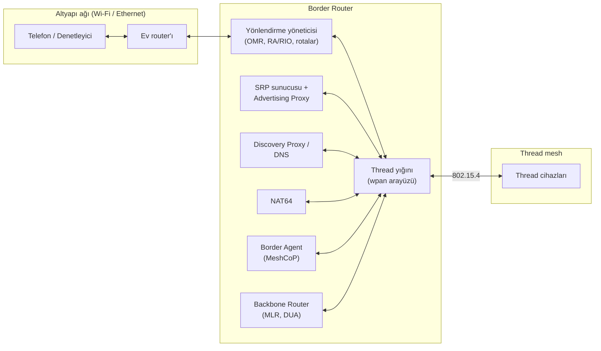
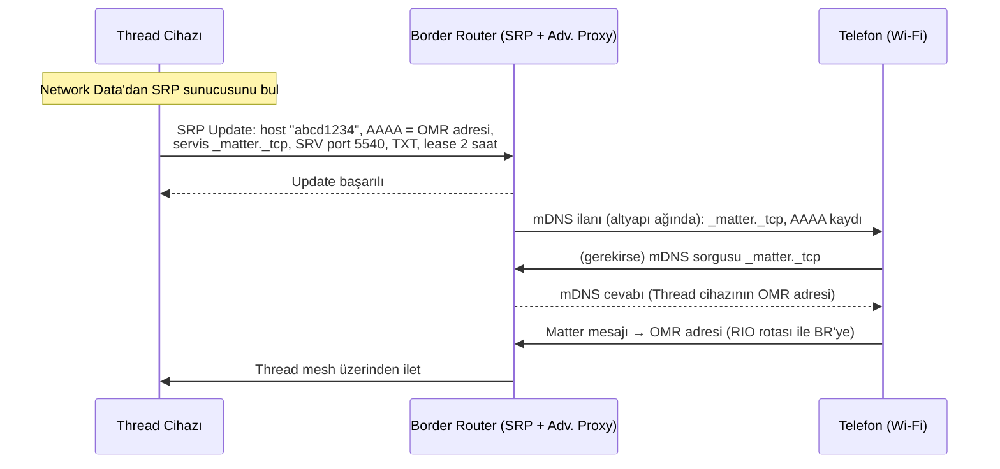
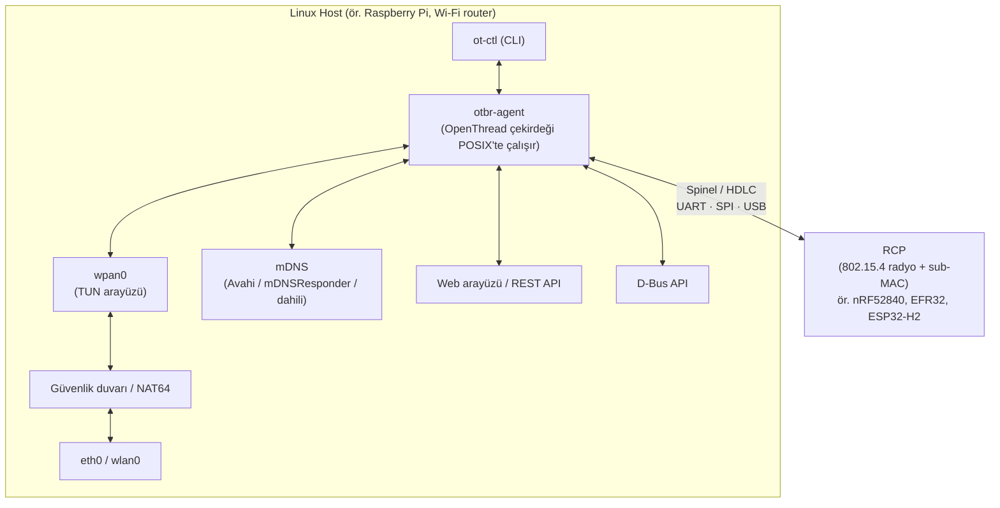

## 19. Border Router

### 19.1 Görevi

**Thread Border Router (BR)**, Thread mesh ağını Wi-Fi veya Ethernet gibi başka IP ağlarına (**altyapı ağı / infrastructure link**) bağlayan cihazdır. Önemli nokta: BR bir **protokol çeviricisi (gateway)** değil, bir **IP yönlendiricisidir**. Thread cihazları zaten IPv6 konuştuğu için BR paketleri çevirmeden yönlendirir (IPv4 erişimi için NAT64 istisnadır).

Thread 1.3 ile standartlaşan ve 1.4 ile zorunlu hâle gelen BR işlevleri:

| İşlev | Amaç |
|---|---|
| **IPv6 yönlendirme** | Thread ↔ altyapı ağı arasında paket iletimi |
| **OMR önek yönetimi** | Thread cihazlarına dışarıdan erişilebilir (Off-Mesh Routable) adres öneki sağlamak |
| **RA / RIO ilanları** | Altyapı ağındaki cihazlara Thread öneklerine giden yolu öğretmek |
| **On-link önek** | Altyapı ağında IPv6 yoksa ona IPv6 öneki sağlamak |
| **NAT64** | Thread cihazlarının IPv4 hedeflere erişmesi |
| **SRP sunucusu** | Thread cihazlarının servis (DNS-SD) kaydı |
| **Advertising Proxy** | Kayıtlı servisleri altyapı ağında mDNS ile duyurmak |
| **Discovery Proxy** | Thread cihazlarının altyapı ağındaki servisleri keşfetmesi |
| **Border Agent** | Harici commissioner erişimi (MeshCoP) |
| **Backbone Router** (1.2+) | Çoklu yayın (MLR) ve DUA desteği |
| **TREL** (1.3+) | Thread'i Wi-Fi/Ethernet üzerinden taşımak |
| **DHCPv6-PD** (1.4) | ISS'den global önek alarak Thread cihazlarına global IPv6 sağlamak |

### 19.2 OMR Öneki (Off-Mesh Routable Prefix)

Mesh-local adresler (ML-EID, RLOC) ağ dışına yönlendirilmez. Thread cihazlarının dış dünyayla konuşabilmesi için **OMR öneki** gerekir:

1. **Kaynak seçimi**:
    - Altyapı ağı **DHCPv6-PD** (prefix delegation) sunuyorsa (Thread 1.4), BR bir **global** /64 alır → Thread cihazları global IPv6 adreslerine sahip olur.
    - Aksi hâlde BR, kendi rastgele **ULA /48** öneğinden bir /64 türetir (ör. `fd4f:2d3c:ee9b:1::/64`).
2. **İlan**: BR öneki Network Data'ya `paros` bayraklarıyla (Preferred, SLAAC, default Route, On-mesh, Stable) ekler.
3. **Adres oluşturma**: Thread cihazları SLAAC ile bu önekten **OMR adresi** üretir.
4. **Birden çok BR**: Her BR kendi önekini yayınlarsa cihazlar çok sayıda adres üretirdi. Bunun yerine BR'ler Network Data'daki önekleri karşılaştırıp **tek bir "tercih edilen" (favored) OMR öneki** üzerinde uzlaşır (önce tercih değeri, sonra sayısal karşılaştırma); diğerleri kendi öneklerini geri çeker.

### 19.3 Altyapı Ağına Yönelik Yönlendirme: RA, RIO ve PIO

Wi-Fi'daki bir telefonun, `fd4f:2d3c:ee9b:1::/64` önekindeki bir Thread cihazına nasıl ulaşacağını bilmesi gerekir. BR bunu **ICMPv6 Router Advertisement (RA)** ile sağlar:

| RA seçeneği | İçerik | Etkisi |
|---|---|---|
| **RIO** (Route Information Option, RFC 4191) | OMR öneki (/64) + ömür + tercih | Altyapıdaki cihazlar "bu öneğe BR'nin link-local adresi üzerinden git" rotası ekler |
| **PIO** (Prefix Information Option) | On-link önek (yalnızca altyapıda IPv6 öneki yoksa) | Altyapıdaki cihazlar bu önekten adres alır; böylece IPv6 ile Thread'e konuşabilir |
| RA bayrakları | Thread BR'ler kendilerini "stub router" olarak tanıtır | Varsayılan yönlendirici gibi davranmaz; yalnızca belirli öneklere rota sunar |

**Ters yön (Thread → altyapı):** BR, Network Data'ya **Has Route** girdileri ekler:

- Altyapı ağının on-link öneki veya `fc00::/7` (ULA hedefleri),
- Altyapı ağında global IPv6 internet bağlantısı varsa `::/0`,
- NAT64 öneki (`/96`, N bayrağı ile).

> [!WARNING]
> Altyapı ağındaki cihazların **RIO'yu kabul etmesi** gerekir. Bazı işletim sistemleri veya yapılandırmalar RIO'yu varsayılan olarak yok sayar. Örneğin Linux'ta (ör. Home Assistant sunucusu) `net.ipv6.conf.<arayüz>.accept_ra_rt_info_max_plen` değeri en az 64 olmalı, IPv6 yönlendirme (forwarding) açıksa `accept_ra = 2` gerekir. Aksi hâlde denetleyici Thread cihazlarına ulaşamaz ve Matter cihazları "yanıt vermiyor" görünür.

### 19.4 NAT64 ve IPv4 Erişimi

Thread yalnızca IPv6 konuşur; ama birçok bulut servisi hâlâ yalnızca IPv4 ile erişilebilir. Çözüm **NAT64**:

1. BR bir **NAT64 öneki** (/96) belirler:
    - Altyapı ağı NAT64 sunuyorsa (RA'daki PREF64 seçeneği, RFC 8781, veya `ipv4only.arpa` sorgusu ile keşfedilen) onu kullanır,
    - yoksa kendi yerel NAT64 önekini (ör. `fd4f:2d3c:ee9b:2::/96`) oluşturur ve kendi NAT64 çeviricisini çalıştırır.
2. Önek Network Data'ya **Has Route + N bayrağı** ile eklenir.
3. Thread cihazı `93.184.216.34` IPv4 adresine ulaşmak istediğinde **IPv4-gömülü IPv6** adresi (RFC 6052) oluşturur: `fd4f:2d3c:ee9b:2::5db8:d822` veya iyi bilinen önekle `64:ff9b::5db8:d822`.
4. Paket BR'ye gider; BR IPv6 başlığını IPv4'e çevirip (durumlu NAT64, RFC 6146) gönderir; cevabı geri çevirir.
5. DNS tarafında IPv4-yalnız alan adları için AAAA kaydı sentezi (DNS64) ya cihazda (NAT64 önekini kullanarak) ya da BR'nin DNS hizmetinde yapılır.

### 19.5 Servis Keşfi: SRP, Advertising Proxy, Discovery Proxy

Klasik yerel ağlarda servis keşfi **mDNS** (çoklu yayın DNS) ile yapılır. Thread'de mDNS kullanmak kötü bir fikirdir: çoklu yayın pahalıdır ve uyuyan cihazlar sorgulara cevap veremez. Thread 1.3 bu sorunu **unicast DNS-SD** ile çözer:

#### SRP (Service Registration Protocol, RFC 9665)

- Thread cihazı, servislerini (ör. `_matter._tcp`) BR üzerindeki **SRP sunucusuna** DNS Update mesajlarıyla **kaydeder**.
- Kayıtlar cihazın açık anahtarıyla imzalanır (SIG(0), ECDSA P-256); aynı ismi başka bir cihaz ele geçiremez.
- Kayıtların bir **ömrü (lease)** vardır (ör. 2 saat) ve cihaz bunları periyodik yeniler; anahtar kaydı daha uzun ömürlüdür (ör. 14 gün).
- Cihazlar SRP sunucusunu Network Data'daki **DNS/SRP servis** girdilerinden (anycast `0x5C` veya unicast `0x5D`) bulur.
- Varsayılan alan adı: `default.service.arpa.`

#### Advertising Proxy

BR, SRP ile kaydedilen servisleri **altyapı ağında mDNS** ile yeniden yayınlar. Böylece Wi-Fi'daki bir telefon, Thread'deki bir Matter cihazını sıradan mDNS ile bulur — Thread'deki cihaz bu süreçte uyanmak zorunda kalmaz.

#### Discovery Proxy (RFC 8766)

Ters yönde, Thread cihazı altyapı ağındaki servisleri (ör. bir Matter denetleyicisi, yazıcı) bulmak isterse BR'ye **unicast DNS sorgusu** gönderir; BR bunu altyapıda mDNS sorgusuna çevirir ve sonuçları döner.

### 19.6 Border Agent ve mDNS İlanı

Border Agent, harici commissioner'ların ağı bulabilmesi için kendini altyapı ağında **`_meshcop._udp`** servisi olarak mDNS ile duyurur. TXT kaydındaki tipik anahtarlar:

| Anahtar | Anlamı |
|---|---|
| `rv` | Kayıt sürümü |
| `tv` | Thread sürümü (ör. `1.4.0`) |
| `nn` | Network Name |
| `xp` | Extended PAN ID |
| `xa` | Border Agent cihazının Extended Address'i |
| `sb` | Durum bit eşlemi (bağlantı modu, Thread arayüz durumu, BBR durumu, ePSKc desteği vb.) |
| `at` | Active Timestamp |
| `pt` | Partition ID |
| `vn` / `mn` | Üretici adı / model adı |
| `id` | Border Agent kimliği (yeniden başlatmalarda sabit) |
| `sq` / `bb` / `dn` | BBR sıra numarası / BBR portu / Thread Domain adı (BBR etkinse) |

SRV kaydı Border Agent'ın UDP portunu (OTBR varsayılanı 49191) verir. Thread 1.4 ePSKc için ayrı bir servis (`_meshcop-e._udp`) yalnızca geçici kod etkinken ilan edilir.

### 19.7 Birden Fazla Border Router

Bir Thread ağında birden çok BR bulunması **önerilir** (yedeklilik):

- Her BR kendi rota/önek/servis girdilerini Network Data'ya ekler; BR'ler OMR öneki, NAT64 öneki ve SRP sunucusu gibi konularda **uzlaşma kuralları** (tercih + sayısal karşılaştırma + sıra numarası) ile tek bir seçim üzerinde anlaşır.
- Thread cihazları dışarı giden trafik için **en yakın** (yol maliyeti en düşük) uygun BR'yi seçer.
- Bir BR kapanırsa Leader onun girdilerini Network Data'dan kaldırır; trafik otomatik olarak diğer BR'ye kayar. OMR öneki BR'ler arasında ortak olduğu için cihazların adresleri değişmez.
- SRP kayıtlarının tek bir BR'de kalmaması için cihazlar, SRP sunucusu değiştiğinde kayıtlarını yeni sunucuya yeniden yapar.

> [!TIP]
> Farklı ekosistemlerin BR'lerinin **aynı Thread ağında** olması, yedekliliğin gerçekten işe yaraması için şarttır. Ayrı ağlar kuran BR'ler birbirinin yedeği olamaz. Kurulumdan sonra BR'lerin aynı Extended PAN ID'yi gösterdiğini (ör. ekosistem uygulamalarından veya `_meshcop._udp` ilanlarından) kontrol edin.

### 19.8 OpenThread Border Router (OTBR) Mimarisi

Linux tabanlı BR'lerin referans uygulaması **ot-br-posix**'tir:

| Bileşen | Görev |
|---|---|
| **otbr-agent** | OpenThread yığınını (FTD) Linux üzerinde çalıştırır; RCP ile Spinel protokolüyle konuşur; BR mantığı (Routing Manager, SRP, Border Agent, BBR, NAT64) buradadır |
| **RCP** | Radyo eş işlemcisi: yalnızca 802.15.4 PHY/MAC alt katmanını (CSMA, ACK, zamanlama, şifreleme hızlandırma) çalıştırır |
| **wpan0** | Thread ağını Linux'a sıradan bir ağ arayüzü olarak gösteren TUN arayüzü |
| **mDNS** | Advertising/Discovery Proxy ve Border Agent ilanları |
| **REST API / Web** | Yönetim ve izleme (ör. dataset okuma/yazma, teşhis) |
| **Güvenlik duvarı** | Altyapıdan Thread'e yalnızca izin verilen trafiğin (ör. OMR hedefli) geçmesini sağlar; mesh-local öneki korur |

Örnek radyo URL'si: `spinel+hdlc+uart:///dev/ttyACM0?uart-baudrate=460800`

### 19.9 Güvenlik Duvarı ve Giriş Filtreleme

BR, altyapı ağından Thread'e giden trafiği filtreler:

- **Mesh-local önekli** hedeflere dışarıdan gelen paketler engellenir.
- Yalnızca Thread'deki **OMR/on-mesh** önekli hedeflere giden paketler iletilir.
- TMF (61631) ve MLE (19788) gibi Thread kontrol portlarına dışarıdan erişim kapalıdır.
- Kaynak adresi Thread öneklerinden biri gibi görünen sahte (spoofed) paketler reddedilir.

### 19.10 Bölüm Özeti

- Border Router, Thread ile Wi-Fi/Ethernet arasında çeviri değil IPv6 yönlendirme yapar.
- OMR öneki (ULA veya DHCPv6-PD ile global) Thread cihazlarına dışarıdan erişilebilir adres verir; RIO ile altyapıya duyurulur.
- NAT64 ile IPv4 erişimi, SRP + Advertising/Discovery Proxy ile multicast'siz servis keşfi sağlanır.
- Border Agent `_meshcop._udp` ile ilan edilir; Thread 1.4 ePSKc geçici erişim sunar.
- Birden fazla BR uzlaşma kurallarıyla tek OMR öneki ve SRP sunucusu üzerinde birleşir; yedeklilik ancak aynı ağdaysalar işe yarar.
- OTBR: otbr-agent (Linux) + RCP (radyo) + Spinel; Home Assistant gibi sistemler bunu kullanır.
