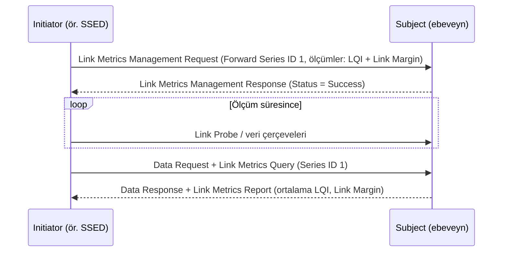
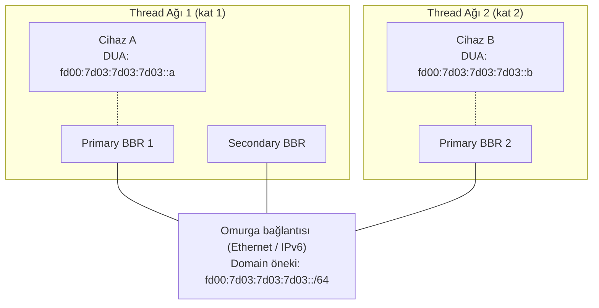
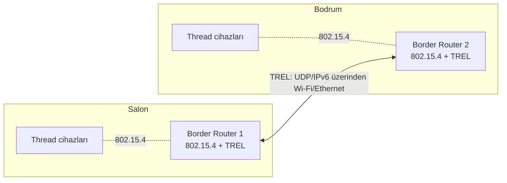

## 20. Thread 1.2, 1.3 ve 1.4 Gelişmiş Özellikleri

### 20.1 Sürümlere Göre Özellik Matrisi

| Özellik | 1.1 | 1.2 | 1.3 | 1.4 |
|---|---|---|---|---|
| Temel mesh, MLE, 6LoWPAN, MeshCoP | ✔ | ✔ | ✔ | ✔ |
| 802.15.4-2015 çerçeveleri, Enhanced ACK, Header IE | | ✔ | ✔ | ✔ |
| CSL (SSED), Enhanced Frame Pending, Enhanced Keep-Alive | | ✔ | ✔ | ✔ |
| Link Metrics | | ✔ | ✔ | ✔ |
| Thread Domain, Backbone Router, DUA, MLR | | ✔ | ✔ | ✔ |
| Commercial Commissioning (CCM) | | ✔ | ✔ | ✔ |
| Thread Border Router şartnamesi (OMR, RA/RIO, SRP, proxy'ler, NAT64) | | | ✔ | ✔ |
| TREL (Wi-Fi/Ethernet üzerinden Thread) | | | ✔ | ✔ |
| SRP istemcisi / DNS istemcisi (cihaz tarafı) | | | ✔ | ✔ |
| TCP desteği | | | ✔ | ✔ |
| Supervision Interval TLV | | | ✔ | ✔ |
| Zorunlu ve birlikte çalışabilir BR yetenekleri | | | | ✔ |
| ePSKc (geçici commissioner anahtarı), kimlik paylaşımı | | | | ✔ |
| DHCPv6-PD ile global OMR öneki | | | | ✔ |
| Gelişmiş ağ teşhisi (yeni TLV'ler, sorgu/cevap) | | | | ✔ |
| TCAT (TLS tabanlı devreye alma) | | | | ✔ |

### 20.2 Thread 1.2

Thread 1.2'nin iki ana teması vardı: **daha verimli uyuyan cihazlar** ve **daha büyük/kurumsal ağlar**.

#### 20.2.1 802.15.4-2015 Özellikleri

- **Enhanced ACK**: IE taşıyabilen, güvenli olabilen ACK çerçevesi. CSL fazı ve Link Metrics verisini taşır.
- **Header IE'ler**: CSL IE, vendor-specific IE (Link Metrics) vb. (Bölüm 4.10).
- **Çerçeve sürümü 2015**: Yalnızca bu özellikleri destekleyen eşler arasında kullanılır; 1.1 cihazlarla 2006 sürümü kullanılmaya devam eder.

#### 20.2.2 Enerji Özellikleri

- **CSL** ve **SSED** (Bölüm 18.7),
- **Enhanced Frame Pending** (Bölüm 18.6),
- **Enhanced Keep-Alive**: Veri çerçeveleri canlılık sinyali sayılır.

#### 20.2.3 Link Metrics (Bağlantı Ölçümleri)

Bir cihazın (Initiator) bir komşusundan (Subject) bağlantı kalitesi ölçümleri istemesini sağlar.

| Ölçüm türü | Nasıl çalışır? |
|---|---|
| **Single Probe** | Initiator, MLE Data Request içinde **Link Metrics Query** gönderir; Subject o mesaja ait ölçümleri **Link Metrics Report** ile döner |
| **Forward Tracking Series** | Initiator, **Link Metrics Management Request** ile bir ölçüm serisi tanımlar (hangi çerçeve türleri sayılacak); ardından **Link Probe** mesajları/veri çerçeveleri gönderir; sonra seriyi sorgular ve birikmiş (ortalama) sonuçları alır |
| **Enhanced-ACK Based Probing** | Initiator, Subject'ten her Enhanced ACK'in içine ölçüm koymasını ister (vendor-specific Header IE); sürekli ve ek mesajsız izleme sağlar |

**Ölçülebilen değerler:** Layer 2 PDU sayısı, **LQI**, **Link Margin**, **RSSI**.

**Kullanım alanları:** SSED'lerin ebeveyn bağlantısını izlemesi ve gerekirse CSL/TX gücü ayarlaması, ağ teşhisi, daha iyi ebeveyn seçimi.

#### 20.2.4 Thread Domain, Backbone Router ve DUA

**Problem:** Büyük bir binada tek Thread ağı yetmez (32 router sınırı, atlama sayısı, kanal kapasitesi). Birden fazla Thread ağı kurulur; ama bu ağlardaki cihazların birbirine ve bina ağına **tek bir IPv6 alanı** gibi ulaşabilmesi istenir.

**Çözüm:** Birden çok Thread ağı, ortak bir **omurga bağlantısı (backbone link)** (tipik olarak Ethernet) üzerinden birleşerek bir **Thread Domain** oluşturur.

| Kavram | Açıklama |
|---|---|
| **Backbone Router (BBR)** | Thread ağını omurgaya bağlayan BR işlevi. Network Data'ya BBR servisi olarak kaydolur (sıra numarası, yeniden kayıt gecikmesi, MLR zaman aşımı). |
| **Primary BBR (PBBR)** | Her Thread ağında aktif olan tek BBR; ALOC'u `0xFC38`. Diğer BBR'ler **Secondary** olarak bekler ve Primary kaybolursa devralır. |
| **Domain Prefix** | Domain genelinde ortak /64 önek; Network Data'da **D** bayrağıyla ilan edilir. |
| **DUA (Domain Unicast Address)** | Cihazın Domain Prefix'ten oluşturduğu adres. Cihaz Domain içinde başka bir Thread ağına geçse bile aynı kalabilir. |

**DUA kaydı akışı:**

1. Cihaz Domain Prefix'i görünce bir **DUA** oluşturur.
2. **DUA.req** (`n/dr`) ile Primary BBR'ye kaydeder (ML-EID'si ile birlikte).
3. PBBR, omurga üzerinde diğer BBR'lere **Backbone Query** (`b/bq`) göndererek adresin başka yerde kullanılıp kullanılmadığını denetler (Duplicate Address Detection).
4. Çakışma yoksa kaydı kabul eder ve omurgada bu adres için **ND Proxy** olarak davranır: omurgadaki cihazlar DUA'ya NS gönderdiğinde PBBR kendi adına cevap verir ve paketleri Thread ağına yönlendirir.
5. Cihaz kaydını periyodik olarak yeniler.

**MLR (Multicast Listener Registration):** Cihazlar admin-local ve daha geniş kapsamlı çoklu yayın aboneliklerini **MLR.req** (`n/mr`) ile PBBR'ye kaydeder; PBBR omurgada MLD dinleyicisi olur ve eşleşen çoklu yayınları Thread'e aktarır (Bölüm 14.5).

#### 20.2.5 Commercial Commissioning Mode (CCM)

Ticari binalarda yüzlerce cihazı tek tek PSKd ile devreye almak pratik değildir. CCM, **sertifika tabanlı otonom kayıt** sağlar:

- Cihazlar üretimde bir **IDevID** (üreticinin imzaladığı cihaz kimlik sertifikası) ile gelir.
- Domain'deki bir **Registrar** (genellikle BBR/BR üzerinde), cihazın kimliğini üreticinin doğrulama servisi (voucher mantığı, BRSKI benzeri) ile doğrular.
- Cihaza Domain'e özgü bir **LDevID** sertifikası (EST benzeri bir süreçle, CoAP üzerinden) verilir ve ağ anahtarı güvenli şekilde sağlanır.
- Security Policy'deki CCM ile ilgili bayraklar (Bölüm 15.9) bu davranışları kontrol eder.

CCM özellikle kurumsal/bina otomasyonu senaryoları içindir; tüketici akıllı evlerinde Matter devreye alması yaygındır.

### 20.3 Thread 1.3

Thread 1.3'ün ana teması **Border Router standardizasyonu ve Matter ile uyum**dur.

#### 20.3.1 Thread Border Router Özellikleri

OMR önek yönetimi, RA/RIO, on-link önek, NAT64, SRP sunucusu, Advertising Proxy, Discovery Proxy, çoklu yayın yönlendirme — ayrıntılar Bölüm 19.

#### 20.3.2 Cihaz Tarafı Servisler

- **SRP istemcisi**: Cihazlar servislerini BR'ye kaydeder (Matter için zorunlu).
- **DNS istemcisi**: Cihazlar BR üzerinden unicast DNS / DNS-SD sorguları yapabilir.
- **TCP**: Düşük güçlü cihazlar için optimize edilmiş bir TCP uygulaması (OpenThread'de TCPlp) tanımlanmıştır.

#### 20.3.3 TREL — Thread Radio Encapsulation Link

**TREL**, Thread'in MAC çerçevelerini **UDP/IPv6 içinde** altyapı ağları (Wi-Fi/Ethernet) üzerinden taşıyan ikinci bir "radyo" bağlantısıdır.

| Özellik | Açıklama |
|---|---|
| Keşif | Altyapı ağında DNS-SD **`_trel._udp`** servisi; TXT kaydında Extended Address (`xa`) ve Extended PAN ID (`xp`) |
| Taşıma | Tekil UDP/IPv6 (çoklu yayın gerektiğinde altyapı çoklu yayını) |
| Güvenlik | Thread güvenliği korunur; TREL için Network Key'den ayrı bir anahtar türetilir |
| Çoklu radyo | Bir router'ın aynı komşuya hem 802.15.4 hem TREL ile bağlantısı olabilir; yönlendirme her bağlantının kalitesine göre en iyisini seçer |
| Fayda | Farklı odalardaki/katlardaki BR'leri tek mesh'te birleştirir; çok atlamalı radyo yollarını kısaltır; Ethernet/Wi-Fi'ın yüksek bant genişliğini kullanır |

TREL ile birleşen BR'ler, aralarında radyo bağlantısı olmasa bile **tek partition** oluşturur; böylece "aynı evde iki ayrı Thread adası" sorunu azalır.

### 20.4 Thread 1.4

Thread 1.4 (Eylül 2024'te duyuruldu), Thread'in tüketici ekosistemlerinde yaşanan pratik sorunlara odaklanır:

| Alan | İçerik |
|---|---|
| **Border Router birlikte çalışabilirliği** | Daha önce isteğe bağlı olan birçok BR davranışı zorunlu hâle getirildi ve sertifikasyonla doğrulanıyor; farklı üreticilerin BR'leri aynı ağda daha öngörülebilir davranır |
| **Kimlik bilgisi paylaşımı** | **ePSKc**: Border Agent'ın ürettiği kısa ömürlü kodla başka ekosistemlerin mevcut ağa güvenle katılması; ekosistemlerin tek ağ kullanması teşvik edilir |
| **Gelişmiş internet bağlantısı** | **DHCPv6-PD** ile ISS'den alınan global öneklerin OMR olarak kullanılması → Thread cihazlarına global IPv6; NAT64 ve DNS iyileştirmeleri |
| **Gelişmiş ağ teşhisi** | Çocuk tabloları, router komşuları, MLE sayaçları gibi yeni teşhis TLV'leri; sorgu kimlikli (Query ID) çoklu cevap mekanizması; ağ topolojisinin uzaktan çıkarılması |
| **TCAT** | TLS ve sertifikalarla, BLE gibi bir taşıyıcı üzerinden Thread devreye alma (Bölüm 16.9) |

### 20.5 Sürüm Uyumluluğu Nasıl Yönetilir?

- **Version TLV** (MLE): Her cihaz kendi Thread sürümünü bildirir (1.1 = 2, 1.2 = 3, 1.3 = 4, 1.4 = 5). Özellikler yalnızca destekleyen eşler arasında kullanılır.
- **Security Policy VR (Version Threshold for Routing)**: Ağ yöneticisi, router olabilecek cihazlar için asgari sürüm belirleyebilir.
- **Çerçeve sürümü**: 2015 çerçeveleri yalnızca 1.2+ eşlere gönderilir.
- **Network Data**: Yeni bayraklar/servisler eski cihazlar tarafından yok sayılır.

### 20.6 Gelecek Yönelimleri

Thread Group'un yol haritası kamuya tam açık olmamakla birlikte; daha düşük güçlü yeni bağlantı modları (ör. uyandırma çerçeveleri ve eşler arası doğrudan bağlantılar), daha büyük ve ticari dağıtımlar, Border Router ve teşhis özelliklerinin olgunlaşması gibi başlıklar topluluk ve OpenThread geliştirmelerinde öne çıkmaktadır. Bu alanlardaki özellikler resmî sürümlere girene kadar deneysel kabul edilmelidir.

### 20.7 Bölüm Özeti

- 1.2: 802.15.4-2015, CSL/SSED, Link Metrics, Thread Domain + BBR + DUA + MLR, CCM.
- 1.3: Border Router şartnamesi (OMR, RIO, SRP, proxy'ler, NAT64), TREL, cihaz tarafı SRP/DNS, TCP.
- 1.4: Zorunlu BR yetenekleri, ePSKc ile kimlik paylaşımı, DHCPv6-PD, gelişmiş teşhis, TCAT.
- Sürümler Version TLV ve geriye uyumlu kodlamalarla bir arada çalışır.
