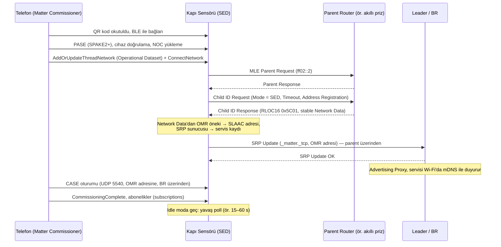
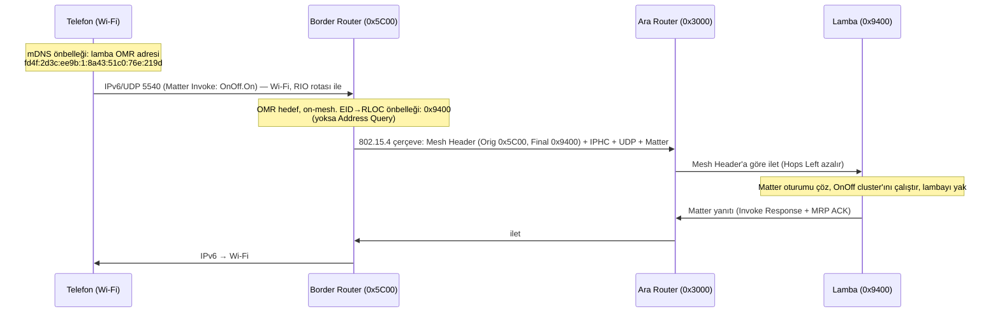

## 22. Uçtan Uca Haberleşme Senaryoları

Bu bölüm, önceki bölümlerde parça parça anlatılan mekanizmaları gerçek senaryolar üzerinde birleştirir. Zamanlamalar tipik değerlerdir; gerçek ağlarda değişir.

### 22.1 Senaryo A — Ağın Sıfırdan Kurulması

Bir evde ilk Border Router (BR1) kuruluyor:

| Adım | Ne olur? | İlgili mekanizma |
|---|---|---|
| 1 | BR1 enerji taraması yapar, en sessiz kanalı (ör. 20) seçer | Energy Scan (Bölüm 4.11) |
| 2 | Rastgele Network Key, Extended PAN ID, PAN ID, mesh-local önek, PSKc üretir; Active Timestamp = 1 | Operational Dataset (Bölüm 17) |
| 3 | Thread'i başlatır, Parent Request gönderir; cevap gelmez | MLE attach (Bölüm 9.7) |
| 4 | Partition kurar, **Leader** olur; Router ID seçer (ör. 23 → RLOC16 `0x5C00`) | Leader (Bölüm 11) |
| 5 | Kendi ULA /48'inden OMR öneki üretir, Network Data'ya `paros` ile ekler; NAT64 öneği, SRP servisi ve rotaları ekler | Network Data, BR (Bölüm 12, 19) |
| 6 | Wi-Fi tarafında RA ile OMR önekini RIO olarak ilan eder | RA/RIO (Bölüm 19.3) |
| 7 | `_meshcop._udp` servisini mDNS ile duyurur | Border Agent (Bölüm 19.6) |
| 8 | Ekosistem uygulaması dataset'i "tercih edilen Thread ağı" olarak saklar | Kimlik paylaşımı (Bölüm 16.10) |

İkinci Border Router (BR2) aynı ekosistemden veya kimlik paylaşımı ile eklenirse, aynı dataset'i alır, Parent Request ile BR1'e bağlanır, kısa süre içinde router'a terfi eder (router sayısı 16'dan az olduğu için) ve kendi BR girdilerini Network Data'ya ekler; BR'ler OMR öneki ve SRP sunucusu konusunda uzlaşır.

### 22.2 Senaryo B — Yeni Bir Matter Sensörünün Eklenmesi

Kullanıcı pilli bir kapı sensörünü (SED) telefonla ekliyor:

Bu süreçte Thread katmanında olanların özeti:

1. **Kimlik bilgisi** BLE/PASE ile güvenli şekilde verilir (MeshCoP joiner akışı kullanılmaz).
2. **Attach**: Sensör en iyi parent'ı seçer (bağlantı kalitesine göre), RLOC16 alır.
3. **Adresleme**: ML-EID (rastgele) ve OMR adresi (SLAAC) oluşur; adresler parent'a kaydedilir.
4. **Servis kaydı**: SRP ile BR'ye; BR Wi-Fi tarafında mDNS ile duyurur.
5. **Uygulama oturumu**: Telefon, mDNS ile bulduğu OMR adresine CASE ile bağlanır; trafik RIO rotası sayesinde BR'ye, oradan mesh'e gider.

### 22.3 Senaryo C — Telefondan Bir Lambayı Açmak

Telefon Wi-Fi'da, lamba (router rolünde, RLOC16 `0x9400`) Thread'de, BR1 (`0x5C00`) ile lamba arasında bir ara router (`0x3000`) var.

**Paketin katman katman dönüşümü (BR → ara router çerçevesi):**

| Katman | Wi-Fi tarafında (telefon → BR) | Thread tarafında (BR → ara router) |
|---|---|---|
| Fiziksel | 802.11 (Wi-Fi) | 802.15.4, kanal 20, O-QPSK |
| Bağlantı | Wi-Fi MAC, WPA2/3 şifreleme | 802.15.4 MAC: kaynak `0x5C00`, hedef `0x3000`, AES-CCM*, frame counter |
| Uyarlama | — | 6LoWPAN: Mesh Header (5 B) + IPHC (≈ 19 B) + NHC UDP (7 B) |
| Ağ | IPv6, 40 B başlık; kaynak telefonun adresi, hedef lamba OMR adresi | Aynı IPv6 paketi, sıkıştırılmış |
| Taşıma | UDP 8 B | Sıkıştırılmış UDP |
| Uygulama | Matter mesajı (CASE oturum anahtarıyla şifreli) | Aynı Matter mesajı (BR içeriği **göremez**) |

Önemli gözlemler:

- BR, paketi **çevirmez**: IPv6 paketi aynıdır; yalnızca bağlantı katmanı ve sıkıştırma değişir.
- Telefonun kaynak adresi (Wi-Fi'daki adresi) mesh içinde sıkıştırılamaz; inline taşınır. Bu yüzden ağ dışından gelen paketlerin Thread'deki ek yükü mesh içi trafikten fazladır.
- Matter yükü uçtan uca şifrelidir; BR ve ara router yalnızca IP/UDP başlıklarını görür.
- Lamba bir **router** (rx-on) olduğu için komut anında ulaşır; bir SED olsaydı bir sonraki poll'a kadar beklerdi.

### 22.4 Senaryo D — Uyuyan Sensörün Rapor Göndermesi

Kapı açıldı; sensör (SED `0x5C01`, parent `0x5C00`) Matter abonelik raporu gönderecek:

| Zaman | Olay |
|---|---|
| t = 0 | Reed anahtarı tetikler; MCU uyanır |
| +2 ms | Alıcı-verici açılır, CSMA-CA, veri çerçevesi parent'a (MAC unicast, ACK istekli) |
| +7 ms | Parent'tan Enhanced ACK; Frame Pending = 0 |
| +8 ms | Sensör, Matter MRP ACK'ini beklemek için **fast poll** moduna geçer (ör. 200–300 ms aralık) |
| +10 ms | Parent paketi Mesh Header ile hedefe (ör. hub/telefon tarafına BR üzerinden) iletir |
| ≈ +60 ms | Alıcının MRP ACK'i parent'a ulaşır ve kuyrukta bekler |
| ≈ +250 ms | Sensörün fast poll'u: Data Request → ACK (Frame Pending = 1) → MRP ACK teslim |
| ≈ +260 ms | Uygulama tamam; birkaç ek hızlı poll'dan sonra yavaş poll'a dönülür |
| sonra | Alıcı-verici kapalı; bir sonraki yavaş poll veya olaya kadar uyku |

Uyuyan cihazın tüm trafiği parent'ı üzerinden geçer; cevaplar parent'ta bekler ve poll ile alınır. Enhanced Frame Pending desteği varsa parent, cevabın geleceğini bildiğinde ACK'te Frame Pending = 1 ayarlayarak bir poll'u gereksiz kılabilir.

### 22.5 Senaryo E — Bir Router'ın Fişinin Çekilmesi

Router `0x3000` (ara router) aniden kapanıyor; iki SED child'ı (`0x3001`, `0x3002`) ve bir MED child'ı (`0x3003`) var.

| Zaman | Olay |
|---|---|
| t = 0 | Router kapanır |
| ≈ t + 0–1 s | Ona paket göndermeye çalışan komşular ACK alamaz; MAC yeniden iletimleri başarısız olur |
| ≈ t + birkaç s | **MED** (`0x3003`) gönderdiği çerçevelere ACK alamaz → parent kaybını hızla fark eder → Parent Request → yeni parent (yeni RLOC16) |
| ≈ t + poll period | **SED**'ler bir sonraki poll'da ACK alamaz; birkaç başarısız denemeden sonra yeniden bağlanır |
| ≤ t + supervision timeout | Poll etmeyen SED'ler bile child supervision sayesinde en geç denetim zaman aşımı (OpenThread varsayılanı 190 s) sonunda durumu fark eder |
| ≈ t + 100 s | Komşu router'lar `MAX_NEIGHBOR_AGE` sonunda `0x3000`'ü komşu tablosundan siler; ondan geçen rotalar alternatif yollardan yeniden hesaplanır (aslında link kalitesi düşüşüyle daha önce başlar) |
| ≈ t + 90–120 s | Leader, Router ID 12'ye rota kalmadığını görür ve ID'yi serbest bırakır; ID Sequence artar |
| + 100 s | Router ID 12, `ID_REUSE_DELAY` süresince başka cihaza verilmez |
| sonrasında | Yeni RLOC16'ları öğrenmemiş cihazlar, eski RLOC16'ya gönderdikleri paketler başarısız olunca Address Query ile güncel konumu bulur |

Uygulamalar (Matter) cihazlara **EID/OMR adresleriyle** haberleştiği için adresler değişmez; yalnızca birkaç saniyelik/dakikalık bir kesinti ve MRP yeniden iletimleri görülür.

### 22.6 Senaryo F — Leader'ın Kaybolması

| Zaman | Olay |
|---|---|
| t = 0 | Leader (aynı zamanda BR1) kapanır |
| t + birkaç s | Diğer router'lar Leader'dan Advertisement alamaz; rota maliyeti artar |
| t + ≈ 120 s | `NETWORK_ID_TIMEOUT` doluyor; router'lar partition'ın Leader'ını kaybettiğini kabul eder |
| t + 120–125 s | Bir router (rastgele gecikmeyle ilk davranan) diğer partition'ları arar, bulamaz → yeni partition kurar, **Leader** olur |
| hemen sonra | Diğer router'lar daha iyi/yeni partition'ı görür, ona bağlanır, eski Router ID'lerini Address Solicit ile geri ister |
| birkaç saniye | BR2 kendi BR girdilerini (OMR öneki, rotalar, SRP) yeni Leader'a kaydeder; OMR öneki aynı kalırsa cihazların adresleri değişmez |
| sonra | SRP kayıtları BR2'ye taşınır (cihazlar sunucu değişikliğini görünce yeniden kaydolur) |

Bu yüzden ağda **birden fazla Border Router** bulunması önemlidir: Leader ile birlikte tek BR da kaybolursa ağ dış dünyayla bağlantısını, BR geri gelene kadar kaybeder (mesh içi trafik devam eder).

### 22.7 Senaryo G — Ağın Kanal Değiştirmesi

Wi-Fi yeni kurulan bir erişim noktası yüzünden kanal 20'yi doldurmaya başladı; BR'nin kanal yöneticisi kanal 25'e geçmeye karar veriyor.

| Zaman | Olay |
|---|---|
| T | Kanal yöneticisi, kanal örneklemelerine (channel monitor) dayanarak daha iyi bir kanal seçer |
| T | Leader'a **MGMT_PENDING_SET**: Channel = 25, Pending Timestamp, yeni Active Timestamp, Delay Timer = 300 s |
| T + saniyeler | Pending Dataset tüm router'lara ve rx-on child'lara yayılır |
| T + dakikalar | SED'ler parent'larından gelen Leader Data / Child Update ile yeni Pending Timestamp'i görüp Data Request ile Pending Dataset'i alır |
| T + 300 s | Tüm cihazlar **aynı anda** kanal 25'e geçer |
| sonrası | Geçişi kaçıran cihazlar (kapalı/uzun uykuda olanlar) eski kanalda parent'larını bulamaz; kanal taraması ve **Announce** mesajlarıyla kanal 25'e geçer |

### 22.8 Senaryo H — İki Adanın Birleşmesi

Bir evin iki katı arasındaki tek router kapanınca ağ ikiye bölünür (Partition A ve B). Router geri geldiğinde:

1. Router, her iki partition'ın Advertisement'larını duyar.
2. Partition karşılaştırması (singleton → weighting → Partition ID) yapılır; ör. B kazanır.
3. A'daki router'lar B'ye bağlanır (önce child olarak, sonra eski Router ID'lerini isteyerek router olarak); A'nın child'ları da onlarla birlikte gelir.
4. A'nın Network Data'sındaki BR girdileri B'nin Leader'ına yeniden kaydedilir.
5. Kısa sürede tek partition kalır; uygulama adresleri değişmediği için Matter oturumları devam eder.

### 22.9 Bölüm Özeti

- Ağ kurulumu: dataset üretimi → Leader → OMR öneki → RA/RIO → Border Agent ilanı.
- Matter cihaz ekleme: BLE/PASE ile dataset → MLE attach → SLAAC → SRP kaydı → CASE.
- Telefon → lamba: RIO rotası ile BR → EID→RLOC → Mesh Header ile çok atlamalı iletim; BR çeviri yapmaz.
- Router/Leader/BR arızaları dakikalar içinde kendiliğinden toparlanır; birden çok BR kritik önemdedir.
- Kanal değişimi Pending Dataset ile eşzamanlı yapılır; geride kalanlar Announce ile yakalanır.
