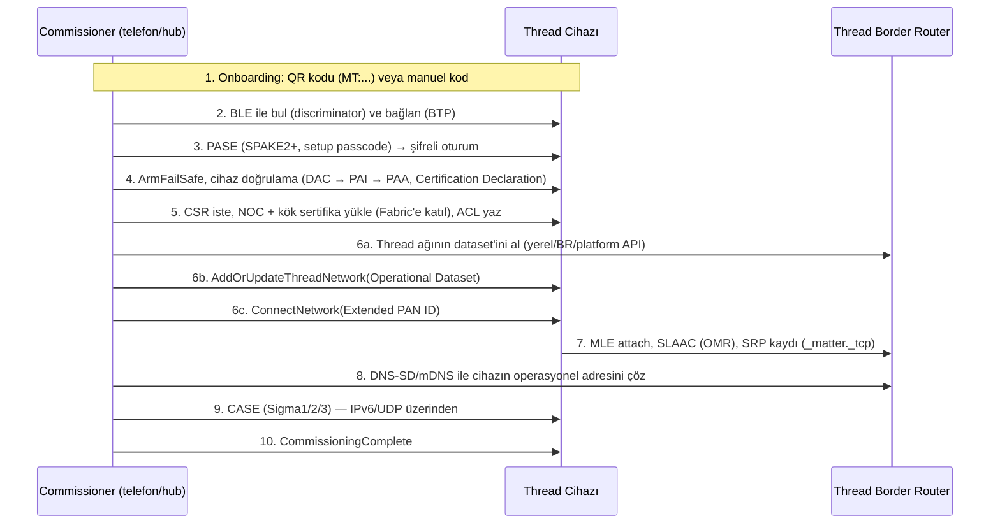

## 23. Matter ve Thread

### 23.1 Matter'a Kısa Bakış

**Matter**, Connectivity Standards Alliance (CSA) tarafından geliştirilen, akıllı ev cihazlarının üreticiden bağımsız birlikte çalışmasını sağlayan **uygulama katmanı** standardıdır.

| Sürüm | Tarih | Öne çıkanlar |
|---|---|---|
| 1.0 | Ekim 2022 | Temel cihaz türleri (aydınlatma, priz, kilit, termostat, sensörler…), Thread/Wi-Fi/Ethernet taşıma |
| 1.1 | 2023 | Uyuyan cihaz (ICD) iyileştirmeleri |
| 1.2 | 2023 | Yeni cihaz türleri (beyaz eşya, robot süpürge vb.) |
| 1.3 | 2024 | Enerji yönetimi, yeni cihaz türleri |
| 1.4 | Kasım 2024 | Thread BR içeren **Home Router and Access Point (HRAP)** cihaz türü; Thread ağ yönetimi kümeleri; çoklu yönetici iyileştirmeleri |

Matter'ın katmanları:

- **Veri modeli**: Node → Endpoint → Cluster → Attribute / Command / Event.
- **Etkileşim modeli**: Read, Write, Invoke, Subscribe/Report.
- **Güvenlik**: PASE (kurulum), CASE (operasyonel), sertifika tabanlı cihaz kimliği (DAC), Fabric ve NOC (operasyonel sertifika).
- **Mesaj katmanı**: AES-CCM ile uçtan uca şifreleme, **MRP** (UDP üzerinde güvenilirlik).
- **Taşıma**: IPv6 üzerinden UDP (port 5540) / TCP; devreye almada BLE (BTP).

### 23.2 Matter over Thread Yığını

```text
+-------------------------------------------------------------+
| Matter Veri Modeli (Cluster'lar: OnOff, LevelControl, ...)  |
| Matter Etkileşim Modeli (Read / Write / Invoke / Subscribe) |
| Matter Güvenli Oturum (CASE / PASE), Mesaj Katmanı, MRP     |
+-------------------------------------------------------------+
| UDP (5540)                                                   |
+-------------------------------------------------------------+
| IPv6 (OMR adresleri, SRP ile DNS-SD kaydı)                  |
+-------------------------------------------------------------+
| Thread: 6LoWPAN, MLE, yönlendirme, TMF, MAC güvenliği       |
+-------------------------------------------------------------+
| IEEE 802.15.4 (2.4 GHz)                                      |
+-------------------------------------------------------------+
```

Thread açısından Matter sıradan bir UDP uygulamasıdır. Matter açısından Thread, "düşük güçlü bir IPv6 bağlantısı"dır. İki katman arasındaki temas noktaları şunlardır:

1. **Devreye almada** Thread kimlik bilgilerinin (Operational Dataset) cihaza verilmesi,
2. **Servis keşfi** için SRP/DNS-SD,
3. **Uyuyan cihaz** davranışının (ICD) Thread poll/CSL parametreleriyle eşlenmesi,
4. **Grup iletişimi** için IPv6 çoklu yayın (MPL, MLR),
5. **Teşhis** için Thread Network Diagnostics kümesi.

### 23.3 Keşif (Discovery)

| Aşama | Mekanizma | Servis / içerik |
|---|---|---|
| Devreye alınabilir cihazı bulma | **BLE reklamı** (Thread cihazlarında tipik) | Discriminator, Vendor ID, Product ID |
| Devreye alınabilir cihaz (IP üzerinden) | DNS-SD | `_matterc._udp` — TXT: `D` (discriminator), `VP`, `CM`, `DT`, `DN`… |
| Operasyonel cihazı bulma | DNS-SD (Thread'de SRP ile kayıt, altyapıda mDNS ile ilan) | `_matter._tcp` — örnek adı `<CompressedFabricID>-<NodeID>` (16'şar onaltılık hane) |
| Denetleyici bulma (commissioner) | DNS-SD | `_matterd._udp` |

Operasyonel kayıttaki TXT anahtarları Thread cihazları için kritiktir:

| Anahtar | Anlamı |
|---|---|
| `SII` | Session Idle Interval — cihaz boşta iken MRP'nin kullanacağı yeniden iletim temel aralığı (ms) |
| `SAI` | Session Active Interval — cihaz aktifken kullanılacak aralık (ms) |
| `SAT` | Session Active Threshold — son etkileşimden sonra "aktif" sayılma süresi |
| `ICD` | ICD çalışma modu (SIT / LIT) |
| `T` | TCP desteği |

Denetleyici, uyuyan bir Thread cihazına mesaj gönderirken MRP yeniden iletimlerini bu değerlere göre zamanlar; böylece cihaz uyurken boşuna yeniden iletim yapılmaz.

### 23.4 Devreye Alma (Commissioning) Akışı



**Thread'e özgü noktalar:**

- Adım 6'da gönderilen veri, Bölüm 17'deki **Operational Dataset TLV dizisinin** ta kendisidir.
- `ConnectNetwork` sonrası cihaz BLE bağlantısını kapatıp Thread'e geçer. Bağlantı başarısız olursa **fail-safe** zamanlayıcısı dolunca cihaz önceki durumuna döner.
- Commissioner'ın dataset'e sahip olması gerekir. Bu yüzden ekosistemler, kendi BR'lerinin dataset'ini ve kullanıcının "tercih edilen" ağını işletim sistemi düzeyinde saklar.
- CASE el sıkışmasındaki sertifika içeren mesajlar büyüktür (yüzlerce bayt–1 KB üzeri) ve 6LoWPAN'da **çok sayıda parçaya** bölünür; zayıf bağlantılarda devreye almanın en kırılgan adımı genellikle budur.

### 23.5 Thread Kimlik Bilgileri ve Çoklu Yönetici (Multi-Admin)

Matter'ın **çoklu yönetici** özelliği, aynı cihazın birden fazla ekosisteme (Fabric) eklenmesine izin verir. Ancak:

- Bir Thread cihazı aynı anda **yalnızca bir Thread ağına** bağlı olabilir.
- Cihaz ikinci ekosisteme eklendiğinde Thread ağı değişmez; ikinci ekosistemin denetleyicisi cihaza, cihazın bulunduğu Thread ağının **Border Router'ları üzerinden** ulaşır.
- İkinci ekosistemin kendi BR'leri **ayrı bir Thread ağı** kurmuşsa, bu BR'ler cihaza yönlendirme yapamaz; erişim birinci ekosistemin BR'lerine bağımlı kalır.

Bu nedenle ekosistemlerin **tek bir Thread ağı** üzerinde birleşmesi kritik önemdedir. Thread 1.4'ün ePSKc mekanizması, işletim sistemlerinin kimlik paylaşım API'leri ve Matter 1.4'ün Thread ağ yönetimi kümeleri bu hedefe hizmet eder.

### 23.6 Uyuyan Matter Cihazları: ICD

| Kavram | Değer / açıklama |
|---|---|
| **ICD Management** kümesi | `0x0046`; IdleModeDuration, ActiveModeDuration, ActiveModeThreshold öznitelikleri |
| **SIT ICD** (Short Idle Time) | Yavaş poll aralığı kısa (≈ 15 s ve altı); denetleyici her an (kısa gecikmeyle) ulaşabilir |
| **LIT ICD** (Long Idle Time) | Çok uzun uyku aralıkları; denetleyiciyle **Check-In** protokolü (cihaz uyandığında kayıtlı denetleyicilere haber verir) |
| **Active Mode** | Bir etkileşimden sonra cihaz belirli süre hızlı poll eder (ör. birkaç yüz ms) |
| **Abonelikler** | Rapor aralıkları (min/max interval) cihazın uyku profiline uygun seçilmeli; çok kısa max interval pili tüketir |

Thread karşılıkları: Idle Mode ↔ yavaş poll period (veya CSL period), Active Mode ↔ fast poll, Check-In ↔ cihazın uyandığında gönderdiği tek yönlü bildirim.

### 23.7 Thread ile İlgili Matter Kümeleri

| Küme | ID | Amaç |
|---|---|---|
| Network Commissioning | `0x0031` | Thread ağı ekleme/bağlanma (AddOrUpdateThreadNetwork, ConnectNetwork), tarama |
| Thread Network Diagnostics | `0x0035` | Thread durumu, sayaçlar, komşu/rota tabloları (Bölüm 21.5) |
| ICD Management | `0x0046` | Uyuyan cihaz parametreleri, Check-In kayıtları |
| Wi-Fi Network Management | `0x0451` | (1.4) HRAP cihazlarında Wi-Fi kimlik bilgisi paylaşımı |
| Thread Border Router Management | `0x0452` | (1.4) BR'nin Thread ağını yönetme (dataset okuma/ayarlama) |
| Thread Network Directory | `0x0453` | (1.4) Bilinen Thread ağlarının dizini ve tercih edilen ağ |

### 23.8 Grup İletişimi

Matter grup komutları (ör. "tüm salon ışıkları kapansın") IPv6 çoklu yayın kullanır:

- Grup adresleri **site-local** kapsamlı (scope 5), Fabric ve Grup kimliğinden türetilmiş önek tabanlı çoklu yayın adresleridir.
- Thread cihazları bu gruplara abone olur ve (BBR varsa) **MLR** ile kaydeder; Thread ağı içinde paket **MPL** ile yayılır (Bölüm 14).
- Grup mesajları grup anahtarlarıyla şifrelenir; MRP onayı yoktur (en iyi çaba).
- SED'lere grup mesajı ulaştırmak, ebeveyn başına ayrı dolaylı iletim gerektirdiğinden maliyetlidir.

### 23.9 Matter over Thread İçin Performans İpuçları

1. **Abonelikleri** cihazın enerji profiline göre ayarlayın; uyuyan cihazlarda sık rapor istemeyin.
2. **Büyük mesajları** (CASE, OTA) en iyi bağlantı koşullarında yapın; zayıf linklerde parça kaybı tüm mesajı kaybettirir.
3. **Birden fazla BR** kullanın ve hepsinin aynı Thread ağında olduğundan emin olun.
4. **IPv6'nın ev ağında** düzgün çalıştığından (RA/RIO kabulü, mDNS'in VLAN'lar arasında taşınması) emin olun.
5. **OTA güncellemeleri** (BDX — Bulk Data Exchange) Thread üzerinde yavaştır; uyuyan cihazlarda aktif mod sırasında yapılmalıdır.

### 23.10 Bölüm Özeti

- Matter, Thread'in üzerinde çalışan uygulama katmanıdır; Thread için sıradan bir UDP/IPv6 uygulamasıdır.
- Devreye almada Thread dataset'i BLE/PASE ile verilir; cihaz doğrudan MLE ile bağlanır, SRP ile kendini kaydeder.
- Operasyonel keşif `_matter._tcp` ile, BR'nin Advertising Proxy'si sayesinde Wi-Fi tarafında mDNS'ten yapılır.
- ICD (SIT/LIT) kavramları Thread poll/CSL davranışına karşılık gelir; MRP zamanlamaları DNS-SD ile ilan edilir.
- Çoklu yönetici, cihazın tek Thread ağına bağlı olması nedeniyle ekosistemlerin aynı Thread ağını paylaşmasını gerektirir.
