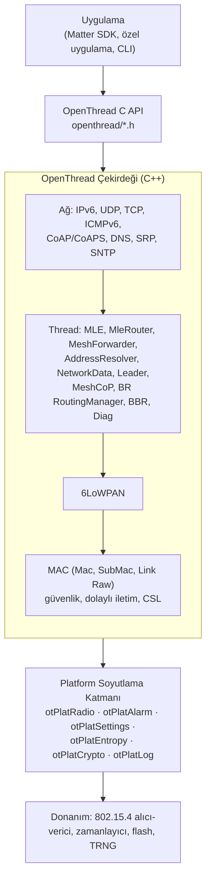

## 24. OpenThread ve Yazılım Mimarisi

### 24.1 Genel Bakış

**OpenThread**, Thread şartnamesinin açık kaynak (BSD-3-Clause) uygulamasıdır. Özellikleri:

- **Taşınabilir**: Çekirdek C++ ile yazılmıştır, dışarıya C API'si sunar; donanıma özgü kısımlar ince bir **platform soyutlama katmanında** (`otPlat*` fonksiyonları) toplanmıştır.
- **Yapılandırılabilir**: Yüzlerce derleme zamanı seçeneği (`OPENTHREAD_CONFIG_*`) ile yalnızca gereken özellikler derlenir.
- **Kapsamlı**: FTD/MTD/RCP derlemeleri, CLI, Border Router, commissioner/joiner, SRP, DNS, NAT64, TREL, CSL, Link Metrics, teşhis…
- **Yaygın**: Çok sayıda çip üreticisinin SDK'sı (Nordic nRF Connect SDK, Silicon Labs, NXP, TI, Espressif ESP-IDF vb.) ve Zephyr RTOS ile entegredir.

### 24.2 Katmanlı Yapı



**Platform katmanının temel arayüzleri:**

| Arayüz | Sorumluluk |
|---|---|
| `otPlatRadio*` | Kanal ayarlama, gönderme/alma, enerji tarama, CCA, (isteğe bağlı) donanım ACK/şifreleme, zamanlı gönderim (CSL) |
| `otPlatAlarmMilli*` / `otPlatAlarmMicro*` | Milisaniye/mikrosaniye zamanlayıcılar |
| `otPlatSettings*` | Kalıcı ayar depolama (dataset, frame counter, ağ bilgisi) |
| `otPlatEntropy*` | Gerçek rastgele sayı üretimi |
| `otPlatCrypto*` | AES, SHA-256, HMAC, ECDSA, anahtar referansları (PSA) |
| `otPlatLog` | Günlükleme |

### 24.3 Derleme Türleri

| Kütüphane / uygulama | İçerik | Tipik kullanım |
|---|---|---|
| **FTD** (`libopenthread-ftd`) | Tam yığın, router/leader olabilir | Prizler, ampuller, BR |
| **MTD** (`libopenthread-mtd`) | Router yetenekleri olmayan küçük yığın | Pilli sensörler (SED/MED) |
| **RCP** (`libopenthread-radio`) | Yalnızca 802.15.4 PHY + alt MAC (sub-MAC) | BR'lerin RF yardımcı işlemcisi (Radio Co-Processor) |
| **CLI** (`ot-cli-ftd/mtd`) | Komut satırı uygulaması | Geliştirme, test |
| **NCP** (`ot-ncp-ftd/mtd`) | Spinel ile tam yığına erişim sunan yardımcı işlemci (Network Co-Processor) | Eski mimari (wpantund) |

### 24.4 Cihaz Mimarileri: SoC, NCP, RCP

```text
SoC (tek çip)                NCP (Network Co-Processor)     RCP (Radio Co-Processor)
+----------------------+     +--------------+              +--------------------------+
| Uygulama             |     | Host         |              | Host (Linux)             |
| OpenThread (tam)     |     | Uygulama     |              | Uygulama, otbr-agent     |
| 802.15.4 sürücüsü    |     | (wpantund)   |              | OpenThread çekirdeği     |
| 802.15.4 RF          |     +------+-------+              +------------+-------------+
+----------------------+            | Spinel                            | Spinel
                             +------+-------+              +------------+-------------+
                             | NCP çipi     |              | RCP çipi                 |
                             | OpenThread   |              | Sub-MAC: CSMA, ACK,      |
                             | (tam yığın)  |              | zamanlama, şifreleme     |
                             | RF           |              | 802.15.4 RF              |
                             +--------------+              +--------------------------+
```

| Mimari | Avantaj | Dezavantaj | Örnek |
|---|---|---|---|
| **SoC** | En düşük maliyet ve güç, tek çip | Uygulama ve yığın aynı MCU kaynaklarını paylaşır | Sensörler, ampuller, prizler |
| **NCP** | Host yalnızca API çağırır | İki tarafta ayrı güncelleme; esneklik az; artık yaygın değil | Eski gateway'ler |
| **RCP** | Yığın host'ta: kolay güncelleme, büyük bellek, Linux araçları | Host her zaman açık olmalı; seri bağlantı gecikmesi | **Border Router'lar** (OTBR, Home Assistant) |

**Çoklu protokol (multi-PAN) RCP:** Bazı üreticiler tek 802.15.4 alıcı-vericisini aynı anda Thread ve Zigbee için paylaştıran RCP firmware'leri sunar. Tek alıcı-vericinin aynı anda yalnızca tek kanalda olabilmesi gibi kısıtlar nedeniyle güvenilirlik ve kanal esnekliği açısından genellikle iki ayrı RCP çipi tercih edilir.

### 24.5 Spinel Protokolü

Host ile NCP/RCP arasındaki iletişim **Spinel** protokolüyle yapılır.

```text
+---------+-----------------------+-------------------------------+
| Header  | Command (packed uint) | Payload                       |
| 1 bayt  | ör. PROP_VALUE_SET    | Property ID (packed) + Değer  |
+---------+-----------------------+-------------------------------+

Header:  bit 7–6 = FLG (her zaman 0b10)
         bit 5–4 = IID (arayüz kimliği)
         bit 3–0 = TID (işlem kimliği; 0 = istenmemiş bildirim)
```

| Komut | Değer | Anlamı |
|---|---|---|
| `NOOP` | 0 | Boş |
| `RESET` | 1 | Eş işlemciyi sıfırla |
| `PROP_VALUE_GET` | 2 | Özellik oku |
| `PROP_VALUE_SET` | 3 | Özellik yaz |
| `PROP_VALUE_INSERT` / `REMOVE` | 4 / 5 | Listeye ekle / çıkar |
| `PROP_VALUE_IS` | 6 | Özellik değeri (cevap veya bildirim) |
| `PROP_VALUE_INSERTED` / `REMOVED` | 7 / 8 | Listeye eklendi / çıkarıldı bildirimi |

RCP modunda en önemli özellik **`STREAM_RAW`**'dır: Ham 802.15.4 çerçeveleri host ile RCP arasında bu özellik üzerinden taşınır. Kanal (`PHY_CHAN`), PAN ID, adresler, TX gücü, MAC anahtarları ve frame counter gibi ayarlar da özellikler aracılığıyla yapılır.

**Çerçeveleme (UART):** HDLC-lite — çerçeve sınırı `0x7E`, kaçış baytı `0x7D` (sonraki bayt `0x20` ile XOR'lanır), sonda CRC-16 (FCS). SPI ve USB-CDC taşıyıcıları da desteklenir.

### 24.6 OpenThread CLI: Hızlı Başlangıç

**İlk cihazda ağ kurmak:**

```text
> dataset init new
Done
> dataset networkname EvAgi
Done
> dataset channel 20
Done
> dataset commit active
Done
> ifconfig up
Done
> thread start
Done
> state
leader
> dataset active -x
0e080000000000010000000300001435060004001fffe00208…
Done
```

**İkinci cihazı aynı ağa eklemek (dataset ile, bant dışı):**

```text
> dataset set active 0e080000000000010000000300001435060004001fffe00208…
Done
> ifconfig up
Done
> thread start
Done
> state
child
> state          (birkaç saniye/dakika sonra, REED terfisi)
router
```

**Sık kullanılan komutlar:**

| Komut | Açıklama |
|---|---|
| `state`, `state router`, `state child` | Rolü göster / zorla |
| `mode rdn` / `mode -` | Cihaz modunu ayarla (FTD / SED) |
| `pollperiod 30000` | SED poll aralığı (ms) |
| `childtimeout 240` | Child zaman aşımı (s) |
| `routerupgradethreshold`, `routerdowngradethreshold` | Router eşikleri |
| `routereligible disable` | Cihazın router olmasını engelle (FED) |
| `leaderweight 72` | Leader ağırlığı |
| `txpower 8` | TX gücü (dBm) |
| `ping ff03::1` | Mesh genelinde ping |
| `udp open`, `udp bind 0 1234`, `udp send ff03::1 1234 merhaba` | UDP denemeleri |
| `coap start`, `coap resource test`, `coap get <adres> test` | CoAP denemeleri |
| `srp client autostart enable`, `srp client service add …` | SRP kaydı |
| `dns browse _matter._tcp.default.service.arpa.` | DNS-SD sorgusu |
| `br enable`, `br omrprefix`, `nat64 enable` | Border Router işlevleri |
| `factoryreset` | Tüm ayarları sil |

### 24.7 Uygulama Geliştirme: C API Örneği

Aşağıdaki örnek, Thread durum değişikliklerini dinleyen ve realm-local tüm düğümlere UDP mesajı gönderen basit bir uygulamadır:

```c
#include <string.h>
#include <openthread/instance.h>
#include <openthread/thread.h>
#include <openthread/udp.h>
#include <openthread/ip6.h>

#define APP_PORT 1234

static otUdpSocket sSocket;

static void HandleUdpReceive(void *aContext, otMessage *aMessage,
                             const otMessageInfo *aMessageInfo)
{
    char     buf[64];
    uint16_t len = otMessageRead(aMessage, otMessageGetOffset(aMessage), buf, sizeof(buf) - 1);
    buf[len] = '\0';
    /* buf: gelen veri; aMessageInfo->mPeerAddr: gönderenin IPv6 adresi */
    (void)aContext;
    (void)aMessageInfo;
}

static void SendHello(otInstance *aInstance)
{
    otMessageInfo    info;
    otMessage       *msg;
    const char      *text = "merhaba thread";

    memset(&info, 0, sizeof(info));
    otIp6AddressFromString("ff03::1", &info.mPeerAddr);   /* realm-local tüm düğümler */
    info.mPeerPort = APP_PORT;

    msg = otUdpNewMessage(aInstance, NULL);
    if (msg == NULL) return;
    if (otMessageAppend(msg, text, (uint16_t)strlen(text)) != OT_ERROR_NONE ||
        otUdpSend(aInstance, &sSocket, msg, &info) != OT_ERROR_NONE)
    {
        otMessageFree(msg);
    }
}

static void HandleStateChanged(otChangedFlags aFlags, void *aContext)
{
    otInstance *instance = (otInstance *)aContext;

    if (aFlags & OT_CHANGED_THREAD_ROLE)
    {
        otDeviceRole role = otThreadGetDeviceRole(instance);
        if (role == OT_DEVICE_ROLE_CHILD || role == OT_DEVICE_ROLE_ROUTER ||
            role == OT_DEVICE_ROLE_LEADER)
        {
            SendHello(instance);   /* ağa bağlandık */
        }
    }
}

void AppInit(otInstance *aInstance)
{
    otSockAddr addr;

    memset(&addr, 0, sizeof(addr));
    addr.mPort = APP_PORT;

    otUdpOpen(aInstance, &sSocket, HandleUdpReceive, aInstance);
    otUdpBind(aInstance, &sSocket, &addr, OT_NETIF_THREAD);
    otSetStateChangedCallback(aInstance, HandleStateChanged, aInstance);

    otIp6SetEnabled(aInstance, true);     /* ifconfig up */
    otThreadSetEnabled(aInstance, true);  /* thread start (dataset önceden yüklenmiş olmalı) */
}
```

> [!NOTE]
> API imzaları OpenThread sürümleri arasında küçük değişiklikler gösterebilir (ör. `otUdpBind`'in ağ arayüzü parametresi). Kullandığınız sürümün `include/openthread/` başlık dosyalarını esas alın.

### 24.8 Diğer Önemli API Grupları

| Başlık dosyası | İçerik |
|---|---|
| `dataset.h`, `dataset_ftd.h` | Operational Dataset okuma/yazma |
| `thread.h`, `thread_ftd.h` | Rol, Leader verisi, router/child tabloları, eşikler |
| `coap.h`, `coap_secure.h` | CoAP istemci/sunucu, DTLS |
| `srp_client.h`, `srp_server.h` | SRP kaydı ve sunucusu |
| `dns_client.h` | DNS/DNS-SD sorguları |
| `border_router.h`, `border_routing.h` | Network Data'ya önek/rota ekleme, BR yönlendirme yöneticisi |
| `commissioner.h`, `joiner.h` | MeshCoP rolleri |
| `link.h`, `link_metrics.h` | MAC ayarları, poll period, CSL, Link Metrics |
| `netdiag.h`, `mesh_diag.h` | Ağ teşhisi |
| `nat64.h`, `trel.h` | NAT64, TREL |

### 24.9 Simülasyon ve Test

- **POSIX simülasyonu**: OpenThread bilgisayarda simüle edilmiş bir 802.15.4 ortamıyla çok sayıda düğüm çalıştırabilir; protokol davranışlarını donanımsız denemek için idealdir.
- **OTNS (OpenThread Network Simulator)**: Düğümlerin konumunu, bağlantılarını ve rollerini görsel olarak gösteren, senaryo betikleriyle çalışan simülatör.
- **Docker OTBR imajları**: Border Router'ı konteyner içinde çalıştırma.
- **Sertifikasyon testleri**: Thread Test Harness ve referans cihazlarla otomatik testler; OpenThread deposunda da şartname senaryolarını izleyen kapsamlı test betikleri bulunur.

### 24.10 Bölüm Özeti

- OpenThread; C++ çekirdek, C API ve ince platform katmanı ile birçok çipte çalışan açık kaynak Thread yığınıdır.
- SoC (sensör/ampul), RCP (Border Router) ve eski NCP mimarileri vardır; host ile yardımcı işlemci Spinel + HDLC-lite ile haberleşir.
- CLI, ağ kurma/katılma, teşhis ve deneme için en hızlı araçtır.
- C API ile UDP/CoAP/SRP/DNS uygulamaları yazılabilir; durum değişiklikleri geri çağırmalarla izlenir.
- POSIX simülasyonu ve OTNS donanımsız geliştirme ve test imkânı sağlar.
