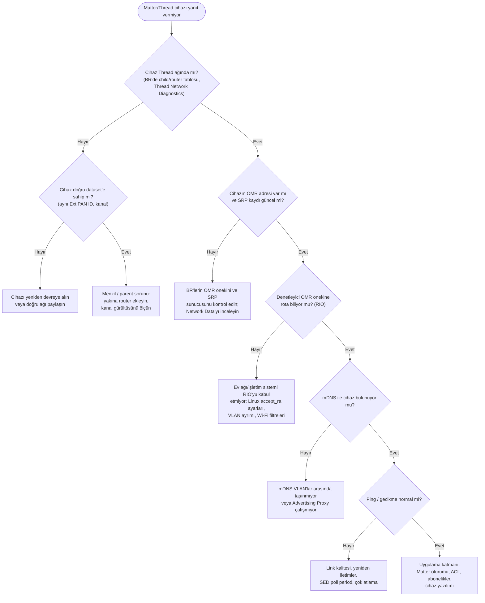

## 27. Sorun Giderme Rehberi

### 27.1 Teşhis Akışı: "Cihaz Yanıt Vermiyor"

### 27.2 Yaygın Sorunlar ve Çözümleri

| Belirti | Olası nedenler | Teşhis | Çözüm |
|---|---|---|---|
| **Devreye alma "Thread ağına katılamadı" hatası** | BR çevrimdışı; commissioner'ın dataset'i yanlış/eski; cihaz menzil dışında; BLE kopması | BR durumu (`br state`, `state`); cihaz yakınındaki router'lar; commissioner logları | Cihazı BR/router yakınında devreye alın; doğru ağın BR'sini kullanın; BR'yi yeniden başlatın |
| **Cihaz eklendi ama sonra "yanıt vermiyor"** | Denetleyici RIO'yu kabul etmiyor; mDNS VLAN sorunu; SRP kaydı süresi doldu; ayrı Thread ağları | Denetleyiciden OMR adresine ping; `srp server service`; Ext PAN ID karşılaştırma | Ev ağı IPv6 ayarları; mDNS reflector; ekosistemleri tek ağda birleştirme |
| **Sık kopmalar / çevrimdışı-çevrimiçi döngüsü** | Zayıf parent bağlantısı (LQ 1); Wi-Fi girişimi; parent router sık yeniden başlıyor; child timeout çok kısa | `parent`, `child table`, MAC retry/CCA sayaçları, ParentChangeCount | Router ekleyin; kanal değiştirin; child timeout/poll ayarlarını uyumlu yapın |
| **Ağ ikiye bölündü (iki partition)** | Bölgeler arasında yalnızca tek/zayıf bağlantı | Farklı cihazlarda `leaderdata` Partition ID'leri farklı | Bölgeler arasına router ekleyin; TREL destekli BR'ler kullanın |
| **SED pili beklenenden hızlı bitiyor** | Kısa poll period; sık rapor/abonelik; zayıf link → yeniden iletim; sürekli parent değişimi; multicast; fast poll'da takılı kalma | Cihazın poll period ve ICD ayarları; parent LQ; sniffer ile uyanma sıklığı | Poll/abonelik aralıklarını uzatın; daha yakın router; multicast'i azaltın |
| **Yüksek gecikme** | SED'e giden komutlar poll period kadar bekliyor; çok atlama; Address Query gecikmesi; parçalanmış paketlerin yeniden iletimi | Cihaz türü (SED/SSED/router); `router table` yol maliyeti | Etkileşimli cihazlarda CSL/ICD aktif mod; topolojiyi iyileştirin |
| **"Thread ağı bulunamadı" (ekosistem uygulaması)** | Border Agent `_meshcop._udp` ilanı görünmüyor; telefon farklı Wi-Fi/VLAN'da | mDNS tarayıcıyla `_meshcop._udp` | Telefonu BR ile aynı ağa alın; mDNS'i düzeltin |
| **BR yedekten geri yüklendikten sonra cihazlarla haberleşemiyor** | Frame counter geri gitti (replay koruması), Key Sequence uyumsuzluğu | Komşularda RxErrSec artışı; sniffer'da MIC hataları | Frame counter'ı ileri alın/anahtar dizisini artırın; ağı yeniden kurmaktan önce yedekleme aracının belgelerine bakın |
| **Çok fazla/az router** | Eşik ayarları; çoğu cihaz FED/MED olarak yapılandırılmış | `router table` sayısı, cihaz modları | Şebekeden beslenen cihazların REED olmasına izin verin; eşikleri varsayılanda bırakın |
| **Adres çakışması / Address Error** | Aynı ML-EID/OMR adresine sahip iki cihaz (ör. klonlanmış ayarlar) | Sniffer'da `a/ae`; aynı EUI-64/ayar dosyası | Klonlanmış cihazlarda `factoryreset` ve yeniden devreye alma |
| **Kanal değişikliği sonrası bazı cihazlar kayıp** | Cihazlar geçiş sırasında kapalıydı; Announce'ları kaçırdılar | Cihaz eski kanalda (sniffer) | Cihazı yeniden başlatın (kanal taraması); commissioner ile Announce Begin |
| **Linux denetleyici Thread cihazlarına ulaşamıyor** | `accept_ra=1` iken IP yönlendirme açık; `accept_ra_rt_info_max_plen` = 0 | `ip -6 route` çıktısında OMR öneki yok | `sysctl net.ipv6.conf.<if>.accept_ra=2` ve `accept_ra_rt_info_max_plen=64` |
| **Wi-Fi kullanımı yoğunken Thread bozuluyor** | Aynı kanal bölgesi; BR içinde Wi-Fi/Thread girişimi (PTA yok) | CCA hataları; `channel monitor` | Thread kanalını değiştirin; Wi-Fi'ı 20 MHz'e alın; BR'yi Wi-Fi AP'den uzaklaştırın |

### 27.3 Belirtiye Göre Bakılacak Sayaçlar

| Sayaç / değer | Yükseliyorsa |
|---|---|
| `TxErrCca` | Kanal meşgul (girişim) |
| `TxRetry` / (`TxAckRequested` − `TxAcked`) | Zayıf bağlantılar, gizli düğüm, aşırı yük |
| `RxErrFcs` | Zayıf sinyal, girişim |
| `RxErrSec` | Anahtar/frame counter uyumsuzluğu, eski dataset'li cihaz |
| `RxDuplicated` | ACK'ler kayboluyor (karşı taraf yeniden gönderiyor) |
| MLE `AttachAttempts`, `ParentChanges` | Kararsız parent ilişkileri |
| MLE `PartitionIdChanges`, `LeaderRole` | Ağ bölünmeleri, Leader değişimleri |
| Address Query başarısızlıkları | Hedef cihazlar ağdan düşmüş veya önbellek sorunları |

### 27.4 Sorun Giderme İçin Altın Kurallar

1. **Önce fiziksel katman**: Sinyal kalitesi ve kanal temiz değilse üst katman ayarları sonuç vermez.
2. **Tek ağ, tek partition**: Birden fazla Thread ağı veya partition, "bazen çalışıyor" türü sorunların en yaygın kaynağıdır.
3. **IPv6'yı doğrulayın**: Matter cihazlarına ulaşılamıyorsa genellikle sorun Thread'de değil, ev ağının IPv6/mDNS yapılandırmasındadır.
4. **Sniffer kullanın**: Tahmin yerine gerçek paketlere bakın; Network Key ile şifreyi çözün.
5. **Değişiklikleri tek tek yapın**: Kanal, BR konumu, cihaz ayarlarını aynı anda değiştirmek nedeni gizler.

### 27.5 Bölüm Özeti

- "Yanıt vermiyor" sorunlarında sıra: Thread üyeliği → OMR/SRP → RIO rotası → mDNS → link kalitesi → uygulama.
- En yaygın kök nedenler: ayrı Thread ağları, ev ağının IPv6/mDNS sorunları, zayıf bağlantılar ve Wi-Fi girişimi.
- MAC/MLE sayaçları ve sniffer kayıtları kesin teşhisin anahtarıdır.
